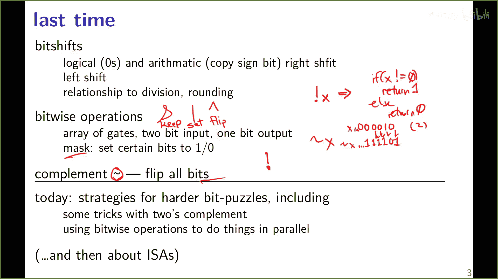
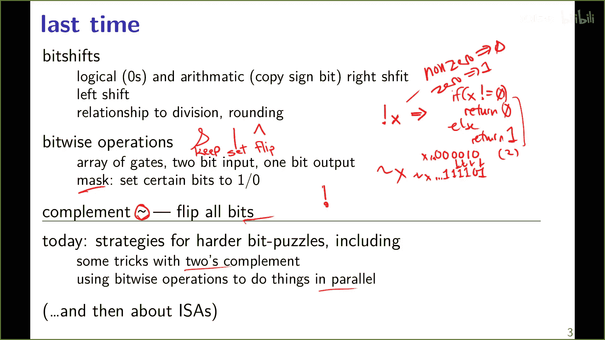
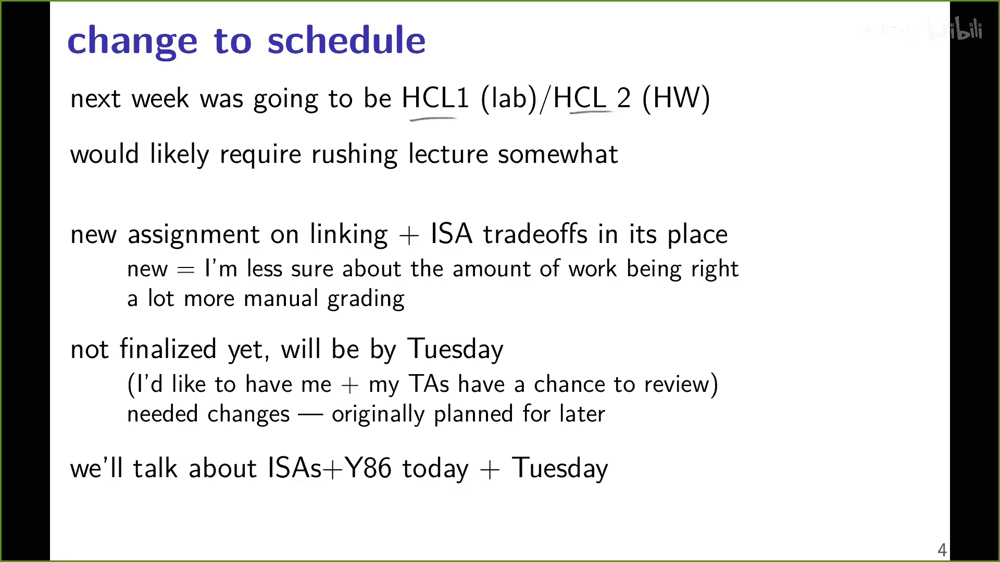
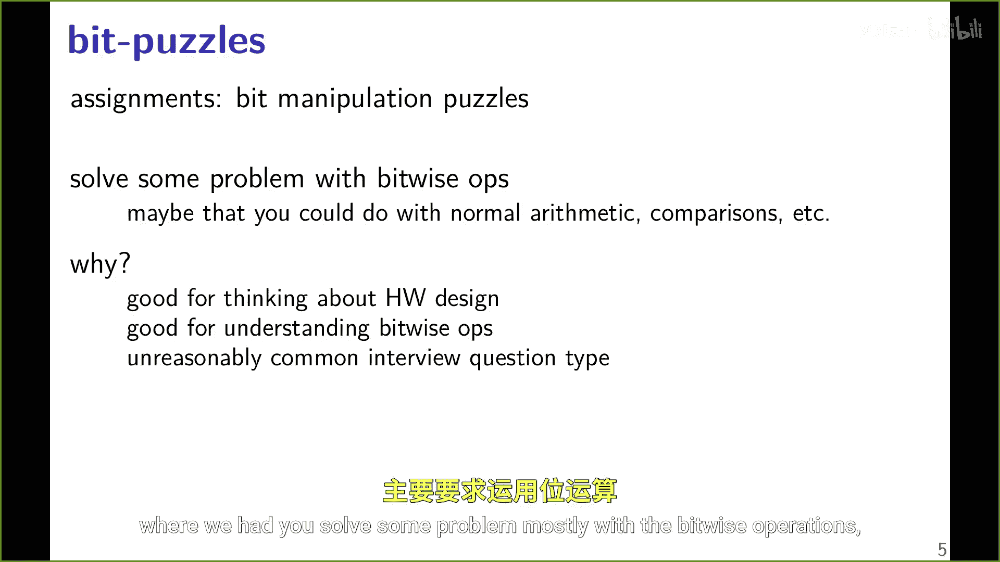

# 弗吉尼亚大学【中英⚡计算机架构｜CS3330 2020 Computer Architecture】 p06 P6 Bitwise (finish) - ISAs -BV1cKeGzqEuJ_p6-

Good afternoon。So， last time。We covered bit shifting so we started with this idea that well in hardware。

 our bits are represented as values and wires， if we have a larger than one bit value。

 we have a bunch of wires in that scheme extracting individual bits and manipulating them is fairly easy but this doesn't get naturally exposed to software。

 so we talked about operations the hardware can provide and does usually provide that let us access individual bits conveniently and one of these was the idea of bit shifts which moves around the bits of a number。

And we learned that there was a relationship between dividing or multiplying by a power of two。

 because， you know， if we。Add an extra zero on the end of a binary number。

 we move the one's placed to the two's place， the two's placed to the fourth place and so on。

 so we multiply lie2。嗯。So there's this natural relationship to multiplying or if we shift in the other direction。

 dividing by a power of two。嗯。And for the right word shift， we where we were equivalent to dividing。

 we had two choices about what to do about extra bits that were left over after we shifted off the bits in the least significant spots。

 One idea was what's called a logical shift where we add in zeroes。

 And the other idea is what's called an arithmetic shift where we copy the sign bit。

 The logical shift is close to division。 If we consider unsign numbers。

 the arithmetic shift is close to division， if we consider。Signed numbers。 And for Bleuff shift。

 we didn't have this issue。 We could always put it in a0。

 and it was always multiplied because there wasn't。Any sort of rounding like question。

Then we talked about bitwise operations。 So these are things where we have。

An array of single bit operators that we apply to every place of。

In the case of most of these operators two numbers， so we have an and operation， one and one is one。

 one in anything else's。One in zero is zero。0 and 1 is 0，0 and 0，0。 And we can apply that to。

Every pair of fits between two numbers。And we saw。Now。

We talked about and or an X or as our examples of these operators。

 and we mentioned that we can kind of think of these as ways of doing logical manipulations to parts of a number by constructing what we called a mask to indicate what parts of the number do we want to manipulate and thinking about what manipulation do we want to do and we learned that the and operation。

Is if we want to keep certain bits， we set up a mask to say， what bits we want to keep。

And that's what we can think of that as doing the or operation。 if we want to set certain bits。

 no matter what they were previously， if we want to make them be set， the or operation can do that。

Arm。And we also had the XO operation， which we can think of as if we want to flip certain bits。

 we say we specify what bits we want to flip with that mask and apply the mask by using this bitwise X or operation。

We also learned about a unari one opera end operator complement。

 which is just to flip all of bits in an number。So before I move on to today's topic。

Questions about anything we covered last time。So a question is。

 what's the difference between this complement operator and。Exlamation point， the bang operator。

So if we think of。Bang X and C。 This is equivalent to。You know， if X。Return one else。Return 0。

 It doesn't work bit by bit。 It looks at the whole value of x。

 And if remember what we talked about with what are false values and see。

 this if x is the same thing as if x is not equal to 0。

Versus the complement operator is flip every bit。 So， for example， if x is equal to say。This is two。

And we flip every bit of that， well we're going to end up with1，1，1，1，0，1。Gus。

 we're working bit by bit。So there's a question。Should this if statement be x doesn't equal。

 That's equals 0。 So this is。Oh， yes， it should。 That is correct。 What I meant to do。

Is probably this way of correcting that。

Yes， it still churn。Non zero values into one。2。Did I still do that wrong xs？0 of x， yes。

 if x equals1。I think I still made that。So。Non zero values should become zero。

I did have and zero values should become。1， okay， now this is correct。 So the key idea is。

Non zero becomes zero。And zero becomes one。Any other questions？That was recovered last time。

So today we're going to move on and we're going to spend。

Probably most of our time talking about some strategies for harder bit puzzles。

 so sort of how can we go about this systematically you looked at them in the homework。And， you know。

 some of them are pretty daunting。Including some very sort of tricks specific to puzzles。

 revolving to complement， and an idea that we can do operations in parallel where if we were writing things in the most natural way。

 we'd write two operators。But we can actually use one operator to do them both at the same time。

 and we'll show any specific example of that。Which is going to show a pattern which comes up a lot in these kinds of problems。

So。But first， a logistical thing。 So next week， if you looked at the schedule yesterday。

 we were going to be doing。The first HL lab and homework。

 this would require a rushing lecture somewhat Leture has just been going slower than it usually goes。

 but that's fine because we have。Because of not doing as many exams more time than we usually have。

 but I do does place the assignments in probably the wrong place for that So to deal with this。

 there was a new assignment I was going to put later on linking in ISA trade offs。

And I've moved that earlier and edited the assignment to remove references to things that we wouldn't have covered。

Because it's a new assignment for this semester and also needs editing and I relatively recently figured out。

 oh wait I'm not going to get to the material for H1 and2 it's not quite finalized yet it will be by next Tuesday I'd like to make sure that I have time to look over it and that I can hopefully convince some of my TAs to look over it so when you do it it comes it's nice and useful also the assignment deals with things we'll discuss about YD6 which we haven't covered yet。

That's sort ofner about change， this is just changing what weeks things are in homework and lab due dates are the same we've just changed what homeworks and labs are in what weeks。

Questions about this logistical change。

Okay， so let's。Look at our bit puzzles， so you did some of these bait manipulation puzzles in lab where we had you。

