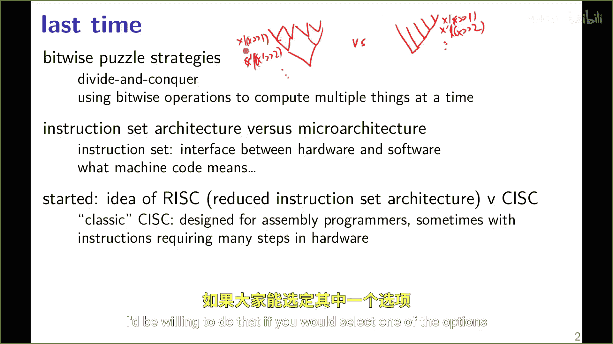
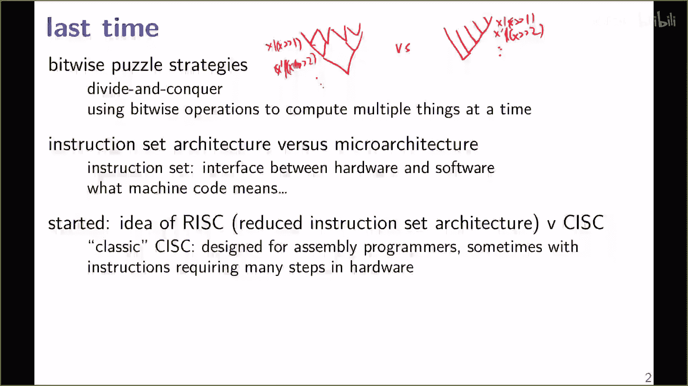
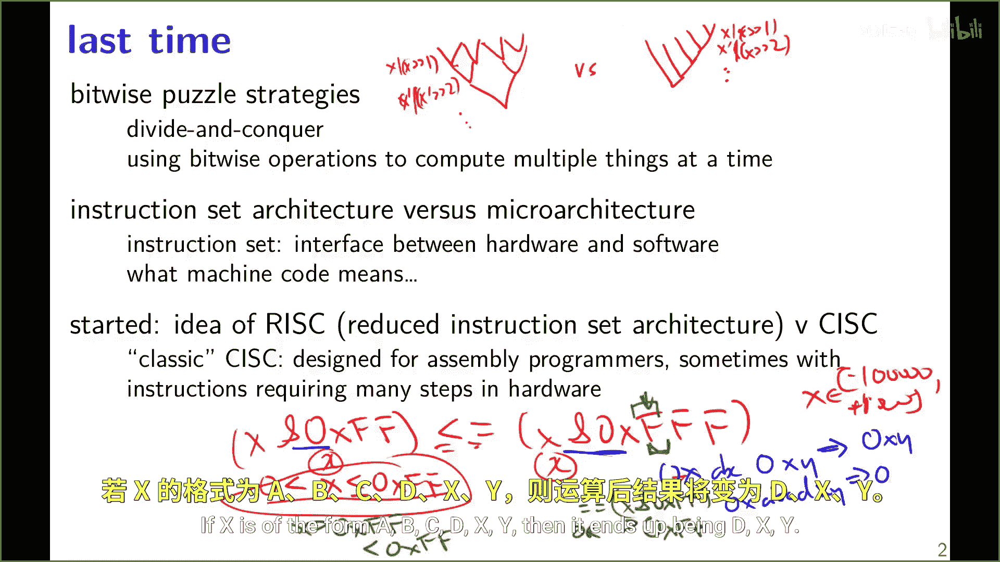

# 弗吉尼亚大学【中英⚡计算机架构｜CS3330 2020 Computer Architecture】 p07 P7 Y86 -BV1cKeGzqEuJ_p7-

Good afternoon so last time we started by talking about some strategies for solving these bit puzzles。

You're working on or have worked on for homework。One big idea we mentioned is that， well。

 when you have some relatively complicated problem。

 you're not just going to be able to look at the problem and look at what bitwise operations you have and immediately see how to do it。

So。What I do first is try to find simpler subprom like how does it work with one bit， you know。

 can we do some pieces of it and try to combine those pieces into a bigger answer。

 So like solve it for one bit， figure out how do we take our one bit solution and make it work with more than one bit。

Or do something like solve you know half of the problem to get an answer of we'll get zero or the answer if this thing is true and another half to get the answer of zero or the actual answer if that thing is true and then add or those two subparts together we can use that kind of method to divide our complex bitwise problems into more manageable pieces。

嗯。And another thing you mentioned is that there's this trick with these bitwise operations is that they can compute multiple things at a time and they do it like kind of regardless of whether we want it。

And weve went through this example of checking if any bid is set in our sort of naive way was we'd or the first two bits together。

 then or that with the next bit and the next bit and the next bit。

And what would happen is we'd end up doing。One bit lior for every bit we were checking。

But because the bit lies or actually ors all the pairs of bits， we'd end up doing tons of oing。

And this was actually rather wasteful and if we were a little clever， we could realize that okay。

 I do this one bit wiser operation that in fact， or you know lots of pairs of bits together。

 I just need to make sure I remember to try to use those extra results somehow。And in that way。

 I can save， you know doing that as a separate bitwise or operation。

 I can get multiple answers in different bit positions out of my one operation。

After we finished up talking about bit puzzles， we moved on to talking about instruction sets。

 and I started by introducing this idea of an instruction set architecture。

 which is what we mean by the for the interface between the hardware and the software。

 So one way you can view it。 It's what the machine code means。 So we're going have some machine code。

 It means something， that machine code corresponds to some assembly code。

 But the machine code is what the hardware sees。 and we need to define you know what that is。

And that's the instruction set architecture and when we've defined one machine code。

 we're going to find out there's a whole bunch of ways we can implement it in hardware。😡。

And those different choices we have are different micro architectureits。

So we might have the implementation be very different。

 but as long as the machine code has the same meaning， when we execute it。

 it's going to do the same thing， you know it's the same instruction set。

And we started looking at instruction sets and thinking about what were the design tradeoffs and at first we looked at sort of very simplistic things of like how many registers do you provide to assembly programmers or how you know how big are instructions in the machine code？

😡，And how many operahens do they take， what format do those operahens have。

 Do you use condition codes or not？And then we started talking about a sort of higher level design question with instruction sets。

 not about those little details， but about sort of what our goal was。

 And we mentioned that at some point。In early days。

 people were designing instruction sets kind of for assembly programmers and had these nice。

 complicated instructions that often would require many。

 many steps to execute in the hardware because that was a convenient thing for assembly programmers and their idea was better hardware would provide more of these nice convenient instructions。

And as reaction to that， we had this second philosophy called Rik reduced instruction set architecture。

Yeah。Your's instructions set computers， what the acronym stands for， and the idea there was， well。

 you know we have compilers now， we don't really need to rely on providing a rich assembly language。

 we want to make sure we give the compilers the tools， they need to produce efficient code。

 and we'll focus on providing the right tools for that。

 even if it means programs you know are bigger and it's harder to write assembly code by hand。

So before we move on and finish up talking about risk versus Ci。

 any questions on these things we covered last time？So there's a question about the quiz。U。

About whether I can go over one of the questions about。嗯。The。You， how we determined。

Wch of those expressions on the quiz were always true。

 I'd be willing to do that if somebody would select one of the options and not have me go over all of them。

If I go over all them， I think that's a little too much time。Okay。

 so the question was on the quiz we asked。Is X O X F F。Less than or equal to X at OX， FF。F。

Is that always true for x is some negative or positive number？

So let's so some number know between negative a million and positive a million。So， let's think about。

嗯。What happens here， And I think this question would be a lot less tricky if， you know， X was always。

Positive， so if x is always positive。Then。If x is less than， if x is between 0 and。Or XF。

 then this expression would be X。And the second expression would also be X。啊。

So we know that this is going to be true， it's going to have equality when x is in this range here。

If x is。Greater than O X FF than。I'll write this in a different color。Just to a cut easier。

 So if x is greater than Ox F F。Then the left side is going to be。Yeah， I guess。

Going to be less than OX FF。And。😡，The right side。Is going to be。One of two things。

 So if x doesn't have any bits in this nibble set， it's going to be equal to x O XFF because we're just removing those four bits。

Or it's going to have one of those bits set。In which case it's going to be greater than that going to or it's going to be greater than OXFF because it's going to have either the one of these four bit set。

So that takes care of it for positive numbers。 So for negative numbers。

 I think the key thing to observe is that these and operations unset the sign bit。

 So it's as if we had the equivalent。Positive number。

So we can apply the same logic we applied for positive numbers。

So question after the M we don't have to consider the sign bit。

 So the sign bit is part of the thing we bitwise ended with， and we ended the signine bit with a0。

 So the sign bit ends up being zero after these both of these and operations because。

We were ending with zero。And there's question。The left side wouldn't be less than or equal to O FF。

 So either if so we have two possibilities。 So if x。Is something of the form。Let's say。You know。

 if x is 0， it is， you know， ABC，0， X， Y。If that's x。

Then the left side is going to end up being 0 X Y。If。If x is of the form， AB，C， D， X， Y， then。

