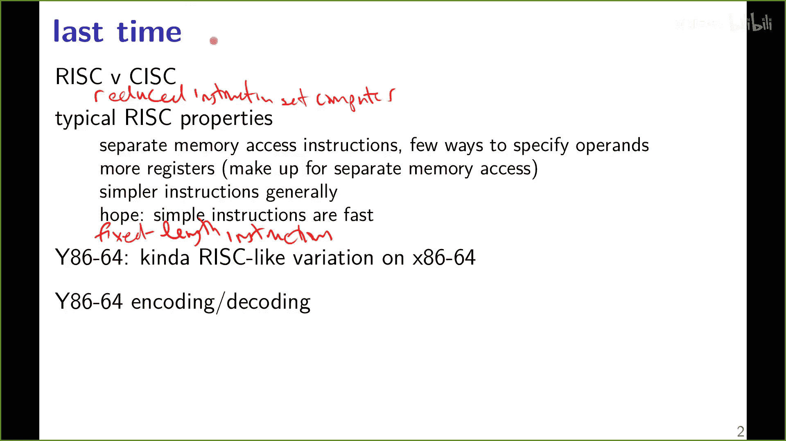
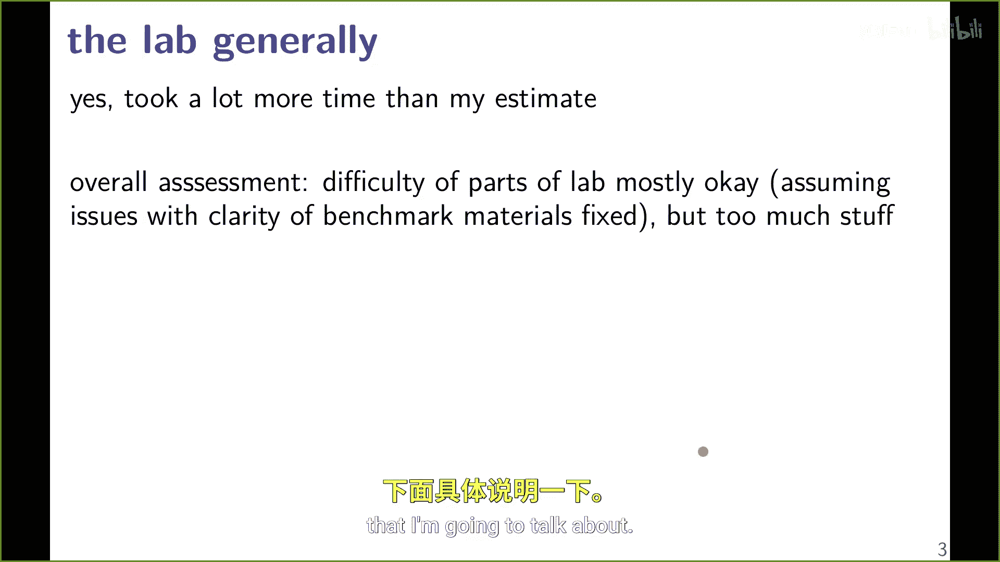
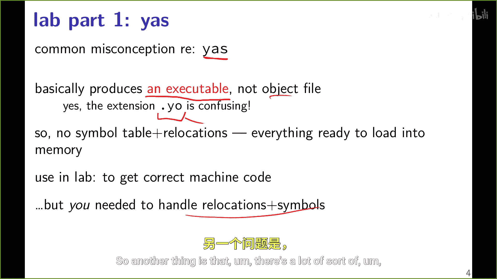
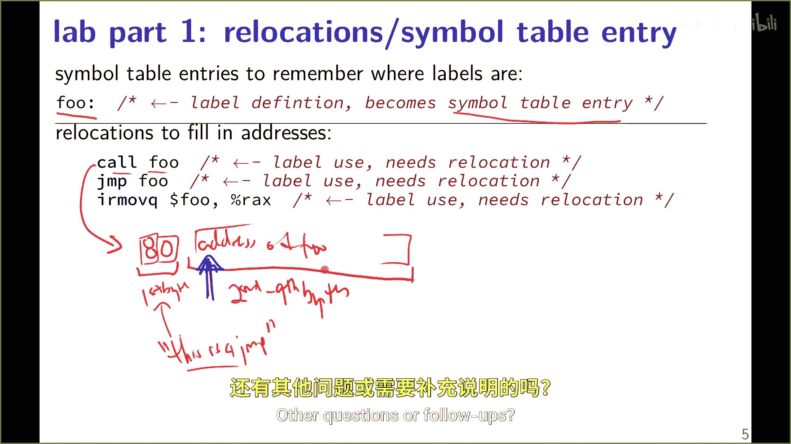

# 弗吉尼亚大学【中英⚡计算机架构｜CS3330 2020 Computer Architecture】 p08 P8 SEQ part 1 -BV1cKeGzqEuJ_p8-

So last time。Weiyi。Started by talking about risk versus so risk stood for this reduced。

Instruction sets。Computer and the idea was that rather than design our instruction set to have all the instructions that might be convenient for an assembly programmer。

We focused on this idea of trying to implement instructions that would be convenient for the hardware。

And rely on compilers to deal with the fact that that makes assembly more complicated。

And this led to a few propertiesties we can expect from a risk construction set。

 So typically we have separate memory access instruction， so we can't like。

Access memory in the middle of an ad instruction， we need to move a value to a register first。

And fewer ways of specifying operahs because though like being able to specify any type of operah anywhere。

And an instruction is useful， like it's going to make the hardware more complicated。

 we want to keep the hardware simple， we'll have to compile or deal with that problem。

And to make up for being less convenient to access memory， we can have more registers。

 and this is also kind of a way we can use the extra hardware that we don't need to devote to implementing instructions and provide something the compiler can use。

Hopefully。And generally we'll just have simpler instructions。

 we're not going to provide a know complex multi step instruction， we'll just say。

 we'll just provide the building blocks for that and say a compiler。

 you have these tools you can do the operation。And the hope is that when we do this。

 the simple instructions are fast and this will just be a better processor。

 easier to build and get better performance。And we talked about YD664。

 and this is our textbook subset of Exod 664。 and if you look at it， it's kind of risk like。

 I say kind of because some of the things that it does aren't risk like， for example。You know。

 risk typically has fixed length instructions because that's。Simpler to implementing the hardware。

 why 664，J didn't do that。And when we finished up， we were looking at Y8664 encoding and decoding。On。

So questions about what we covered last time or something else before I go on。

 I'm going to talk a bit about the lab since probably should talk about that。

 and then we're going to look at decoding Y8664 machine code。

Questions on these things from last time。And I'll take one question from。Earlier。

 so asking aboutquiz3 regrades， yes， I know there are a bunch of them。

The TA who's going to look through all the comments on the quiz will also look through the list of wrong answers and well probably make some adjustments then after that I will look through the regrades and see which ones aren't handled and handle them。

Questions on this topic。From last time。

I don't see any。Let's just talk about the lab generally。

 so the lab took more time than I thought it would。And I think。

What happened is like I was really worried about the difficulty of each part of the lab and that was probably mostly okay。

 except that there were some clarity issues where like for the benchmark stuff。

 some people were doing a lot more work than we wanted it to be。But there was just too much stuff。

So that was。A mistake。goinging through the lab notice that there were some common misconceptions that I'm going to talk about。

So start with， you know go through each part of the lab， so starting with part one。

So there's an issue regarding what YIS does。 So the textbooks assemler produces an executable。

 And I understand that this confused people because they looked at the extension do Y0 and said， oh。

 this must be an object file and it's not an object file because。

You can't combine it with another O file， it's missing information you need to do that。

 so it's really inexecutable， so to produce the object file we were looking for。

 you needed to handle adding the relocations and symbols。😡。

Because it was just the information was missing， you know， it didn't include that。

And we just wanted to use Yas because。Just as a side effect of producing an executable。

 it asked all the code to produce the machine code， you could have done that by hand。

 but that's really tedious and not worth your time so we were hoping you'd like make an executable that has the same machine code extract the machine code from a it put it in your object file。

So another thing is that there's a lot of。

Sort of。Am。Confuion about symbol tables and relocations So with simple table entries。

 basically when we define a label in assembly， there's nothing that appears in the machine code for this label。

 so we need to remember it by writing a symbol table entry so in our simple assembly。

 we're just going you know if it can be used from another file， it needs a symbol table entry。

Otherwise， when we make the object file， we totally forget about the label and that's pretty bad。

And when we use a label， we need。A relocation to fill in the address。

 because of when we think about the Y8664 machine code for this， for example， for call。

 this is going to turn into a byte 8，0。 So this is the first byte。And then we're going to have。啊。

The remaining bytes are going to be the address。A tho。And even if F is in the same assembly file。

 we don't know what this address is yet。😡，Because， well。No。

We don't know exactly where the machine code from this file is going to end up in memory yet because it depends on what we do with the other object files we're combining to make an executable。

And the relocation is going to point to where we need to put the address。 So it's going to point to。

The beginning of the address， which is going to be the second byte。Of this call instruction。

Or and similarly， it would be the second bite of the jump instruction。

 And if you look at how Iron moveq is encoded in the table the。

Third byte of the I move Q instruction。For getting the address of who into where the constant appears in the instruction。

Questions about。Sort of symbol table entries relocations and。How they work。

So the question is why do we need to start with the second bite， So our machine code。

Has this first bitete， which is basically saying。This is the this is。

A jump instruction and we don't need to replace that part of the instruction when the final executable。

 we still want it to be a jump instruction， we need to preserve this 80 that says it's a jump instruction。

We just went to replace the address and remember the linker doesn't actually understand assembly。

 so we're just telling the linker here's where the address is。

 we have to point to the exact location。So the question is you're asking is when we zero out the location that doesn't include the first byte。

 so I assume by saying zero out the location， you're saying that when you produce your machine code。

 you replace this address with a bunch of zeros。And if you're doing that。Sorry。

 the machine code and the object file is， and if you're doing that。

 indeed you better not replace this 80。In addition to pointing the relocation to the right place。

I would say that actually replacing。This address and the object file。

 you know where the address could be with a bunch of zeros。

 that's not required because when we make the executable。

 we're going to edit it regardless of what was there before。

 so we don't need to have anything in particular there。

 It's just a convention that assemblers will typically leave it as zeros。

 but there's no requirement to do that。😡，Other questions or follow up。

