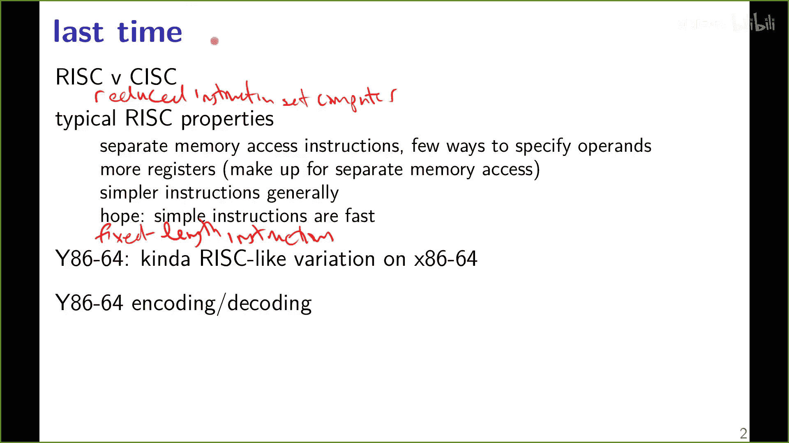
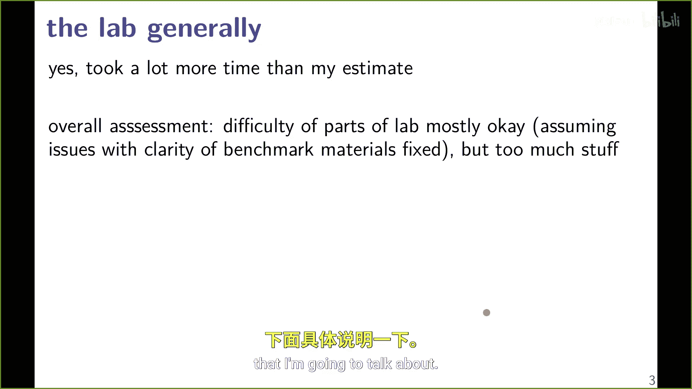
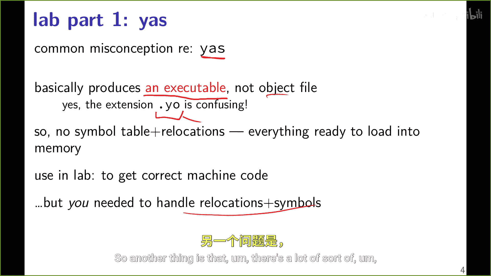
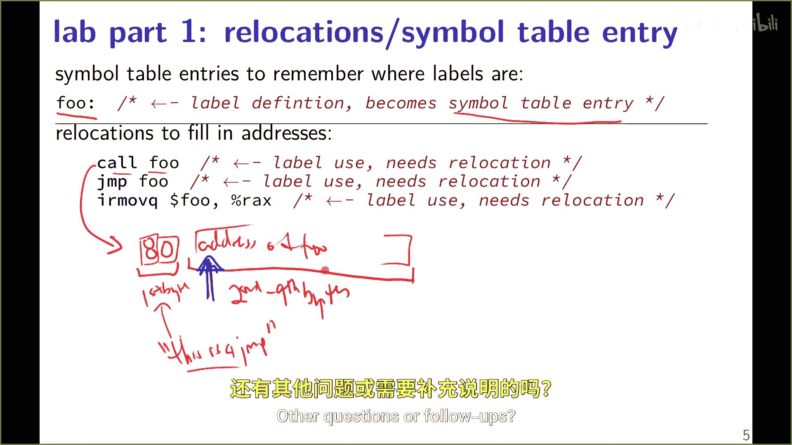

# 计算机架构：P8：SEQ处理器第一部分 🧠

在本节课中，我们将学习RISC（精简指令集计算机）的基本概念，回顾YD664指令集，并探讨机器码解码的细节。我们还将讨论上一个实验中的常见问题，特别是关于符号表和重定位的理解。

---

上一节我们介绍了RISC架构的核心思想。本节中，我们来看看RISC指令集的一些具体特性。

RISC代表**精简指令集计算机**。其核心理念是，与其设计一个对汇编程序员来说方便、功能齐全的指令集，不如专注于设计对硬件实现来说更便利的指令。编译器将负责处理由此带来的汇编编程复杂性。

以下是RISC指令集通常具备的几个属性：

*   **独立的存储器访问指令**：我们不能在一条加法指令中间访问内存。必须先将值移动到寄存器中。
*   **更少的操作数寻址方式**：虽然能在指令中任意位置指定任何类型的操作数很有用，但这会使硬件更复杂。为了保持硬件简单，我们将这个问题交给编译器处理。
*   **更多的寄存器**：为了弥补访问内存的不便，我们可以提供更多的寄存器。这也是一种利用我们无需用于实现复杂指令的额外硬件资源的方式，为编译器提供可用的工具。
*   **更简单的指令**：我们不提供复杂的多步骤指令，只提供基础的操作模块，让编译器使用这些工具来组合完成复杂操作。

这样做的希望是，简单的指令执行速度快，从而能构建出性能更好、更易于实现的处理器。

我们讨论了**YD664**，这是教材中使用的x86-64指令集的一个子集。观察它，会发现它有些类似RISC，但又不完全是。例如，RISC通常采用**固定长度指令**，因为这简化了硬件实现，但YD664（x86-64）没有这样做。

---

上一节结束时，我们正在研究YD664的编码和解码。在继续深入之前，我们先简要讨论一下之前的实验。

实验花费的时间比我预期的要长。我认为主要问题在于实验内容本身过多，此外，在基准测试部分存在一些表述不够清晰的地方，导致一些同学做了比预期更多的工作。

以下是实验第一部分中遇到的一些常见误解：

*   **关于YAS汇编器的输出**：教材的汇编器生成的是一个可执行文件（.yo）。这可能会让人困惑，因为扩展名看起来像目标文件（.o）。但它并不是一个真正的目标文件，因为它缺少与其他.o文件链接所需的信息（如重定位和符号表）。我们使用YAS主要是为了利用它生成机器码的副作用。你可以手动生成机器码，但那非常繁琐。
*   **关于符号表和重定位**：
    *   **符号表条目**：在汇编中定义一个标签（如函数名）时，机器码本身并不包含这个标签信息。因此，我们需要创建一个符号表条目来记住它。如果这个标签可能被其他文件使用，它就需要一个符号表条目。
    *   **重定位条目**：当我们使用一个标签时（例如`call`或`jmp`指令），我们需要一个重定位条目来告诉链接器在最终的可执行文件中填充正确的地址。例如，`call`指令的机器码第一个字节是操作码（如`0x80`），随后的字节才是目标地址。在生成目标文件时，我们不知道这个地址最终是什么（因为它取决于链接时其他目标文件的位置）。重定位条目就指向机器码中需要被替换为最终地址的那个位置（即`call`指令的第二个字节开始处）。

**为什么从第二个字节开始？**
因为机器码的第一个字节（`0x80`）标识了这是一条`jump`/`call`指令。在生成最终可执行文件时，我们仍然希望保留这个操作码，只需要替换后面的地址部分。链接器并不理解汇编，所以我们必须通过重定位条目精确地告诉它地址所在的位置。

**问：在目标文件中，我们是否需要将地址部分预先清零？**
答：这不是必须的。因为在链接生成可执行文件时，无论那里原来是什么值，都会被覆盖。通常汇编器会将其置为零，但这只是一种惯例，并非要求。

---

本节课中，我们一起学习了RISC架构的设计哲学及其特性，回顾了YD664指令集与典型RISC的异同，并澄清了在机器码生成、符号表和重定位理解上的关键点。理解这些基础概念对于后续构建处理器模型至关重要。