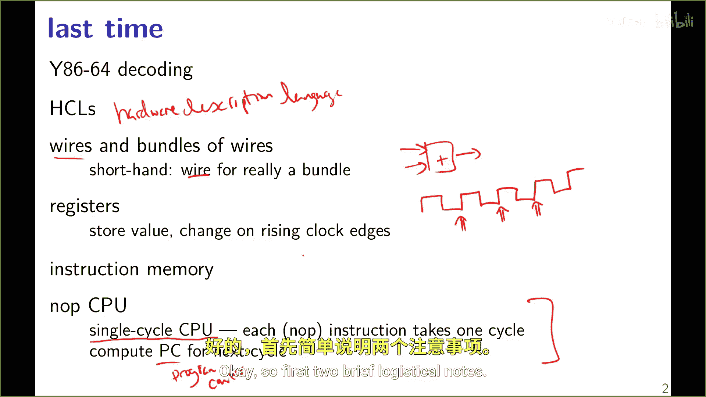
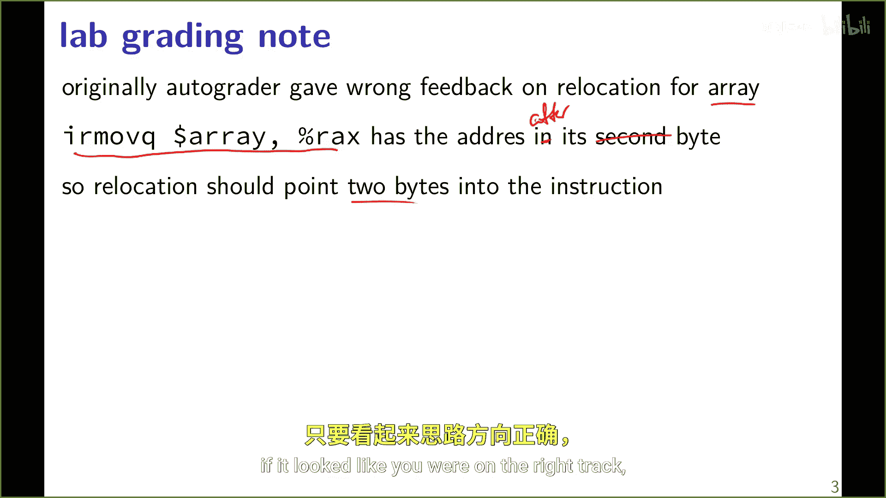
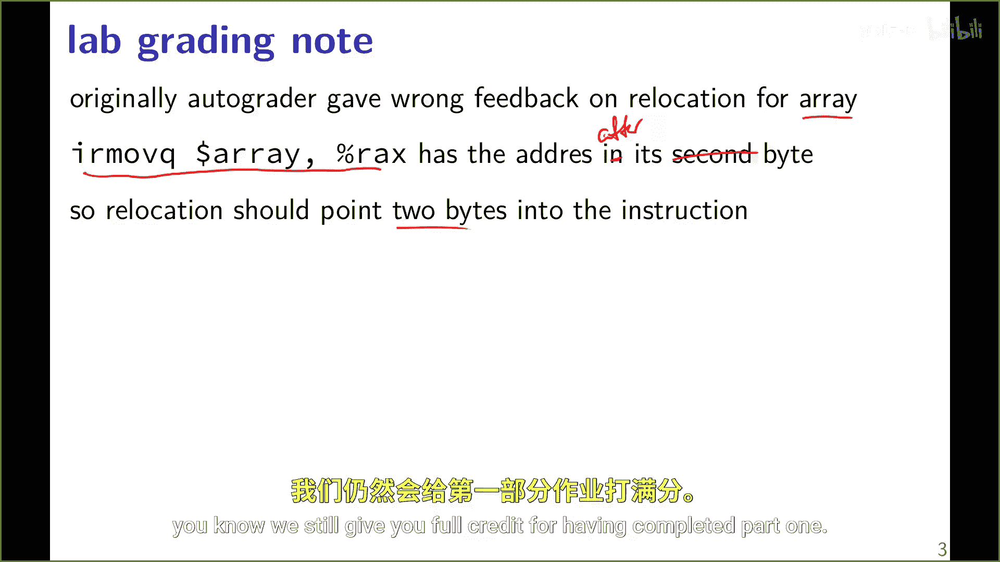
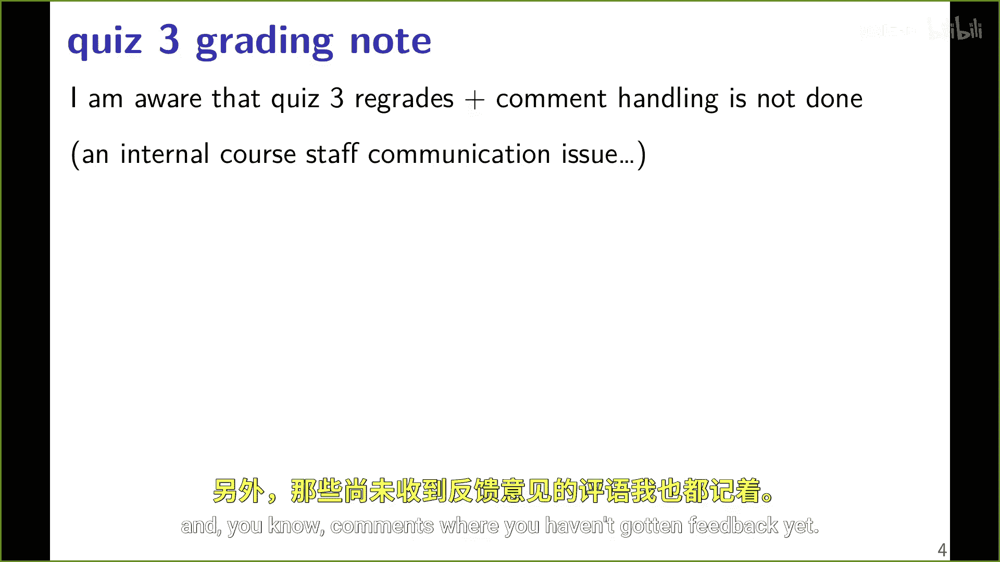
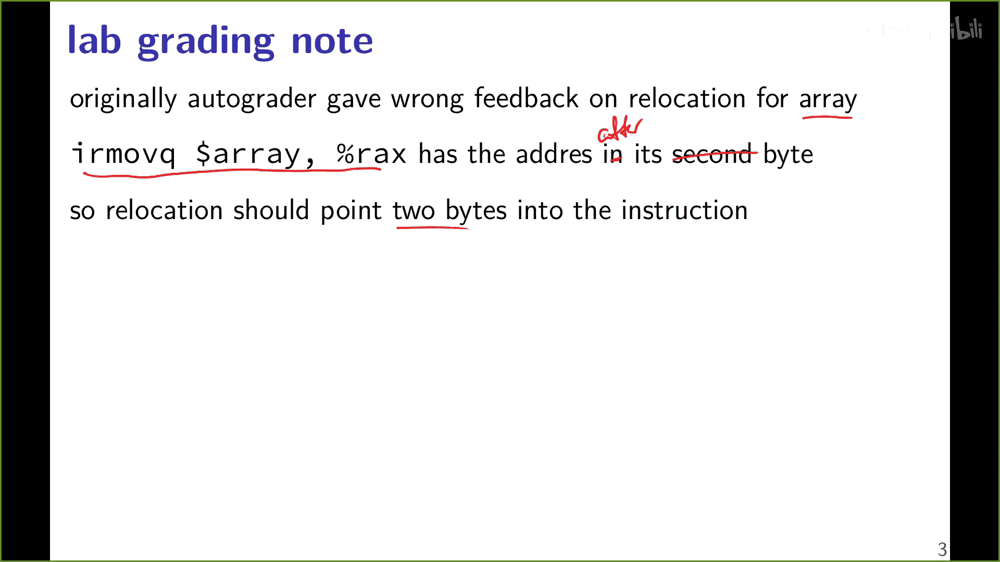
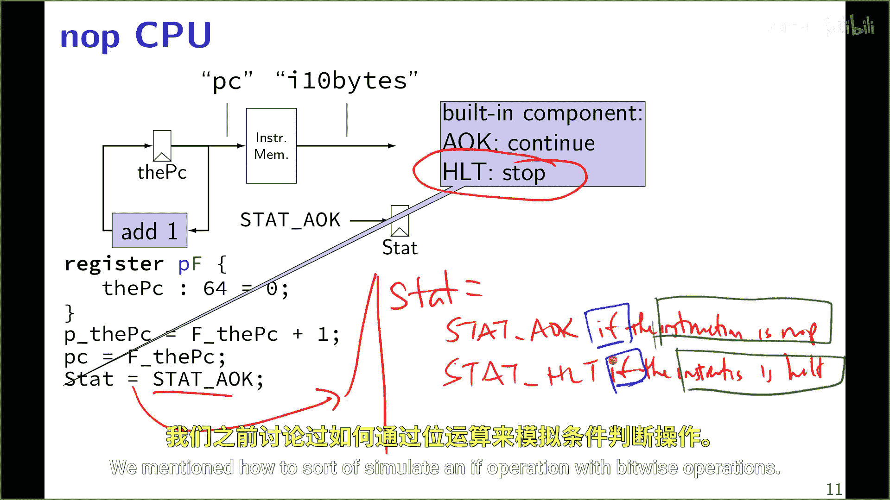

# 弗吉尼亚大学【中英⚡计算机架构｜CS3330 2020 Computer Architecture】 p09 P9 SEQ part 2 -BV1cKeGzqEuJ_p9-

Okay， good afternoon， so last time we started by finishing up talking about decoding Y664 instructions。

And the idea is that we had this table of what the encoding was。

We figured out what row of the table we were in by looking at that most significant first four bit of the first bite of the instruction were。

 And then we matched up fields in the table to fields in the instruction。

 Then we started talking about designing hardware。 We had this idea of hardware description languages。

嗯。And we mentioned the one we'd be using is one built for this class that's specifically designed for making a Yd664 processor of HLRS。

And in that we needed some abstraction for first holding values that we were computing on。

 we had this idea of a wire which would hold a bit。

 you know physically this would be represented by some voltage and we typically wanted the values that were bigger than a bit we just have bundles of wires and we' call these sort of collectively a wire。

As I shorthand。And when we had these wires， we could。

Say we assume we had something which like did a computation， like adding them。But， you know。

 this is the way this circuit would work is we'd input some values。 It would output a value。

But it would have you know take some time to do that and we'd have to worry about， well。

 what happens when we're changing the inputs or what happens when it's computing and it's not done getting the right output。

 you know we don't want to deal with those sorts of values that are in between So we need some way of controlling when we go from one step to the next and making sure that we wait long enough。

For something like this adding circuit that we might have to actually finish computing a value so we can ignore those intermediate values while it's figuring out what the result should be。

And our tool for doing that。Was this idea of。Registers and registers would store。Values。

So they storage， and we have to control when they store values， when they read those values in。

 and our idea is we have this clock signal。Which is they use some periodic single like this。

 And we just chose that at these。Rising edges。Is when the registers would do their thing and。

Store a new value and start outputting it。We also。Had。I need to store our programs。

 and we mentioned we had this component we called an instruction memory。That did that。

 And the way this worked is that we put in an address and we get out the instruction at that address。

And when we finished up， we hadn't actually gotten to actually using that value。

 we just set up a CPU where we assumed everything was a no instruction。And this was。

A CPU we'll call a single cycle CPU。 Each instruction takes one cycle。 In this case。

 we only had knos。 We assumed everything was anob。 so we didn't fetch the instruction for memory。

 but we didn't actually look at it。 We just said up， yep。

Whatever it's there must be enough because that's the only instruction I implement。

And aO instruction now stands for no operation， but it doesn't really do no operation because we have to advance to the instruction afterwards。

 so we did this work of computing the program counter value。😡，For the next cycle。

 the address of the next instruction， which was adding one。

That's where we left off and today we're going to move beyond this to implement some other instructions。

You know， deal with the issue that， well， if we assume everything's a not。

 then our processor never stops。So we're going to talk about adding a halt instruction to say， hey。

 simulator， we're done or the equivalent in real heart will be like。

Telling whatever controls the power to shut off。So questions about these topics recovered last time。

Where I move on。So first two brief logistical notes， so there are lab grades on the submission site。

 originally my auto grader gave the wrong feedback on the relocation for the symbol called arrayray because I entered the wrong number into the autograder in this instruction。

If we look at the encoding， the address is。Is in。It's。Oh。Startts after its second byte。

 so I we should probably say starts after its second byte， not after its first one。

 so the relocation should point2 bytes into the instruction， not one。

 which is what I had entered in the other grader， that feedback should be corrected。

 it didn't affect anyone's score because the way we graded at the lab is that know even if you got all the relocations wrong。

 if it looked like were on the right track， know we still give you full credit for having completed part one。

Another issue is that I know quiz 3 grading is not done yet。

There's some internal communication issue with because I'm trying to have kidss do it and not me personally so I can work on。

Open people with things that are more directly beneficial。 hopefully， I know that's behind。

 I hope in the future that quiz ratingd is you know， one week turnaround。Just letting you know。

 I haven't forgotten about those res。And you， comments for you haven't gotten feedback yet。

questionsions about logistical issues。

So last time when we finished off， we had this。Not CPU here。So we have our program counter。

 which is the address of the currentnP instruction that we're executing。

 stored in this register and we have our clock cycle and each time。We have a rising edge。

 We advance from。From zero to one to two to the next not instruction。

 we don't actually check whether we have a not instruction or not because that's all we implement。

So we just assume it's a not instruction， but we're going to have to in the future like look here and figure out wait is it really a not instruction。

 and we also needed to have this value which controls our simulator。

And here we're saying to keep going， that A okay is just a constant。That is predefined in HqLRS。

 and there's one for don't keep going。 but right now all we can do is say keep going。

 So when you run this， we found out that it ran for a long time until the emimulator said you took too long we're done。

This is our CPU， and we're going to talk about well。嗯。Fixing you know our problem here。Which is that。

 you know， we really wanted this to not just be。You know， always continue。

 We want to sometimes support this halt input。 So the code we really wanted in sort of pseudocode is we wanted to write stat equals。

Start a， okay， if the instruction。Is not。But， and。St halt。If the instruction。Is halt。

 And there's two parts of this。We have to figure out how to do。

 So one thing we have to figure out how to do is this。Is this sort of if statement。

 how do we implement an if statement here in it shall。

We're not going to have a traditional if statement because that's not you know not how our circuit works。

 if we have something connected to something else， it's always going to happen。

And the other thing we're going to have to figure out how to do is how to。Evaluate this condition。

Is the instruction a not or is it a halt， which means we're going to have to figure out how to use our value coming off the instruction memory to figure that out。

So I'm going to start by dealing with the problem of。Of this if。

 And there's one solution I'm not going to do。hich would be based on our bit fiddling sort of exercises。

 We mentioned how to sort of simulate an if operation with bitwise。

