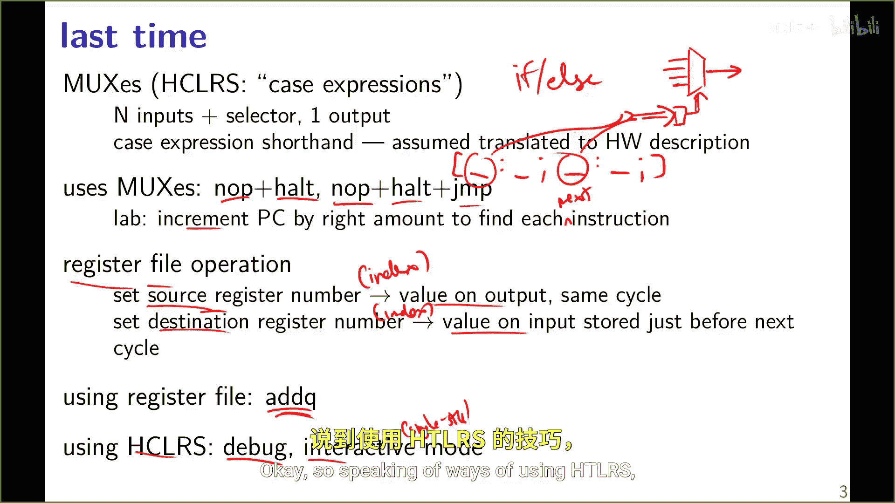
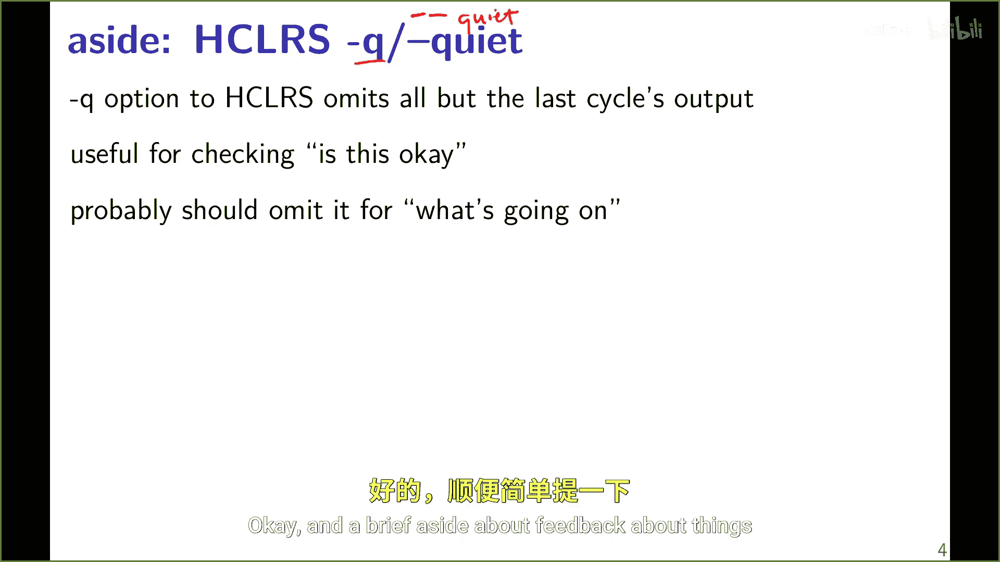
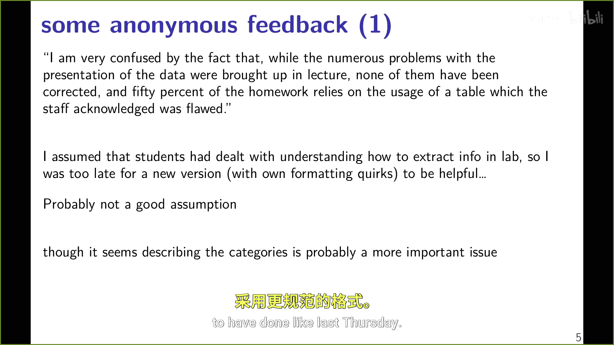
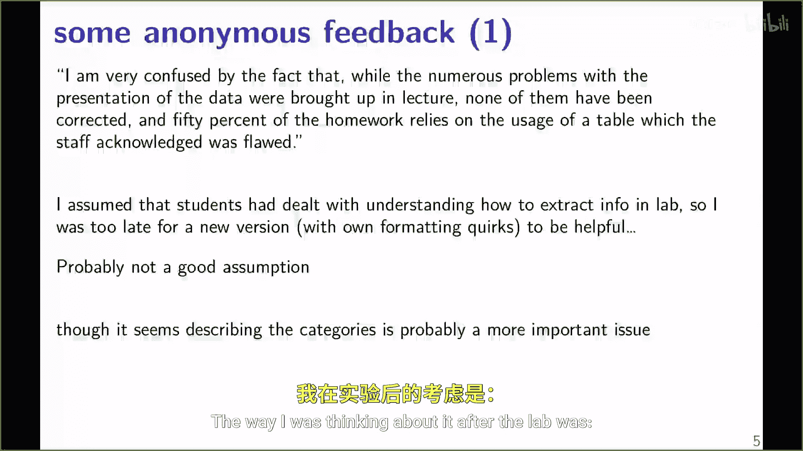
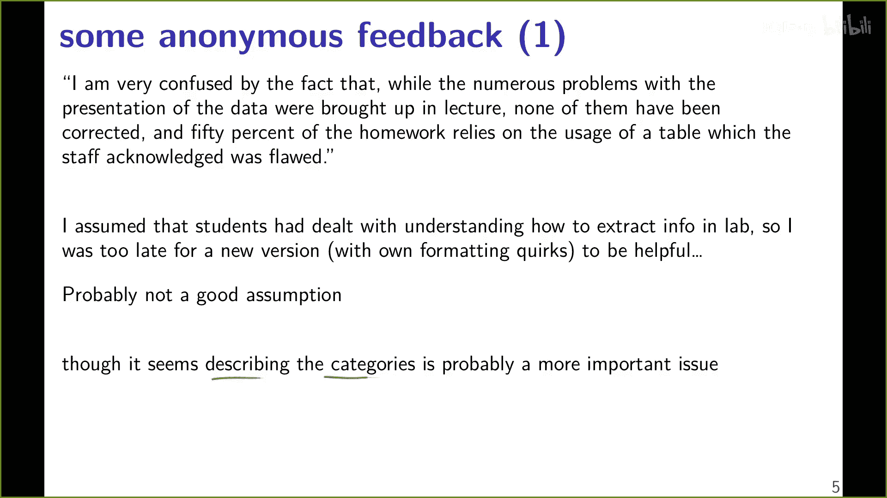
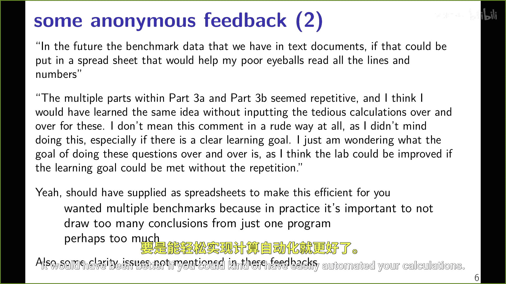
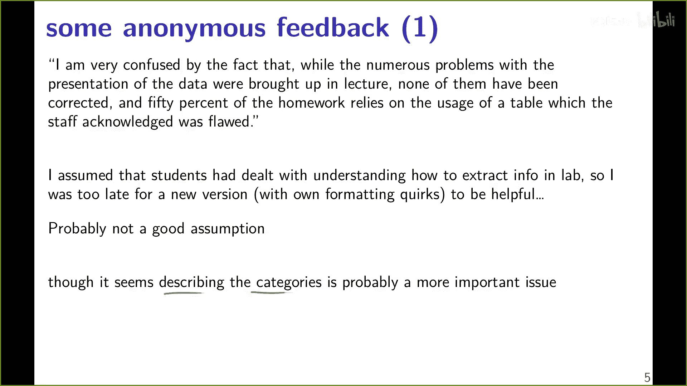
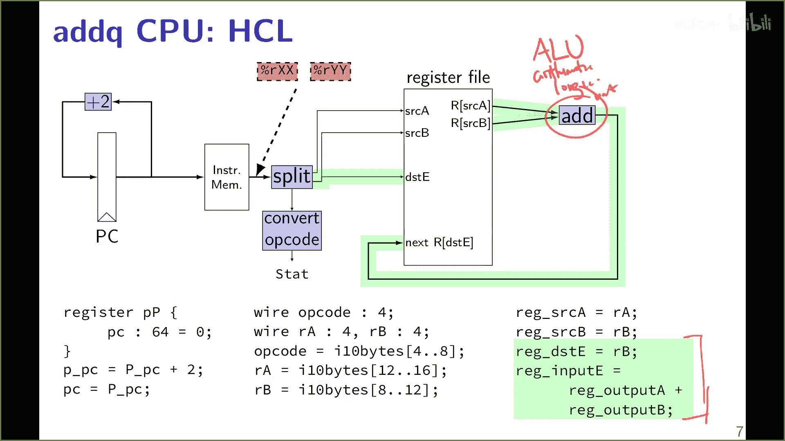
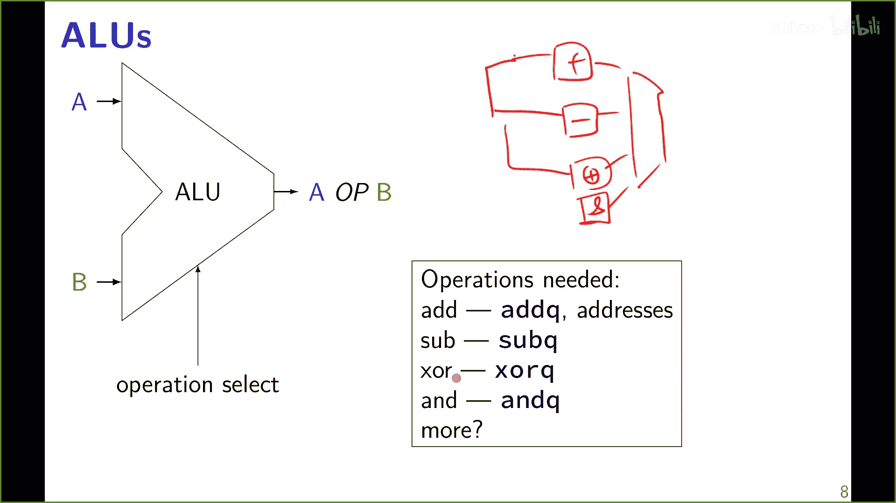

# 弗吉尼亚大学【中英⚡计算机架构｜CS3330 2020 Computer Architecture】 p10 P10 SEQ part 3 -BV1cKeGzqEuJ_p10-

Good afternoon。So， last time。We started by talking about how we can make decisions in hardware。

 and we mentioned a hardware component that would be our sort of equivalent of。If else statements。

 and that was this Mux， which would take several inputs and a selection input and produce one output based than that selection input。

And we said that we'd represent these in HCclLRS by this case expressions syntax。

And we'd assume that Hs would translate that into an efficient hardware description where we'd end up most likely with this MuX component and some logic circuit that takes in。

Our values for conditions。And translates them into the index to a lack of our N inputs。

And we looked at how we could use these。To construct some simple processors to go beyond what we started away through aspace are not processor。

 which you know executed instructions that did nothing so all we did was fetch each instruction and not look at it because we assumed it did nothing we extended that to actually fetching our instruction and you know。

Possibly halting by telling the simulator， hey， we're done now or by sometimes advancing by one byte to get to the next instruction and sometimes advancing to an address in the instruction for a jump。

And in the lab， you extended this， hopefully to increment the PC by the right amount to find。Each。

Next instruction。Rather than just the next instruction for knobs。We also looked at our registers。

 So we mentioned this idea of a register file， this built in component that would store our assembly visible registers for us rather than us trying to you know。

 construct a whole bunch of machinery with。Mux is and a bunch of normal quote unquote， registers。U。

And the way this worked is that we had signals where you could send a source register number。

 and you can think of these register numbers as indexes into like an array of registers。And。

With the source register numbers， retention this number， and in the same cycle。

We get a value on the output。We also could set a destination register number and in the same cycle we also would set a value that we once stored at that destination and just as we go to the next cycle at that rising edge of the clock。

 if we think about instructions in the type of processors we're building these are what we call single cycle processors。

 so this is as we transition from ones instruction in one cycle to another。

 each instruction takes one cycle， that's when we would actually store a value in the register。

And we have these indexes to say where' to store where the table of what index was where register was just the same as the one we used for our machine code when we needed to have a four bit field represent which register is this instruction using。

And using that， we showed we can construct a processor that executed our ad instruction。Om。

By actually accessing the appropriatereate registers。

 we also looked at how some things about using HRS。

 I mentioned that there was this debug mode where you could look at the values of wires and this interactive。

 which you can think of as sort of a single stepping mode。

Just because that might come in handy on future assignments such as the homework for this week。

For next week， I should say。So questions about things we covered last time。Okay。

So speaking of ways of using HtLRS， I have one thing I want to mention because I noticed it came up in the lab。

Which is about the dash queue or dash dash quiet。Option to HLRS。In the lab。

 we told you to use this to compare our output that we wrote in the lab documentation to your actual output。

And what this option does is it limitss all about the last cycle's output。

So that's really useful for checking is this okay， you just look at what happened at the end。

 it was everything in the right state。Um， if you actually want to figure out like。

 why is it different， you probably should omit this option so you can see what's going on during every other cycle。

😡，Okay， and a brief aside about feedback about things that went rough in our homework that was due Wednesday。

 So one thing that came up is I mentioned that I， you know。

 wasn't happy with the format I gave you the instruction data in and some people said， well。

 probably I should have。

I've given you it in a better format， and I agree in retrospect that probably would have been a good idea to have done like last Thursday。

The way I was thinking about it after the lab was I assumed that basically the damage had been done that you had already dealt with extracting data from these files and that。

 you know if I gave you a new version and went through the trouble of trying to announce here's a new version that would be more work overall。

😡。

Um， so probably when first the wrong thing there probably was too worried about the new version being a problem。

Though I would say my impression in retrospect is that the format was yes。

 not ideal for like extracting the numbers， but I think there was more confusion from describing what the categories mean。

 which。Is something I would want to try to do something about if I use that again in this class。

 and that's obviously more work and thought than just something I could put together quickly。

嗯。Another。嗯。Th about it is well that it the problems we had seemed repetitive。 Like。

 why did we have you do the same thing five times so。Indeed。

 if I gave the data to you in a more spreadsheet like format。

 this probably would be less of a complaint。But what I was thinking when I supplied five different benchmarks is that when we're doing this sort of thing in the real world。

 when we're saying， is this a good processor or design。

 we want to look at multiple different programs so we don't accidentally optimize for one application and make all the others kind of a little crappiier。

😡，嗯。So that was the thought about doing that， but yes。

 it would have been better if you could kind of have easily automated。

Your calculations。

Ss。Feedback。 So let's look back at。Our a CPU。 So here's our a CPU from last time we showed you this HL code。

And if you write the book carefully， one thing that may be a little weird is our。Add here。

 and you may remember the book says that this is done with an AU。

 which stands for arithmetic logic Uni。And that's not what I've drawn。On this picture。

 and that's also not something that we see any indication of in the HCL code that corresponds to this。

嗯。

So in ALU。Is。Something that you put in the processor which does all sorts of arithmetic so in the books and conceptually our YD664 processor design。

 this would be one thing which can do an addition， a subtraction and X or an and。

 and the way it would work is we put in our two inputs。

 and we'd have a separate signal to select which of these operations are we doing。

And it would do those operations and the reason you've used this instead of like having like an adder and a subtractor and an Xer and an ander。

And like wiring up。You know， a to each of these， you have a combined box for this。

Is that even though you could like。Make this combined box by know having each of these components and choosing which one to use in practice。

 you can get more efficiency by taking advantage of the fact that well adding and subtracting and exoring are actually very related operations。

