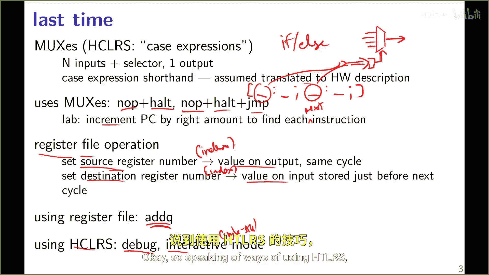
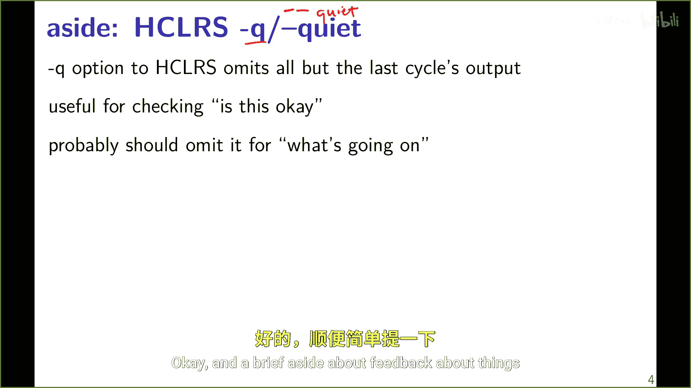
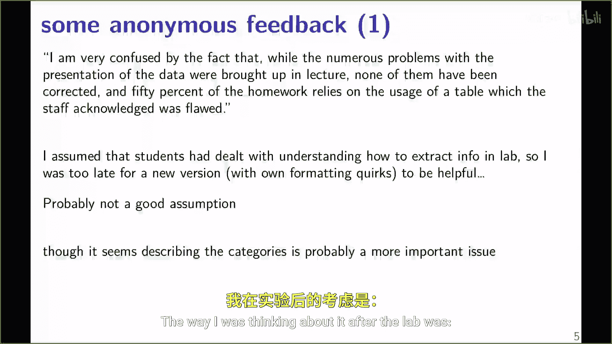
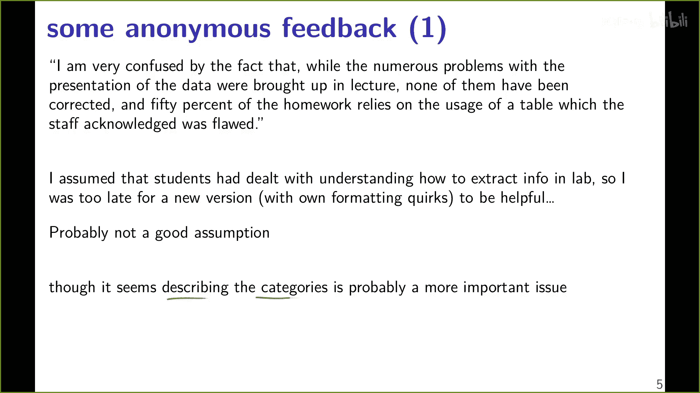
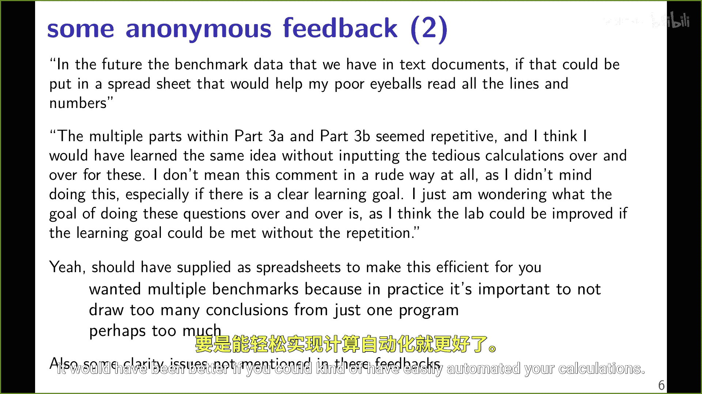
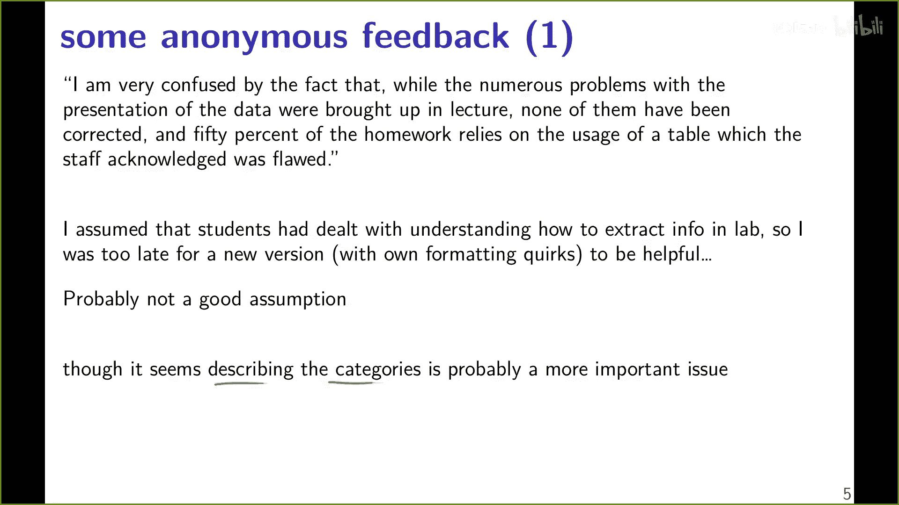
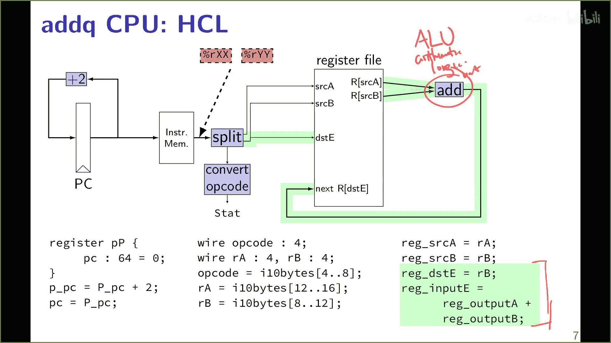
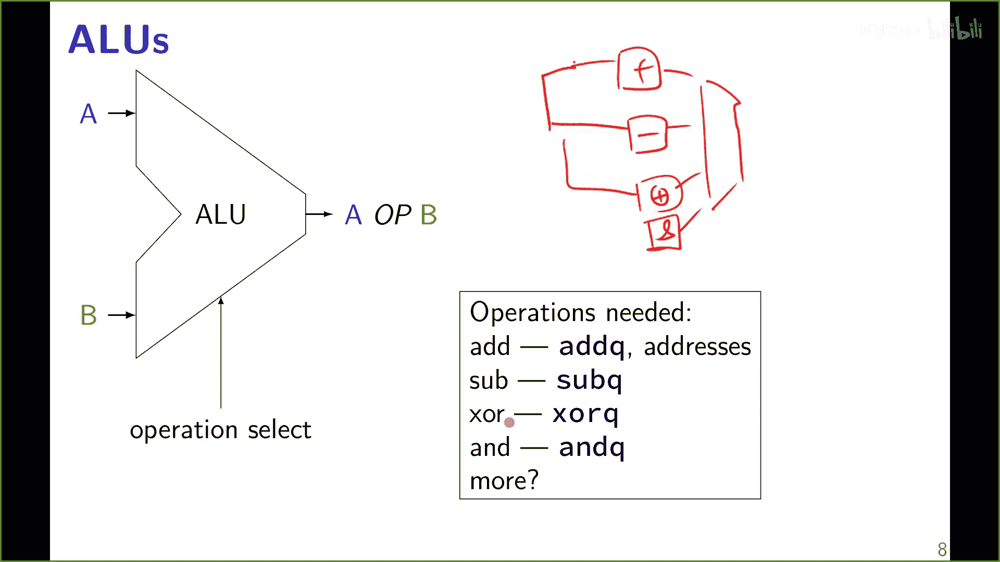

# 计算机架构：P10：SEQ 第三部分 🔧

在本节课中，我们将继续学习如何用硬件描述语言构建处理器。我们将回顾决策逻辑的实现，深入探讨寄存器文件的工作原理，并介绍算术逻辑单元（ALU）的概念。同时，我们也会讨论一些使用工具时的实用技巧。

## 硬件决策逻辑回顾

上一节我们介绍了如何在硬件中实现决策，并提到了一个类似于编程中 `if-else` 语句的硬件组件——多路复用器（Mux）。

多路复用器接收多个输入和一个选择信号，并根据选择信号输出其中一个输入的值。在 HCLRS 语言中，我们使用 `case` 表达式语法来表示它。HCLRS 编译器会将其转换为高效的硬件描述，最终很可能生成一个多路复用器组件和一个逻辑电路。该逻辑电路接收条件值，并将其转换为选择 N 个输入中哪一个的索引。

我们研究了如何使用这些组件来构建比最初简单的“什么都不做”处理器更复杂的处理器。最初的处理器只是获取指令但不执行任何操作。我们将其扩展为：获取指令，可能通过向模拟器发送“完成”信号来停止，或者根据指令内容，有时将程序计数器（PC）前进一个字节以获取下一条指令，有时跳转到指令中指定的地址。

在实验环节，你们进一步扩展了这个设计，使其能够根据指令正确计算并更新 PC 的值，以定位每一条下一条指令，而不仅仅是下一条“空操作”指令。

## 寄存器文件详解

我们还研究了寄存器。我们提到了寄存器文件的概念，这是一个内置组件，用于存储汇编语言可见的寄存器，避免了我们需要用大量多路复用器和普通寄存器来构建复杂结构。

寄存器文件的工作原理如下：通过源寄存器编号信号，我们可以指定要读取的寄存器。你可以将这些寄存器编号视为寄存器数组的索引。在同一个时钟周期内，指定源寄存器编号后，我们就能在输出端获得该寄存器的值。

同时，我们还可以设置目标寄存器编号和要存入该目标寄存器的值。在我们构建的这类单周期处理器中，指令在一个周期内完成。当时钟进入下一个周期的上升沿时，如果设置了目标寄存器和值，该值就会被存入指定的寄存器位置。

这些寄存器的索引与我们机器码中使用的索引一致，即用一个 4 位字段来表示指令使用的是哪个寄存器。

利用寄存器文件，我们构建了一个能够执行 `add` 指令的处理器，通过访问正确的源寄存器并写入目标寄存器来实现加法操作。

## HCLRS 使用技巧

关于 HCLRS 的使用，我提到过调试模式，你可以查看导线的值，还有一个交互模式，可以看作是单步执行模式。这在未来的作业（比如下周的作业）中可能会派上用场。

接下来，我想提一个在实验中出现的问题，关于 HCLRS 的 `-q` 或 `--quiet` 选项。

在实验中，我们要求你们使用这个选项来将实验文档中预期的输出与你们实际的输出进行比较。这个选项的作用是**仅输出最后一个周期的状态**。这对于快速检查最终状态是否正确非常有用。

但是，如果你想弄清楚“为什么结果不一样”，那么你应该省略这个选项，以便查看**每一个周期**中发生了什么。

## 关于作业的反馈

简单提一下上周三截止的作业中遇到的一些问题。有反馈提到，我提供的指令数据格式不太理想。事后看来，如果我能提供一个更好的格式（比如更结构化的数据），可能会更方便大家提取数字进行计算。

我当时考虑的是，大家已经花费精力从原始文件中提取数据了，如果中途再提供新版本，可能会造成更多混乱。不过，我承认数据格式本身以及对其类别的描述确实可以更清晰，如果未来再次使用类似作业，我会在这方面进行改进。

另一个反馈是任务看起来有些重复，比如为什么让我们对五个不同的基准程序做同样的计算。我设计五个不同基准程序的初衷是，在现实世界中评估一个处理器设计的好坏时，我们需要观察它在多种不同程序上的表现，以避免只针对某一种应用进行优化，而导致其他应用的性能变差。

当然，如果数据格式更便于自动化处理，这个重复性工作的体验会好很多。

## 引入算术逻辑单元

现在，让我们回顾一下上节课的加法 CPU。这是上节课展示的 HCL 代码。如果你仔细对照课本，可能会发现一个有点奇怪的地方：我们的 `add` 操作。

你可能记得课本上说这是由一个 **ALU** 完成的，ALU 代表算术逻辑单元。但这并不是我在图中画出的结构，在对应的 HCL 代码中也看不到任何 ALU 的迹象。

那么，**ALU 是什么？** 它是处理器中的一个部件，负责执行各种算术和逻辑运算。在课本和我们概念中的 Y86-64 处理器设计中，这是一个统一的部件，可以进行加法、减法、异或和与运算。

它的工作方式是：我们输入两个操作数，并有一个单独的控制信号来选择当前要执行哪种运算，然后它就会输出运算结果。

之所以使用 ALU，而不是分别为加法、减法、异或、与运算各自搭建独立的电路然后再用多路复用器选择输出，是因为在实践中，通过利用这些运算在底层逻辑上的相关性，将它们组合在一个单元里可以实现更高的效率。

---

本节课中我们一起学习了处理器数据通路的关键组件：多路复用器用于决策，寄存器文件用于存储数据，并引入了功能更强的算术逻辑单元概念。我们还讨论了一些工具使用和作业设计上的实践经验，这些都将帮助我们更好地完成后续的处理器设计任务。