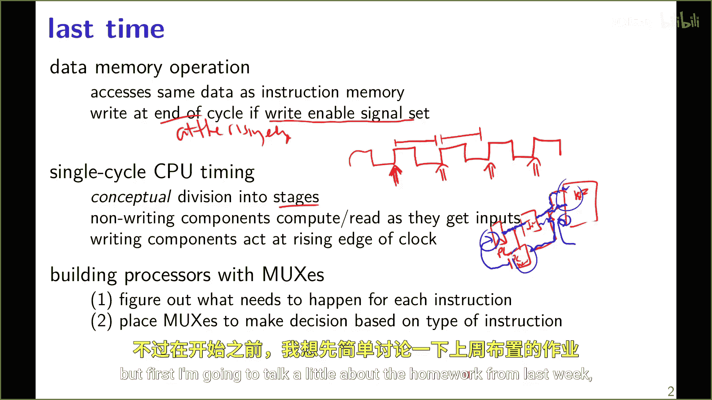
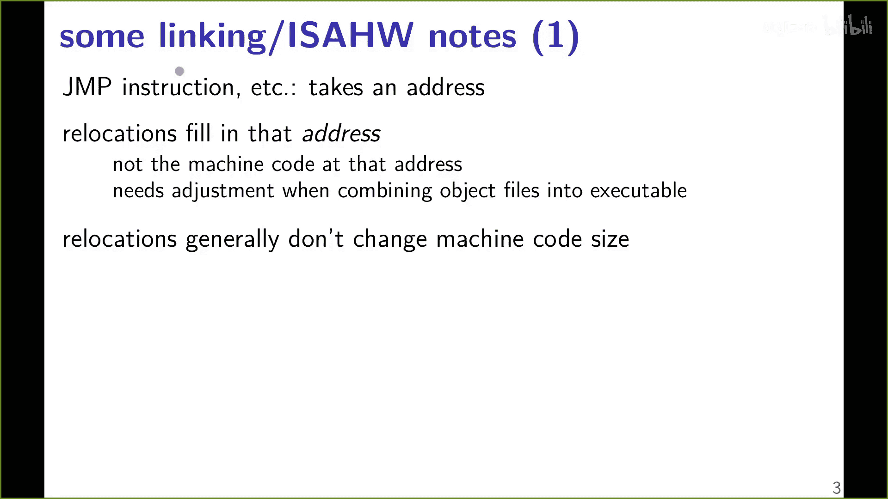
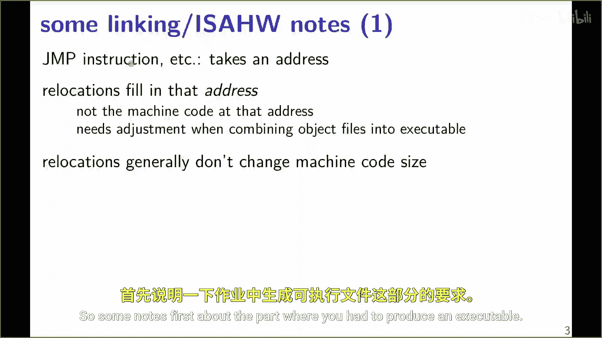
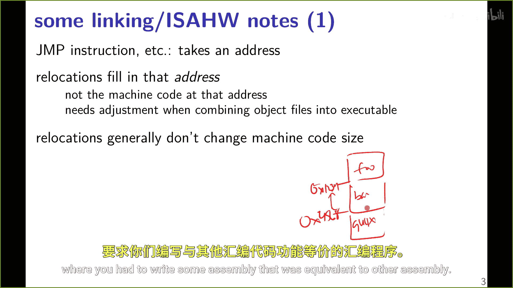
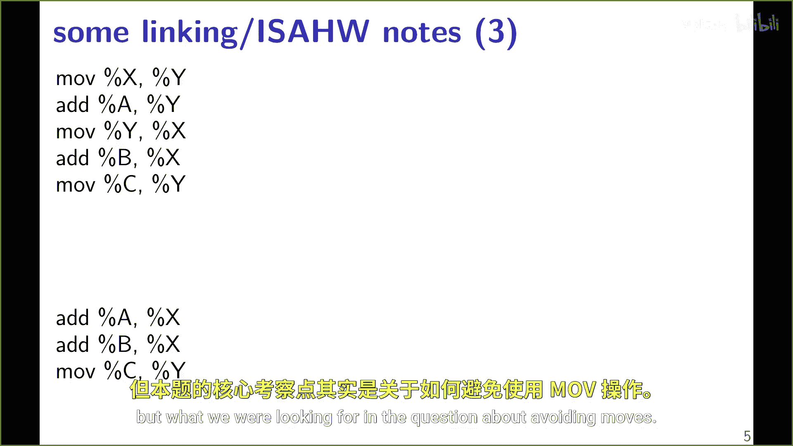

# 弗吉尼亚大学【中英⚡计算机架构｜CS3330 2020 Computer Architecture】 p11 P11 SEQ part 4 - Pipelining 0 -BV1cKeGzqEuJ_p11-

Good afternoon。So last time we finished up talking about the components we're going to use to implement our single cycle processor。

 talking about this data memory。Mention that the data memory envisioned by our textbook is actually another way to access the same memory as the instruction memory when we talk about caches will make a little more sense of。

 you know， how can that actually be and what。T of component does the data memory really represent？

Unlike our instruction memory， our data memory had the ability to write values。

And we needed some way of controlling when that happened， so we had a write enable signal。

 so unlike our register file where we had a special value to indicate。

This is not a real place to write。 We don't reserve an address as a special。

 This is not a real address to write to。 We just have a separate signal， instead。

And like our register file， our PC register。And。every component we've seen that can write things。

 the right happens at the end of the cycle that is at the rising edge of the clock。And generally。

 our single cycle CPU， we have a single clock signal， which we think of as oscillating like this。

And we have its rising edges。And that's where。Rightites happen and when we write to the PC register。

 we change what instruction we're on， so we do our actual computation for the instructions in between these rising edges。

And when we have components like。Yeah， say we have。well。

 our register file gets fed from our instruction memory， which gets fed from our PC。

And when our PC changes。Because of that rising edge of the clock。You know that。

Proagates to the instruction memory。 The instruction memory after some amount of time。

 figures out what values。Okay， send out that goes to the register file。

 and it also goes to other places。 remember remember， we have our。Sorcuit to increment the PC。

And that's going to receive those values at the same time because it's how it's physically hooked up。

 and so we would expect that our register file and our PC increment might happen at the same time。

 there's nothing that requires them to happen in any particular order。

And this is why I said when our textbook divided our processor into stages， at this point。

 these are conceptual stages because what really determines what happens is。

For components that write， this clock signal says when to take the value that it know may have had for a while sitting on。

You know， one of these inputs。This' one for the register file and store it。

That's the clock signal says when they do those rights。 and for other。Computations or reads。

 it all depends on when it gets the value as input。 Sometime after that。

 it's going to produce the answer。Yeah， you know， there's just some delay because physically we can't have those components act instantaneously。

そ。After we know about how all our components work， we talked about a strategy for building up。

Our processors and so our basic idea is that we have a particular way we want the components connected in order to execute each type of instruction。

And thered be some conflicts for different instructions。

 like when we were looking at how to implement all the move instructions， well。

 you know all the move instructions when it's write to a register。

But it sometimes varied which register they wanted to write to。

 so we added the Mus to decide for the instructions that went to write to RA to send RA to the register file for the instructions that went to write for RB。

 to send R B to the register file and similarly， we had a decision to make about what value was sent to the register file。

 so we had a mu to decide between the different values we might choose depending on the kind of instruction。

And this is going to be our general strategy。And thinking of our textbook stages could be helpful for this because what we can do is we can say。

 well， here is the part of the instructions that has to happen in each stage。

 let's just write down all the instructions we have to worry about and what needs to happen。

 like what registers， does each instruction need to read， we can just enumerate them。

We'll look at an example of that when we start out today。So before I move on to today's topics。

 questions about these things we covered last time。Okay。

So I'm going to go back to looking at what happens in each of the stages our textbook talks about。

 but first I'm going to talk a little about the homework from last week， the linking ISA homework。

 which started grading it， should have it done a couple weeks hopefully sooner。

So some notes first about the part where you had to produce an next cutable。

Um so。When we think about the linking process， what we're doing is we're filling in things like jump and call instructions。

 which take an address。 There's some address of something that's somewhere else in the executable。

 but when we made the object file， we didn't know where that is。

 and the relocation is going to fill in the address because that's what's in the instruction。

 The instruction doesn't contain data from elsewhere， it's just a pointer to that data。

And I saw a surprising number of answers which filled in what was at that address and well we need what's at that address to be in the executable。

 but we're not going to put it in the middle of say a function call。

 the function call is going to say I want to call the function that's over here。

 we're not going to embed the code to the function there。啊。

Another thing is that some people wanted to adjust the machine code to change the size of things as a part of this was probably not realizing。

 well， and at YD6 or you know places where we need to fit in addresses or8 bytes， but in general。

 when we're linking we're not going to change the machine code size we could hypothetically have this happen。

 but this would really complicate the linking process。Because。

What the linker typically does is we say， okay， here are all the things that we need to make up the executable。

We have a few bar and quas or input files， for example。

 we're going to lay them out in the executable。 I know that this is going to be at address 1，2，3。

4 and this is going to be an address 456，8 and I'm going to figure this out based on the size of bar。

 but if the size of bar changes depending on how we fill in the relocations。

 this gets really annoying and tricky。So generally the linker won't change the machine code size。

 and it'll be the responsibility of the assembler to provide the right size placeholder by putting in the right instruction sort of template。

For the linker to fill。That's not about the linking part。

So we've had two exercises on the homework where you had to write some assembly that was equivalent to other assembly。

In one of them， we asked for a version of this instruction with simpler addressing and this instruction。

Computes this address， so we take RX out RBX times8 and add the constant X 1，2，3，4。

And then we access memory there。😡，And。I don't know。 Maybe did I phrase the question wrong。

 A lot of people never accessed memory。 They computed the address correctly。

 but then did nothing with it。 besides， but like put the address in R Cx。

But this doesn't just compute this address， it goes to memory that address and retrieves a value there。

Another thing that a lot of people did is that they。Access memory at some address related to this。

 And then did some of these operations。 So like they would access memory at， you know。

 this address and add。One， two， three， four， hex two， what they got for memory。That。

All of this computation is to compute the address you know。

And there's not no computation after the memory axis。And our。

Last piece of sort of assembly translation。There were a lot of ways to do because I was unintentionally。

 you know， didn't give restrictions I probably should have given like not allowing people to use LEA。

 but what we were looking for in the question about avoid。

