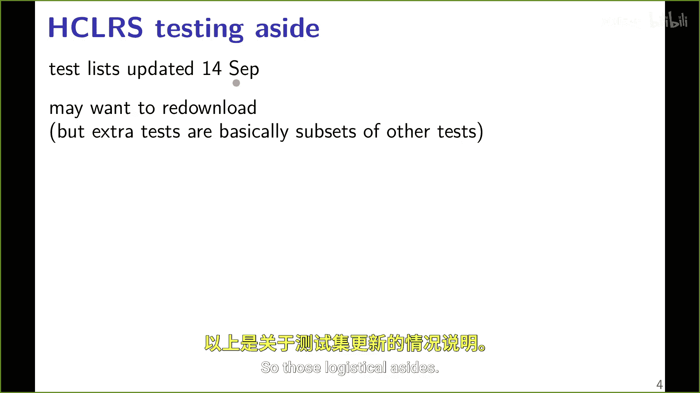
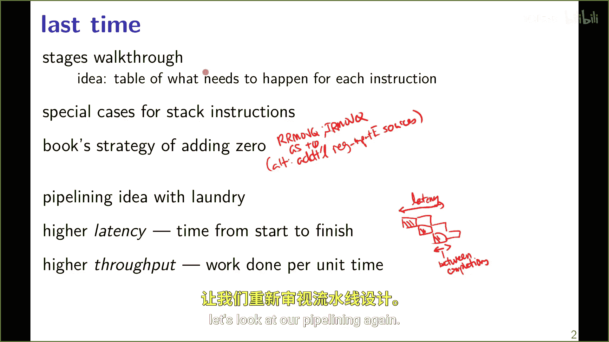
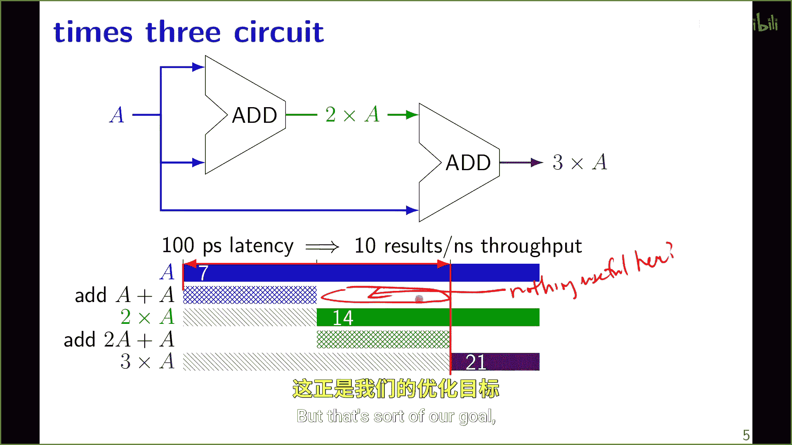
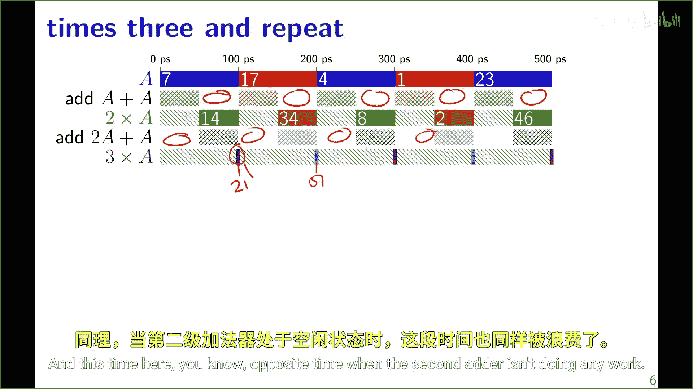
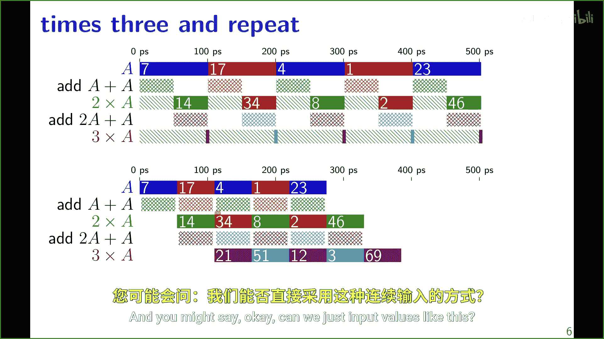

# 弗吉尼亚大学【中英⚡计算机架构｜CS3330 2020 Computer Architecture】 p12 P12 Pipelining 1 -BV1cKeGzqEuJ_p12-

Good afternoon。 So last time we looked at the stages that our textbook divided up our processor into and looked at how we can kind of use that to help build our processor like you're going to have to do in the next P assignment next。

 the next assignment next homework and you did。For some specific cases in me。

Bt lab and mention that well， you could just look at a particular stage， you know， for example。

 the code means we're just thinking about what registers do we read。

 you can look at your list of instructions and kind of make a table and say， okay。

 at this instruction， what registers do I need to read and you can use this to figure out what you should do for that instruction and it's relatively straightforward to go from the table to a case expression for each column in your table。

In H。As we were doing this。Comment theme was that all these stack instructions。

 push pop call return were kind of annoying。 And， you know。

 maybe it wasn't so nice that we have them in our instruction set。

 like they're convenient in assembly， but。They actually make minor implementation a lot more complicated。

We also saw that the book did this thing where they decided that they would have the ALU add zero to avoid having additional muxes。

Mux inputs， you don't have to do that， but mention that weird strategy that book use。

After we finished looking at our single cycle processor。

 we talked about this idea of pipelining that we're going to take these stages。

 which previously were just this conceptual thing， but weren't actually what determined what happened when in our processor and we were going to make them the actual steps and we were going to do this because we're going to get some of this huge efficiency gain。

By doing parts of multiple instructions at once and the observation that we started with。

 we use this analogy of laundry for doing laundry， if I have one washer。

That doesn't mean I can only do one load of laundry at a time。

 I can only have one load of laundry at a time in the washer。

 but I can do multiple loads of laundry at a time because the washer isn't the only thing I need to do a load of laundry。

And the same principles can apply to our instructions that。I only have one instruction memory。

 but I can do the other parts of the instruction。嗯。

At some time when I'm using the instruction memory for a later instruction。

And that's this idea of pipelining that we'd move on to the next stage of our first instruction。

 and then the second instruction can do the first stage。

 and we can keep repeating this and have multiple instructions active at onces。

And we mentioned that when we do this， we're going to find out that we increase our latency。

 the time from when we start our first step to to finish the last step of a particular instruction is going to be higher。

But this is going to be fine because we're going to also increase our throughput。

 the amount of work we get done per unit of time， because if we look at once things get started。

 how much work are we getting done， we look， well， how often do we complete an instruction we're going to find out well。

 we complete an instruction。And much quick more quickly， basically， however。

 long the slowest thing takes， every time that finishes， we're going to complete a new instruction。

And that's going to be better that we started out with。Yeah。As far as the rate of completion。

Because when we started out without doing this pipelining idea。

 we have to wait for all the steps to complete here we just have to wait for the longest step to complete。

Questions about the ideas we covered last time。Okay， so a couple brief logistical notes。

 so the homework that's due next week is to implement the rest of the single cycle processor we hopefully have covered enough that you can do that This includes push pop call and return when the assignment was marked tentative I had copied a version from a semester where we didn't have you do these instructions and how you do an additional problem set。

But we want you to do the whole processor all the Y860。Om。Also on the 14th of September。

 before most of you， but not all of you downloaded HL orRS， the list of tests was updated。

 I don't think this affects your correctness testing。

 because if the list of tests was updated to add some tests that are basically subsets of other tests where the idea is that if you fail this complicated tests。

 we have some simpler tests that you might be easier to debug and look at the same issue。

 but because we have coverage of the same functionality， if you don't make the update。

 I don't think you're going to be surprised about how you're doing on the homeworks or anything like that。

 but just mentioning this because I know some people have the preseptember 14th version。

And the test lists are different for。Some of are for the upcoming homework。

So those logistical assigns。

Let's look at our pipelining again， and we're going to start applying this to a circuit。

 and we're going to have to do some extra stuff to apply it to a circuit。

 and I'm going to use this toy circuit， not like our full processor circuit。 We'll get to that。

But have this toy circuit， which multiplies with value times three in a rather silly way。

What we do is we add our input A to itself to get two times A。

 then add two times A to itself to get three times a。And。

The motivation for why we might want to do pipeing here is if we draw sort of a timeline of what happens here。

 let's say。你了。That this ad takes around 50 picoseconds and by it takes， I mean。

 that's the time from when you put it in a new value until when you can assume that the result two times a in this case is stable on this output。

So let's say that's 50 picoseconds。 so once we start inputting 7， the output starts changing。

 but it's not usable yet because it's。Yeah not stable yet， but after 50 pcoseconds。

 it's stable and ready and we have 14。And our second outer works the same way。

So once we have the value 14 on this wire， along with the seven on the other wire， it。

Output starts changing， taking that 14 into account， and about 50 peak or seconds later。

 we can count on it being stable and everything's okay。

And if we think of where conceptually or computation is happening。

 this first adder is doing computation for the first 50 picoseconds。

 and the second adder is doing computation for the second 50 pico。

So overall we get 100 picoconds of latency that's the time for when we input 7 to we get a result of 21。

 so 10 results per nanosecond is our throughput。But。

It looks like if we wanted to do lot of multiplying by three。That。

It would be really nice to use this adder during。This time here。And。We can't do that because， well。

This outer needs to stay the same so the second outer can do its work。

But that's sort of our goals that we want to use this time and we want to start doing a second ad。

So if we have a whole bunch of values to multiply times three with the circuit I just showed you。

 I can input7 and get my result of 21， 100 picoseds later。

And I have to wait for that the whole thing to finish before I can input a new number。

 say 17 to get my result of 51。😡，And so I'm getting one value every 100 picoseconds。

 there's also a little bit of a question of wait a moment。

 is this really enough time to use the result and we'll also solve that later。

But what I'd really like to do is I'd like to avoid this kind of dead time when this first adder is not doing any work and this time here。

You know， opposite time when the second adder isn't doing any work。

And have a timeline more like this where I input7， the first adder adds 7 to 7 to get 14。

 and then the second adder adds 14 to7 to get 21， but at the same time。

 rather than having the first adder sit idle， we have the first adder start with our next thing we want to multiply times 3 and add 17 to 17。

😡，To get。34。And we just keep doing that and the idea is that we should get values you know。

 basically twice as fast。And。

