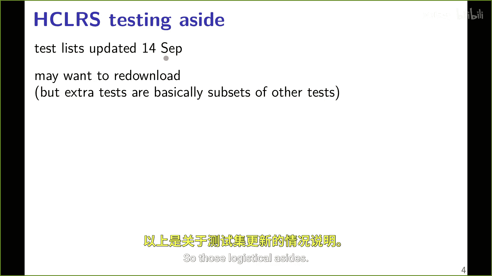
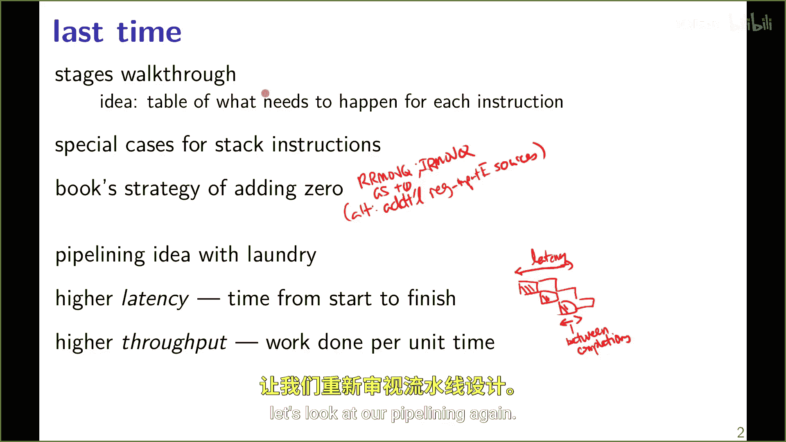
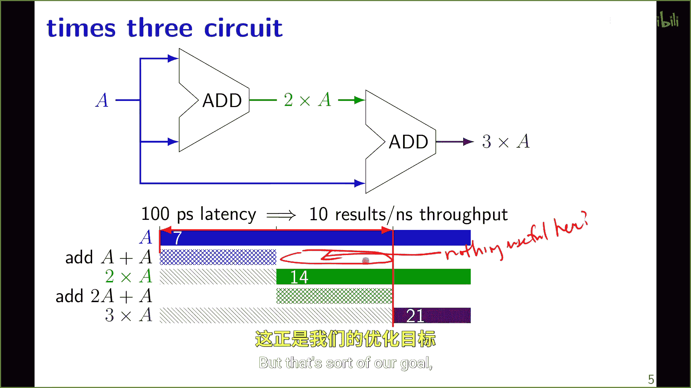
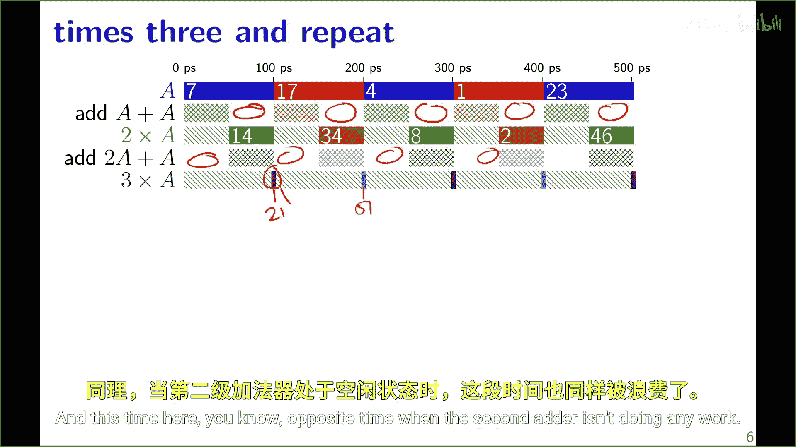
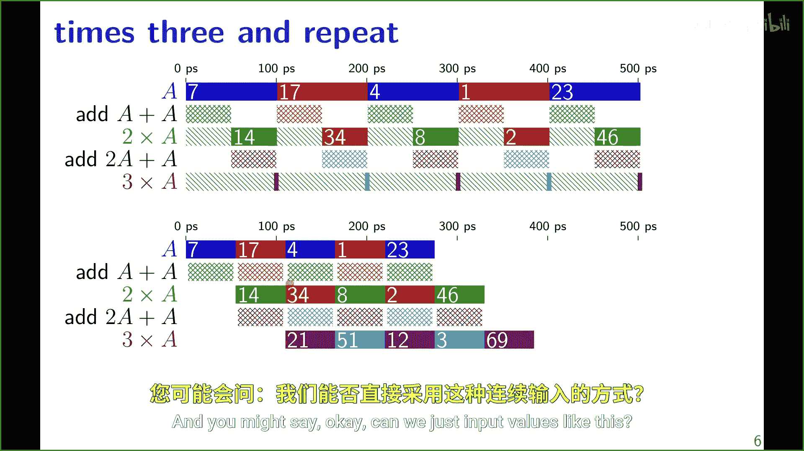

# 计算机架构：第12讲：流水线技术（第一部分）🚀

在本节课中，我们将学习流水线技术的基本概念，了解如何通过将处理器工作划分为多个阶段并同时执行不同指令的不同阶段，来提升处理器的效率。我们将从一个简单的电路示例开始，逐步理解流水线的原理和优势。

---

上一节我们介绍了将处理器划分为不同阶段的概念，并讨论了如何利用这些阶段来构建处理器，就像你们在下一个编程作业中需要做的那样。我们提到，对于某些特定情况，例如在代码中，我们可以只关注某个阶段，比如需要读取哪些寄存器，并通过制作表格来简化设计过程。从表格到为每一列编写case表达式是相对直接的。

在讨论过程中，我们注意到所有堆栈指令（如push、pop、call、return）在实现上有些繁琐。虽然在汇编语言中很方便，但它们确实让处理器的具体实现变得更加复杂。

我们还看到教科书采用了一种策略：让ALU加零，以避免增加额外的多路选择器输入。你们不一定需要这样做，但这是一种书中提到的特殊策略。

在完成对单周期处理器的探讨后，我们引入了流水线的概念。我们将把这些原本只是概念性的阶段，转变为处理器中实际执行的步骤。这样做是为了获得巨大的效率提升。

通过同时执行多条指令的不同部分，我们可以提高吞吐量。我们用一个洗衣的类比来理解：如果我只有一台洗衣机，并不意味着一次只能洗一批衣服。虽然洗衣机一次只能处理一批，但我可以同时进行其他步骤（如烘干、折叠），从而在同一时间段内处理多批衣物。

同样的原理适用于我们的指令。虽然只有一个指令存储器，但我可以在使用指令存储器处理后续指令的同时，执行其他指令的其他部分。这就是流水线的核心思想：第一条指令进入下一阶段时，第二条指令就可以开始它的第一阶段。我们可以不断重复这个过程，让多条指令同时处于活动状态。

我们提到，采用流水线会增加延迟，即从开始处理一条指令到完成其最后一步所需的时间会变长。但这没关系，因为我们会同时提高吞吐量，即单位时间内完成的工作量。一旦流水线启动，我们完成指令的速度将大大提高，基本上每隔最慢阶段所需的时间，就能完成一条新指令。这比我们最初的非流水线设计要好得多。

关于上次课的内容有什么问题吗？

---

接下来是一些简要的课程安排说明。下周截止的作业是实现单周期处理器的剩余部分。希望我们目前讲解的内容足以让你们完成它，这包括实现push、pop、call和return指令。另外，在9月14日之前，测试列表进行了更新。这次更新主要是增加了一些更简单的测试用例，以便于调试。虽然这不会影响你们作业的正确性测试，但知道一下比较好。



---



现在让我们再次审视流水线，并开始将其应用到一个电路中。我们将使用一个简单的玩具电路作为例子，而不是完整的处理器电路，之后再扩展到更复杂的情况。

考虑以下这个以相当繁琐的方式将输入值乘以3的电路：
```
输入 A
    ↓
加法器1: A + A = 2A
    ↓
加法器2: 2A + A = 3A
    ↓
输出 (3A)
```

我们想要在此应用流水线的动机是，如果我们画出这里发生的时间线：假设每个加法器需要大约50皮秒才能产生稳定的输出。那么，从输入7开始，经过50皮秒，第一个加法器输出稳定的14；再经过50皮秒，第二个加法器输出稳定的21。总的延迟是100皮秒，吞吐量是每纳秒10个结果。

但是，如果我们想用这个电路进行大量乘以3的运算，问题就出现了。在第二个加法器工作的50皮秒期间，第一个加法器是空闲的。我们希望能利用这段时间。

如果我们有一系列值要乘以3，使用刚才展示的电路，我输入7，100皮秒后得到结果21。然后我必须等待整个过程完成，才能输入下一个数字（比如17）来得到51。这样，我每100皮秒才能得到一个值。



我真正想做的是避免第一个加法器在这段空闲时间不工作，以及第二个加法器在另一段时间不工作的情况。

理想的时间线应该是这样的：我输入7，第一个加法器将7加7得到14；然后第二个加法器将14加7得到21。但同时，不让第一个加法器闲置，而是让它开始处理我们下一个想乘以3的数，将17加17得到34。我们持续这样做，理论上我们应该能以大约两倍的速度获得结果。



---



**本节课总结**
在本节课中，我们一起学习了流水线技术的基本思想。我们了解到，通过将计算过程划分为多个阶段并让这些阶段重叠执行，可以显著提高系统的吞吐量，尽管单条指令的延迟可能会增加。我们用一个简单的乘法电路示例，形象地展示了流水线如何消除硬件空闲时间，从而提升整体效率。下一节，我们将探讨如何将这一概念具体应用到处理器设计中。