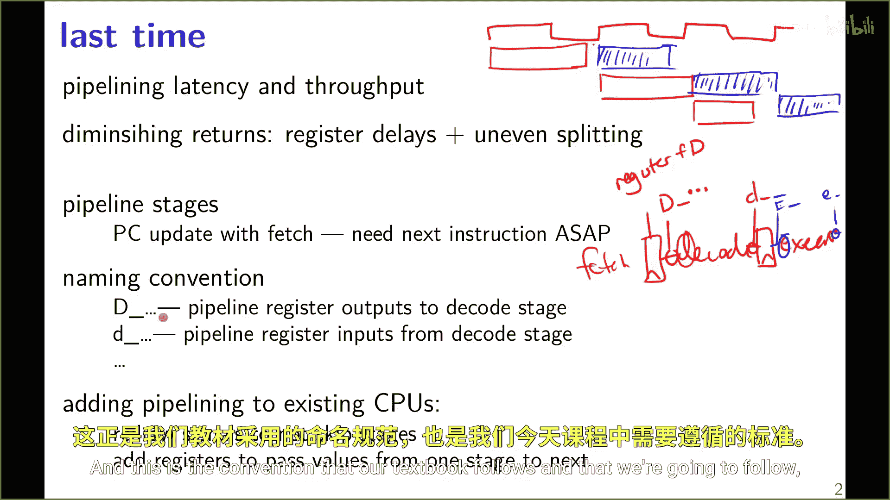
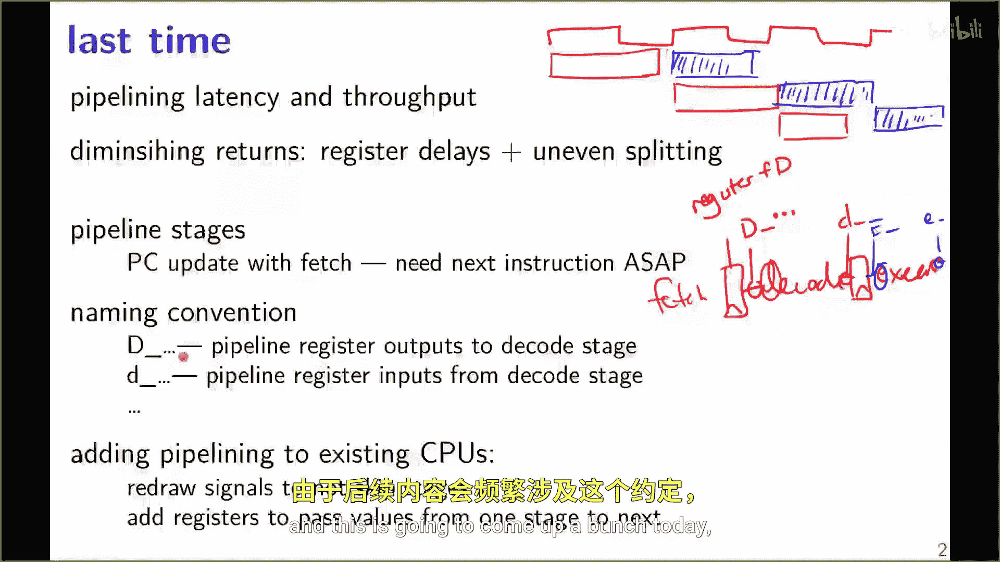
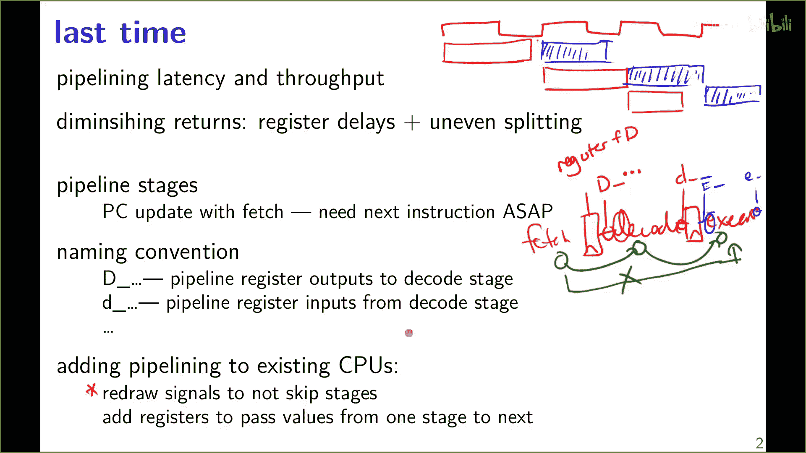
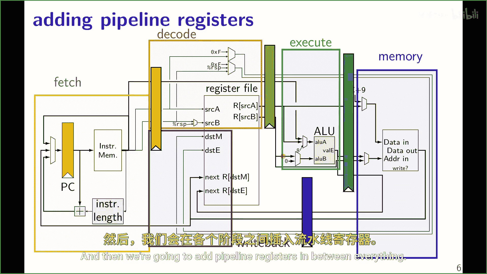
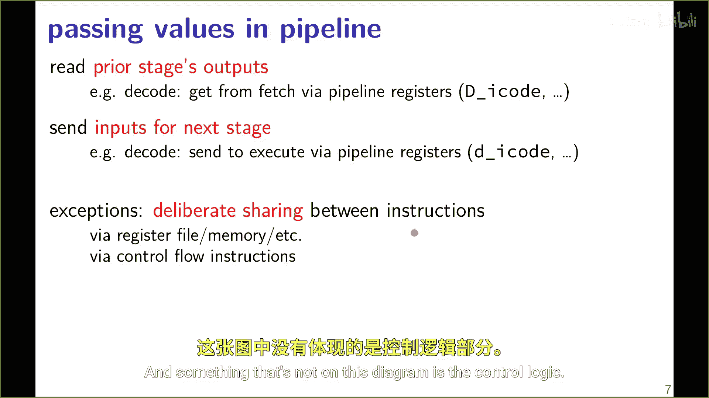
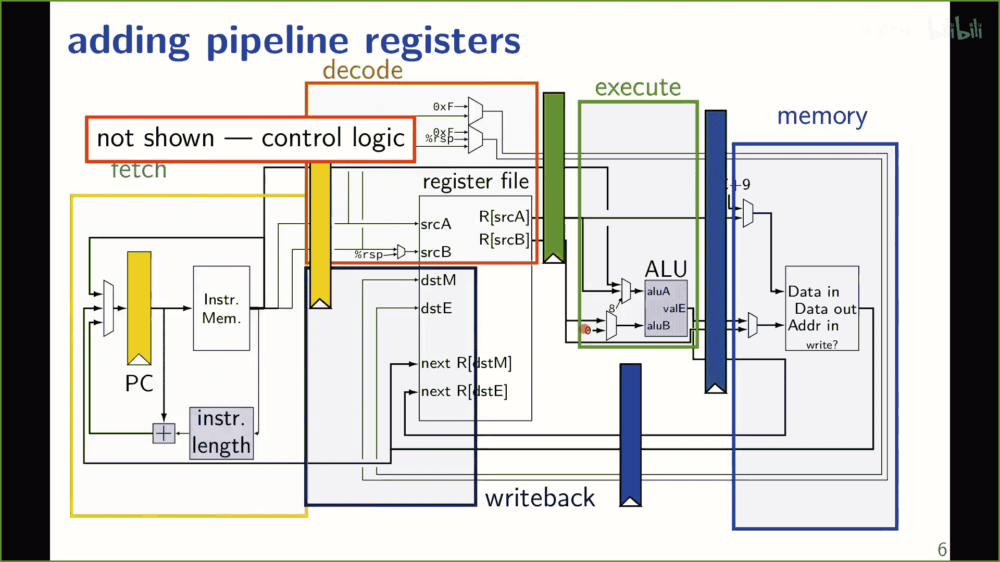
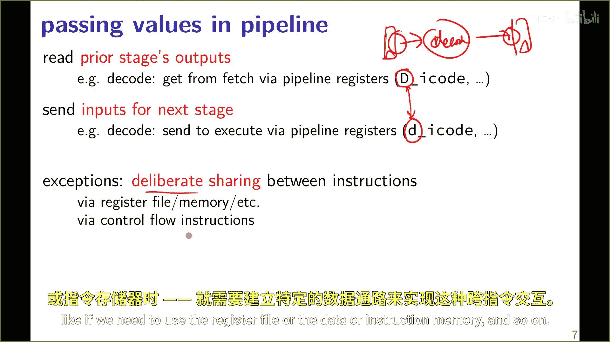

# 弗吉尼亚大学【中英⚡计算机架构｜CS3330 2020 Computer Architecture】 p13 P13 Pipelining 2 -BV1cKeGzqEuJ_p13-

Good afternoon。So last time we talked about。Making pipeline circuits and how adding pipeline stages。

 putting up our circuits into these stages。It changed latency and throughput。

 She mentioned that once we have a pipeline circuit， we'd have。A well。

 previously in our single cycle designs we saw for processors happened in one cycle be split across multiple clock cycles with。

One stage of an instruction going。Happening in each cycle。

 So the instruction goes from the first stage， the second stage to the third stage。

 and once an instruction finishes its first stage， we can put another instruction in that stage。 So。

 for example， if our first stage uses the instruction memory。

 we can use the instruction memory for our first instruction， then our second and so on。

And we mentioned that when we did this， we had two concerns which made this not actually just improve our performance。

So one issue was we had register delays that after we， for example， used our instruction memory。

 we needed to put those values somewhere so they could be used by the next stage and we pass those values in through registers。

And these registers aren't free， they take some amount of time to physically store a value。So。

 that meant that。If we divided something that to one stage or single cycle design to two。

 we end up not having each stage take half the time。

 we'd have some extra time because of the register delays， even if the actual logic。

 the actual what we consider quote unquote real work。Was split evenly。

 We also have this issue that we often couldn't split up the work evenly that。

The nature of whatever computation or storage we're using would not let us take something which previously took 100 picoseconds and divide it up into say 255 pico second pieces。

 we'd have to make some other sort of compromise， and this means that we'd have some stages be faster than the others。

 but we could only set one cycle time。The ratio between the rising edges of the clock needs to be the same for everyone。

In the entire circuit。Because our first stage， for example。

 can't move on until the second stage is free， our last stage can't do work until it gets something we're in the first stage。

 so we all need to compromise on the time of the slowest stage。

So and even splitting would give us a further degradation over sort of I ideal of you know。

 dividing things into three pipeline stages， meaning that we get three times as much work done。

So that would be a decrease in our throughput and an increase in our latency you know。

 so because when we divided these things into three pieces。

 we have this extra time from our register delays and from waiting for other stages to finish。

That would increase the actual time from when instruction started to when it finished。

So after we talked about the trade offs in pipelining。

 we looked at applying pipelining to our actuals processor design。

And one thing we did is we took the stages our textbook started with and we adjusted them a little bit。

 our textbook said that the PC update was the last step。

 and that made sense if you think of running the instructions by hand that well after you figure out what the instruction supposed to do。

 you figure out what instruction do we run next。But that doesn't actually work out so well。

If we think of pipeline stages， because after we finish the first stage of an instruction。

 we want to start the next stage of the first stage of the next instruction at the same time as we start the next stage of the first instruction。

So to accommodate this， we merge PC update with fetchch that we want to as soon as possible compute the next instruction to run。

And we mentioned that we had a bit of a problem here that we're going to resolve not today。

 but next time of what if we can't figure out what that next instruction is？😡，mYou know， for example。

 what if we have a return where， you know， the information about where that next instruction is。

 we don't have effect。We'll talk about that。Next time。Now。

Our main idea once we figured out what our stages would be， was that wed lay out our processor。

And insert pipeline registers in between。Each of the stages。

And we had this naming convention that within a stage， we'd have， say our fetch。And a code and say。

Execute， and either would be registers between these stages。 and we'd say that we would name。第一。

Outputs that go into a stage with a upper case letter following what HLRS supports。

 because we declare this in HLRS with register F。第一。

And these outputs would be named with an uppercase D and the inputs on the other side would be named with a lowercase D for the decocode stage。

 and we do something similar for， for example， for execute。

 we'd have the outputs be named with an uppercase C and the inputs that will go into the memory stage named with the lowercase D。

And this is the convention that our textbook follows and that we're going to follow。

 and this is going to come up a bunch today， which is why I want to make sure we're clear on how this works。

So。Uppercase D is output from these pipeline registers into the D stage D4 to code in this case and。

Lowercase D is inputs from the Dacode stage to the next stage， which would normally be executed。

It's then in naming convention we're going to use。And following that naming convention。

 our basic strategy was once we divided up into stages。

 we did some extra work that we need to redraw some signals to not skip stages。

 We always want values to go flow from fetch into the code into execute one step at a time。

 We went all the instructions value together。 We can't have。Some values skip a stage。

Because then we're kind of mixing values。From two different instructions together。

 we don't want to do that unless we know why we're doing it， we don't want to just randomly do that。

And adding these registers。So we're going to review what this looks like for a pipeline processor。

Talk about how we are going， you know， some rules we're going to follow using these conventions to write code for stages。

 and then look at some cases where。This steps about in pipeline and give us the wrong answer。

 and we're going to talk about why that is and how we're going to fix it。😡。

But before I move on to that， any questions about these topics we covered last time？Okay。

So when we finished up last time， we said that we were going to take our。

Single cycle processor， figure out where the stages were。 We're going to fix these cases where。

We're sending， you know some values from fetch to the code， which is what we want。

 but some values from fetch to write back， which is what we don't want and something similar for execute to memory versus execute to write back by redrawing these wires。

 and then we're going to add pipeline registers in between everything。

And something that's not on this diagram is the control logic。

 and we're going to need to be careful about that。

And I want you to think about the control logic when I talk about these rules。

 that we're going to want to make sure that when we're writing the code for a particular station or pipeline。

 I think this is where we finished up last time that our code is going to for one stage。

 so we're going to have our decode。

Here， and we're， for the most part， going to read the outputs of the prior stage from the pipeline registers and compute inputs for the next stage。

And。😡，Based on our naming convention， if we're in the code。

 we should be using things that start with the letter D and something similar is going to be true for execute and the cases where we don't do that are cases where I would say we're sharing values between instructions。

 So for example， thecode is going to read from the register file。

And we're doing that because we want to get values from another instruction。

But if you aren't trying to get values from another instruction。

 you can so consider it bad if you have something that doesn't start with the letter of the stage。

Questions on。This idea yeah。Our stages code， yeah。We're dealing with values from art。

 the outputs of the prior stage， inputpost to the next stage。

 except for cases where we're trying to set things up so we can interact with other instructions like if we need to use the register file or the data or instruction memory。

