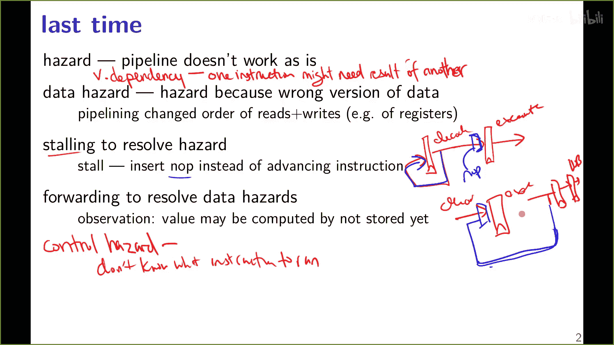
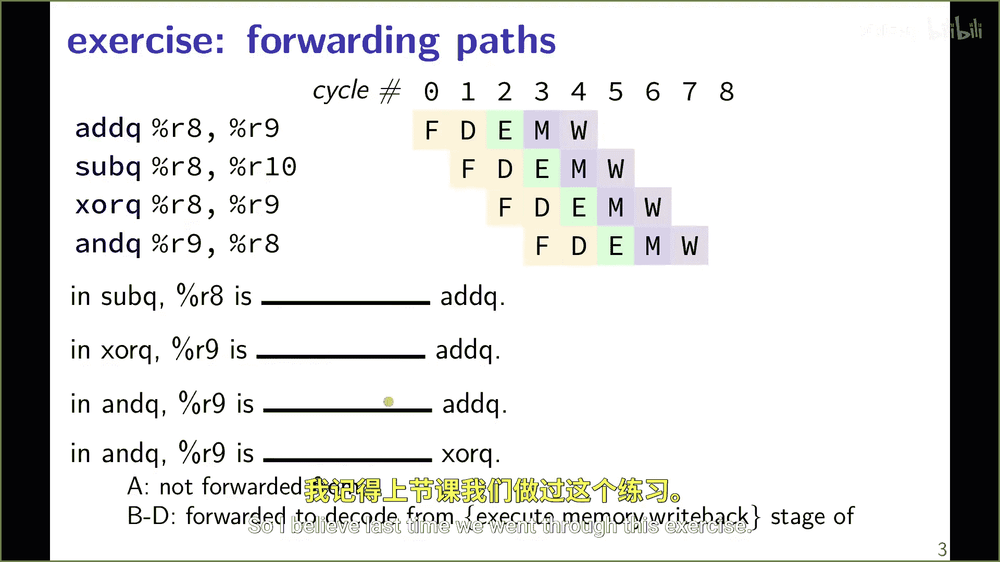
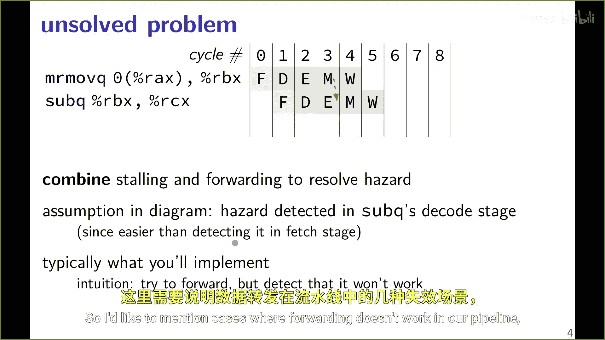
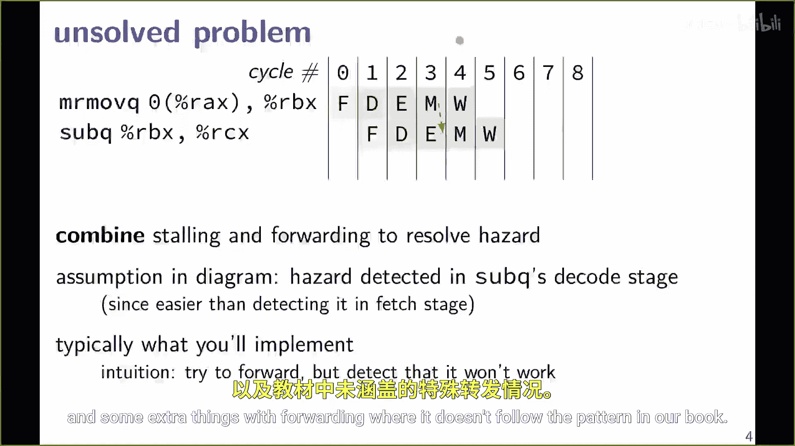
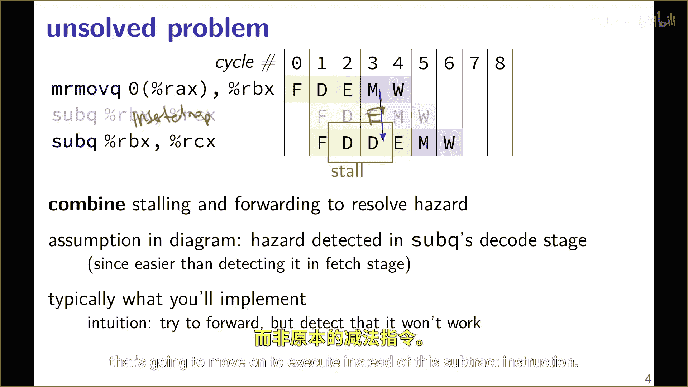

# 弗吉尼亚大学【中英⚡计算机架构｜CS3330 2020 Computer Architecture】 p14 P14 Pipelining 3 -BV1cKeGzqEuJ_p14-

Good afternoon。So last time we talked about the idea of hazards that we'd have our pipeline processor。

And after we added pipelining， it didn't work correctly。

 it did something different than what we'd expect in the single cycle processor we wouldn't be able to get the right answer。

And we started off with this idea of data hazards， where the pipeline didn't work correctly because it got the wrong version of some data。

And we can think of this as being due to a dependency between instructions where it happened to be the case that。

The pipeline changed the order of reads and writes of a particular piece of data。

 so we ended up reading an old version of some data。And。

We mentioned that when we have to do something about this hazard to make our pipeline processor useful。

And our simplest idea， which happens to always work is to use stalling that we insert anob instead of advancing the instruction and we mentioned。

 so basically we usually we read our instruction send it through a register to the next stage。

 for example， from tocode to execute。And the simplest idea was that weed。Or from。We'd say， okay。

 we can't do that。 We don't have the numbers we need yet， so we're going to you know。

 keep it there for a while that rather than sending instructions on。

We're going to end up keeping the current instruction I probably should do。

Current instruction as what we'll do next cycle and sending in a。Anob down the pipeline。

 so we'd insert this knob instead of advancing the instruction。

 keep the current instruction where it is。And we'll talk more about what the logic for this looks like later today。

啊。And the idea of this is that by doing this， we end up with。Arm。A processor that works correctly。

 but a bit slower， but only when they're hazards， so if they're no hazards。

 we're still getting all the benefits of pipeline。Except that maybe we have this extra mus here and maybe one here that's going to make things very slightly slower。

 but it's basically as fast when there are no hazards and when they're all hazards。

 we do pay this big cost in that we're not actually finishing an instruction every cycle anymore。

We mentioned for data hazards we had a better way。To solve hazards， a lot of the time。

 but not always， which is that， well， sometimes a value wasn't computed， yet was computed already。

I should say， but not stored， so that often we'd have computed the value。

 but we have several stages to go through before it actually ends up， say in our register file。

And we could。Do something about this case by saying， well， if we have the value。

 we just need to get it to where we want it。 So we'd。

We have our normal path to get the value say from Decode to execute。And we have a。Mox。

 and we have the yo。And wed have a shortcut here， sort of a bypass to rather than waiting for。

A value that we computed to make it all the way to the right back stage。

We just get the value directly by adding an extra wire and a amongst to select that value。

And this works great as long as the value has already been computed。 And that's often the case。

 but not always the case。 So this is a solution which， you know， when it works， it's great。

 when it doesn't work， it's。Not so great。And we finished up last time after reviewing some cases by mentioning this idea of control hazards。

 which we'll talk a bit more about today， but first we're going to review some forwarding topics and with control hazards。

 this was another type of hazard where rather than the issue being getting the wrong type of data。

 this was the issue with control hazards is we don't know what instruction to run。

And this occurs for things like a conditional jump where we can't figure out where the jump is supposed to go until we know what the condition codes are。

 and we can't figure out the condition codes until an instruction finishes computing the condition codes。

 And that might not happen for a while after when。According to how the pipeline usually works。

 we're supposed to fetch them。And。The reason we mentioned stalling as our first solution to hazards is that stalling works for our data hazards and it works for our control hazards。

But later today， we're going to talk about a better solution for control hazards than sting。

So before I move on， and we talk a little， do a little review of some。Forwarding relatedlay topics。

Any questions about things we covered last time？Okay。

So I believe last time we went through this exercise。

 We'll go through a few more exercises like this。 So I'd like to mention， you know。

 cases where forwarding it doesn't work in our pipeline and some extra things with forwarding where it doesn't follow the pattern in a book。

 So first， a case where it doesn't work。 And we'll call this the load use hazard。

 This is where our textbook calls it。

And。This is a case where we can' do forwarding。 So I've drawn here what forwarding we want to do。

 And the way reason I've drawn it like this is。That。We can say that we want to get RBX。

From here to subcu。And if we think about when we compute RBX。

 it's going to be at the end of the memory stage。 We're going to have our data memory。

 and it's going to be sending its value into a pipeline register。

And this is where the MR move Q is running when that happens。 And before that we have our ALU。

Where the subq is running in its execute stage。And we'd ideally like to。Do this。Pass。

But we can't do that because， you know， we could add that wire。

 but then we're making our cycle time long enough to handle this critical path。 That's way。

 way too long。 and that kind of defeats the point of pipelineing right if we just connected everything directly if we can do that。

 then we're going to get to our single cycle processor or cycle time。

 which is not why I wanted to do pipelineing。 So this is not an acceptable forwarding path when we do forwarding。

 we don't want to be doing any extra work。After we forward a value。

Besides like selecting the value as the one to keep。

We don't want to do something like this where yeah， we could add that bypass。

 but now we've kind of defeated the point of having the execute and memory stage being separate。So。

Your question is， why will there be extra work？So the reason it's extra work。

 so the reason why this is not an acceptable forwarding path is that this green line here is our new critical path。

So now we need to be able to access the data memory and do an ALU operation in one cycle。😡。

Whereas previously we all need to do one of them， and if we're assuming we can access the data memory and do an AU operation in one cycle。

 then there's no reason why we'd had the executing memory stages be separate。

Stop answer your question。And generally， the rule of thumb when we do forwarding is that we basically went to forward right next to a pipeline register。

 so the only extra thing we're adding to the critical path is just the mugs to select the forwarded value。

😡，So that's going to be a general rule， even though you can build this processor where it's not acceptable because。

 we want to get our pipelining cycle times， not our single cycle piping lines。😡。

So this is the forwarding we can't do。 So what we're going to do instead is we're going to stall。

 and in this picture I'm saying that hypothetically we detect the hazard in the decode stage of the subqe and therefore we say。

 okay， we can't do this execute yet， so we're going to keep the instruction in decode。😡。

And then we're going to move on to execute。And this is our stall。

 The reason it's a stall is that this means that we're going to have an insertednob。

That's going to move on to。

