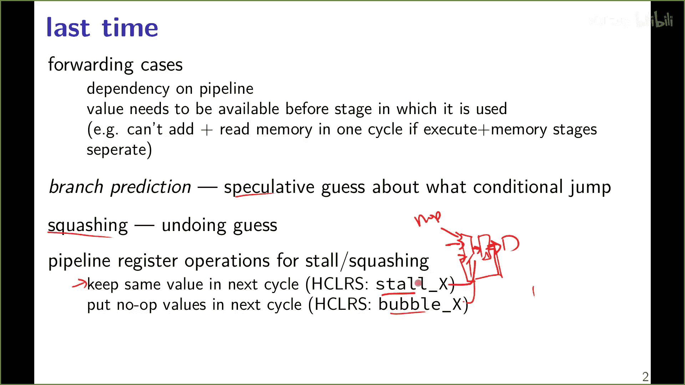
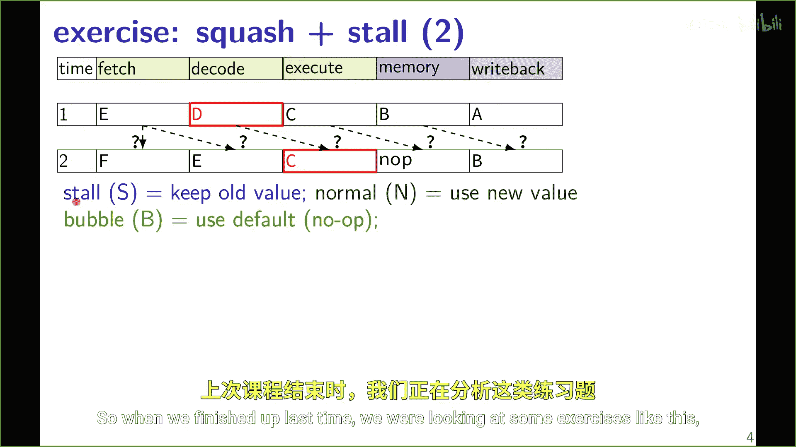
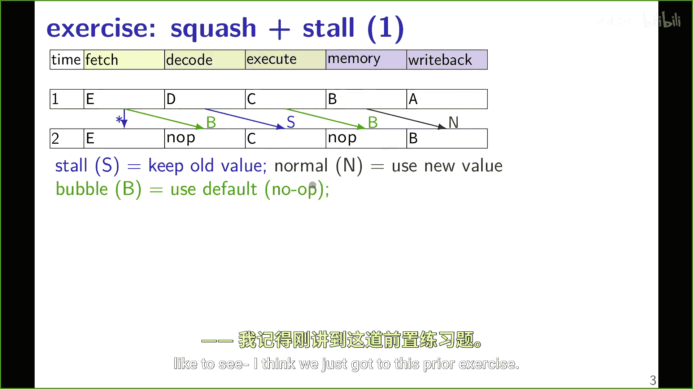
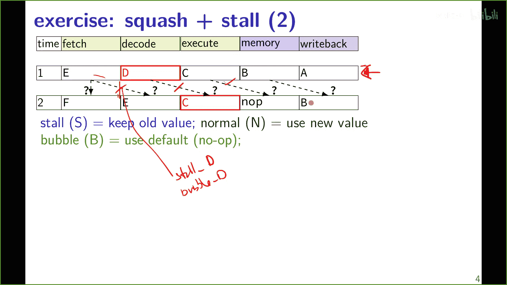
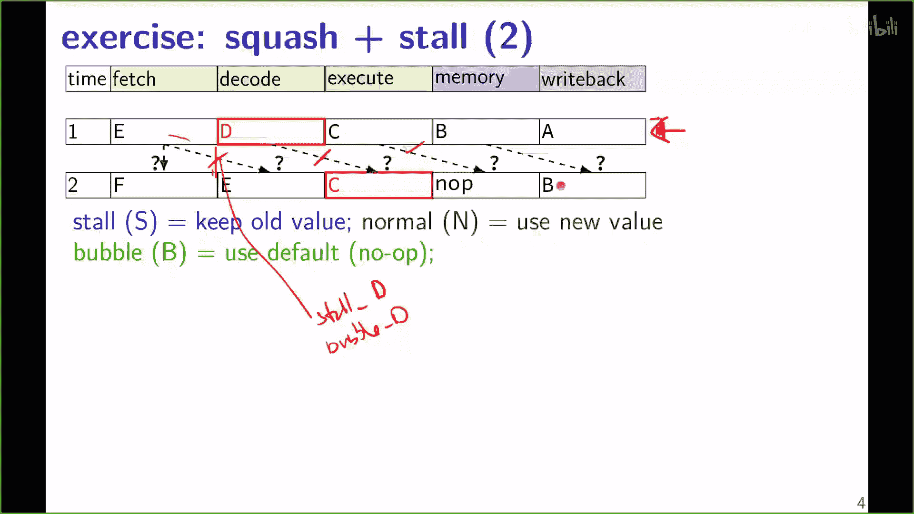
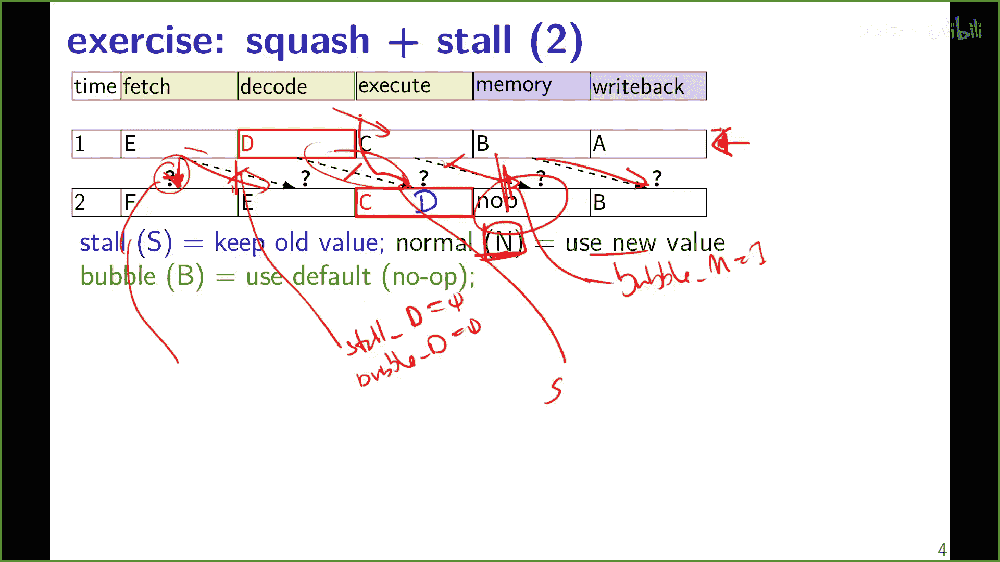

# 弗吉尼亚大学【中英⚡计算机架构｜CS3330 2020 Computer Architecture】 p15 P15 Pipelining 4 - Cache 1 -BV1cKeGzqEuJ_p15-

Good afternoon， so last time we finished up talking about forward looking at。How that would work。

We have this。Strategy when figuring out would happened that we'd look for where the dependency。

 the value that we needed was in the pipeline。And we try to get it from the instruction that was computing it。

And we had this rule that we needed the value to be。

Available in time that you know we can't do something like。

 say we're going to compute the value and then use it to read memory in one cycle。啊。

Because that would。Defeat the purpose of having a separate execute and memory stage。

 so we want to make sure it's computed。You know， before it's used。And after talking up forwarding。

 we looked at a different type of hazards。 We have these control hazards where。

We didn't know what instruction to fetch and the most obvious case which with a conditional jump。

 so with a conditional jump， we had something that computed some condition codes that with our pipeline processor could end up running after we would want to fetch the thing that would be based on those condition codes with our conditional jump。

And our solution was to speculate that we would guess about what the conditional jump would do and。

If that guess was right， well we just move on and we don't have to do anything special， it was wrong。

 we'd need to do what's called squashing and undoing that guess and going back to the right instruction。

We also started talking about， well， we knew about stalling。

 which sometimes we need to combine with forwarding and for our return hazard。

 you know return gets a value for memory， we don't have a good guess， we need to stall， you know。

 and for squashing， we need some way of implementing that。

And we talked about a tool that HCL RRS provides。Which implement two common things that are going to be part of the one installing and squashing。

 So one is that we need some way with our pipeline registers of keeping the same values。

Going out of some registers in the next cycle that if we have our register。

 say feeding the decode stage， we want the same instruction to be in the decocode of the next cycle。

 So we need some way for these registers to output the same value。

 we mentioned you could have a amongstux that selects。

The value currently being output as the input to do this， and HL orRS has this built in。

 and the control signal for this mux is this stall。A signal that we can set。

Another thing we wanted to do is that when we were holding back an instruction。For stalling。

 or when we made a guess about what instructions to run and that guess was wrong。

 we wanted some way of sending anob to the next cycle。

And that means we needed to have some way where we could override。

The values that would normally go into our pipeline register with aOP and this also needed a control signal。

 and HLS provided that with this bubble signal and it got the values that corresponded to a not based on our default values。

 which for our pipeline register are usually going to be the ones for a not because when our processor starts up。

 we want the stages that haven't fetched instructions yet to not be doing anything interested。

So questions about things we covered last time before I start。

Moving on to looking more about how do we actually implement stalling and squashing， you know。

 given that we have these signals， how does that apply to our actual cases where we need to manipulate these registers in our processor。

So when we finished up last time， we were looking at。Some exercises like this， like to。

See， I think we。Now， just got to this prior exercise。 just to review， let's do this。

Alternative version。And remember， what we're trying to figure out is whether the fetch tocode。

 tocode to execute， and so on registers are going to be told to stall so。Sally， this would be。

Or to bubble。Or neither。And。These signals would be set during time1 to control what would happen at time two and what we want to achieve is that we have initially instructions。

 E， D， C， B， and A our pipeline， we want to end up with instructions F。

 which is presumably the one after E E C， so instruction D goes away。ANo op。

 because we don't advance instruction C， we don't want two copies of it and B。

And we don't have a question about this case。Here， which is， you know， what the PC is doing。

 we just don't have don't asking me about that in the pool。

We're going to talk later today about what is thelijaic for actually updating RC looks like。😡。

Our textbook talks about using the stall signal for this， and we've done that， but。

We're going to have to look more about that， because we all seem to deal with things。

 What about when we mispredict where we should go from a branch and need to correct that How does that work。

 We're going to talk about that a little bit later today。I'll give another。25 seconds。So， so。

It seems like a vast majority of people have figured out。

This case here that if we want a not to go into the memory stage， then。During time1。

 we're going to set。Bubble M to one， that's how that's going to happen。And on the others。

 we seem to have some confusion about what does this stall operation mean？So let's think about here。

 so from fetch to the code， this is the Sta D and bubble D signals。

 so most people have figured out that we everyone has figured out that we don't need the bubble signal because we're not adding and off anywhere。

But。😡，Let's think about what happens normally， normally what would happen is the values that are being sent from fetch to code would do that。

 so E would go from fetch to code。😡，And that's what happens here。😡。

So these are both going to be zero。You know， not set， we're going to have the normal case。

I've used the new value， the value that came in。From the previous stage。

 that sort should happen here。And the same applies for memory to write back M to W。

So then we have our special case with Decode X and here， normally what would happen。

Is that we have D Go here， that's。Because。You know， if， if we have instruction D into code。

 we'd expect instruction D to be an execute the next cycle if we didn't do anything special。

 So we have to do something to change this and。Well。

 if you wanted to keep the same instruction there， that's what the stall signal does。

 The stall signal says whatever you were outputting。Here， just keep outputting that again。😡。

