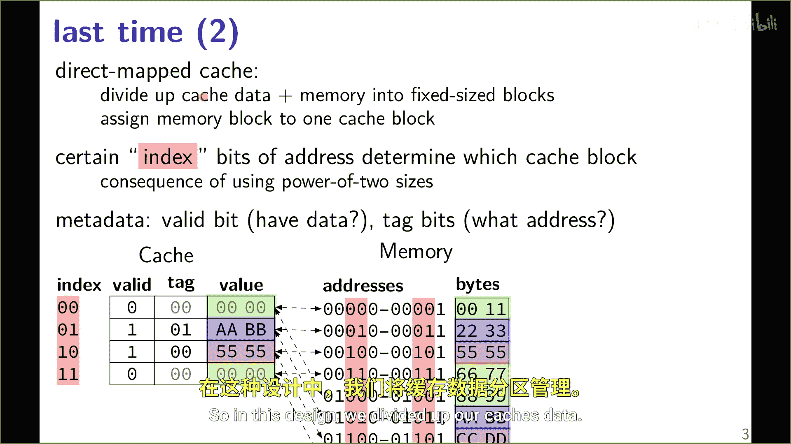
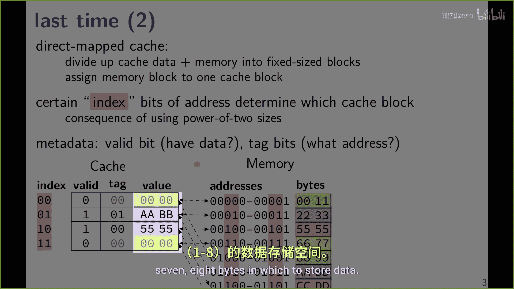
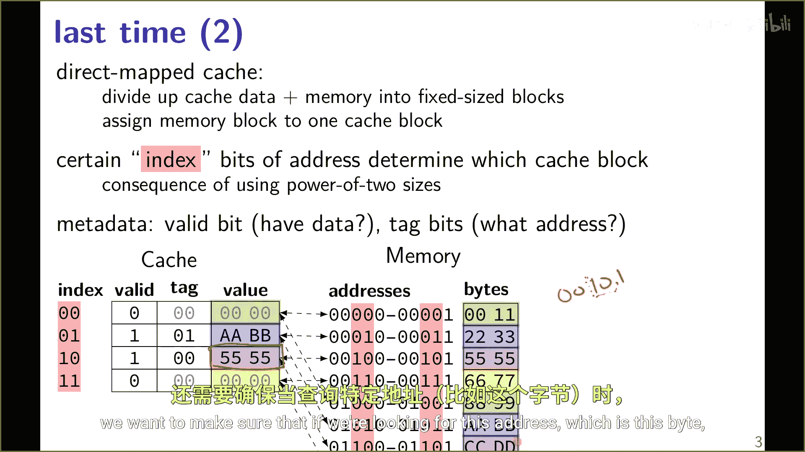
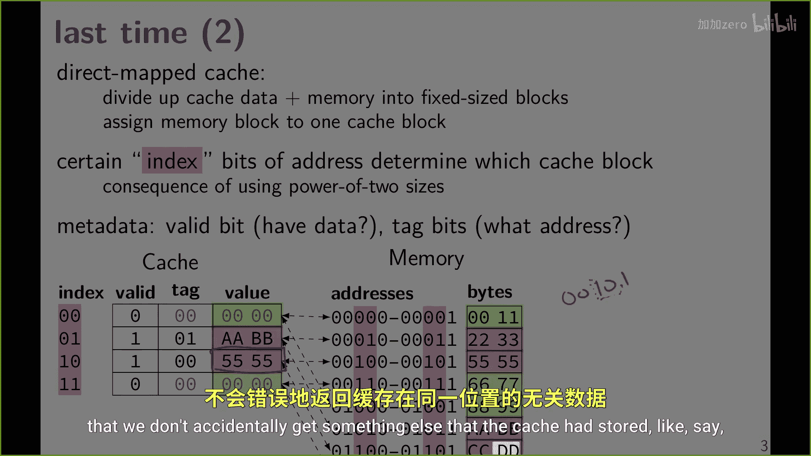
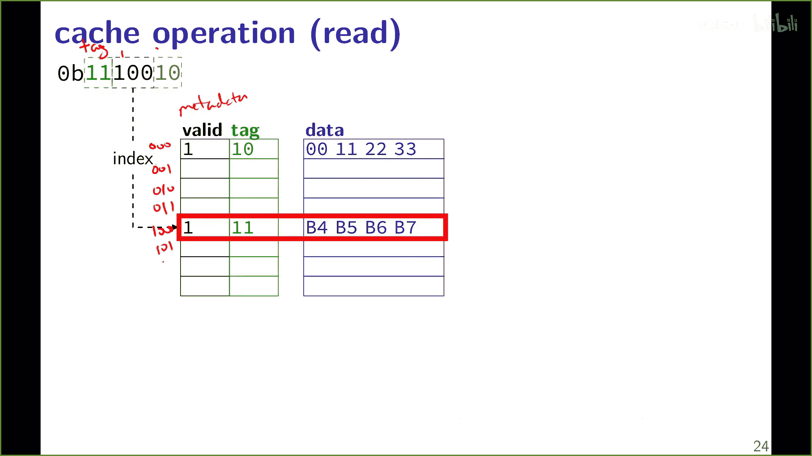

# 弗吉尼亚大学【中英⚡计算机架构｜CS3330 2020 Computer Architecture】 p16 P16 Cache 2 -BV1cKeGzqEuJ_p16-

Good afternoon。So last time we finished up talking about。

How to do the control logic for our pipeline processor。

And we mentioned that we had this idea of the stall and bubble signals that HLRS provided for our pipeline registers。

 where the stall signal told it to repeat the same values the next cycle。

And the rebel signal said to put a knot there the default values in the next cycle。

 And we saw that we could apply this to implement things like。Squaashshing and stalling。

And our sort of strategy was we looked at like what should happen next cycle and it worked out what each of the pipeline registers should be to do that。

And figured out based on the particular scenario we're trying to make happen。You know。

 what combination of stolen and bubble signals we needed， often it was actually a combination。

 even if we were quote unquote， only skull。We also looked at the PC update。

 and we saw that we have to do some special things to deal with our conditional jumps and returns where occasionally。

We couldn't just figure out what the next instruction is to fetch until the instruction with the information had。

Actually gone pretty far into to the pipeline。 And we saw our textbook solution to this is that we have some input about what in。

From about where we should actually be fetching that we retrieve from later in the pipeline。

And our textbook chose to do this sort of at the beginning of the fetch stage。 So we got our。

PC registers for your place with a predicted PC， and then we substituted that for the actual target of a conditional jump we mis predicteddicted or the actual location a return should go to。

So then we switched to talking about our current topic， which is about caches。

 mentioned the concept that caches are these small， fast memories。But， you know。

 we love the fast part。 We don't like the small part。

So they're backed by these big but slow memories and our goal was that we're going to make it for a program that usually the memory is fast。

 but it's also big。And the reason why we could ever hope to achieve this is that we can arrange for most axises to access this fast memory。

 even though it's quite small compared to the bigger， slower memory。

And this is because programs have this property called locality and we talked about two types。

 so almost this temporal locality that when a program access to value by the alerts its instructions or its data。

 it would be likely to access that again soon， so if our cache kept right recent values。

 even though it's small， we'd be likely to often have the value the program is looking for。

We also had spatial locality， which that a program access to value。

 likely to access nearby values in memory， our natural notion of what's a nearby value is values with similar addresses。

And this means that our cache， we can keep the nearby values together and thereby ensure that we have more often the value the program is looking for already in our cache。

 we don't have to go to the big slow memory。And we started by looking at a simple design。

That allowed us to start to take advantage of this， which we called a direct map cache。

 So in this design。

We divided up our caches data， so we decided， okay， we're going to have in this case，1，2，3，4，5，6，7。

8 bytes。In which to store data。

And we divided it up into fixed size blocks， in this case， I chose two bytes。

And we also divided that memory into blocks of the same size。

 and we assigned each memory block to one cache block， So why would we do this。

 This is so when we're looking for a value in the cache， we have exactly one place to look。

And that's going to make our cache nice and efficient。O。And easy to look things up。

 And when we use power of two sizes， this lookup is actually really simple in the hardware because we get to take part of the address because with the power of two size。

 it turns out that when we interleave values like this。As far as what they're assigned to。

 we assign the first part of memory to the first block， second to the second and so on。

 and then we wrap around when we run out of blocks in our smaller cache when we do that。

 it turns out that some bits of the address which we call index bits indicate which row of the cache we want to go to which block。

It's assigned to this is just because we use power of two sizes。That's going to be how it works out。

Now。We had a fast way of saying， okay， I'm looking for you know the thing at address 00101。

 you know we know okay here the index bits are 10， so I'm looking here for it。

 but we needed to know that the value we had here you know。Was the right value。

 And we had some metadata to let us do that。 And one piece of metadata we had was this valid bit。

 because when our cache starts out。It's going to have something there。

 we want to know that that's not something that we actually copied for memory， it's not useful。

 so we have this valid bit to tell us that we started at zero so we know there's nothing interesting there yet and we set it to one when a value is loaded into our cache。

Then once we know there's something here， we want to make sure that if we're looking for this address。

 which is this byte， that we don't accidentally get something else that the cache had stored。

 like say this byte， which would be stored in the exact same location。

And to deal with that， we use。Some bits of the address to remember where the value came from and we call this the tag Now we could have stored the whole address of this block in this case。

 but we don't do that because we can save space。And we know that we only need these extra bits here because。

 well this last bit just tells us where in the block we are。

 notice it always ranges from zero to one because we have two bytes in each block so we don't that information is not actually useful。

And the index bits， we already know what the index is of everything stored here because that's the only way it could be stored on that row。

 so the tag bits， the leftover ones are all we need to know exactly where the value came from。

Some questions about anything we covered last time， either stall bubble related。

Or with our direct map caches。Quest about， can I repeat about the PC update， so the PC update。

We have to do something a little extra。😡，Versus what we saw with our single cycle processor because we don't always compute the PC right away。

 so usually we'd expect that we get a prediction and that's exactly where we want to go in the next cycle。

 but that doesn't always work and we have one big problem。

 which is that for conditional jumps and returns。We're going to debt。

A new program countervalue from an instruction that's down further in the pipeline。

 The textbook solution is that at the beginning of the fetch stage。

 we have a mu that decides whether we need a value further in the pipeline or where we can use the prediction from last cycle fetch。

😡，We also have an extra case of dealing with Stas where we want to fetch the same PC we just fetched。

Other inquiries about anything recovered。Last time。Okay， so。When we finished up， we were looking at。

Cash has worked。 And I'm going to give a sort of picture of sort of what the hardware for a cache would look like。

 So we're going to have some storage that's going to store our metadata。The valid in factbits so far。

 which's going to turn out we're going to need a little extra for many caches and also our data。

 and we're going to split up our address into three pieces。And there's the tag， index， and offset。

And we're going to have take this index and use it to select a row。

 and we're going to have some hardware component that stores this data where we input one of these row numbers。

 so we have here 00，0，001，010，011， and so on。😡。

