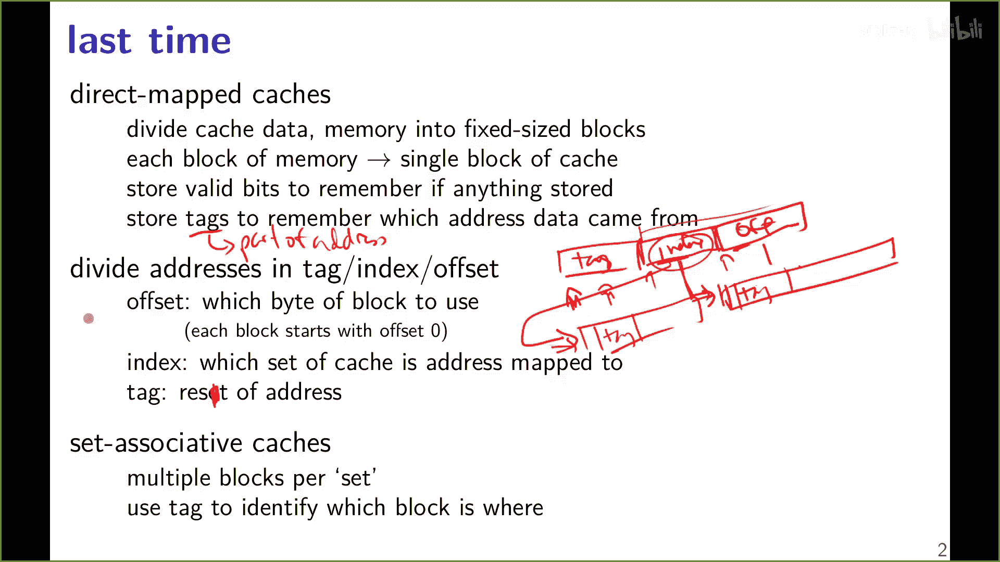
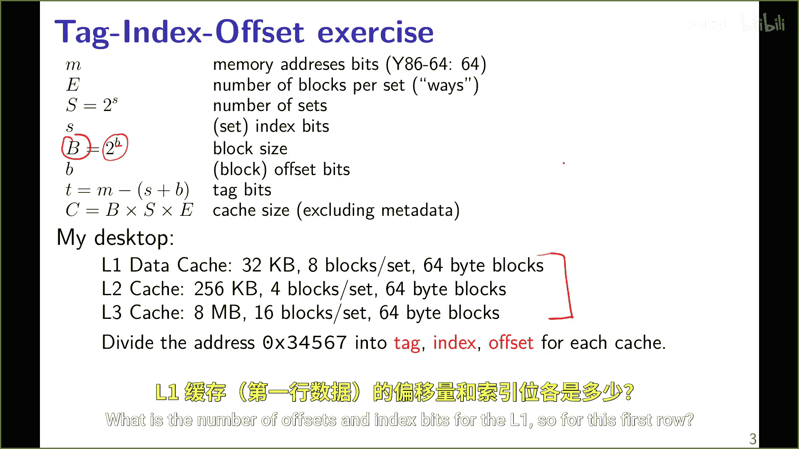
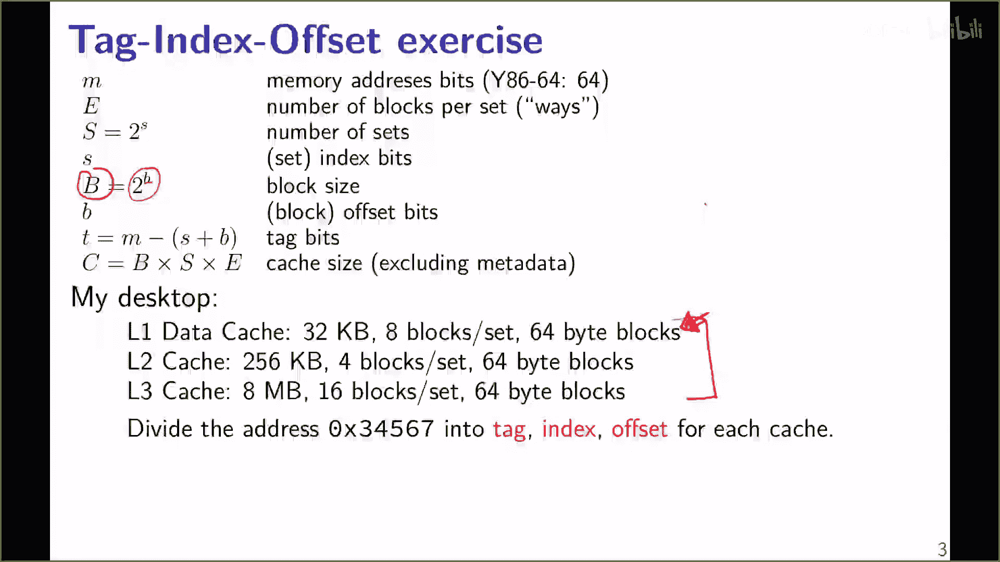
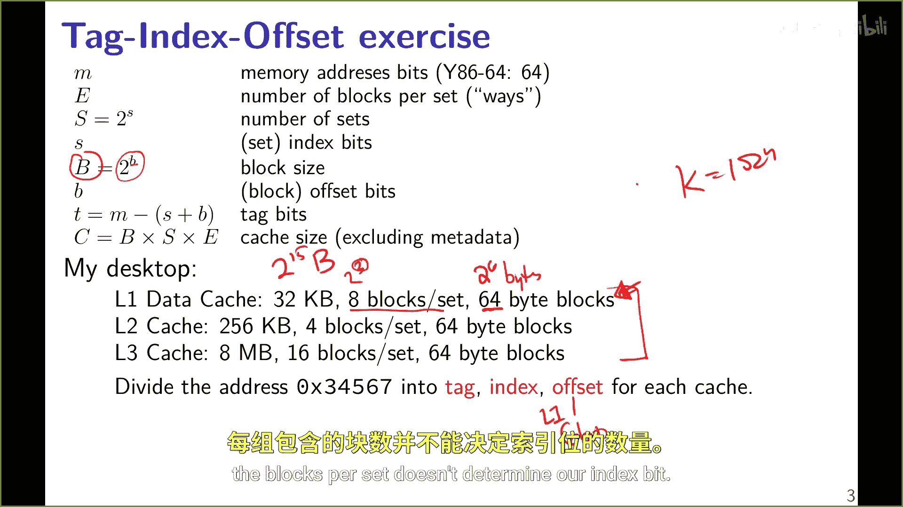
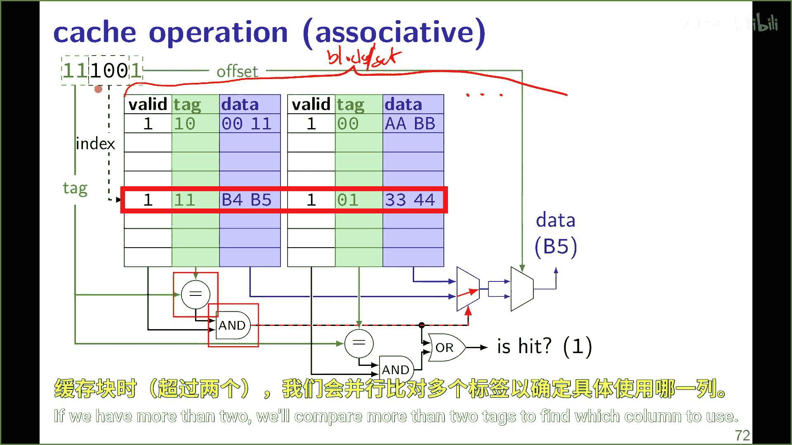

# 弗吉尼亚大学【中英⚡计算机架构｜CS3330 2020 Computer Architecture】 p17 P17 Cache 3 -BV1cKeGzqEuJ_p17-

Good afternoon。 So last time。We started by finishing up talking about direct math cache。

 So here we knew we wanted to cache this kind of small fast memory that was still part of our bigger memory。

And for direct caches， we made this by dividing up our cache into some fixed sized blocks and dividing up memory in the same way。

 same size blocks， and assigning each block of memory to one location in the cache。And to do this。

 we needed to store some metadata。 We needed to know some things about our blocks we stored in the cache。

 So one thing we need to know is that when we started up， we didn't actually have。

Anything useful stored in the cache and we need to know that so we have this idea of a ballot bit to remember whether or not we had anything stored yet。

When we did have things stored， each block of memory matched to a single block of cache。

 but each block of cache could map to many blocks of memory。

 so it needs to distinguish between which of the many does it not to。

 and we stored tags which were part of the address。To remember what the original address was。

And when we use this direct map cache scheme。It worked by。As far as the lookup procedure went。

 dividing our input address into pieces。 we had a tag piece。Index piece and an offset piece。

 So the offset piece said where in the block to go。And。

We would set up our block sizes and our number of blocks。Such that we had。

Power of two number of blocks and power of two number of bytes per block。

 So these would map evenly to a certain number of bits。 So， for example， if we had。2 byte blocks。

 Then we need， you know one bit to determine which of those two bytes or even addresses would be the first byte of blocks or odd addresses would be the second byte。

 So we'd have one bit for the offset， and we generalize that to having you know four bytes or8 bytes。

 in which case we use multiple bits to determine whether it's the first second third or so on。

 part byte of a block。We also need to determine what。

Set we were in and use the term set because that's going to come up in our generalization。

 but basically you know where in the cache is this block is this data， this address， I should say。

 eligible to have its data stored。And we used the bits before the offset to do that。

 we managed to have the number of sets be a power of two。

 so we could just again use as just a fixed number of fits。To determine which set the address map to。

 and everything we didn't use was O。 We needed。Just everything else we didn't eat the rest because well。

 we know if two addresses differ in the offset， they're just different parts of the same block。

Because we know all the offset are used in that block。

And we know that if we're in a particular sort of set， that is row of our catch。

 that the index bits must have had a particular value。 so we don't need to store those。

 So the only thing we need to store to remember where a value came from is the bit leftover bits。

 which we call the tack。So with direct map caches， when we got an index。

 there was one block we were looking at with one valid bit and。One tag。But。

We found out that this had this problem that we would end up。

Having multiple addresses that we were interested in using happening to go to the same row。

And the solution for this is that we can instead store multiple blocks per setap。

So that is multiple blocks per row， so we still have an index determining which row to go to。

 but now we have multiple blocks to check and we figure out where our data is by checking all the tag。

 and we can kind of adjust how complicated it is to find data by adjusting how many blocks we put in each set。

😡，And that's I believe roughly where we left off last time。

 so questions about our direct mapped or set Associ of caches。

Okay。So。I believe when we finished last time we were on this exercise。

 so here I have a bunch of formulas， but these are just expressing knowledge like， oh。

 if I have a certain number， a certain science block。

 I just need to assign a different bit pattern to each part， so if I have B bytes in my block。

 that means if B is2 to the little B， I need little B bits for the offset and this are formulas from our textbook that's sort of encode all that knowledge。

 you can use these formulas or not。And my question here is， well。

 here are the statistics of my desktop's caches， these set associatedator caches are in fact the most common design you see in real machines。

And I'm asking， you know， first。I'm not sure whether or not we got to this last time， but。

Review this， what is the number of offset and index bits for the L1， so for this first row。

And you can use these formulas or you can sort of reason about our pictures of what a set of sociative cash looks like。

And well， oh， I probably should。 it' earlier。 so some power of two stuff would be helpful。

 so 64 bytes is two to the six bytes。32 kilobytes remember in this class we're going to use K for always power of two。

 so this is two to the 15 bytes and eight is of course， two to the third。Give another。

20 seconds or so。Okay， so we have。A pretty good consensus that we should have。6 bits for the offset。

And we have。Two popular answers of3 and 6 for the number of index bits。

 and the answer of three is presumably because you looked at8 blocks per set。 Okay。

 so there's a three here。嗯。But the blocks per set doesn't determine our index bit。 So if we remember。

Our Associative cash。The number of blocks per set is the number of times。We have these column。

 number of columns we have。And if we look at our index， our index doesn't figure into。You know。

 which column we go to， we figure that out indirectly。 We go to the right row with the index。

 and then we compare the tags。If we have more than two or compare more than two tags to find which column。

