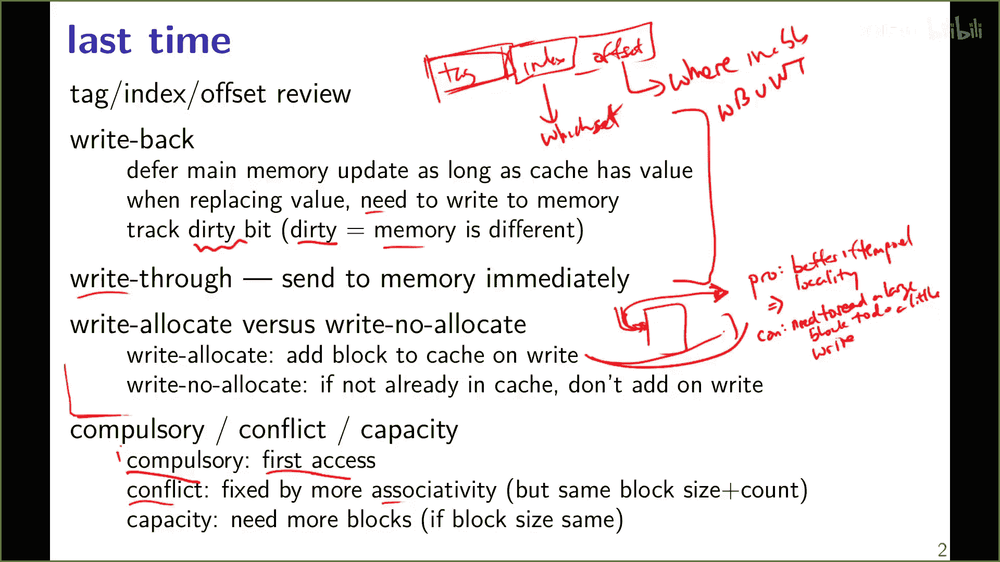
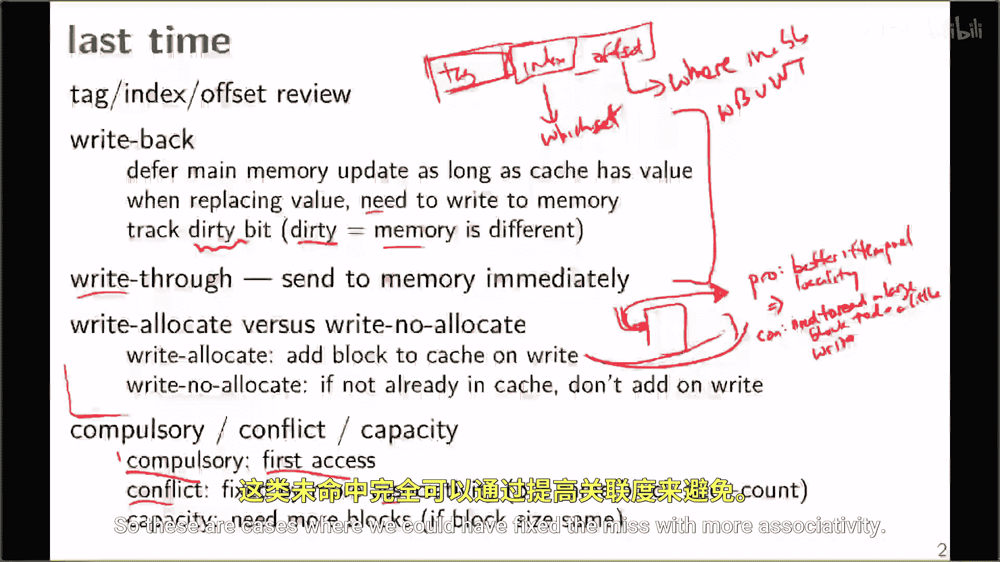
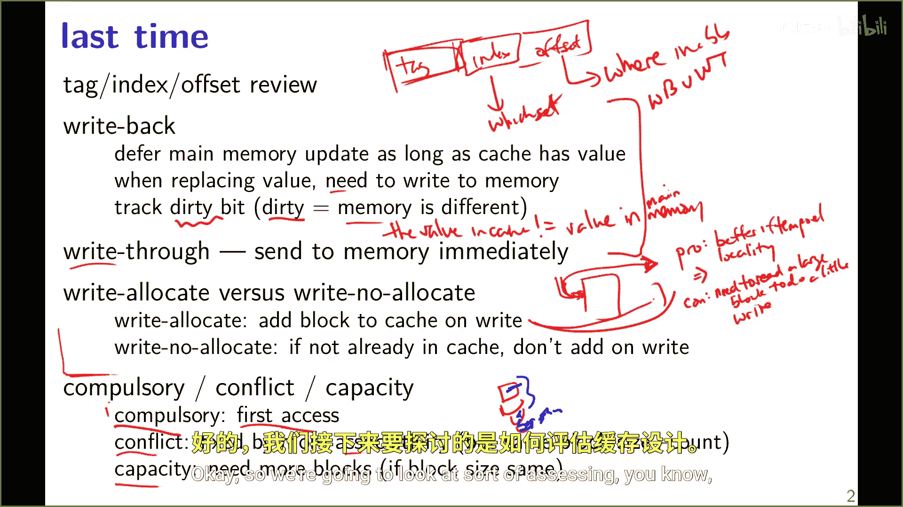
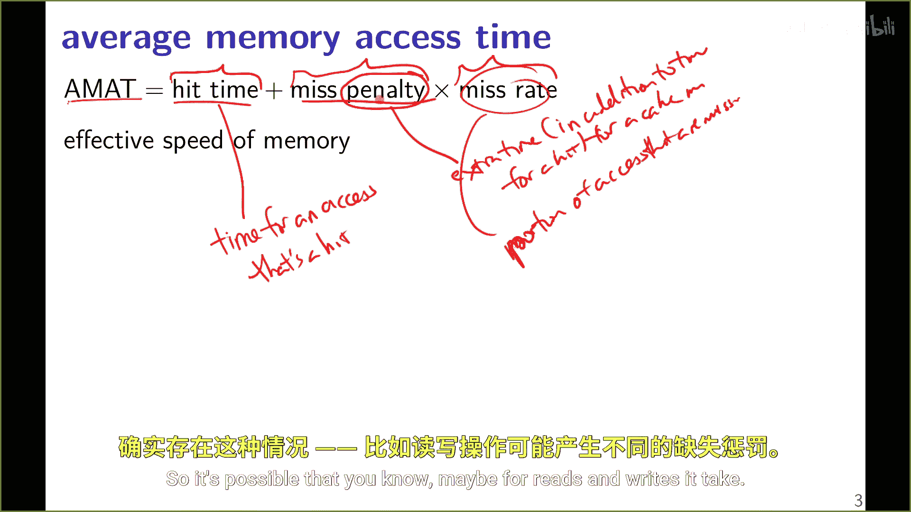

# 弗吉尼亚大学【中英⚡计算机架构｜CS3330 2020 Computer Architecture】 p18 P18 Cache performance 1 -BV1cKeGzqEuJ_p18-

Good afternoon。So last time we started by reviewing tag index offset。

Which was that this way that we split up addresses for our set Associative caches。 So we had our。

Tag first， then our index， then our offset going from most to least significant。

 or offset tells us where in a block。Our index told us which set。And。

Once we knew which set to look at， we needed to identify where a particular block came from。

 so we needed the rest of the address， the tag to do that。

 we didn't need the index because that's how we know what set of the cache to go to。

And we didn't need the offset because all of the offsets are going to be used in the block we have stored。

Of the possible。Values for this offset phase。Then we talked about right policies。

 you mentioned we had some choices， we had one choice， which was right back versus right through。

And in the right back policy。To handle rights， we would defer the update to main memory as long as possible。

 So rather than。When we updated the cache， also updating memory right away。

 we would update the cache and remember that， oh， yeah， I need to update main memory at some point。

 and we do that with this dirty bit。 we'd say that。

A block in our cache was dirty if it was different than memory and we went to clean up。

Every block in the cache before we replaced it。And this meant that in the write back policy。

 suddenly things that were just reads would become more complicated that even if we're just reading a value into the cache。

Because we're replacing something that's dirty， we need to write that thing out before the cache forgets about it。

The alternate policy was a right through policy， where rather than tracking。

That the cash has things that are out of date， we just never let that happen。

And we never let that happen by always updating memory right away。

 so there's no concern about parts of the cache being dirty and needing to be cleaned up by being written back to memory。

A separate but related decision。Is what we would do in the case where we had our cache and we wrote a value。

 we were asked to write a value that wasn't stored in the cache yet。And。

This is a separate decision from right through versus right back because。You know。

 we don't actually have to keepap the value in the cache。 We could decide， well。

 it's a write not a read。 Let's just send it directly。去卖吧。So why would we want to do either。

 So for right allocate， sort of the big advantage is that you know。

This is better if we have temporal locality。Cloy， because。

We'll bring in the thing we're writing to the cachetion。

 if we're reading that later on or writing it again， that might be more efficient。😡。

But the con is that if say we're writing know8 bytes。

 we're going to have to read in you know the full block size。 so if we have say 64 byte blocks。

 that's a typical size， you know。We need to read。A large block。Who do a little right？

So you know we write  eight bytes to the cache， that's what the processors trying to do that turns into a 64 byte read for memory to allocate that block in the cache and if we're not going to get paid off because we're using that block because of temporal locality。

And maybe it's also a spatial locality， then that's just going to be a waste。

So we have their alternate policy， right， no allocate where we just say if it's not already in the cache。

 don't bother， just assume it's not important enough， you know， and that might be a reasonable guess。

 even though programs naturally have locality because we never saw a read。😡，Before。At least。So。

After talking about right policies， we talked about generally classifying misses and we're going to revisit this today and thinking about sort of how our cache optimizations。

 you by which I mean design decisions we can make to improve our caches affect each of these types of misses and we kind of divided our misses into these three categories and this division that you'll commonly see is based on assuming that we have some block size we've chosen。

 and we're thinking about how do I set the cache size， how do I set。你好。B。

Associivity for that cache and we have these three types and the simplest type is what we call compulsory misses and this was the first access to a particular block that we can't avoid these by changing how we arrange the blocks。

Or how many blocks we have if we increase the number of blocks well。

It doesn't matter it's the first access we couldn't possibly have had it in our cash。😡。

Because we wouldn't have a reason to get them in advance。

Our other next category was conflict misses。 So these are cases where we could have fixed the miss with more asssociivity。

 that the problem was that we had， say， you know a whole bunch of blocks in our cache。

 but we were only using， you know， certain ones of them。

And。We just。Or maybe we were using all of them， but we were kind of overut a certain part of it rather than optimally spreading things out。

😡，So conflictness is something where if we had you know。

 a fully associative cash and we chose the best replacement policy， we would have avoided it。

 but we probably couldn't do that because that cash would be impractically slow。

And our final category is if it doesn't， if we couldn't have fixed it by being more flexible about how we spread out the accesses among our blocks。

 then we just need more blocks， so we call that remaining category capacity misses。

I believe that's where we left off， Tuesday， so questions about any of these topics from last time。

So question is， what do I mean by memory is different？ I mean， the the value in cash。Doesn't equal。

The value in memory。And by memory， I mean main memory。St answer that question？Other questions。Okay。

 so we're going to look at。

Sort of assessing you know， cache designs and something we often want to figure out is how good is a cache doing？

And to do this， we want to say， well， what's this effective speed。

 And a common metric for this is something called average memory access time， appreviated aap。

 And we can compute this as the hit time。 So whether is it a hit time， this is the。

Time for an access。 That's a cache hit。Hit。Plus， the missed penaltyal。

And they note that this is penalty。 So this is the extra time。In addition to the time for a hit。

Right。For a cash miss。Times the。Missrate， which is the portion of accesses that are misses。And。

Why mightt we divide up the formula this way？😡，So the reason why this is useful is because we can think separately about what we can do to improve our hit time。

 what we can do to improve our miss penalty， and what we can do to improve our miss rate when we're thinking about how can I improve this cache。

 we can think okay there's some design decision that might improve the rate hit time。

 there's some designer does not improve the miss rate and that's how sort of processor designer sort of work on figuring out exactly what parameters they want to set。

So there's a question， could there be different missed penalties？

