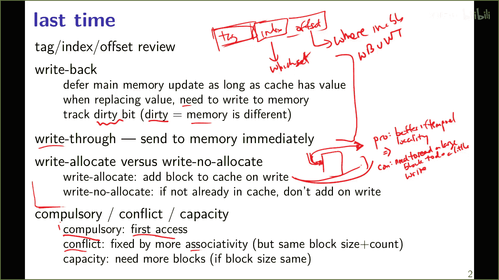
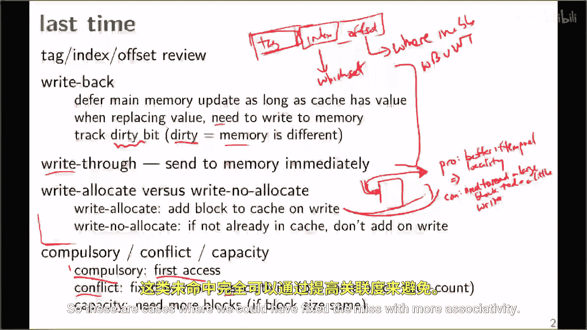
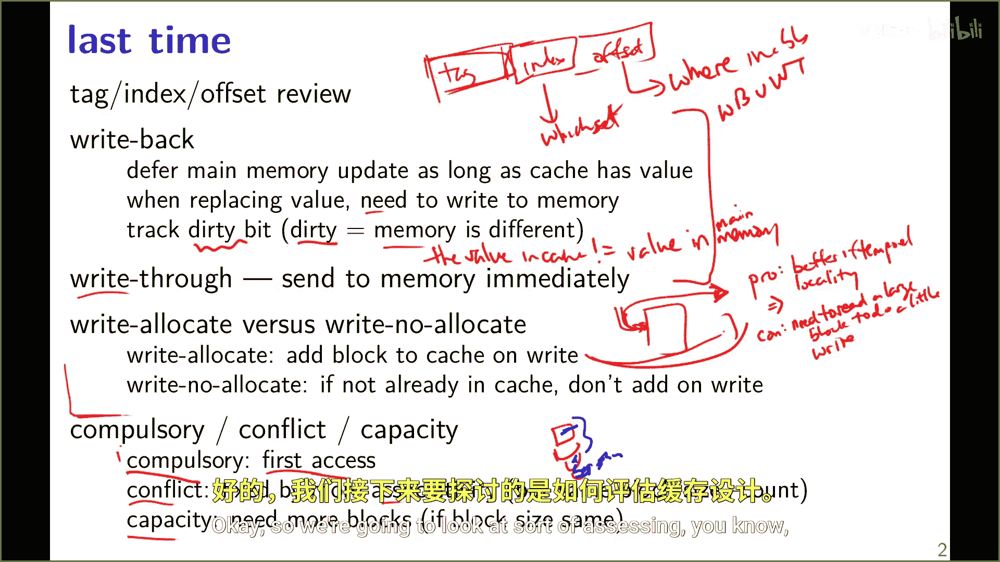
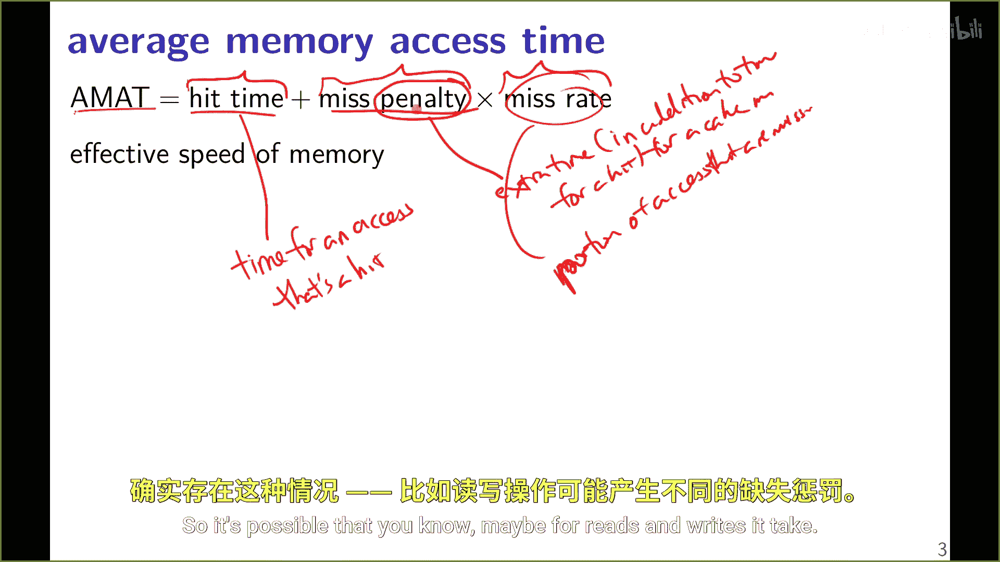

# 计算机架构：第18讲：缓存性能分析 1 🧠

在本节课中，我们将学习如何评估缓存设计的性能。我们将回顾地址划分、写入策略和缺失分类等核心概念，并引入一个重要的性能指标——平均内存访问时间。

## 地址划分回顾

上一节我们介绍了标签、索引和偏移量。这是为组相联缓存划分地址的方式。

地址从最高有效位到最低有效位依次为：**标签（Tag）**、**索引（Index）**、**偏移量（Offset）**。

*   **偏移量** 告诉我们数据在缓存块内的具体位置。
*   **索引** 告诉我们该访问缓存的哪一个组。
*   确定组后，我们需要**标签**来识别该缓存块具体来自内存的哪个地址范围。此时我们不再需要索引和偏移量信息。

## 写入策略回顾

接着，我们讨论了写入策略。主要有两种选择：写回与写直达。

**写回策略** 在处理写入操作时，会尽可能延迟对主内存的更新。缓存块被修改后，会设置一个**脏位（dirty bit）** 来标记它与内存中的数据不一致。只有在需要替换这个脏块时，才会将其写回内存。这意味着即使是读操作，如果它需要替换一个脏块，也会变得复杂，因为必须先将脏块写回。

**写直达策略** 则通过立即更新内存来避免缓存数据过时。每当写入缓存时，也会同时写入主内存。因此，缓存中不存在脏块，也无需在替换时进行额外的写回操作。

一个相关但独立的决策是**写分配**与**写不分配**。这决定了当要写入的数据不在缓存中时，我们该如何处理。

*   **写分配** 策略会先将目标数据所在的整个块从内存读入缓存，然后再进行写入。如果程序具有良好的时间局部性，后续可能会再次访问该数据，那么这种做法是高效的。但其缺点是，即使只写入少量数据（如8字节），也可能需要读入整个大块（如64字节），如果后续没有利用到该块，这就是一种浪费。
*   **写不分配** 策略则假设要写入的数据不重要，不会将其载入缓存，而是直接写入内存。这对于之前从未读取过的数据来说，可能是一个合理的猜测。

## 缺失分类回顾

在讨论了写入策略后，我们介绍了缺失的分类。今天我们将重新审视这一点，思考不同的缓存优化设计会如何影响各类缺失。

我们通常将缺失分为三类，这种分类基于我们已选定块大小，并考虑如何设置缓存大小和关联度。

以下是三类缺失：

*   **强制性缺失**：这是对某个块的第一次访问。无论我们如何安排块或增加块的数量，都无法避免这种缺失，因为我们没有理由提前将其载入缓存。
*   **冲突缺失**：这种缺失可以通过提高缓存关联度来避免。问题在于，缓存中可能有很多空闲块，但访问却集中在某些特定的组或路上，导致其他块被不适当地替换。如果使用全相联缓存和最优替换策略，就可以避免这种缺失，但全相联缓存通常速度太慢而不实用。
*   **容量缺失**：如果缺失无法通过更灵活地分布访问来避免，那么我们就需要更多的缓存块。这类剩余的缺失就称为容量缺失。

## 缓存性能评估

现在，我们来看看如何评估缓存设计的性能。我们常常想知道一个缓存的表现有多好。

一个常用的衡量指标是**平均内存访问时间**，缩写为 **AMAT**。

我们可以用以下公式计算它：
**AMAT = 命中时间 + 缺失率 × 缺失惩罚**

*   **命中时间** 是指一次缓存命中所需的访问时间。
*   **缺失惩罚** 是指一次缓存缺失所带来的额外时间开销（即在命中时间之外增加的时间）。
*   **缺失率** 是指所有访问中发生缺失的比例。

为什么这样划分公式是有用的？因为它允许我们分别思考如何改进命中时间、如何降低缺失惩罚以及如何减少缺失率。当考虑如何优化缓存时，我们可以分析：某个设计决策是否会改善命中时间？另一个决策是否会降低缺失率？处理器设计师正是通过这种方式来确定最佳的参数设置。

有一个问题：是否存在不同的缺失惩罚？是的，例如，写回缓存中替换脏块时的缺失惩罚，就可能比替换干净块时要高，因为前者需要额外的写回操作。

## 总结

本节课中，我们一起学习了缓存性能分析的基础。我们回顾了地址的标签-索引-偏移量划分法、写回与写直达策略、以及写分配与写不分配策略。我们还重温了强制性缺失、冲突缺失和容量缺失这三种缺失分类。最后，我们引入了**平均内存访问时间（AMAT）** 这一核心性能指标，其公式为 **AMAT = 命中时间 + 缺失率 × 缺失惩罚**，这为我们定量分析和优化缓存设计提供了重要的理论工具。