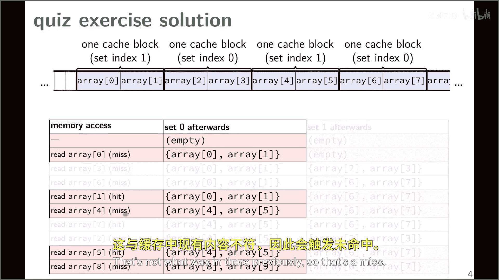
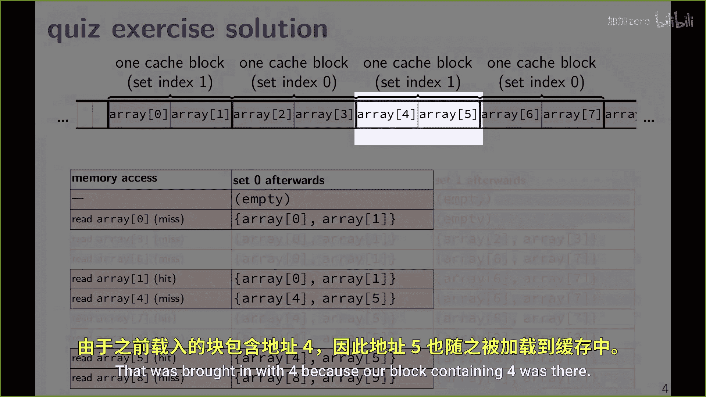
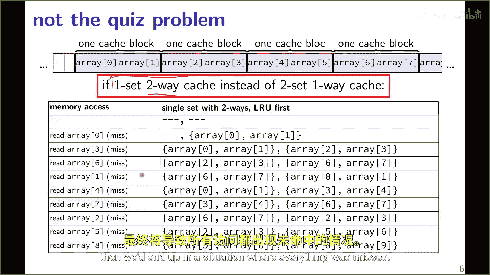

# 弗吉尼亚大学【中英⚡计算机架构｜CS3330 2020 Computer Architecture】 p19 P19 Cache performance 2 -BV1cKeGzqEuJ_p19-

Good afternoon so last time we talked about trade offs in cash designs and looking at evaluating them。

And one way we looked at evaluating them is based on sort of what part of our overall memory access time was affected and we had this formula for average memory access time where we had this component hit time。

 like how fast is our cache for hits。Which mattered because， well， if we didn't care about that。

 we just make our cash really， really big， but then it would be really， really slow for hits。

 but we had to balance that with its miss rate。嗯。And。Also。

 we wanted to think about well what was the total cost of aIS， we know it's high。

 but how our cache is designed can change how high if we have big blocks to get for memory that's probably going to increase our miss penaltyal and if we have secondary caches。

 that's a way we can decrease our mis penaltyal。And sort of looking at for a particular set of programs we're interested in。

What this formula bears out for the types of design decisions we're making helps us decide how to make our caches if we're designing a processor。

Another factor was that it's program dependence so we need to think about when we're thinking about things that affect the miss rate。

 what types of misses we were actually had in our programs and we had sort of one way of classifying that was this compulsory conflict capacity which helped us get an idea of well。

 what kind of things can we do that will help this program based on what we see it doing？For example。

 if there's lots of compulsory misses， like doing things like optimizing the replacement policy。

 not likely to be useful。We also then looked at while we were dealing abstractly with sort of list of accesses and of how the cache worked。

 we wanted to actually relate this to real programs So we're going to continue that today。

And to do this we want to look at code and figure out well what actually uses the cache so the instruction cache that' we kind of glossed over that's the simple case。

 like all our instructions， their machine code that's stored in main memory at some point they have to use the instruction cache。

 but for the data cache。You have to remember that this is sort of what represents the data memory in the processor we had。

And that means that the register file does not the cache。

 so accessing registers that's separate from the cache that has a consistent speed。

 there's no getss or misses。 We always got values from registers quickly。

And we just need to worry about memory accesses， so in our no Y86 processor we had MR Move Q。

 RM Mo Q push pop call return， those were our memory accessing instructions that would use the data cache。

And when we started looking at。How a program's accesses to the data cache would affect performance。

 we realized that there was this one concern that we could have values that crossed multiple cache blocks。

 I probably should have written blocks here lines as a synonym for blocks if you read some sources。

But course in cash blocks， meaning we could have like。Our memory laid out into cache blocks。

 and we could have， say， one integer， which， you know。

 were two bys if it were in one block and two were in another。

 And these would be really slow are really slow if you try to use them because。

We have to do two cache accesses to get one value or to write one value。

And compilers avoid this using alignment， meaning that they arrange for values to be at a multiple。

To be in a multiple of a power of two， by a power of two。

 because we know cache block sizes are always power of two， so this is always going to work out。

To avoiding。If you choose the right number， having this situation。And once we dealt with that。

 we started looking at sort of looking at some C code and trying to count cache misses。

 and we had sort of a very exact way where we just identified all the cache accesses。

 figured out what blocks they went to and what sets they went to。

 and we just sort of simulated the cache similar to what you did in the cache lab。And since。

With real size caches， you know this can get pretty complicated。

 we have some ways of kind of simplifying that and one thing I mentioned is that we can divide the axises into the sets。

 the rows of our cache and we can analyze each set separately because we know if we have a bunch of accesses to index 0 and we have a bunch of other part of our code which is accessing index1。

 those can never interfere with each other because we'll never look for something with index1 and set0 and we'll never look for something with index0 and set1。

 so we can just look at them separately， count the misses add them up。Set after the fact。好。

And we had some a quiz question about this， which I'm going to go over next。

So any questions about these things we covered last time？I'm waiting for questions。

 some logistical notes so there's no lab tomorrow the schedule is right。

 there is a homework due next week， however on sort of cash misses and C programs。

That's a new homework， I hope it's the right size for homework。啊。

And also on the quiz that was due today， there's one question that I know is going to need some manual grading there's a note below the question just mentioning that。

Any questions about material from last time？Okay， so let's talk about the quiz question。

So on the quiz quiz， the last question on the quiz， which。Now， we had a program which accessed。

 We had an array。 The array was set up such that we had。Blocks of two。

Array elements in our cache and our cache had two sets。 and it was direct map， meaning one way。

 meaning it was a one way。To set cash。With。Two array element blocks。Box， and。

We don' our axises were zero，3，6，1，4，7，258 in that order。And as I mentioned。

We can look at this by looking at each set separately。

 so if I look at how things map to sets where I'm assuming that set0 is where a array zero is。

 if we swap these， then we're just swapping this row and this sorry this column and this column so it will change the number of thiss。

So I'm just assuming you know， I'm going to number the first set as zero。And the access is to。0，1，4。

5， and 8。 you set 0。 So we'll look at them in isolation because we know the other axises aren't going to change anything in set 0。

 So we're just going to look at what happens in set 0 first。We find out， well， after accessing zero。

 that's a miss because it was originally empty， we bring in this whole block here to get 01。

 then we access one next。 That's the next thing in set zero。 There's two axises in between。

 but they don't use set zero， so we don't need to worry about them when thinking about what happens to set zero。

So that's going to be a hit， then we access four， that's not what was in there previously。

 so that's a miss， we access five that was brought in with four because our block containing four was there。

So that's a hit， and then we access eight。好。Should have these have these numbered raw up here。

Access 8 and that。Not was in there previously， so that's a miss。And we have something similar for。

Se one， we a similar analysis and we have this one case where we have a hit， the others are misses。

 and that's how we get our root answer。Of six。Questions on how I。Solve this。

So I think one source of confusion that。I think tripped up some people on this question the quiz is many people wanted it to be。

They read that it was a two set cash。But they really wanted it to be a two way cache。

 So if we had a two way cache with one set， and so there a。To set cache with one way。

 and we had said an LRU replacement policy， then we'd end up in a situation where everything was missed。

