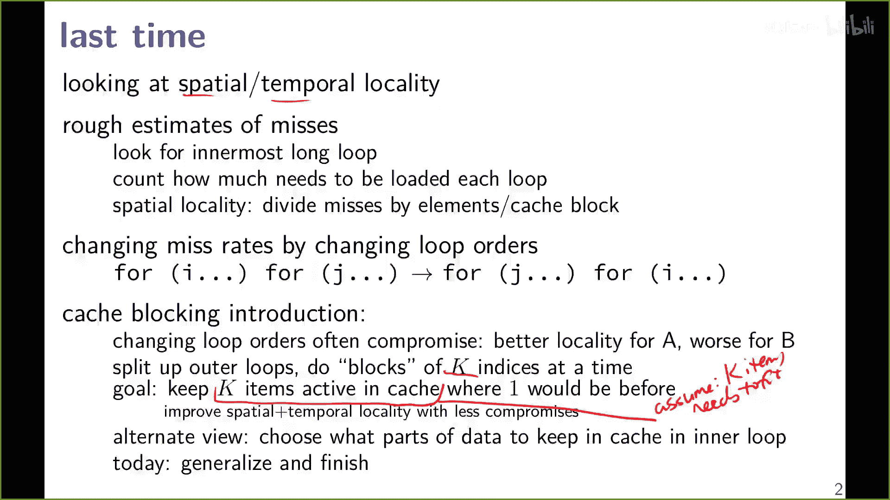
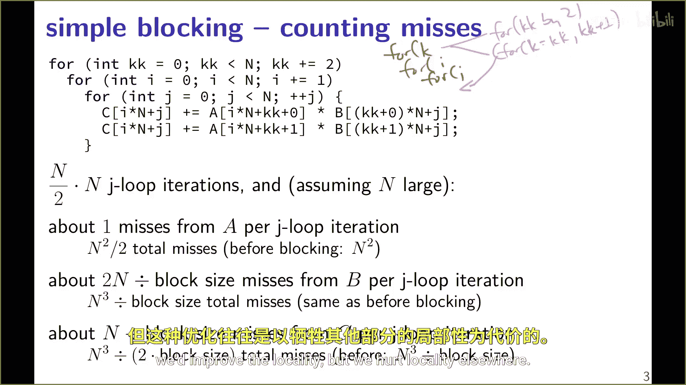
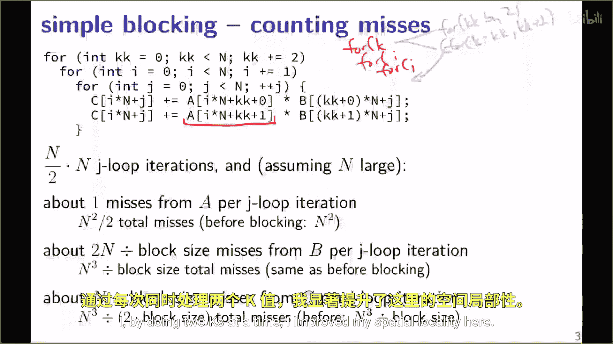
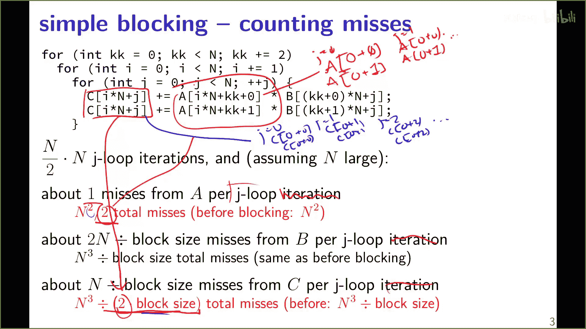

# 弗吉尼亚大学【中英⚡计算机架构｜CS3330 2020 Computer Architecture】 p20 P20 Optimization and Out-of-order 1 -BV1cKeGzqEuJ_p20-

Good afternoon。So last time。We talked about moving beyond。

Sort of evaluating the performance of the cache by doing a very detailed simulation where you would like look at every single access。

 figure out what its index bits were， figure out what set map to look at what would be in each set at each point and use that to count the miss this works。

 but it's real tedious， and we want to figure out how we can arrange our code to take better advantage of the cache in a way which is a more practical。

And sort of our shorthand was to look for localities， so look for spatial locality。

 things nearby each other being accessed together and temporal locality things being used over and over again。

And we can。Use this idea of looking for spatial and temporal locality to get rough estimates of misses and。

A typical code with lots of loops， which is usually what we're concerned about when we think we have lots of data。

 and therefore we're going to have the cash performance matter。

And sort of one intuition we had is we could look at the innermost loop that would run a lot of times and try to discount how much needs to be loaded。

 that is how many misses。Because each time we load something that's likely a cache miss we would need。

 and we could also take into account spatial locality realizing， oh。

 we're going to reuse a cache blocklock so we'll get some benefit proportional to the size of those cash blocks。

And this gave us a fast way of getting a rough estimate。 Why is it rough。

 Because we're not taking into account details like what if two things have the same index and we were out of room in that set。

 We're just doing a very quick approximation， but this is enough to tell us， oh。

 if I have two ways of arranging the code， You know， which one is likely to be better。

 And we saw this with。A common example of loop orders that we could change when we had nested loops。

 you know， the order of those loops， we do the same calculation。

 we just do it in a different order and but we could compare these by comparing the locality and our estimates of the mis rates to have a good guess about which one of these would be better。

Now， loop orders kind of had this compromise sometimes that sometimes when we changed the loop orders。

 we would improve locality in one place and herd it in another。

 and we kind of wanted a way to compromise。And cash blocking was this idea where we would。

Sort of do something in between changing the loop order of doing sort of blocks of elements for one of the outer more loops。

And our net result， when we're looking at our estimates of misses。

 is that we'd be keeping K items around if our block was K wide instead of one。

 and this would improve the spatial and temporal locality overall。You know。

 in a way which we couldn't just do by changing loop orders。 Now， for this to work。

 we have this constraint。You know， we have this assumption here that。K items。Needs to effect。😡。

And that's going to be the sort of the limitation of this technique。

And another way we can view it is that we're like by choosing the size of these blocks。

 we're kind of choosing what to keep in the innermost loop。

And we're going to look at that when we finish up today。

 kind of do look at the general version and also talk about， well， how do I choose the numbers here？

Like the ultimate answer is you try some and measure the performance。

 but we want to get into the right neighborhood so we don't try like a million possibilities。

 we don't have time to do that。So before I move on to that。

Questions about things we covered last time。Oh。Okay。

So last time I believe we started looking at sort of cash blocking in miscounts in detail with this example where what we've done here is I took a loop where it was originally 4K。

 for I，4J， set of loops， I should say。And you know， and changed it so I kind I split up this k loop。

Into。Okay， a loop by two and a loop。For K。KK and Kk plus one。

So I first split that up and then I moved the split up loop to the center。

 and then I expanded this loop。To make it easier to see what's going on。

And the benefits of doing this are that we've improved our locality a bit in a way which doing loop ordering。

 while we'd improved the locality， but we hurt locality elsewhere。 So I by doing two ks at a time。

 I improve my spatial locality here。

Now I'm accessing to adjacent case， I improve my temporal locality here。And well。

 it looks like don't I have some bad spatial locality in here so。The locality for the bees is worse。

So。But there's no problem， but okay。As long as。2 bes fit in the cache， right。

 We're just saying that I need to store two different parts of B from different blocks in the cache。

 If that's not a problem， you know， yeah， I have worse。

 I guess I should say this is worse spatial and temporal。 Yeah， I have worse locality than I used to。

I guess this sorry， worse locality than I used to， but it's not going to be a big deal。U。

And when we do our miss estimate， we're going to say， okay， I'm loading。Yao。Two end items。

Instead of n， but I have half the loop iterations because I'm going by two。

 so it works out roughly the same number of misses for B。And。I have an improvement。In both A and C。

 I think last time my slides， I'm not sure if I got， if I showed this briefly last time or not。

 I implied that that we didn't have this factor of two here， but we do because of the locality in C。

And we have a factor of two here because of our better locality in N。

And that's going to result in a net performance increase that is more than we could get by just changing the loop borders。

Questions about sort of my conclusion here。And。So there's a question is why are A and C different。

 So I assume that's about why。Do I not have the block size factor in the factor too， so for a。

IfWe think about what this access pattern is。I'm accessing。Sort of。A of zero plus zero。

Just the first iteration， then A of。0ero plus one。And then I need to think。

 and I'm doing that over and over again。 So when this is for J equals 0， then for J equals 1。

 I'm accessing a of 0 plus0， a of 0 plus 1。 and I keep doing that for all the Js。So that means。

That I expect one miss overall。For each time we run the J loop， I should say。We probably break that。

Can loop here。In contrast， with C。When j equals zero with the i of zero， when we're starting out。

 I'm accessing zero plus0 and0 plus0。But when J equals 1， I'm accessing。And。They're not。

 I'm accessing 0 plus one and 0 plus one。And when J equals 2。

 I'm accessing0 plus 2 and0 plus2 and so on， so I'm not repeating the same thing over and over again。

