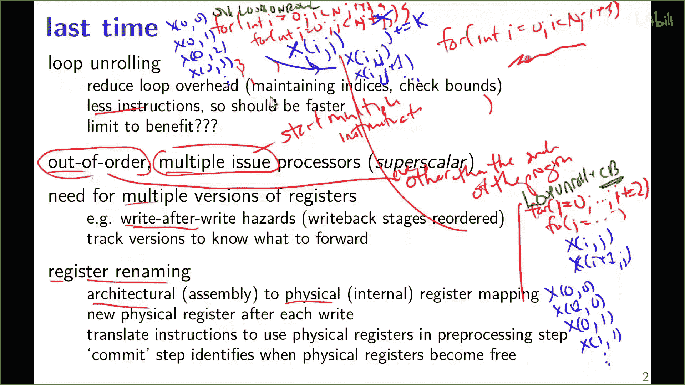
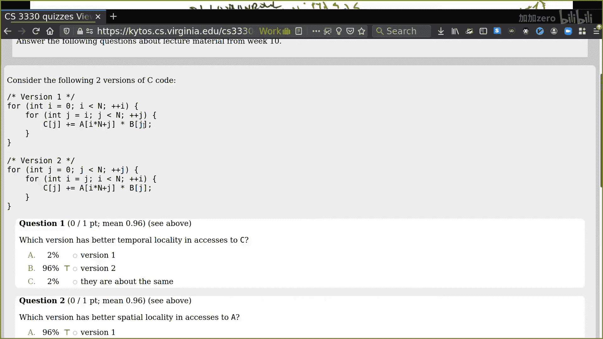

# 弗吉尼亚大学【中英⚡计算机架构｜CS3330 2020 Computer Architecture】 p21 P21 Optimization and Out-of-order 2 -BV1cKeGzqEuJ_p21-

Good人 afternoon。So last time we talked about loop unrolling。

 which was an optimization where you observed， well， in a typical loop， we have a lot of。

Instructions that are devoted to kind of the boring part of the loop。 that if we like。

 think of a typical for loop。You， we have our interesting part of the loop in its body。

 but we have a lot of code manage。The part where we just track the indexes。

 check whether we're done and so on。And we can reduce that by duplicating the body and ining by two instead of one。

 you have these regular patterns is a fairly mechanical thing to do。

 and it gives us less instructions overall， so it should end up being faster and we found that it did end up being faster。

 but we kind of ran into this plateau where it stop benefit。So to examine like how that happens。啊。

We looked at how our processors worked。And we saw that we had。Out of order。Multiple issue processor。

 So multiple issue means that they start and finish multiple instructions at a time。Once。

 and out of order meant that they run the instructions other than in the program order。

So we exact program instructions other than the order。Of the program。

Tother these are sometimes called superscalear that's a term you might see。

 and these are both features that our pipeline processor didn't have。

 our pipeline processor ran the instructions in the order they appeared in the program。

 it ran parts of them at the same time， but we did the fetch stage of each instruction in order and the execute stage of each instruction in the order it appeared in the。

And also， it was single issue。 We started one instruction at a time。

 Sure we had multiple going on at once， but we only started one at a time and therefore could only finish one at a time。

And when we do this。Type of processor with out of order instructions。

We discovered we had the sudden need to track multiple versions of registers that was a lot more important。

And。In our pipeline processor。So one example of this is that we might have an instruction that know two instructions that write the register and。

They might run in a different order and we need to remember which one we want to keep in the register when we're done。

 this is known as a right after right hazard where we move a right after another right because we are reordering things。

😡，And we also need to in general， when we have these multiple instructions writing at different times。

 we need to know which versions to forward， so we need to do some tracking of multiple versions of our values and we can't just rely on what we do with pipelining where we know。

 oh， the one in the closest stage is the one I want。

And our solution was that we would explicitly track the different versions of our instructions。

To know what to forward and to know also， it turns out， as we'll see today。

 to know what instructions to run， what instructions we can execute。And to do this。

 we had this idea of register re naming that we map our architectural registers to physical registers we maintain this mapping。

😡，And we have a whole lot of physical registers one for each different version we'd be keeping track of it once。

 and we'd assign a new physical register for each right。

 so we only used each physical register for one version of a value。

And we do this translation to these physical register names in this preprocessing step and we also have to do a little extra bookkeeping。

 we didn't go into details about how it works， but at some point we need to free up physical registers so we can use more and we have a commit step where we figure out what instructions are actually done what values our versions that we no longer need for anything and we free them up so we can keep using them。

So today we're going to look at， well once we've done registry naming。

 how do we actually run instructions and how do we run instructions in particular where we're having this out of order property。

 where we'll run whatever instructions we can rather than just running them in the order they appear in the program。

😡，So before I move on to that， questions about things we covered last time， things that confusing。

Weant to talk about。So question， can we go over the difference between loop unrolling and cash blocking sure？

So in loop unrolling。We're not changing what。V loop body does。So if I unroll this loop here。

 and I have。X， and well， let's like use an example。

 So if I had like nested loops and I do loop un rolling。I switch to my pen tool。You know。

So if I have these nested loops， loop unrolling means that I'm going to end up。I have x as my body。

 you know， x of J， let's I comma J。When I enroll， what I'm going to do is I'm going to change this。

Increment J by 1，2 B J plus equals， you know， sub number。 And I'm going to do X of I comma J。

 X of I comma。J plus 1 and so on。Note that I'm not doing anything where I change。

 you know which eyes I do。😡，And this means that if I consider the overall order in which I'm doing things。

 I'm still doing I0， J 0， I0， J plus1， J1， I0， J2， and so on。

 I'm still doing the same loop bodies in the same order。

 I'm just doing more than per iteration of this innermost loop。😡，When we do cache fing。

 we might do something where we change the outer loop。And therefore。

 change the and change the inner loop at the same time。

 So we actually change the order in which we do things。 So here， you know。

 we started out doing x of 0，0， x of 0，1， x of 0，2。 and I'm still doing this。

After I do this transformation of the loop with cache blocking， we might transform it。 So we do。

So we change the outer loop， all right down here for a sake of space。So we'll do for I equals zero。

And I say plus equals two。And for Jay。And I might do， say， x of。I comma J and x of I plus 1 comma J。

 In that case， if I like， look at what this loop does， I'll end up doing。X of 0， comma 0。 I is 0。

 J is 0， then x of 1 comma 0。So I've changed the order， and then I'll go back to x of0 comma 1。

 x of 1 comma 1 and so on， so I've changed the order for my original order。

And that's cache blocking because I'm going to change the order in which I access a race。

That answer that question？啊。Other questions about。Cash blocking versus loop on rolling。 Yeah。

 so the big thing is when we do loop on rolling， we aren't changing the order。

 when we do loop on rolling。 This is sort of this is loop on rolling。Plus， cash blocking。

And this is only loop unrolling。And question， can I explain quiz number three later， Yes。

 we'll probably leave that till the end since I want to try to get two things to。

I think a majority of people got。Certain can't go over that later。 I guess I can。

Can I explain that quickly。Let's find out。That'squiz number three is the one with the missrate。

 right。With this number of misses。

So we'll just pull that over here。So for quiz number three。

They're asking how many misses there were for B and version 1。

 So here we're accessing B of J and J changes every iteration of this inner loop here。

So how many value different values of j do we have， Well， we have about n over 2， yn over2。

 I averages n over 2。And we go up to n。 So there's n over two values in between。And。

That means we have N over2 messagesses。

