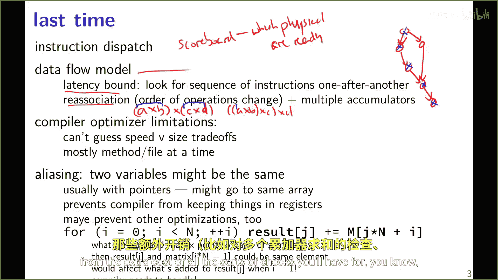
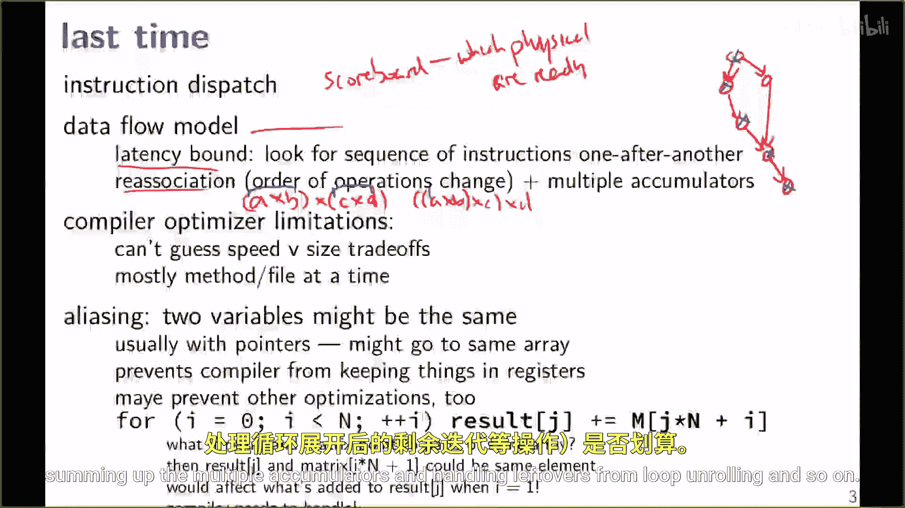
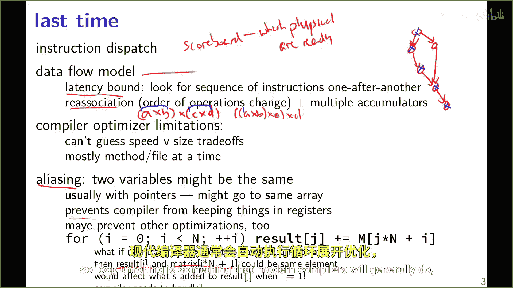

# 弗吉尼亚大学【中英⚡计算机架构｜CS3330 2020 Computer Architecture】 p22 P22 Optimizations 3 -BV1cKeGzqEuJ_p22-

Good afternoon。So。Last time we talked about what happens after we do registry naming in an out of order processor that we have this list of instructions。

And we have it in a way which makes it relatively easy， though。Relatively。

 to figure out what instructions to run when。So we can look at what registers and other input each instruction use。

 And we had this idea of having a table of。What registers were ready？

Which physical registers that is。Ready， and we know ones that weren't ready。

 the instruction that would write the value。That instruction that would be later on read from that register hasn't run yet。

And we could update this based on knowing， well， when we dispatch an instruction。

 you know it's going to either take so long so they can set the ready flag that much later or for things like the datacache where we might have to figure out。

 oh， is this going to be a hit or a miss， you know if it's amiss， take a lot longer。

 we can wait for a signal from whatever component we're sending it to saying yes it's done。

 you can mark it as ready for the next instruction to use this value。

Now we can kind of simulate an out of order processor at this instruction dispatch level of detail。

 looking at what the instruction queue looks like and so on。

 but that's really tedious and it's hard to get great insights on how to actually change our programs。

To get better performance from that。But when looking at these sort of instruction dispatch examples。

 we noticed this sort of phenomenon where often there just wouldn't be any work for the processor to do that it could do right away。

 it might have say two or three AUs， but because all the instructions for waiting for things which haven't been computed yet。

 maybe only one or two of them could be used。And as a way of thinking about it。

 we had this idea of a data flow model that we could sort of draw a graph。Of。

The dependencies between instructions。And use that to figure out， you know。

 things that have to happen right after each other。 So in order to compute， say。

 this bottom value of the graph， we need to compute this。And before we compute that。

 we need to compute that and then before that and so on。

 And we can look for sort of the longest chain of operations that need to happen one after another。

 And we know that the sort of minimum amount of time we need to execute a sequence of instructions is going to be bounded by that length of that longest chain that we need to do one operation。

 and after that completely finishes， well， completely enough for us to get the value to something else。

 we can start the next operation and so on。 And our textbook calls this。The latency balance。

And knowing this concept， we can think about how we can rearrange our programs to lower that latency bound。

 And what idea was something where we could change the order of operations。

 Our textbook calls this reassociation， and we gave the example of。You know， A times B。

 C times D that we'd rather compute have this version of parentheses over。

Perhaps the more obvious one。Of this， because。If we think of our auto flow graph。

 we can do this these two multiplies in parallel。In the first version here， in the other version。

 we have to， you know， do them one at a time。 We have this longer sequence of things that much happen one after another。

And we also saw the version of this problem for loops with this idea of multipleccumulators that if we're sort of constructing an overall value in a loop。

The classic example is a sum， but it could be any sort of value where we're you know。S。Adding on。

 not possibly literally with adding to a single place。In loop。

 we can do more in parallel if we have multiple of them and then combine the results at the end。

 this is going to lower that latency bound。Now， after looking at how processors work and these optimizations。

 we wanted to ask about well， you know， many of these seem very mechanicalchanical。

 why isn't the compiler just doing it for us and sometimes the compiler does but。

The compiler has some limitations and。One big limitation is that the compiler kind of has to guess about what it can get away with view because there are disadvantages to the optimizations we talked about like loop unrolling and using multiple chumulators that they make our code bigger and they're not really helpful if we have a loop that doesn't run very much。

And the compiler doesn't have a great way of knowing at least not the way you typically run it， you。

 whether it's okay to you increase the size of code for a loop by 10 times。

 whether that's going to be worth doing in terms of the loss of performance from having a bigger executable。

 from spending more time to load it into the instruction cache。😡，And。

And if the loop doesn't execute very many times from the extra cost of all the sorts of checks you'll have for you know。

 summing up the multipleccumulators and handling leftovers from loop unrolling and so on。

 So the compiler is just bad at guessing that。

Because this doesn't have the information there， it's not in the program。

 like you can guess reading the program and knowing what's slow， but the compiler doesn't know that。

Another big issue is that compilers sort of mostly work a method or a file at a time。嗯。

So typically just for performance， they won't do very much of trying to look at， you know。

 both a method and something it calls to do optimization when compiling multiple files。

 we talked about linking at the beginning of the semester if the compiler does linking the way we described。

 then it can't modify the code in a method based on how it's called。

 and it can't modify something which calls a method based on how。😡，Yeah。How the methods it's used。

At least if it does linking in the way we describe。

 I say mostly here because there are sections to this。

 but they're often not the default just because you know it's going to make things a lot slower to have to like look across methods and it's a good performance trick for making your compile times not ridiculously bad。

啊あ。Sort of bigger category in maybe more subtle category of compiler limitations is that the compiler needs to handle corner cases and a big。

Case pernicious issue with handling these corner cases is something called aliasing that when we have code that the compiler is compiling。

 there might be two variables which are really the same thing。 This is usually with pointers。

 usually with pointers to arrays is where it most commonly comes up well。

 why because pointers can point to the same thing and because arrays are where we're most concerned about doing optimizations because if we're know doing a lot of stuff there's probably an array involved。

And if we aren't doing a lot of stuff， well， the code's probably fast enough anyways。嗯。

And one thing that this worry about。Aliasing does is it prevents the compiler from keeping things in registers。

 So for example， here， let's say we have this loop and result in mr pointers。

 there might be this issue that may be result of J and say matrix of j times n plus1 are the same element。

 So that means when I equals 0 we might be assigning to by modifying result to the value we'll read when I equals1 and that means we couldn't keep result of J in a register and that's going to slow things down a bunch。

 and it's going to be worse than that because we also probably can't easily use multiple accumulators if we have to worry about this。

And there might be some other optimizations that we'd want the compiler to do that is just going to say。

 oh， but what if I'm writing something I'm about to read here in the next iteration or a few iterations later。

 where it's going to stop the compiler from doing an optimization we really want。😡。

So I'm going to sort of finish up talking about A S and do a little review exercise。

 and then we're going to talk about a few miscellaneous optimizations and generally what compilers can do and our final topics going to be about what I'll call SMdy or vector instructions。

 which are a processor feature that we can take great advantage of to improve our performance。

Where processor has instructions that can do a lot of things。In one instruction that might seem。

kindin of a surprising。So a question， is loop enrolling and cash blocking something that modern comppirs like Kang and GCC actively do。

 or is it something the programmer should do？So。

