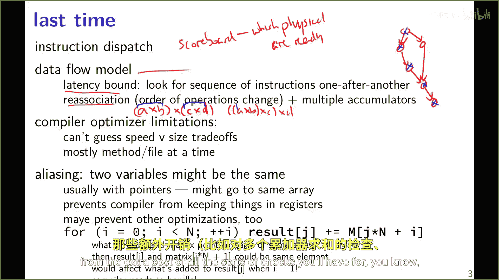
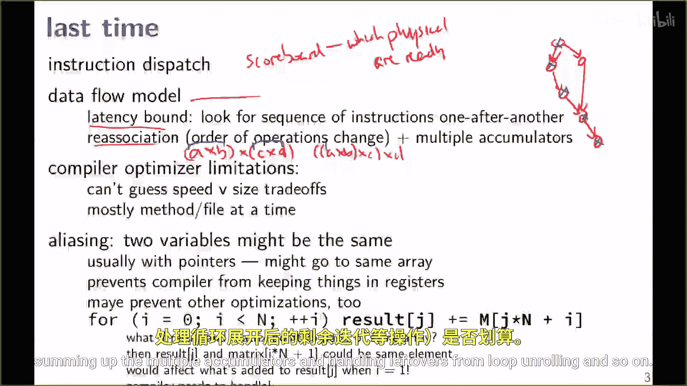
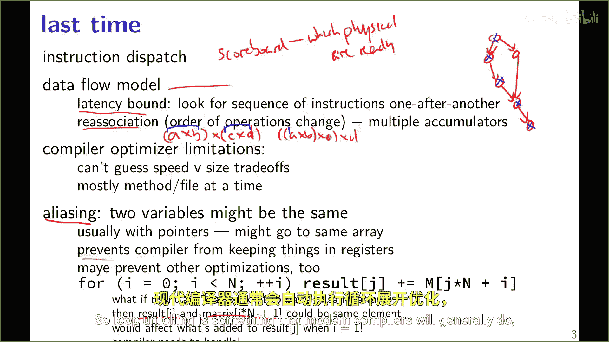

# 计算机架构：P22：优化策略3 🚀

在本节课中，我们将学习乱序处理器中指令调度的后续过程，探讨数据流模型和延迟界限的概念，并分析编译器优化的局限性。我们还将了解如何通过重组操作和使用多重累加器来优化程序性能。

---

上一节我们介绍了在乱序处理器中进行寄存器重命名后，如何管理指令列表以确定执行顺序。我们通过一个表格来追踪物理寄存器的就绪状态，从而模拟指令分发的细节。

然而，这种模拟方法繁琐且难以指导我们如何实际修改程序以获得更好的性能。在观察指令分发的例子时，我们注意到一个现象：处理器常常因为所有指令都在等待尚未计算完成的数据，而无法充分利用其全部计算单元。

为了更清晰地思考这个问题，我们引入了数据流模型的概念。我们可以绘制一个**依赖关系图**来表示指令间的依赖。

```
例如，要计算图中的最终值D，需要先计算C。而要计算C，又需要先计算B，以此类推。
```

通过分析这个图，我们可以找到必须**顺序执行**的最长操作链。执行一段指令序列所需的最短时间，就受限于这条最长链的长度，这被称为**延迟界限**。

理解了延迟界限的概念后，我们就可以思考如何通过重排程序来降低这个界限。我们的教材将此称为**重组**。

一个典型的例子是计算 `(A * B) * (C * D)`。如果我们按照 `(A * B) * (C * D)` 的顺序计算，两个乘法 `A*B` 和 `C*D` 可以**并行**执行。但如果按照 `((A * B) * C) * D` 的顺序，所有乘法都必须**串行**执行，导致更长的关键路径。

在循环优化中，我们也看到了类似的思想，即使用**多重累加器**。例如，在求和的循环中，如果只使用一个累加器，每次迭代都必须等待前一次加法完成。

```
// 单一累加器
sum = 0;
for (i = 0; i < n; i++) {
    sum += a[i]; // 每次加法依赖前一次的结果
}
```

而使用多个累加器，可以将工作拆分，让部分加法并行执行，最后再合并结果，从而降低延迟界限。





```
// 多重累加器 (例如2个)
sum0 = 0; sum1 = 0;
for (i = 0; i < n; i+=2) {
    sum0 += a[i];   // 这两个加法可以并行
    sum1 += a[i+1];
}
sum = sum0 + sum1; // 最后合并
```

---

在了解了处理器工作原理和这些优化手段后，我们可能会问：为什么编译器不自动完成这些优化？有时编译器的确会做，但它存在一些局限性。

一个主要局限是编译器必须**猜测**哪些优化是值得的。像循环展开和使用多重累加器这类优化会增加代码体积。如果循环迭代次数很少，这些优化带来的收益可能无法抵消其开销（如指令缓存压力、合并结果的额外操作等）。编译器通常缺乏足够的信息来做出完美判断。

另一个大问题是编译器通常以**单个方法或文件**为单位进行优化。在分别编译多个文件时，编译器无法基于调用方的上下文来优化被调用的方法，反之亦然。虽然存在“链接时优化”等技术，但它们往往不是默认选项，因为会显著增加编译时间。

一个更微妙但影响深远的局限是编译器必须处理**边界情况**，其中**别名**问题尤为棘手。当编译器编译代码时，两个不同的指针变量可能指向同一内存位置（别名），这通常发生在数组操作中。

```
// 示例：可能存在的别名问题
void compute(float *result, float *matrix, int n) {
    for (int i = 0; i < n; i++) {
        for (int j = 0; j < n; j++) {
            // 如果 result[j] 和 matrix[j*n + i] 是同一位置（别名）
            // 那么对 result[j] 的写入会影响下一次迭代的读取
            result[j] += matrix[i*n + j];
        }
    }
}
```

这种对别名的担忧会阻止编译器将变量保留在寄存器中，也可能阻碍其应用多重累加器等优化，因为编译器必须假设每次写入都可能影响后续的读取。

---



本节课我们首先回顾了乱序处理器的指令调度，并引入了数据流图和延迟界限的概念来分析性能瓶颈。我们学习了通过**操作重组**和**使用多重累加器**来降低延迟界限的优化方法。随后，我们探讨了编译器在自动应用这些优化时的局限性，包括其对优化收益的猜测困难、以单个模块为单位的优化范围限制，以及因担心**内存别名**问题而采取的保守策略。理解这些原理有助于我们在编写高性能代码时，知道何时需要手动引导优化。