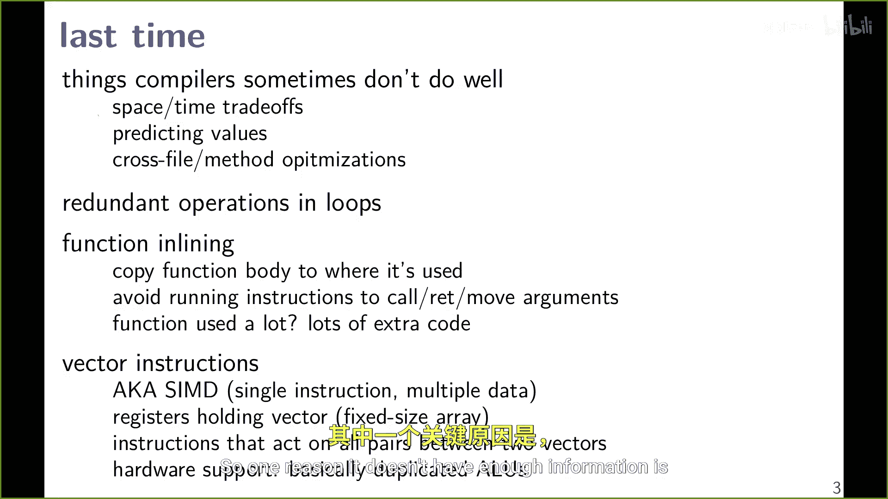
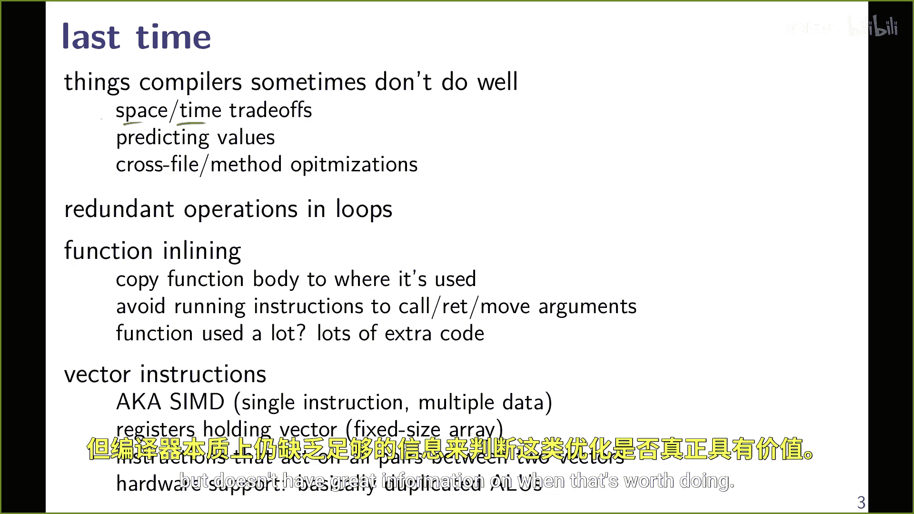
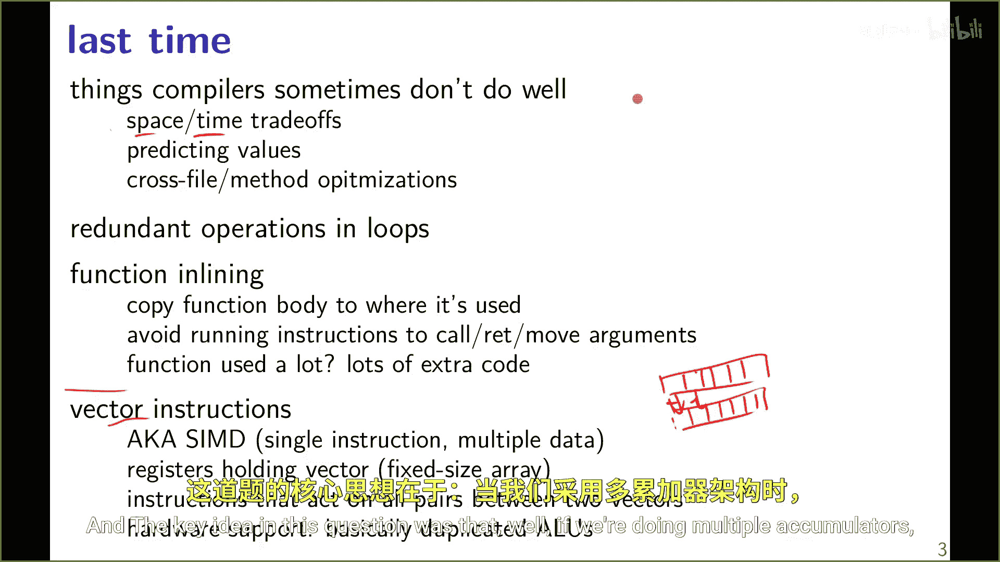
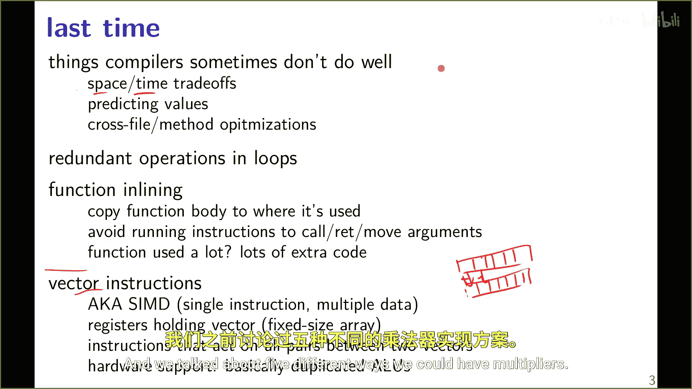
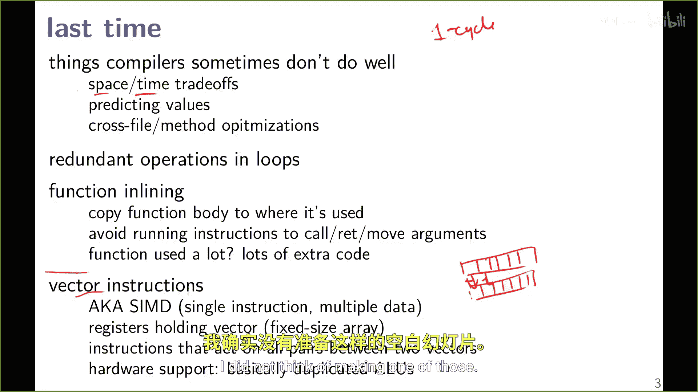
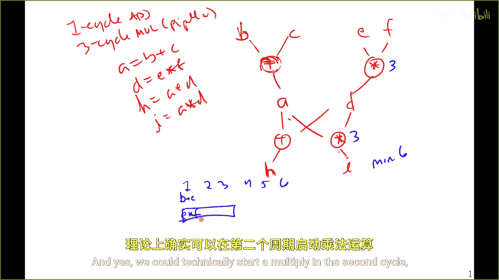

# 弗吉尼亚大学【中英⚡计算机架构｜CS3330 2020 Computer Architecture】 p23 P23 Exceptions -BV1cKeGzqEuJ_p23-

Good afternoon。So。Lasts time we。Talked a bunch about optimizations and started mentioning sort of the roles of compilers and there were things that compilers。

These sometimes don't do well。 And one of these things is。Well。

 most of these things are just about the compiler just doesn't have enough information to do everything we might want it to do with optimization。

 So one reason it doesn't have enough information is that many of the optimizations we want to do have sort of space time trips that we make our code bigger to make it faster or things like loop unrolling or catch blocking and that's not going to be worthwhile in many cases。

 and the compiler doesn't have great information， Maybe there's some way you can give it a hint but doesn't have great information on when that's worth doing。

And。Something which makes this worse is that the compiler， you know。

 kind of has to guess what a typical value will be。

 so it doesn't know if a loop button has a lot of iterations。 It doesn't know of two pointers。

Often point to the same array or not， and it has to generate code。

 which works in spite of this and is not like really bad in spite of this。

And this means that many of the optimizations we talked about。

 at least unless you sort of do something to encourage the compiler。

 it's not likely to make on its own。Another issue is that for performance reasons， most compilers。

 at least by default， you know， mostly avoid cross fileile and cross method optimizations just because it's a lot faster and we're talking about multiple files。

 we can't use the object file scheme we talked about if we want to do cross file optimization。

We talked about a few miscellaneous optimizations。 So one thing you mentioned is that， you know。

 if you have a loop with some redundant operation， like hopefully the compiler can like just do it once。

 but sometimes that might not be possible。 We gave an example of like a call to。

The string line function， the compiler would need to do a lot of analysis。

And cross file analysis to figure out， oh， the string line function is not going to change its result。

 so it's going to call it lots of times and you might have similar situations where that comes up where there's some comparison or something like that in a loop that you know we as humans can figure out。

 oh， this is going to be the same every time but the compiler can't really know that。

Another thing the reaction was this idea of function in lining that。Just like with loops。

 we have this sort of index maintenance， these comparisons to see if we're done with the loop with functions。

 we have。Instructions to move arguments to the place where we expect them under the calling convention to do calling and returning。

And instead of doing that， we could just copy the body of the function where it's used。

And this will just save instructions in the T case。And no， that's usually a win。

 but compilers won't do this all the time because， well， if we did it all the time。

 we just make our program huge and that would not end up being faster。

 but for cases where you know it's an inner tight loop and the functions pretty small。

 it's worth doing and the compiler is going to guess what those cases are。

 but it may not guess them all correctly。Question is， I can't find the flies on the Ca schedule。

 are they uploaded， they are probably uploaded with no link because I made a mistake。Yes。

 that is precisely what happened。Not sure if this fix will happen in time。

So they'll hopefully be present。Some version of the slides will hopefully be present。

 though I probably should。Actually。We' probably be present in a few minutes。So questions Oh。

 should of finish up。 So after we talked about function inlinning， talked about vector instructions。

 So this was the idea that our processors can provide instructions where instead of having one value in a register。

 we keep。A little array of values in a register， so we have much bigger registers to accommodate that and we provide instructions that most commonly act on all pairs of values between two registers to get a results。

 so we would have an a instruction which would add say eight pairs of numbers instead of one。

 and our implementation would basically be we duplicate the ALU to support this。

And why would that be worthwhile， Well， we're duplicating the ALU。

 but we weren't duplicating all the logic for fetching instructions， for scheduling instructions。

 which you learned， got really complicated in an out of order processor。And things like that。

So we're going to finish up talking about vector instructions to start out today。

 but before I do that， any questions about things we covered last time？

And for those who want to follow along with slides， that should upload a version of the slides。

Can I question is can I go through quiz question two。

 So I need to remember what quiz question two was。So first question two was about。

Doing a multipleccumulator' optimization with various sort of multiplier designs and。

The key idea in this question was that， well， if we're doing multiple accumulators。

 the purpose of that is to allow multiple operations to occur in parallel。

And。We talked about three different way， five different ways。 we could have multipliers。

 the first two。

You know， only allowed one multiply to happen at a time。 So even if we had， you know。

 the multiplications arranged in a different order， we could still only do one at a time。

 and we'd be able to achieve that under the assumptions of the question in our original。

Design so in our original loop without using multiple accumulators。

The others had the capability of doing at least between 10 and 100 multiplies at a time。

 different parts of them， but we could do parts of different multiplies at a time。😡，And。

 and that is where multiple accumulators became helpful， because rather than doing one。

Multipplication， waiting for it to finish during the next， we can do one and start another。

 possibly in the same cycle if we had enough multipliers， possibly a little bit later。

 but before the first multiply finishes， and that's where we get an advantage。

S answer about question2。And someone' was asking if we could review questions。1 and4。 So sure。

 I'll talk about question one。 So question one on the quiz said that we had a。One cycle adder。

 do I have a slide that is mostly blank？Or did I not think of making one of those。

 I did not think of making one of those。

I know。 I did It did。 Okay， so we have a。A one cycle adder。嗯。And they。Fe cycle wall that's pipeline。

And we're asking about scheduling。A equals B plus C。D equals E times F。H equals。A plus D。

And I equals a plus D。A times steep。And。To kind of figure this out。 I draw a data flow diagram。

 So we have。B。 this is A。We have B and C feeding into this plus operation to become a。

And we have E and F feeding into this times operation to become D。And then we produce。H。

 by adding these。And。I， by multiplying them。So one thing we can observe immediately is that we know that we have to do the multiplication of E and F before we can do the multiplication of A and D。

 and this takes three cycles， this takes three cycles， so we're going to need at least six cycles。

That happens to be an number we can actually take and we can see that because what we can do is we can during we can actually schedule these operations so that happens we can do the B plus C during the first cycle and the E times F。

 we can schedule for three cycles。And。

