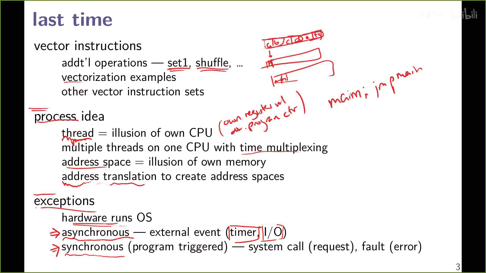
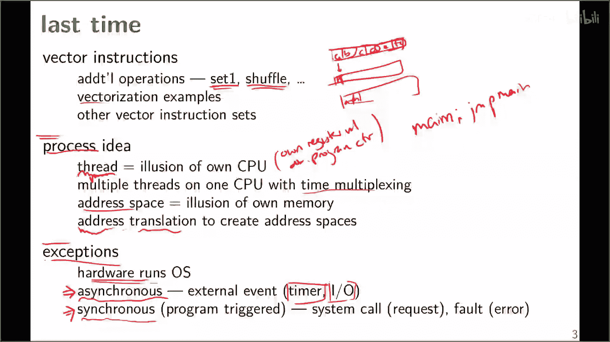
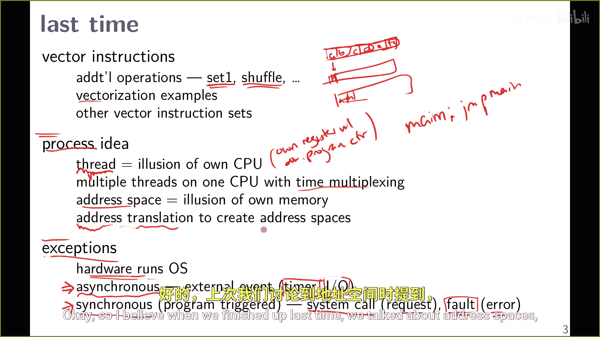
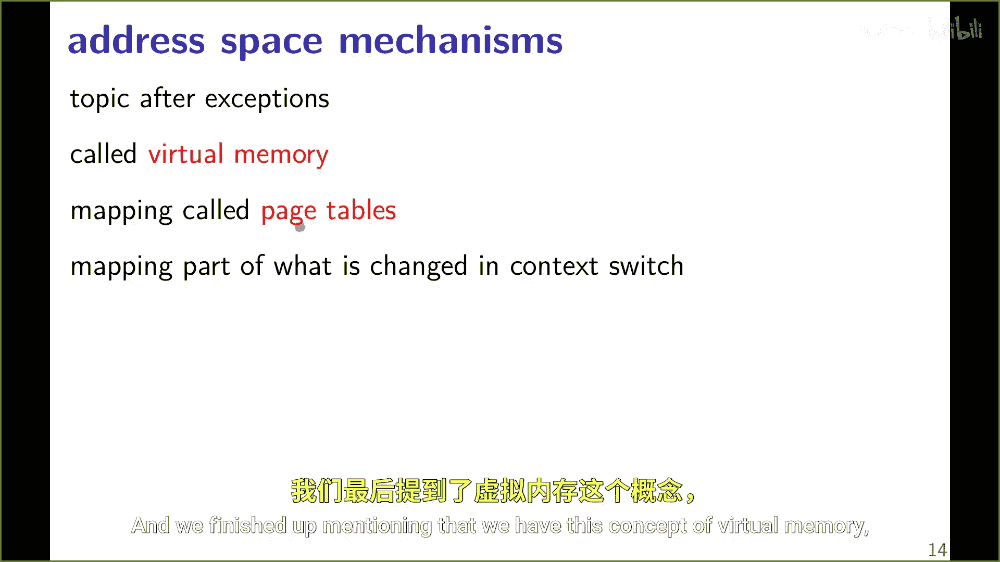
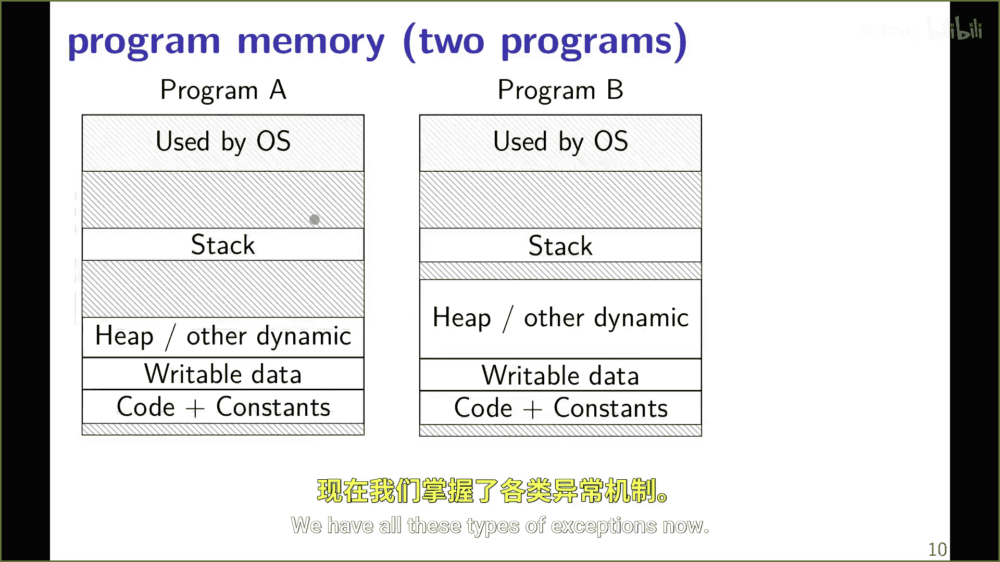
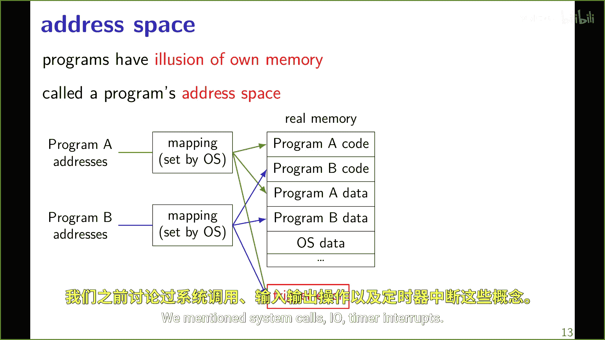

# 弗吉尼亚大学【中英⚡计算机架构｜CS3330 2020 Computer Architecture】 p24 P24 Exceptions (finish) - Virtual memory 1 -BV1cKeGzqEuJ_p24-

Good afternoon。So last time we finished up talking about vector instructions。

 and we started by showing that， in addition to our。

Operations where we had a vector and a single vector register and did。

These sort of pairwise operations with another register where they have you know。Some values。

In our vector and another vector。 And we get。For example。

 the sum or some other operation of each pair。So that well sometimes that wasn't quite enough to do everything we wanted。

 so we had some additional operations that might help us we learned that we could broadcast a single value across a vector。

In case we wanted to say。add the same thing to all the values in a vector and that we could move values around in vector and these were operations that we kind of needed to make these vector instructions useful for less contrived problems than sort of the simple examples we started with and you used some of those probably。

During the lab on Wednesday。嗯。And we went through an example of doing vectorization with the more realistic matrix multiply problem and made some notes that。

 well， the vector instructions that Intel shows know。

 maybe not the best possible choice and that there are other instruction sets out there with more features than what we're going to be able to use in our assignments and also with programming interfaces that are at least higher level than the version we are using。

Then we went on to our different topic of talking about the idea of a process。

 so a process is sort of what you think of when you have a running program on a typical operating system that from the perspective of that program。

 it's kind of like you have the CPU to yourself。And we call this idea a threat that you have your own CPU with your sort of own register values and own program counter。

And it looks like when you set your registers， it doesn't affect any of the other programs。

 even though we know that you're probably going to be sharing a single processor with a single set of registers and a single program counter register with other programs。

😡，And we learned about one technique for doing that， which is that。We do time multiplexing。

 we split up the time you spend on that CPU， so other things get time。mAnd to make this happen。

 we need to have something run that handle the switching from。One program to another。

 and we learned that that would be the operating systems job。

 but we also needed a mechanism for the operating system to run in the first place because if I'm running。

 say， you know in infinite loop of main， say jump main， well， there's no instruction here。

That if my processor is just executing instructions normally would say to now。

 stop doing this loop and go somewhere else。So we had to have some sort of out of band mechanism and that mechanism is called exceptions where if the hardware would run the OS without prompting。

 and we could use that we learn to implement time multiplexanders。

 some other functionality we'll learn this also going to be implemented with exceptions。

In addition to giving you the illusion of your own CPU， when you run a program。

 it usually has the illusion that has its own memory that know if you write to your stack。

 that's not going to affect any other program that's running stack。

 you aren't going to accidentally read things from other programs。

And the mechanism should provide this。Was called address translation。 and we call the illusion。

 It creates an address space that you have an independent address space that the addresses you can access and address translation creates that by having the processor。

Take every address your program uses and put it through a mapping that the OS describes。

 and we're going to talk later today， we start talking about what that mapping looks like and finish up talking about that next week。

So after we introduce the process， we look more into this idea of exceptions。

So we mentioned with exceptions that。Yeah。this is a case where the hardware is going to run the O without prompting。

 And we started looking at， well， like， why would exceptions happen， And we mentioned。

Things that would happen outside the program and things that would happen inside the program。

 we call the things that happen outside asynchronous exceptions。

 things that happen inside the program， synchronous exceptions。

So the asynchronous exceptions include things like a timer。 So in order to。You know。

 run a program on the CPU for a bit of time， but then let another program run。

 the OS sets a timer and when that timer goes off， an exception occurs and the hardware runs the OS in spite of the program perhaps running an infinite loop that doesn't say to go to the US。

😡，We also learned that for things like IO events， like pressing a key。

 we want the operating system to figure out， well， what do I do with this key。

 which program does it go to because things like our keyboard and most of our other IO devices are kind of shared between all the programs。

😡，And what we'll do rather than having the hardware。

 figure out how to run the right program and give the right program the info。

 we'll just have the hardware run the operating system and the operating system is going to figure out how to deal with that IO event。

😡，So that's these asynchronous exceptions for IO。 We also have these synchronous exceptions where the program triggers an exception。

 and we mentioned one case of what we called a system called this is a request by the program for assistance from the OS。

And we'll talk later today about wait， why does this need to be done with an exception。

 why can't it just make a function call and there's going to be a reason for that。😡。

Related to how we keep programs from doing things that they aren't supposed to do。

And there's other type of。Exception that occurs that you've probably seen symptoms of。

 which is called a fault。Which is when a program does something it's not supposed to do。

 And the hardware needs to know how to handle that。 So， for example。

 we mentioned we have address translation to。While the operating system specify what memory a program can access and the operating system can specify。

 oh， there's some memory you're not supposed to be able to access。 You know， it's not allocated yet。

 And the hardware has to do something when the program tries to access that memory。

 What it's going to do， it's going to trigger a fault。And run the operating system。

 ask the operating system， hey， operating system， what do you want to do？You know。

 what do you want to do through this program that access memory wasn't allocated or divided by zero or some other erroneous operation where otherwise the hardware would have no idea what to do？

So we're going to pick up today by now that we've talked about sort of types of exceptions to talk a bit about how we actually run the exception handler。

 the code in the OS that handles the exception and something about how we have some additional hardware mechanisms to allow the OS to keep programs for messing up the OS of stuff。

So before I do that， questions about any of these topics。Okay。

So a question is the synchronous asynchronous terminology related to web application。

 So you might see the term synchronous。And asynchronous used in other contexts。

 and generally asynchronous means not being triggered by something。You know， directly。

 and so in a web application context， you might say something's asynchronous if like the server triggers it。

 and it's the same kind of idea， but it's a very different context， but you know。

 is it triggered by what we're currently doing versus something that's。

 you know not what we're currently working on。😡，that answer that question。Other questions。Okay， so。

I believe when we finished up last time we talked， we were taught。

 talked about address spaces we mentioned。That we can。And we we finished mentioning that。

We have this concept of virtual memory， which we'll talk about later。

 and we have all these types of exceptions now。 So we have our exceptions for， oh。

 what if the program access is memory that's not allocated to it。

 It's set to trigger an error that runs the US。 We have our exceptions for。😊。

Things like。嗯。Dividing by zero， we mentioned system calls。

