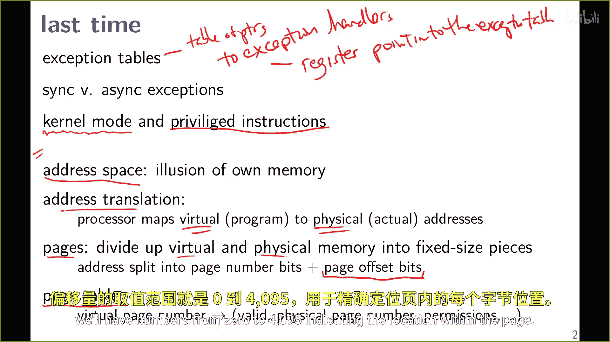
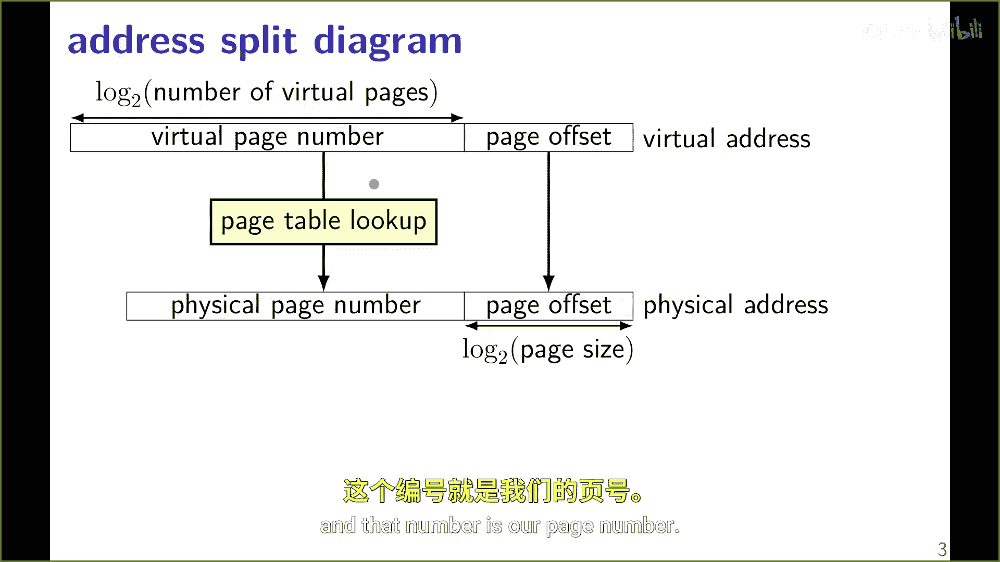
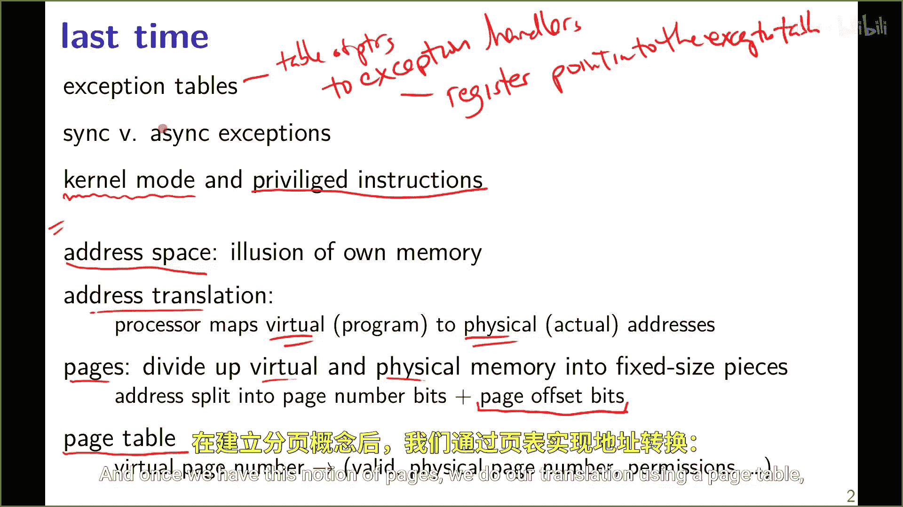
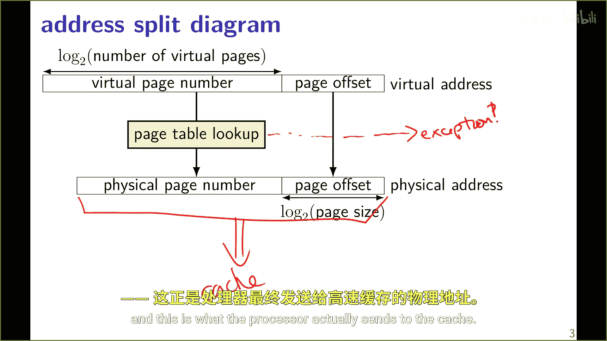
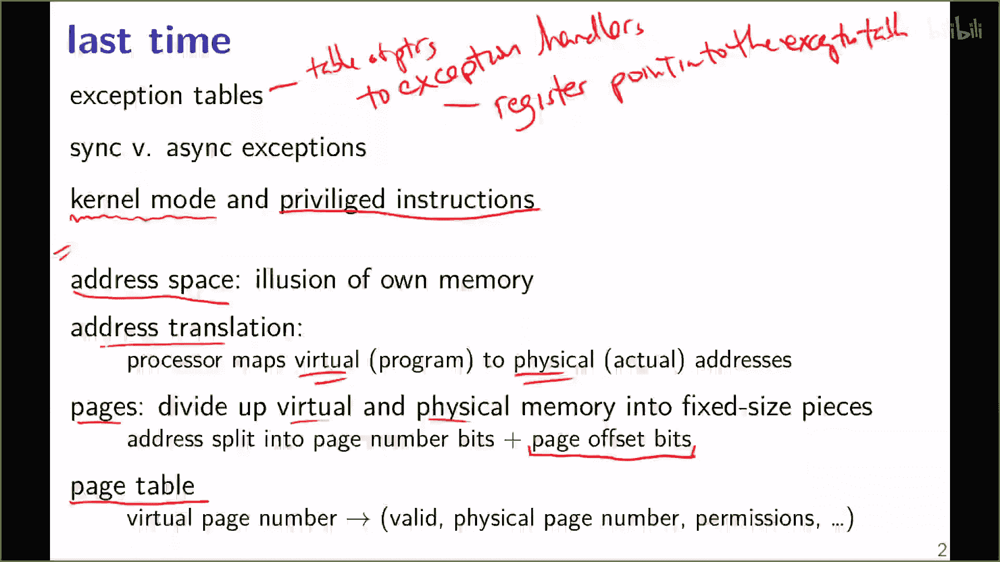
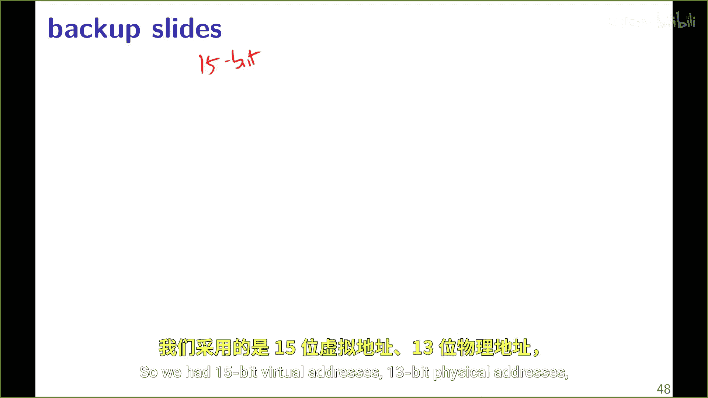

# 弗吉尼亚大学【中英⚡计算机架构｜CS3330 2020 Computer Architecture】 p25 P25 Virtual memory 2 -BV1cKeGzqEuJ_p25-

我看看。Good afternoon。 So last time we talk finished up talking about exceptions。

 You mentioned the idea of exception table。 So this is a。Table of pointers。To exception handlers。

 that's the code。 the operating system wrote that。Deals with each kind of exception will have a different handler for each particular type of scenario that the hardware might ask the operating system for help。

 and we have a register set by the OS pointing。To the exception 2。

We mentioned that there are different kinds of exceptions， and we enter one particular。

At the scenario where read。Weant to have an additional processor feature integrated with exceptions to help out the O。

 And this was that， well， we want the O to do things to help share the machine。

 They mentioned the idea of switching between different programs to share。the processor over time。

 that idea of threads， and we don't want it to be the case that one program could mess things up for other programs。

 so we went certain operations like setting up how exceptions work。

And doing IO to the deviceses that are shared between multiple programs to be reserved for the OS。

 and we call these things privileged instructions。And we need to have the processor track whether the OS is writing or not。

 and to do that we have this idea of kernel node。That in kernel mode。

 the the processor makes these proboion instructions work。

And the idea is the OS is the only thing that gets to run in kernel mode and neural program is run in user mode。

 instead， where those pair with instructions instead trigger one of the exceptions。

 the OS gets to decide what to do about it， probablycraed the program and print out a message saying。

"Hey， this program tried to do something it shouldn't have。

And we integrate this with exceptions because we can switch to kernel mode when an exception happens。

 because we know we're running the OS， and we can let the OS switch back when it returns from one of those exception handlers and wants to be running a normal route。

Then we looked into。More detail about our second part of this idea of processes。

 Our process idea gave us sort of the notion that we had a whole machine。

 We talked about how we had this。Processor to ourselves with this idea of switching over time。

But we still needed some way of sharing the memory and we want to give each program the illusion that has its own memory that's dedicated to itself。

 even though that's not going to be really the case really we're just going to have one memory and we call this illusion and address space and the mechanism that is almost always used to implement address spaces is something we can call address translation that there's this mapping that the processor uses that maps the program addresses。

 which we call virtual。To the real addresses on the machine， which we'll call physical。

This mapping is used by the processor but it's set by the OS and by setting this mapping differently depending on what programs are running。

 the OS can make each program have its own view of what the memory is and not make sure that that is independent for each program that one program can't interfere with the others and each program also can't interfere with the OS' stuff because that's going to be in a part of memory。

 it's not going to be allowed to access。Then we started talking about the mechanism that we use to represent this mapping。

 and that's going to be something we call the mechanism called virtual memory。

 and we're going to represent the mapping in virtual memory with something called a page tip。

And page tableable deals with pages， and what are pages？😡，As a step2。

Be able to represent this mapping。 We want to divide up our。Available addresses into chunks。

 because we don't like to specify each individual address。 So we'll specify these big chunks。

 we call pages。And we'll just divide up virtual and physical memory into these fixed size pieces。

 We'll actually choose not just a fixed size， but a power of two size。

 And that's going to mean that we can split up our addresses into。Two pieces。

 So one piece well call the page offset， which is sort of the location within a page。

 So if our page size is say。4096 bytes， that's 2 to the 12 bytes will have numbers from  zero to 4095。

 indicating the location within the page。

And we'll need 12 bits to represent that that will be our page offset bits。

And we call the rest of the address a page number， which is just going to be 012 when we split up into pages。

 we just number the pages starting at the beginning and that number is our page number。

And。

Once we have this notion of pages， we do a translation using a page table that we take our virtual page number。

 that's the page number from the virtual address。And we have a table with an entry for each possible virtual page number that gives us the corresponding physical page number。

 And we learned that， well， it gives us the corresponding physical page number， or it might say。

That that didn't work， and there's an exception。This is the case where we just haven't assigned a physical page to that。

That particular virtual page。 And once we get that physical page number。

 we combine it with a page offset， and this is what the processor actually sends to the cache。

是的。

Questions about these things we covered last time。So one question。

 where does the virtual address come from？So these virtual addresses。

 these are any address used by the program。So when virtual memory。

 when one of these page tables is active， every single address the program uses it be it the address it's jump to a pointer it's to referencing the address of the stock pointer all goes through this translation。

So then there's a question， so the page offset says specifies where in the page the physical addresses。

 so remember that when we set up these pages， we said that we split our virtual addresses so this is our range of all virtual addresses。

We split them up into chunks， so this was one page， this was one page and so on。

 and we did the same with our physical addresses， so if this was all physical addresses。

 we split them up into chunks of the same size。And our pH number tells us which of these chunks we're in。

So。You can say B。Page number。It equals which page？And that's true。

 regardless of whether we're looking at the physical or virtual。

 just you know which view of addresses we're looking at and the page offset says where and here are we。

 So the page offset。Is location。Within page。And。The page offset is going to be the same within our physical and virtual and physical address。

Because if， for example， if。啊嗯。If the mapping in our page table says that this virtual page goes to this physical page。

 then we want to make sure that if the address that we're looking at is this far into the page。

 it's the same part distance into the page after the translation。

 which is why we just copy that page of set。😡，And there's a question。

 can the physical address be the same as the virtual address， Yes， and how would that happen， Well。

 that's going to happen if this。Page table look up here。😡，Yields the same number going out as in。 So。

 for example， if our page table had， you know， an entry for， say， you know， like index 1。

You got a valid bit and our physical page number was one。 well， it would be the same address。

And that would just be a coincidence， right， because typically that's not going to happen。嗯。

Some other question， can I go over question4 in the quiz。

 I will need to remember what question4 in the quiz is。Question4。

Was asking if we have a system with 13 bit virtual addresses。

 13 bit physical addresses and page tables with 32 entries， what's the size of pages？

Do I have a blank slide， yes， okay？So I'll do that so we had。

