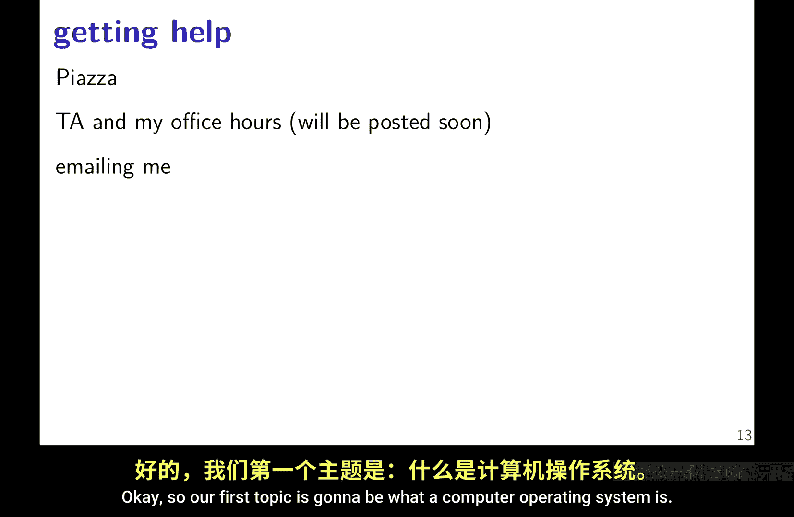
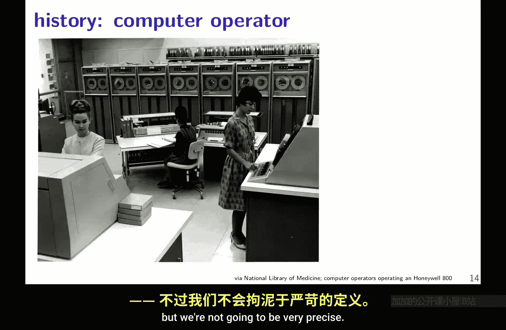
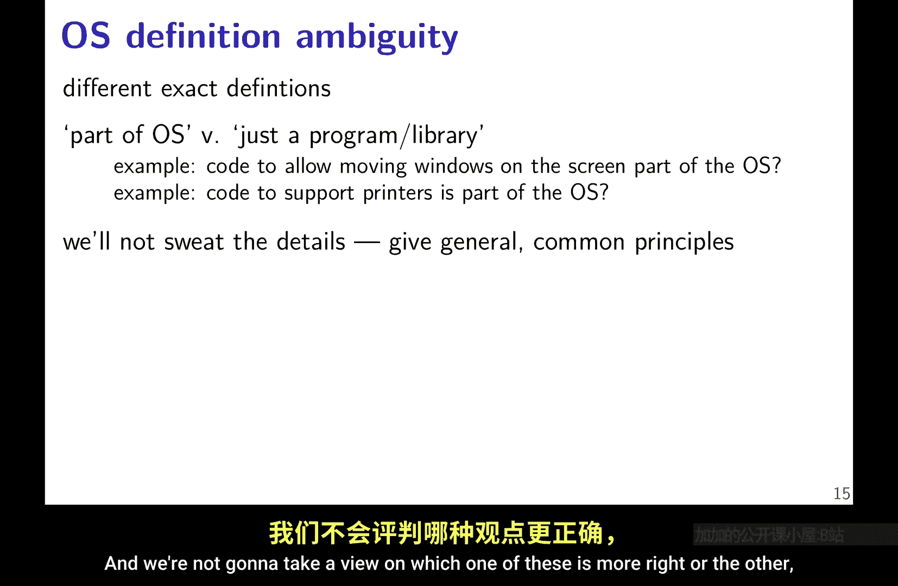

# 001：什么是操作系统与课程安排

在本节课中，我们将学习操作系统的定义及其核心功能，并了解本课程的具体安排和要求。

## 课程安排

以下是本课程的具体安排和要求。

*   **课程网站**：所有关于作业、日程安排等信息都发布在课程网站上，该网站链接可在协作平台中找到。
*   **作业**：作业占总成绩的55%，非常重要。第一份作业截止日期是下周五。大部分作业使用C或C++语言，课程后期会有一份Python作业。作业通常给一到两周时间完成，如果是两周的作业，中间会有一次检查点提交。两周的作业分值更高，因为预计需要投入更多时间。
*   **教学操作系统XV6**：部分作业将使用一个名为XV6的教学操作系统。它基于MIT人员构建的一个旧版UNIX系统，重写后支持32位和多核，理论上可以在真实硬件上启动，但为了便于开发，我们将在模拟器中运行它。
*   **测验**：每周讲座后会有在线测验，内容覆盖当周所讲知识。测验是开卷的，可以使用笔记和互联网。目的是促使你复习材料。
*   **考试**：课程安排中有一次期中考试和一次期末考试。期末考试是与另一个班级合考，时间为晚上7点，不在正常上课时间。如果无法参加考试，请提前告知。
*   **迟交政策**：具体政策详见课程网站。
*   **教材**：推荐教材是Anderson和Dahlin合著的《操作系统：原理与实践》。没有强制要求的教材。另一本建议教材是《操作系统：三步走》。如果你不喜欢纸质书或想要便宜的选择，推荐前者，因为它对某些内容的阐述不那么简略。两本书覆盖了大部分相同内容，只是方式略有不同。你也可以参考更早的教材以获取不同视角。
*   **学术诚信**：作业是个人任务。这意味着你不应使用之前学期的代码，除非是你自己之前学期的代码。不应共享代码、伪代码、代码的详细描述或其他可能导致代码雷同的内容。请不要使用来自互联网的代码，图书馆的书籍等也有限制例外。如果代码解决的不是作业的主要问题，例如，作业主要不是关于文本解析，但你需要一个分割字符串的函数，这种情况可以使用。使用时必须在代码中注明出处。如果涉及作业的主要目标，则不允许使用。如有疑问，请事先询问。对于测验，虽然是开卷，但也请独立完成，不要共享答案或到网上寻求解答。
*   **候补名单**：如果你在本学期需要此课程才能按时毕业，并且你在候补名单上，请发邮件给我说明具体情况。请注明你能参加哪个部分的课程，如果不能参加所有部分，请解释原因。
*   **寻求帮助**：你可以使用Piazza平台提问。会有答疑时间。你也可以给我发邮件作为最后的选择。

## 什么是操作系统

上一节我们介绍了课程安排，本节中我们来看看操作系统的定义。

操作系统像许多程序一样，旨在自动化一些原本需要手动完成的任务。历史上，有计算机操作员这个职位，负责管理存储文件和程序的磁带，需要手动将它们加载到适当的位置，并操作计算机控制台来启动程序等。操作系统自动化了这些任务，协调所有程序、文件等。

现在，我们来谈谈什么是操作系统，但我们不会给出非常精确的定义。原因在于，外界对于什么算作操作系统并没有非常精确的共识。大家清楚它涉及自动化加载程序、读写程序、处理程序输入输出等任务，但其边界定义并不明确。

具体来说，你会发现有些人认为某些东西是操作系统的一部分，而另一些人则认为那只是一个库或一个程序，并非真正的操作系统部分。例如，允许我在屏幕上移动窗口的代码。有些人会说这是操作系统的一部分，是操作系统让你能在屏幕上移动窗口。另一些人可能会说，那只是一个运行着的、让你排列窗口的程序，只是碰巧预装了而已。我们不会评判哪种观点更正确。

本节课中我们一起学习了操作系统的核心概念——作为自动化资源管理和程序协调的软件层，并详细了解了本课程的结构、要求以及学术诚信准则。