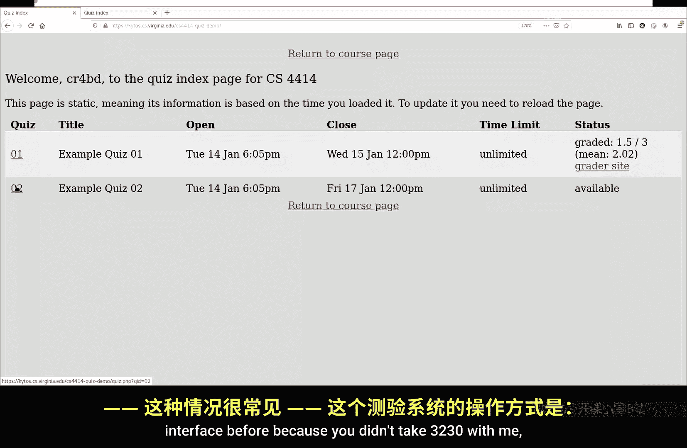
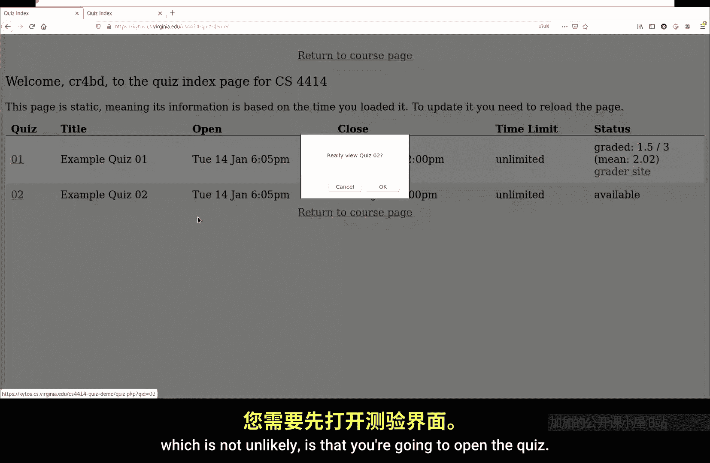
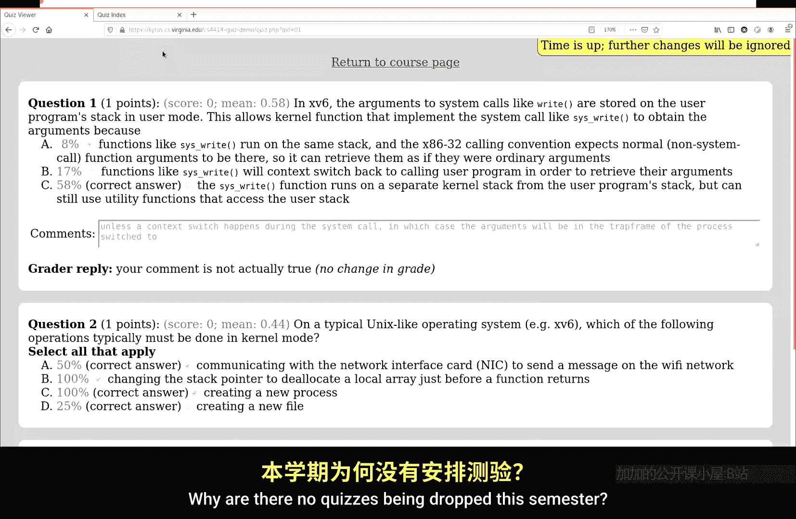

# 002：异常与上下文切换 🔄

在本节课中，我们将学习操作系统如何利用硬件异常机制，在用户模式和内核模式之间安全切换，以及如何实现进程间的上下文切换。我们还会介绍课程每周测验的流程。

---

上一节我们介绍了操作系统通过内核模式与用户模式的分离来保护系统资源。本节中我们来看看，当需要执行特权操作或响应特定事件时，系统如何从用户模式切换到内核模式。这个机制的核心是**异常**。

硬件提供了一种受控机制，用于从用户模式切换到内核模式。其基本思想是运行一个在系统启动时由操作系统设置好的**异常处理程序**。这个程序位于一个已知的内存地址，包含由操作系统精心编写的代码，用于决定在触发异常的事件发生时该做什么。

我们还需要这种机制的原因有几个：
1.  当某些事件（如键盘输入）发生时，操作系统需要使用特权指令来处理它们。
2.  我们需要一种机制来防止一个程序无限运行下去。
3.  程序需要能够显式请求操作系统执行需要特权的操作，例如分配更多内存。

在XV6操作系统中，系统调用的路径展示了这一过程：
1.  用户空间的一个包装函数包含一条特殊的、能触发异常的指令。
2.  执行流进入XV6中异常处理的公共入口点。
3.  系统判断出这是一个系统调用，并确定是哪个具体的调用。
4.  最终调用该调用的实际处理程序，获取参数并执行操作。
5.  操作完成后，返回到用户程序。

---

在继续今天的新主题之前，我们先了解一下本课程的每周测验安排。


以下是关于测验的重要信息：



*   **时间安排**：测验按周进行，在特定时间开放和关闭。通常在本节课后（晚上8点）开放，在下节课前（中午12:15或12:30）关闭。请另一时间段上课的同学不要在讲座期间完成测验。
*   **界面与题型**：测验界面会显示问题，可能包括单选题、多选题和自由回答题。选择答案后，选框会变绿表示答案已记录。如果选框变黄并带有红边，则表示答案因网络等问题**未成功记录**。
*   **答案与评论**：除了选择答案，你可以为任何问题添加评论。所有错误答案的评论都会被助教或教师审阅，以决定是否应给予分数调整。
*   **成绩查看**：测验截止后会自动评分。你可以在成绩页面查看自己的答案、评分以及每个选项的选择人数统计。
*   **注意事项**：
    *   由于截止后答案即公开，**无法为测验提供延期**。如有特殊原因（如生病），请另行联系。
    *   本课程**不打算**设置可丢弃的测验成绩。



---

现在，让我们回到操作系统的主题。我们了解了异常如何让控制权从用户程序转移到操作系统内核。但现代操作系统需要同时运行多个程序。为了实现这一点，操作系统必须在这些程序之间快速切换，让每个程序都感觉自己独占了CPU。这个过程称为**上下文切换**。

上下文切换的核心是保存当前运行程序的“状态”（即**上下文**），并恢复下一个要运行程序的已保存状态。程序的状态主要包括CPU寄存器的内容。

以下是上下文切换的基本步骤：

1.  **触发切换**：可能由定时器中断（防止程序独占CPU）或程序主动进行系统调用（如等待I/O）触发。
2.  **进入内核**：通过异常机制，CPU从用户模式切换到内核模式，并跳转到操作系统内核的中断/异常处理代码。
3.  **保存当前上下文**：操作系统将当前正在运行的进程的寄存器状态保存到该进程的**进程控制块** 数据结构中。
    ```c
    // 示意性代码：保存寄存器到进程结构体
    current_proc->context.ra = saved_ra;
    current_proc->context.sp = saved_sp;
    // ... 保存其他寄存器
    ```
4.  **调度选择**：操作系统的**调度器** 决定接下来运行哪个进程。
5.  **恢复下一个上下文**：操作系统从下一个进程的进程控制块中加载其之前保存的寄存器状态。
    ```c
    // 示意性代码：从进程结构体恢复寄存器
    next_ra = next_proc->context.ra;
    next_sp = next_proc->context.sp;
    // ... 恢复其他寄存器
    ```
6.  **返回用户模式**：操作系统执行一条特殊的“从异常返回”指令。这条指令会切换回用户模式，并将程序计数器跳转到新恢复的进程之前被中断的指令地址，从而继续执行该进程。

通过高速重复这一过程，操作系统创造了多个程序在同时执行的假象。

---

本节课中我们一起学习了：
1.  **异常**是硬件支持的、从用户模式切换到内核模式的受控机制，用于处理事件、执行特权操作和实现系统调用。
2.  课程**每周测验**的流程、界面和重要政策。
3.  **上下文切换**是操作系统实现多任务的关键机制，它通过保存和恢复进程的上下文（主要是CPU寄存器），在多个进程之间透明地切换CPU控制权。



理解异常和上下文切换是理解操作系统如何管理并保护多个同时运行程序的基础。