# 003：Unix API 1

在本节课中，我们将学习操作系统如何管理进程，特别是如何启动一个新线程。我们将深入探讨XV6操作系统中的具体实现，包括如何初始化一个线程的内核栈，以及如何通过模拟函数调用来实现线程切换。

---

上一节我们讨论了XV6如何处理系统调用和异常，以及如何通过切换内核栈来实现线程间的上下文切换。本节中，我们来看看如何启动一个全新的线程，这是之前讨论中缺失的关键环节。

在XV6中，每个进程只有一个线程。当我们想要启动一个新线程时，需要为其准备一个内核栈。然而，我们的`switch`函数期望栈上已经保存了之前调用`switch`时的状态。为了解决这个矛盾，XV6采用了一个技巧：它为新线程的初始内核栈“伪造”一个状态，使其看起来像是已经调用了`switch`函数并正在等待返回。

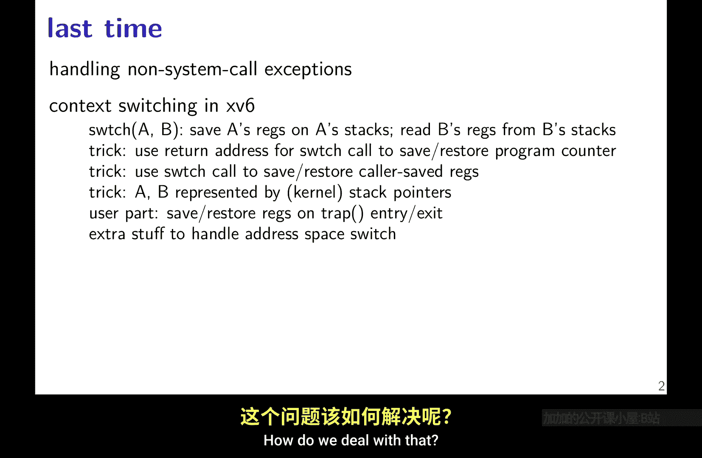

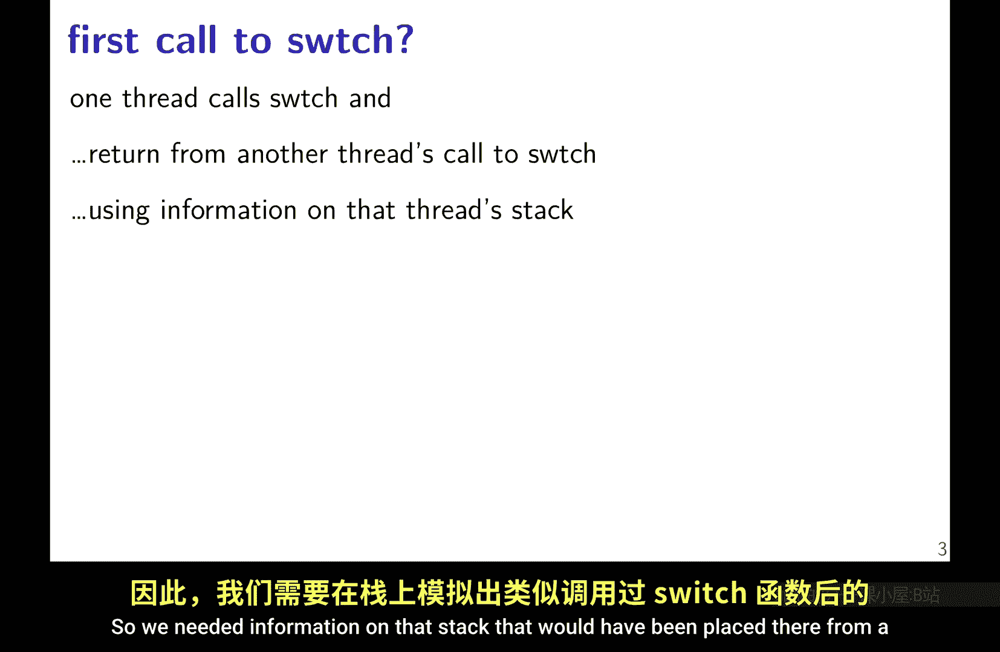

以下是初始化新线程内核栈的关键步骤，代码位于`allocproc`函数中：

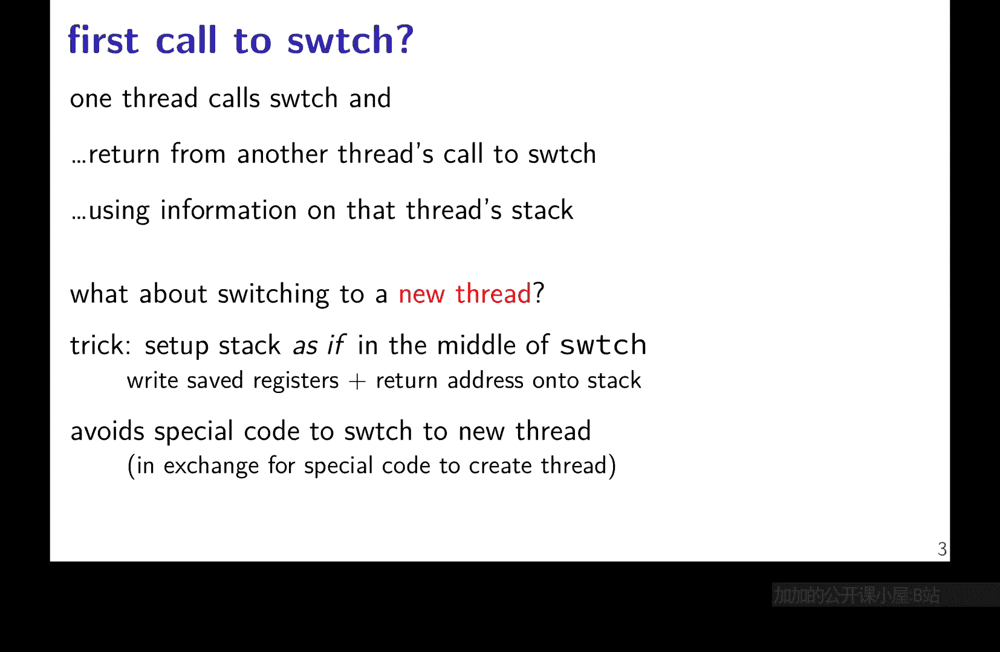

1.  **分配并定位栈顶**：首先为新进程分配一个内核栈，并将栈指针`sp`指向栈的顶部（在XV6中，栈向低地址方向增长）。
    ```c
    sp = p->kstack + KSTACKSIZE;
    ```

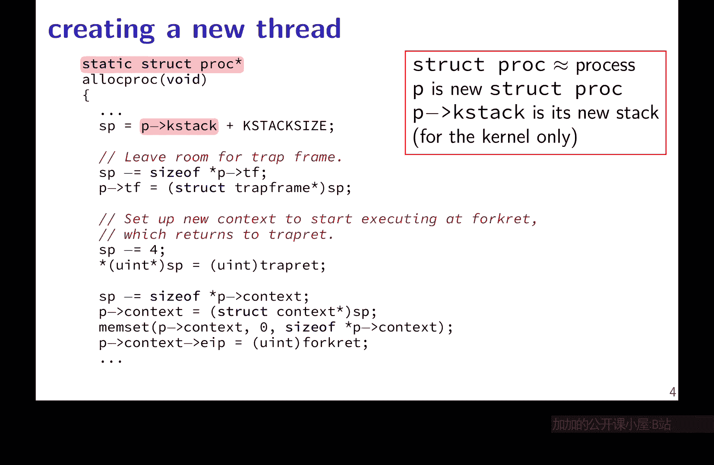

2.  **预留陷阱帧空间**：在栈上为陷阱帧（`struct trapframe`）分配空间。陷阱帧用于保存用户态寄存器的状态，以便在从异常（或模拟的异常）返回时恢复。
    ```c
    sp -= sizeof *p->tf;
    p->tf = (struct trapframe*)sp;
    ```

3.  **设置陷阱返回地址**：在陷阱帧中，设置程序计数器`eip`指向`trapret`的地址。`trapret`是汇编代码中紧跟在`call trap`指令后的标签，其代码负责从陷阱帧恢复用户寄存器并返回到用户模式。
    ```c
    p->tf->eip = (uint)trapret;
    ```

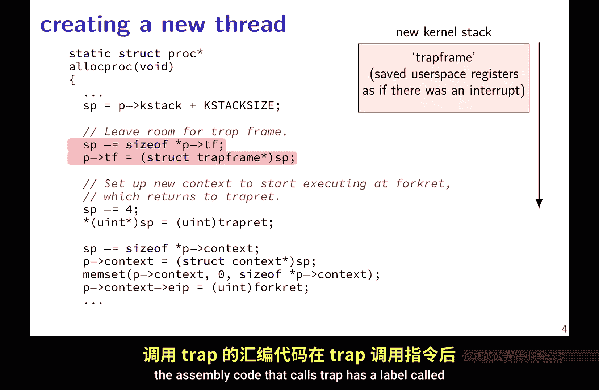

4.  **模拟`switch`调用上下文**：在陷阱帧下方，继续分配空间并设置一个“上下文”（`struct context`）。这个结构体正是`switch`函数保存和恢复寄存器时所期望的格式。我们将上下文的返回地址`eip`设置为`forkret`函数的地址。
    ```c
    sp -= 4;
    *(uint*)sp = (uint)forkret; // 返回地址
    sp -= sizeof *p->context;
    p->context = (struct context*)sp;
    p->context->eip = (uint)forkret;
    ```

5.  **完成上下文初始化**：将上下文结构中的其他寄存器（如`ebx`, `esi`, `edi`, `ebp`）初始化为0。
    ```c
    memset(p->context, 0, sizeof *p->context);
    ```

通过以上步骤，我们构建了一个特殊的栈。当调度器最终通过`switch`函数切换到新线程的这个栈时，`switch`会“恢复”这个伪造的上下文。它会将`eip`（指令指针）弹出到寄存器并执行`ret`指令，从而“返回”到`forkret`函数。

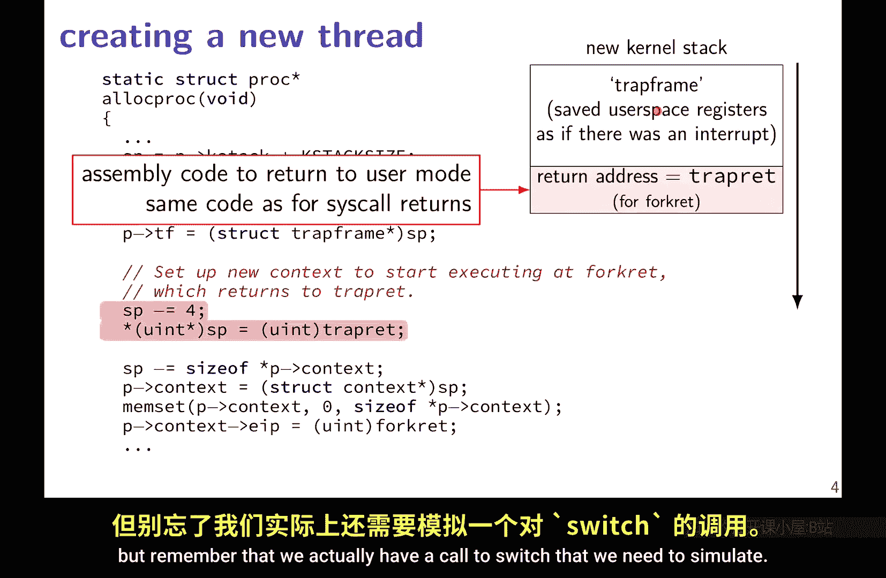

`forkret`函数会执行一些额外的初始化工作，然后返回。由于其返回地址被我们预先设置成了`trapret`，所以接下来就会执行`trapret`的代码，从我们预先设置好的陷阱帧中恢复所有用户寄存器，并最终跳转到用户空间开始执行新线程的程序。

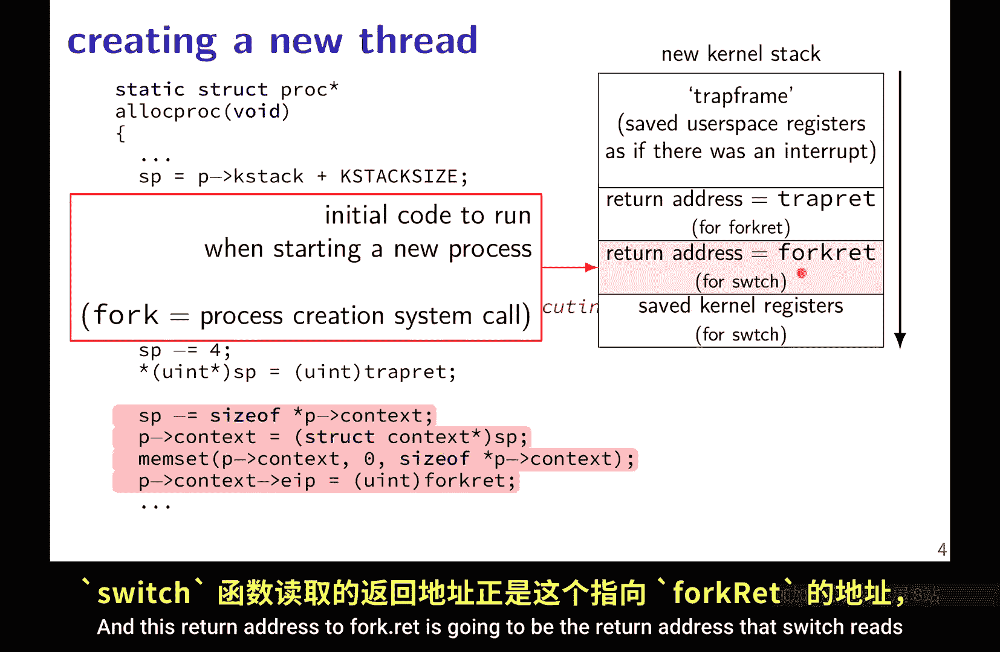

这个精巧的设计避免了为线程启动编写特殊的`switch`代码，复用了现有的上下文切换机制。

---

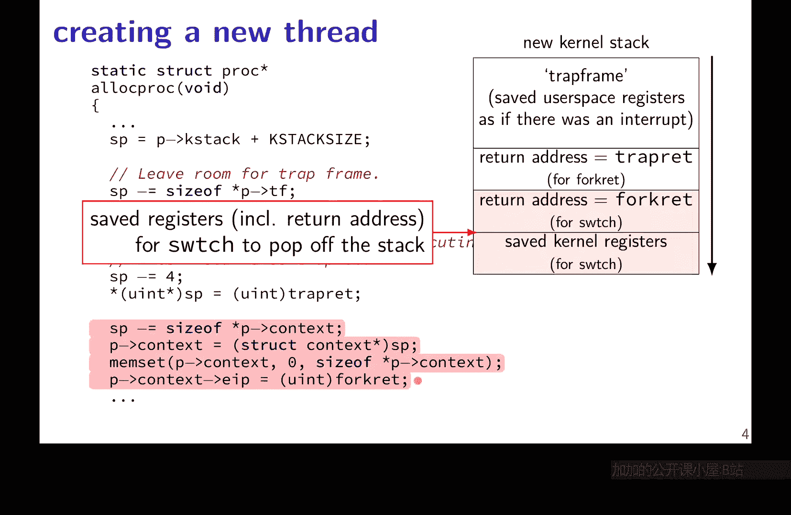

在讨论线程启动时，我们反复提到了一个`p`变量，它指向一个`struct proc`。这是XV6中表示进程（也是线程）的核心数据结构，在操作系统中通常被称为**进程控制块**。

让我们看看`struct proc`中包含哪些关键信息：

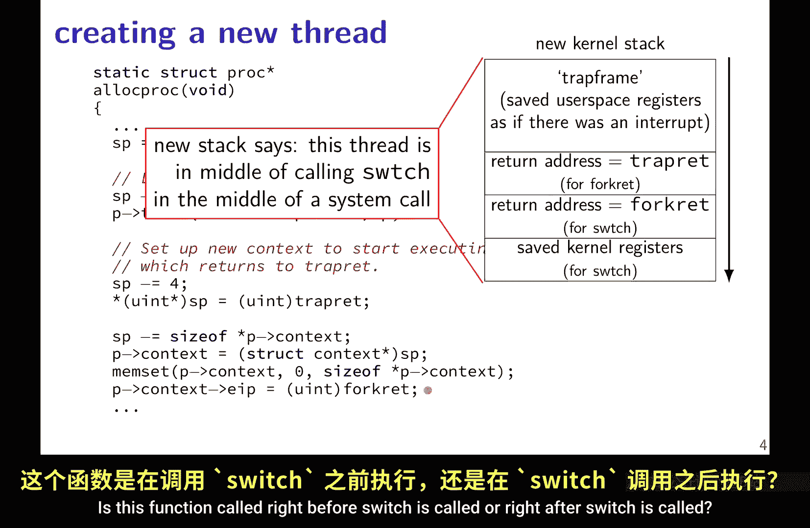

*   **内核栈** (`kstack`): 指向该线程内核栈的指针。
*   **陷阱帧** (`tf`): 指向当前陷入内核时保存的用户寄存器状态的指针。
*   **上下文** (`context`): 保存线程在内核中执行时的寄存器状态，用于`switch`进行上下文切换。
*   此外，它还包含进程状态、进程ID、父进程、内存页表、打开的文件等管理信息。

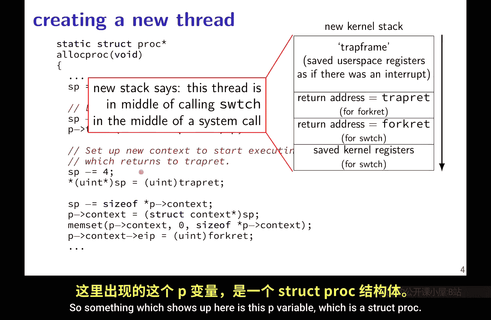

---

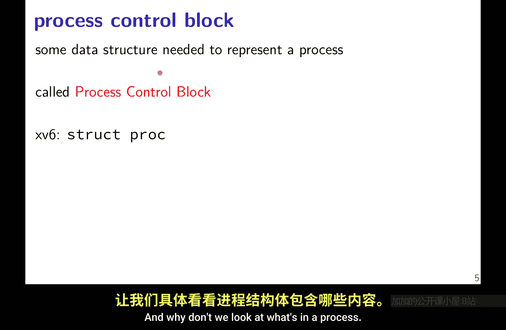

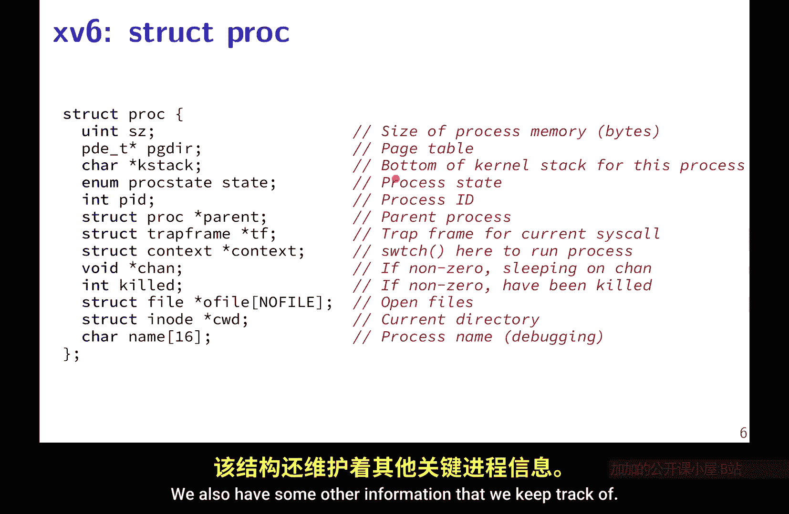

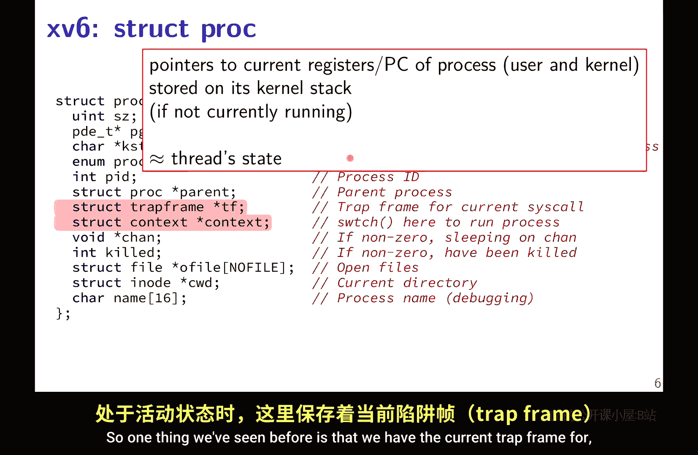

本节课中我们一起学习了操作系统启动新线程的机制。我们了解到，XV6通过精心构造新线程的初始内核栈，模拟出一个已经调用过`switch`函数的环境，从而巧妙地复用了现有的上下文切换代码来启动线程。我们还介绍了用于描述线程/进程所有信息的核心数据结构——进程控制块（在XV6中即`struct proc`）。理解线程的创建和表示是理解进程管理的基础。