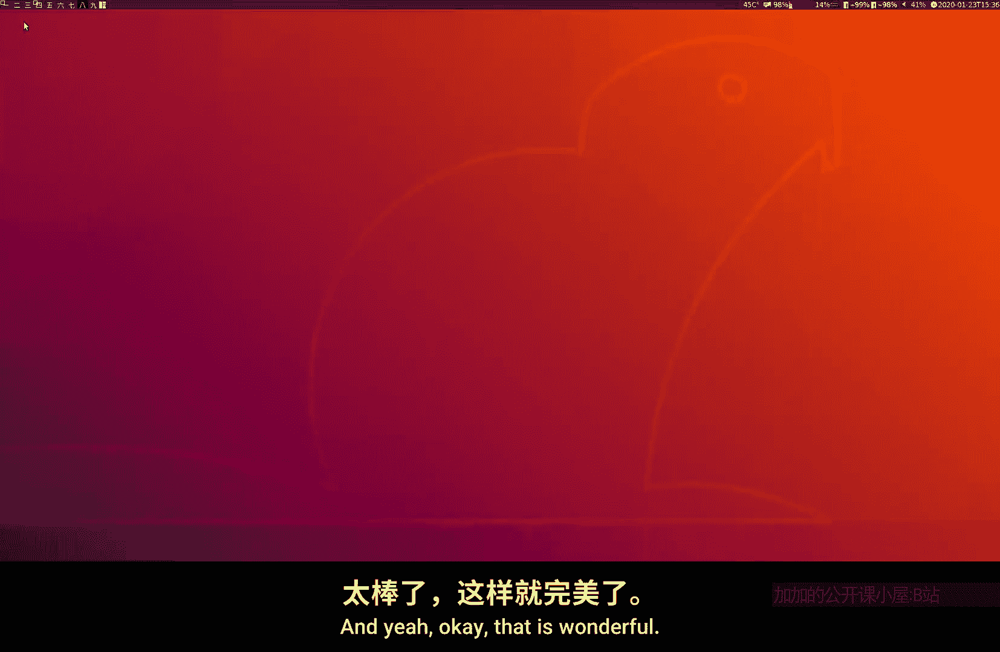
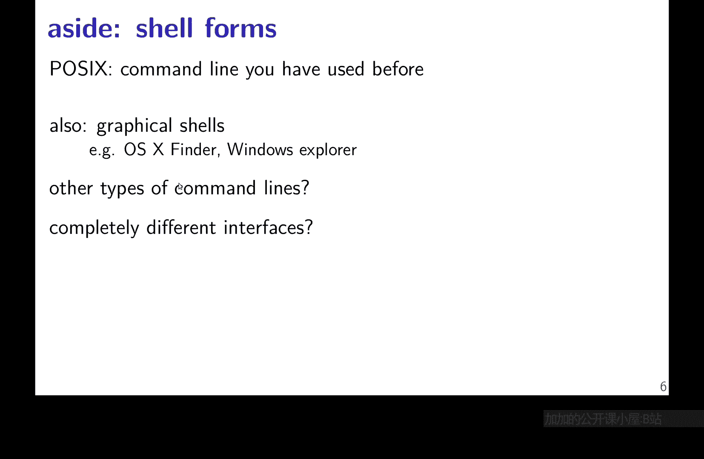
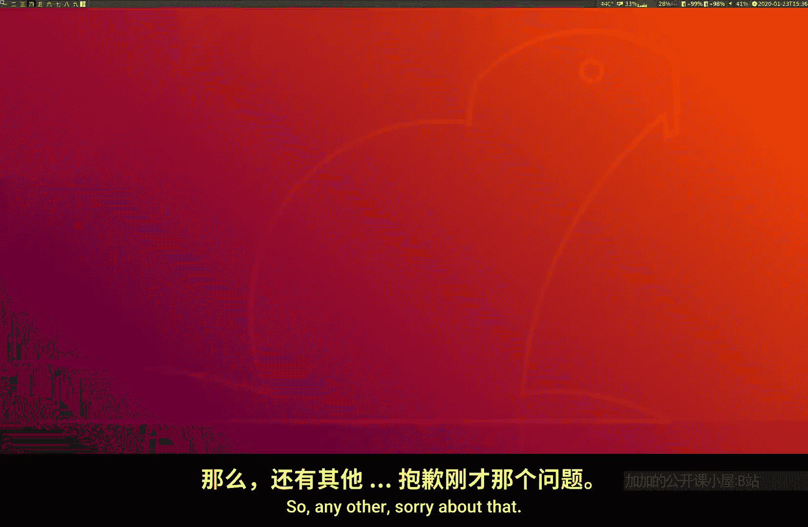
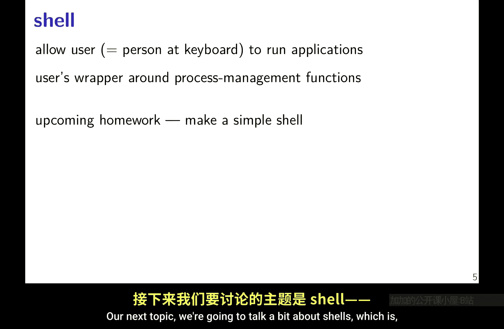

# 004：Unix API 2 - 进程与Shell 🖥️

在本节课中，我们将深入学习Unix API中关于进程创建与管理的核心概念，特别是`fork`、`exec`和`waitpid`的组合使用。我们将通过分析一个具体的编程练习来理解这些系统调用如何协同工作，并初步探讨Shell程序的基本工作原理。

## 练习回顾与分析

上一节我们介绍了`fork`、`exec`和`waitpid`的基本用法。本节中，我们来看一个综合运用这些调用的练习，以加深理解。

以下是一个代码片段，我们将分析其执行流程和可能的输出：

```c
for (int i = 0; i < 2; i++) {
    fork();
}
// 在子进程中
if (getpid() != 原进程PID) { // 简化表示，实际通过fork返回值判断
    execlp("echo", "echo", "0", NULL);
}
// 在父进程中
printf("1\n");
waitpid(...);
waitpid(...);
printf("2\n");
```

### 执行流程解析

程序的核心是一个循环，其中调用了两次`fork`。以下是其执行步骤：

1.  **主进程**：开始执行，进入循环。
2.  **第一次`fork`**：创建一个子进程（称为子进程A）。现在有两个进程：主进程和子进程A。
3.  **第二次`fork`**：**主进程**和**子进程A**都会执行这次`fork`调用。
    *   主进程创建第二个子进程（子进程B）。
    *   子进程A创建自己的子进程（子进程C）。
    *   此时，共有四个进程：主进程、子进程A、子进程B、子进程C。
4.  **执行`exec`**：每个子进程（A、B、C）在判断自身为子进程后，都会执行`execlp("echo", "echo", "0", NULL)`。这个命令会打印“0”并换行。**关键点**：`exec`调用成功后，会完全替换当前进程的代码段，因此子进程执行完`echo`命令后就会退出，不会再返回执行循环或后续的`printf`和`waitpid`。
5.  **父进程继续**：主进程（父进程）跳过`exec`部分，继续执行。它首先打印“1”。
6.  **等待子进程**：主进程随后调用两次`waitpid`，分别等待两个直接子进程（A和B）结束。`waitpid`会阻塞，直到指定的子进程退出。
7.  **最终打印**：当两个直接子进程都退出后，主进程打印“2”，然后结束。

### 输出顺序分析

基于以上流程，我们可以推断输出的可能顺序：


*   **“0”的打印**：三个子进程（A、B、C）各自执行`echo 0`。由于进程是并行执行的（即使单核也会被操作系统调度切换），这三个“0”的输出顺序是**不确定的**。它们可能以任意顺序出现。
*   **“1”的打印**：由主进程打印。它发生在主进程创建完所有子进程之后，但在调用`waitpid`之前。由于主进程和子进程并行执行，“1”可能出现在**任何位置**，甚至可能夹在几个“0”中间。
*   **“2”的打印**：由主进程在两次`waitpid`都返回后打印。这意味着，在打印“2”之前，主进程必须已经等待其两个直接子进程（A和B）结束。而子进程A和B的结束，又依赖于它们（以及子进程C）完成“0”的打印。因此，“2”**总是最后一个**被打印的输出。



综上所述，可能的输出模式是：三个“0”和一个“1”以任意顺序出现，但“2”一定在最后。例如：“0 0 1 0 2”、“1 0 0 0 2”、“0 1 0 0 2”等都是可能的结果。





## 进程树示意图

为了更直观地理解，以下是该程序创建的进程树结构：

```
        主进程 (打印 “1”, 等待A和B，最后打印 “2”)
        /       \
       /         \
子进程A (echo 0)  子进程B (echo 0)
      |                |
子进程C (echo 0)      (无)
```

主进程通过`waitpid`等待子进程A和B。子进程A和B（以及A创建的子进程C）各自执行`echo 0`后退出。

## 引入Shell的概念

在理解了进程创建与控制的基础后，我们很自然地会问：用户通常如何与这些系统调用交互来运行程序？答案就是**Shell**。

Shell是一个特殊的用户程序，它作为用户与操作系统内核之间的命令解释器。它的核心工作流程正是我们刚才练习的扩展：

1.  **读取命令**：显示提示符，等待用户输入命令（如 `ls -l`）。
2.  **解析命令**：将输入字符串解析为程序名（`ls`）和参数（`-l`）。
3.  **创建进程**：调用 `fork()` 创建一个新的子进程。
4.  **执行程序**：在子进程中调用 `exec()` 系列函数，将自身替换为要运行的程序（如 `/bin/ls`）。
5.  **等待完成**：父进程（Shell本身）调用 `waitpid()` 等待子进程结束。
6.  **返回结果**：子进程结束后，Shell回收其资源，再次显示提示符，准备接收下一条命令。

这个过程完美地体现了 `fork-exec-wait` 这一经典模式。我们下一个实践任务就将围绕实现一个简化版的Shell来展开。

## 总结

本节课中我们一起学习了：
1.  通过一个复杂练习，深入分析了 `fork`、`exec` 和 `waitpid` 在多个进程创建场景下的交互与执行顺序。
2.  理解了子进程通过 `exec` 执行新程序后，其原代码路径被彻底替换的核心概念。
3.  掌握了并行进程中输出顺序的不确定性，以及通过 `wait` 进行同步的必要性。
4.  引入了 **Shell** 的概念，了解到它本质上是一个循环执行 `fork-exec-wait` 模式的用户程序，是我们与操作系统交互的主要桥梁。



这些知识为理解操作系统的进程管理机制和后续动手实现简单Shell打下了坚实的基础。