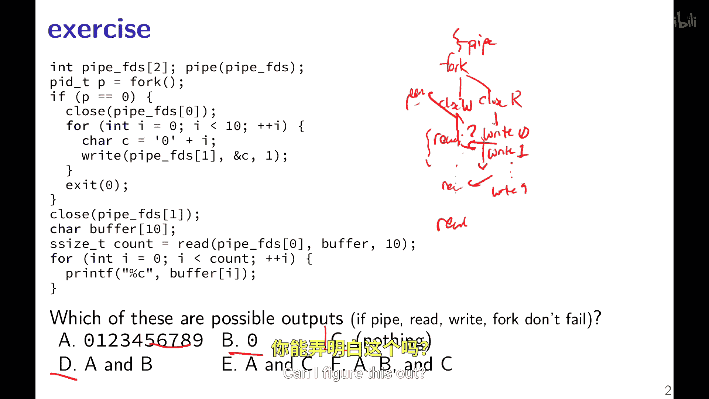
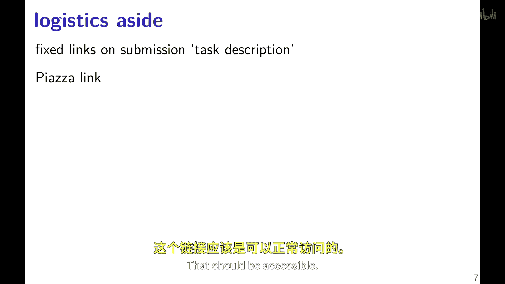
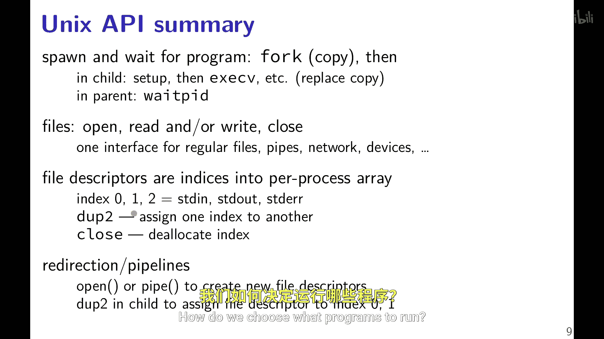
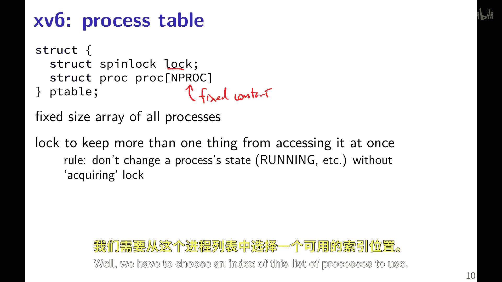
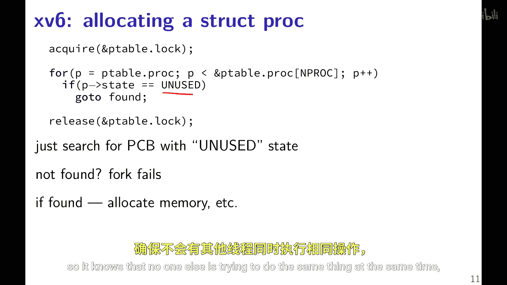

# 005：Unix API 3 - 调度 1 🧵⏱️

在本节课中，我们将学习操作系统中一个核心概念：调度。我们将从一个关于管道的练习开始，回顾Unix API的关键部分，然后深入探讨操作系统如何管理和选择运行哪个进程。

## 管道练习回顾

上一节我们介绍了进程间通信的管道机制。本节中我们来看看一个具体的代码示例，以理解其行为。

以下是一段创建管道、在子进程中写入数据、在父进程中读取数据的代码：

```c
int main() {
    int pipefd[2];
    pipe(pipefd);
    if (fork() == 0) {
        // 子进程
        close(pipefd[0]); // 关闭读端
        for (int i = 0; i < 10; i++) {
            write(pipefd[1], &i, sizeof(i));
        }
        exit(0);
    } else {
        // 父进程
        close(pipefd[1]); // 关闭写端
        int buffer[10];
        int count = read(pipefd[0], buffer, sizeof(buffer));
        for (int i = 0; i < count / sizeof(int); i++) {
            printf("%d ", buffer[i]);
        }
        printf("\n");
    }
    return 0;
}
```

问题是：父进程的`read`调用会返回什么？可能的结果是：
A. 读取到子进程写入的所有数据（0到9）
B. 只读取到第一个写入的数据（0）
C. 可能读取不到任何数据
D. 可能读取到0到9之间的任意数量的数据，具体取决于时机



经过讨论和实验验证，正确答案是D。父进程读取到的数据量取决于子进程写入和父进程读取的相对时机。这涉及到操作系统的调度决策。

## Unix API 关键概念回顾

在深入调度之前，我们先简要回顾已学的Unix API核心概念。

以下是进程与文件管理的关键系统调用：

1.  **进程创建**：使用`fork()`复制当前进程。第一个进程需要特殊处理。
2.  **程序执行**：使用`exec()`系列调用将当前进程替换为新的程序映像。
3.  **进程等待**：使用`waitpid()`等待子进程结束。
4.  **文件操作**：遵循“打开(`open`/`pipe`) -> 读写(`read`/`write`) -> 关闭(`close`)”的模式。
5.  **文件描述符**：每个进程有一个文件描述符表，索引0、1、2分别默认为标准输入、标准输出和标准错误输出。可以使用`dup2()`等函数重定向。



## 进程管理与调度基础

现在，我们转向操作系统的核心任务之一：决定在任意时刻运行哪个进程。这首先要求系统能跟踪所有活动进程。

在XV6操作系统中，这是通过一个称为**进程表（Process Table）** 的数据结构实现的。

### 进程表（Ptable）

进程表是操作系统内核中用于管理所有进程控制块（PCB）的数据结构。在XV6中，它的定义简化如下：

```c
struct {
    struct spinlock lock;       // 保护进程表的锁
    struct proc proc[NPROC];    // 进程控制块数组
} ptable;
```

*   **`struct proc proc[NPROC]`**：这是一个固定大小的数组，用于存放所有进程的PCB。`NPROC`是一个编译时常量（例如64），它限制了系统能同时存在的最大进程数。这种设计是为了简化。
*   **`struct spinlock lock`**：这是一个自旋锁，用于**同步**对进程表的访问。其核心作用是确保在任意时刻，只有一个CPU核心（或一个执行上下文，如中断处理程序）能够修改进程表或更改进程的状态（例如从可运行变为睡眠）。



锁的必要性在于，如果没有它，可能会发生竞态条件。例如，调度器正在根据进程状态选择下一个要运行的进程时，一个定时器中断可能突然改变了某个进程的状态，导致调度决策错误或系统不一致。

### 分配进程槽位

当需要创建一个新进程时，操作系统需要在进程表中找到一个空闲的槽位来存放新进程的PCB。

以下是XV6中查找空闲进程槽位的简化逻辑：

```c
struct proc* allocate_proc() {
    acquire(&ptable.lock); // 获取锁，确保独占访问
    for (int i = 0; i < NPROC; i++) {
        if (ptable.proc[i].state == UNUSED) { // 找到空闲槽位
            struct proc *p = &ptable.proc[i];
            // ... 初始化进程控制块 ...
            release(&ptable.lock); // 释放锁
            return p;
        }
    }
    release(&ptable.lock); // 释放锁
    return 0; // 没有空闲槽位
}
```

这个过程在锁的保护下进行，遍历进程表，找到第一个状态为`UNUSED`的PCB并返回其指针。如果表已满，则返回空指针。



---



本节课中我们一起学习了调度问题的引入，通过管道示例看到了进程执行顺序的不确定性。我们回顾了Unix API中进程与文件管理的关键点，并开始探讨操作系统如何管理进程。我们介绍了XV6中用于跟踪所有进程的**进程表（ptable）** 结构，以及使用**锁（lock）** 来保护对共享资源（进程表）的访问，防止竞态条件。下一节，我们将深入探讨调度算法，看看操作系统如何从可运行进程中选择下一个执行者。