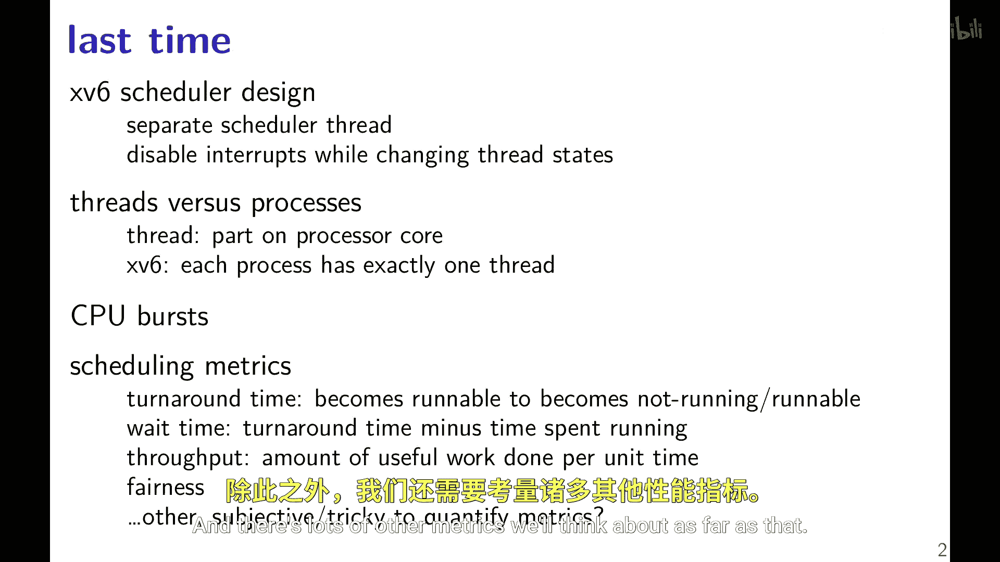
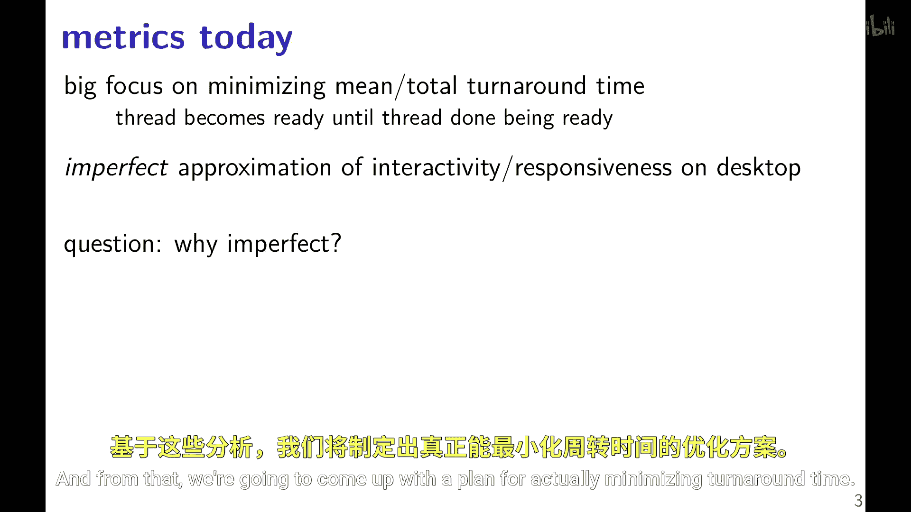
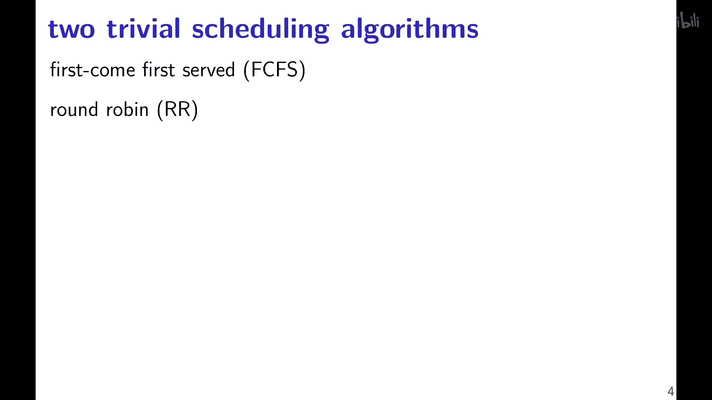
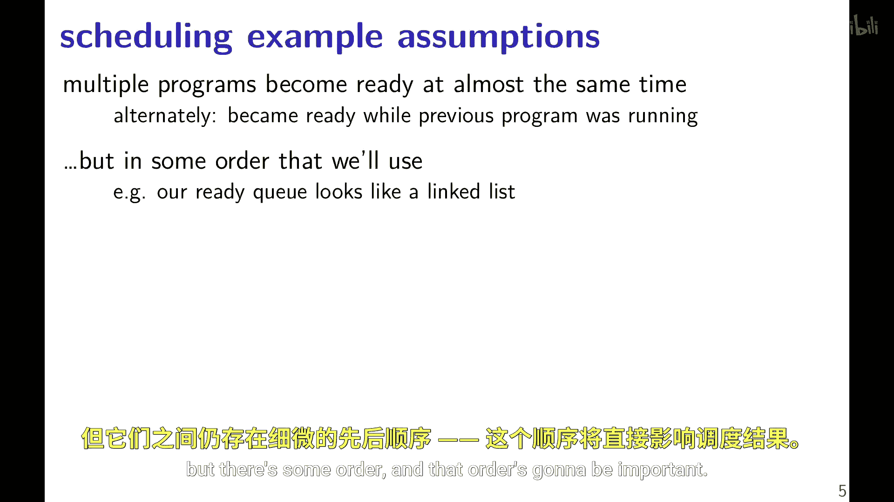
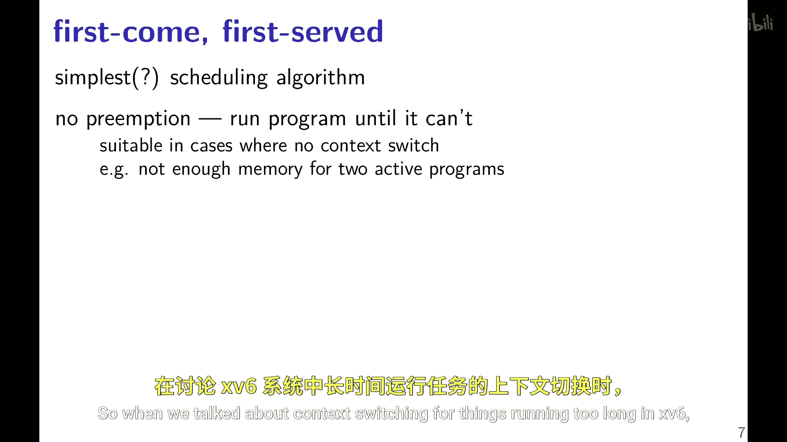

操作系统课程：P6：调度算法（第二部分）

在本节课中，我们将深入探讨处理器调度器如何在不同线程间分配CPU时间。我们将从回顾XV6的简单调度实现开始，引出衡量调度器性能的指标，并重点分析如何最小化周转时间。最后，我们将介绍两种基础的调度算法：先来先服务（FCFS）和轮转（Round Robin），并分析它们对性能指标的影响。

上一节我们介绍了XV6操作系统中的基本调度机制。本节中，我们来看看如何评估和比较不同调度算法的优劣。

为了比较不同调度决策的好坏，我们需要一些度量标准。以下是两个与任务运行速度相关的核心指标：

*   **周转时间**：指从一个任务就绪（例如，一次I/O操作完成）开始，到该任务完成其CPU执行并等待下一次I/O为止所经过的总时间。
*   **等待时间**：指一个任务在就绪后，到它实际开始使用CPU之前，所花费的等待时间。这本质上衡量了当该任务还有工作要做时，系统却运行其他任务所浪费的时间。

除了追求快速响应，调度器还需考虑其他可能与之冲突的目标：

*   **吞吐量**：单位时间内完成的有用工作量。上下文切换和复杂的调度决策本身（称为**开销**）会消耗CPU资源，从而降低有效吞吐量。
*   **公平性**：调度策略不应过度偏袒某些程序或用户。虽然“公平”的定义可能比较主观，但一个理想的调度器应确保所有任务都能获得相对平等的处理机会。

这些只是部分度量标准。在今天的课程中，我们将把大部分时间集中在如何通过调度来最小化平均（或总）周转时间上。

我们之所以聚焦于此，是因为最小化周转时间近似于优化桌面、笔记本电脑或手机系统的交互性和响应速度。当然，这个近似并不完美。例如，它没有区分响应键盘输入和响应网络通知的重要性差异，也没有考虑不同应用程序（如后台浏览器和即时通讯软件）对用户而言的相对重要性。尽管如此，它仍是一个重要的优化起点。

我们将从讨论两种看似简单的调度算法开始。它们并非直接为优化某项指标而设计，但通过分析它们对周转时间的影响，我们能找到最小化周转时间的思路。

这两种基础的调度器分别是**先来先服务**和**轮转调度**。我们先从可能最简单的调度器——先来先服务开始。

为了让分析简单明了，我们首先假设多个程序几乎在同一时刻就绪（例如，它们的I/O几乎同时完成），但存在一个微小的先后顺序。这个顺序对于先来先服务调度器至关重要。

先来先服务调度器按照任务就绪的先后顺序运行它们，并且**没有抢占**。这意味着一旦一个任务开始使用CPU，它就会一直运行直到主动放弃CPU（例如，进行I/O操作或结束）。这类似于我们在XV6中看到的，一个线程可能运行过长时间的情况。

本节课中，我们一起学习了调度器的性能评估指标，包括周转时间、等待时间、吞吐量和公平性。我们明确了本课程将重点探讨如何最小化周转时间。作为起点，我们介绍了先来先服务这一非抢占式调度算法的基本思想。在接下来的课程中，我们将继续分析其具体表现，并引入轮转调度算法进行对比。