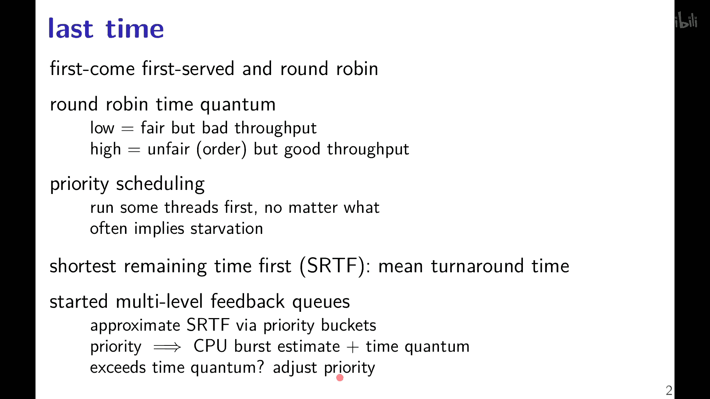
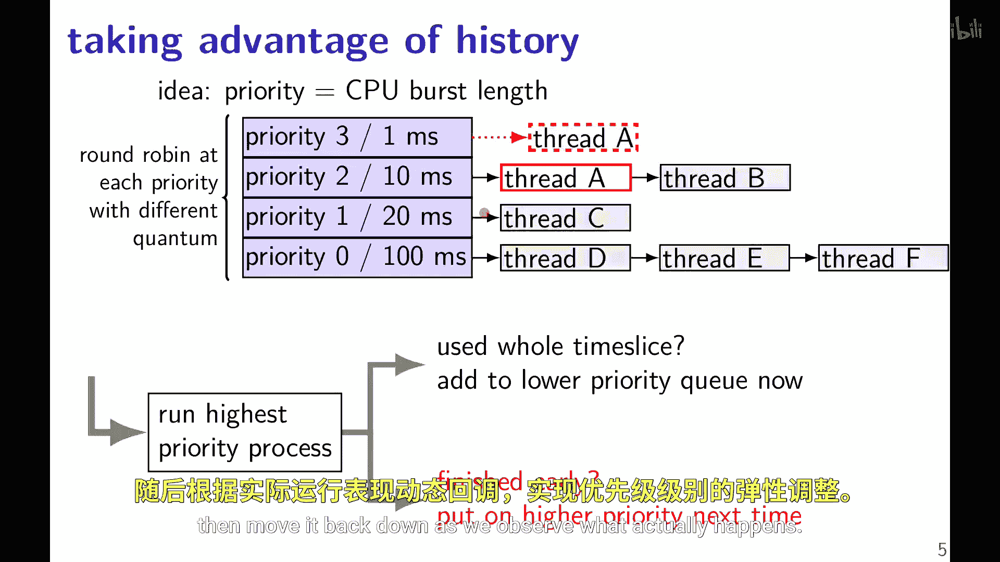
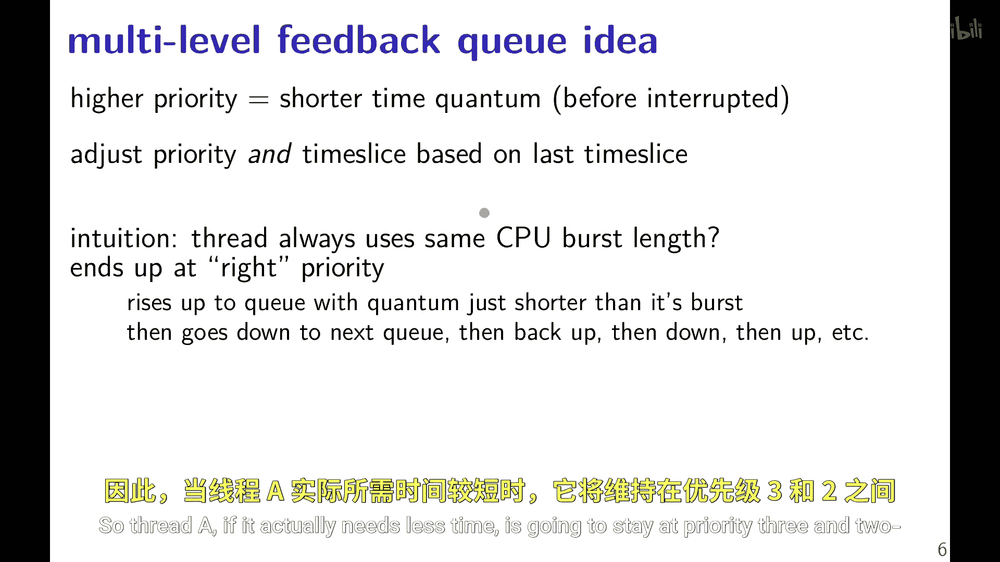
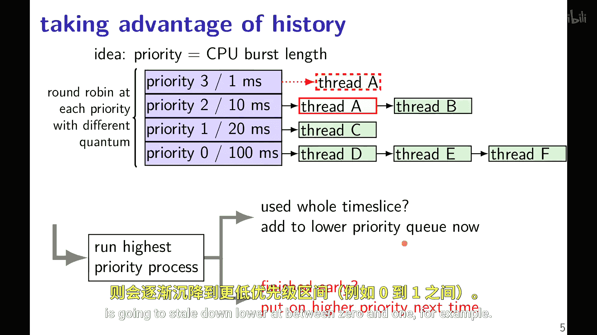
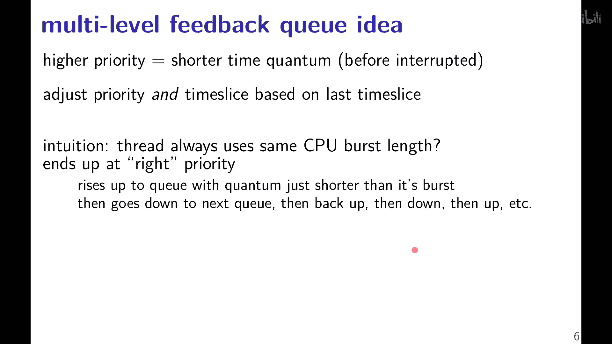
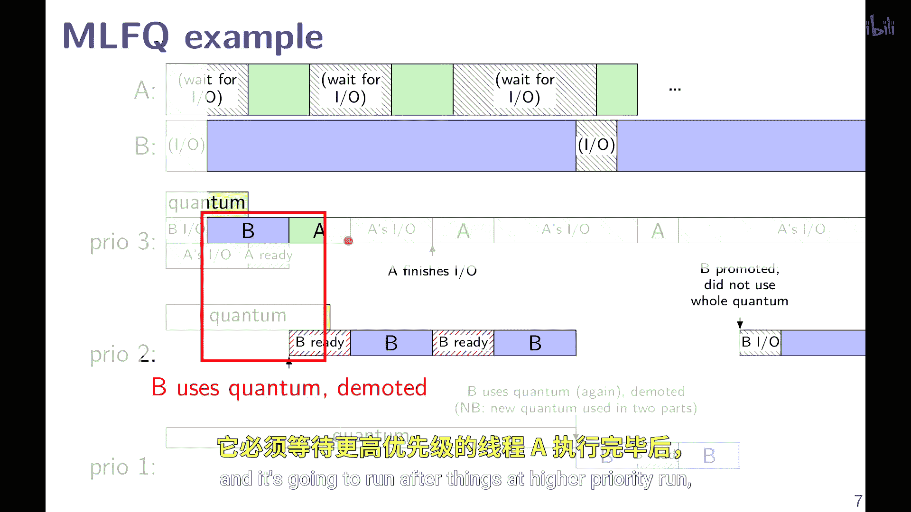

# 007：调度策略（三）⏳

在本节课中，我们将继续探讨操作系统的调度策略。我们将回顾上次课的内容，并深入介绍一种结合了多种策略优点的调度算法——多级反馈队列。我们将学习其工作原理、如何动态调整进程优先级，以及它如何在实际系统中平衡响应时间和吞吐量。

## 回顾：从先来先服务到优先级调度

上一节我们介绍了先来先服务（FCFS）和轮转（RR）调度策略。先来先服务策略简单，但可能导致长任务阻塞短任务，影响系统响应性。轮转调度通过引入时间片和抢占机制解决了这个问题，但需要在公平性和上下文切换开销之间进行权衡。

随后，我们讨论了优先级调度，即系统管理员可以指定某些任务更重要，应优先运行。但这种策略可能导致低优先级任务“饥饿”——永远得不到运行机会。

为了优化平均周转时间（这与系统的交互性和响应性密切相关），我们引入了**最短剩余时间优先**策略。该策略总是优先运行剩余执行时间最短的任务，从而最小化平均周转时间。

然而，最短剩余时间优先策略存在一个根本问题：我们无法预先准确知道一个任务的剩余执行时间。因此，我们需要一种方法来**估计**它。

## 引入多级反馈队列 🔄

为了解决估计问题，我们引入了一种基于优先级调度思想，但能动态调整优先级的策略：**多级反馈队列**。

其核心思想是：我们根据对任务剩余时间的**估计**来设置其优先级。优先级越高，我们估计其所需时间越短，分配给它的时间片也越短。

我们通过以下机制来“验证”我们的估计：
*   如果一个任务用完了整个时间片，说明我们低估了它所需的时间。我们将其**降低**优先级（降级），并允许它在后续以更长的时间片运行。
*   如果一个任务在时间片用完前就主动放弃CPU（例如进行I/O操作），说明我们可能高估了它所需的时间。我们将其**提高**优先级（升级），下次它醒来时能更快得到服务。

这样，系统就能根据任务的实际行为动态调整其优先级，最终使任务在其“合适”的优先级附近振荡。

### 多级反馈队列的工作流程

以下是多级反馈队列调度算法的一个具体示例步骤：

1.  **初始放置**：所有新到达的任务通常被放入最高优先级队列，给予一个短时间片。这确保了新交互式任务能快速获得响应。
2.  **调度执行**：调度器总是从**最高非空优先级**队列中，以轮转方式选取任务执行。
3.  **时间片使用判断**：
    *   如果任务在时间片内**完成**或**主动阻塞**（如I/O），则其优先级**提升**（或保持在最高级）。
    *   如果任务**用完了整个时间片**，则其优先级**降低**，被移入下一级队列。
4.  **重复过程**：被降级的任务将在低优先级队列中等待。低优先级队列通常有更长的时间片，适合CPU密集型的长任务。只有当所有更高优先级队列为空时，才会调度低优先级队列中的任务。

### 示例分析

假设我们有一个三级反馈队列：
*   **优先级 2（最高）**：时间片 = 10ms
*   **优先级 1（中）**：时间片 = 20ms
*   **优先级 0（最低）**：时间片 = 40ms

现有两个任务：
*   **任务A**：交互式任务，频繁进行短时间CPU计算和I/O。
*   **任务B**：CPU密集型任务，需要长时间计算。

运行过程可能如下：
1.  任务B先就绪，在优先级2队列运行10ms后未完成，被降级至优先级1队列。
2.  任务A就绪，在优先级2队列运行，很快（比如2ms后）发起I/O并阻塞。完成后再次就绪，因其未用完时间片，保持在优先级2。
3.  调度器再次运行优先级2队列中的任务A（短时间片，快速响应）。
4.  当任务A阻塞时，系统运行优先级1队列中的任务B（较长时间片）。
5.  如此往复，任务A因其行为特征，将主要在高优先级队列振荡，获得频繁的短时间服务，响应迅速。任务B则逐渐沉降到低优先级队列，获得大的时间片来高效完成计算。

通过这种方式，多级反馈队列巧妙地结合了短任务优先（优化响应时间）和轮转调度（保证公平性）的优点，并能自适应地根据进程行为进行调整，是许多现代操作系统（如Unix系）采用的经典调度算法。

## 总结

本节课我们一起学习了多级反馈队列调度算法。我们首先回顾了先来先服务、轮转和优先级调度等基础策略的优缺点。然后，我们指出了为优化周转时间而提出的“最短剩余时间优先”策略所面临的挑战——无法预知剩余时间。

为此，我们引入了多级反馈队列，它通过以下方式动态逼近最优调度：
*   使用**多个优先级队列**，每个队列配有不同长度的时间片。
*   根据任务**实际使用CPU的行为**（是否用完时间片）来动态**提升或降低**其优先级。
*   使得**短交互式任务**能停留在高优先级队列，获得快速响应；而**长CPU密集型任务**会沉降到低优先级队列，在系统空闲时高效运行。

这种设计使得多级反馈队列能够同时兼顾响应性、吞吐量和公平性，是一种高效且实用的调度算法。