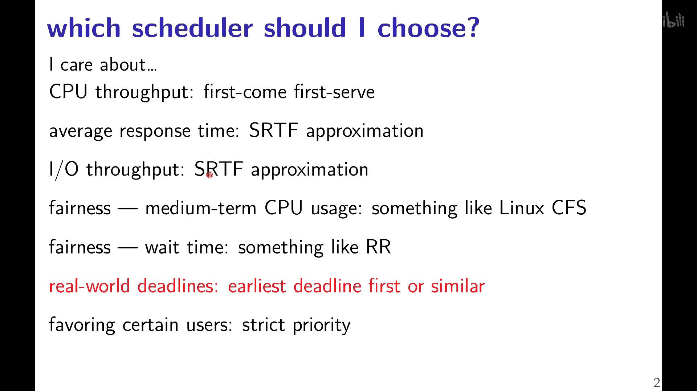
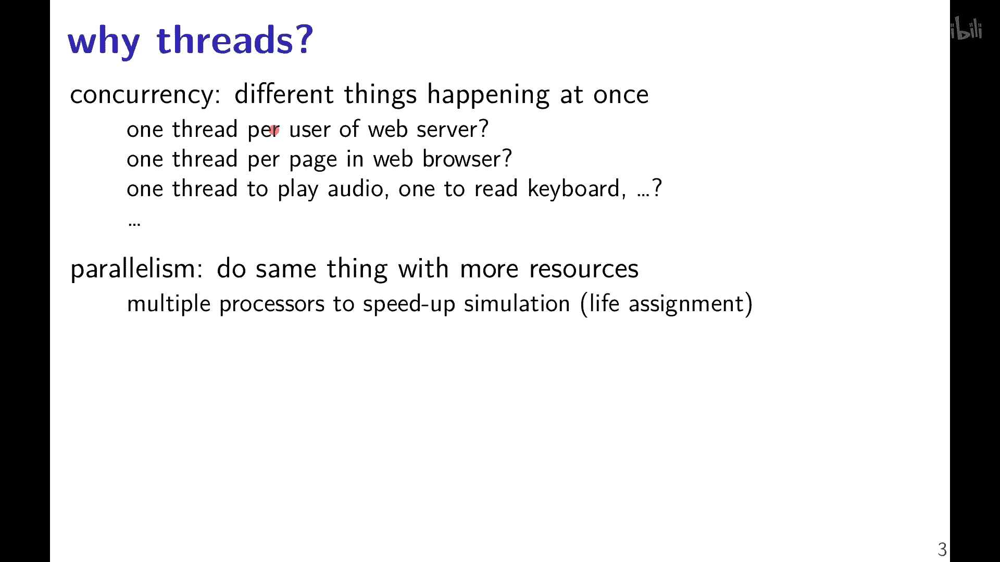
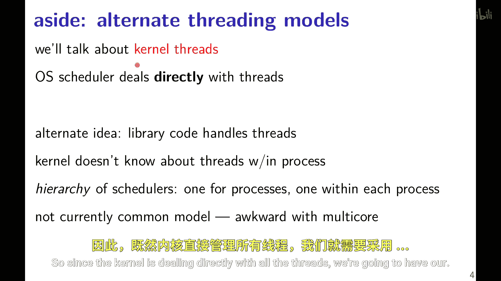
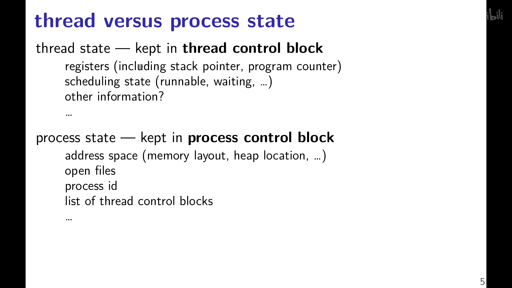
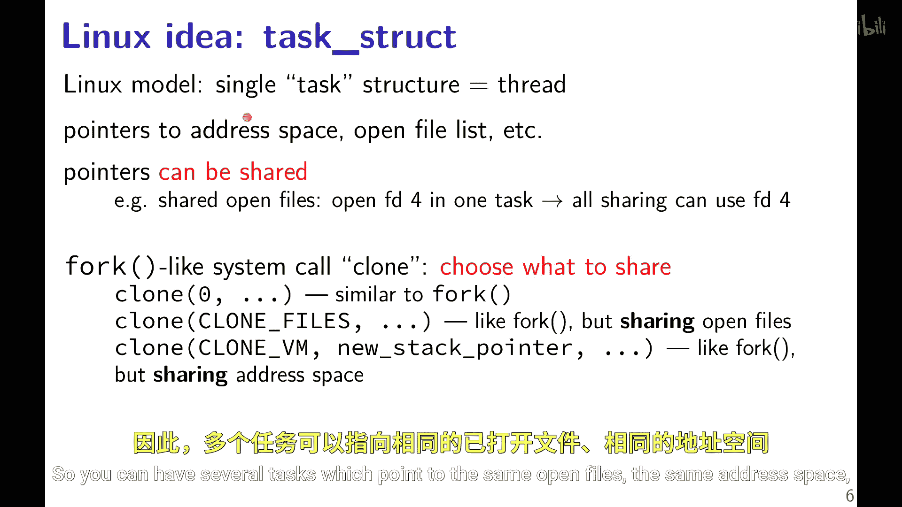

操作系统：P8：线程同步1 - 锁 1 🔒

在本节课中，我们将要学习线程同步的基础知识，特别是锁的概念。上一节我们介绍了线程调度，本节中我们来看看如何让多个线程安全地协作。

---

### 概述

我们之前讨论了线程调度，从最简单的先来先服务调度器开始，它优化了吞吐量但牺牲了响应性。接着我们探讨了理想化的最短剩余时间优先调度器，以及其基于优先级的近似实现。我们还研究了公平性调度器，如彩票调度器和Linux的完全公平调度器。最后，我们提到了用于实时系统的调度器，如最早截止时间优先算法。

现在，我们将转向多线程编程。线程允许我们在一个进程内执行多个任务流。这主要有两种用途：并发和并行。并发是指处理多个相对独立但需要协调的子任务（如Web服务器处理多个用户请求）。并行是指将一个单一的计算密集型任务拆分成多个部分，以利用多核处理器来加速执行。

我们将假设使用内核线程模型，即操作系统内核直接调度所有线程。每个线程有其独立的线程控制块，包含寄存器、栈指针、程序计数器等状态信息，并与进程控制块关联。

---

### 线程控制块与进程状态

在典型的操作系统中，线程控制块与进程状态是分离的。

线程控制块包含：
*   寄存器状态
*   栈指针
*   程序计数器
*   调度状态（如可运行、等待I/O）

进程控制块则包含：
*   内存映射信息
*   打开的文件列表
*   进程ID
*   关联的线程控制块列表

操作系统调度器直接操作线程控制块。值得注意的是，像Linux这样的系统采用了一种略有不同的设计：它使用一个统一的`task_struct`数据结构来表示线程，其中通过指针来共享或指向进程级的资源（如地址空间、文件列表）。

---

### 线程的用途：并发与并行

以下是使用线程的两个主要场景：

**并发**
并发用于处理一个总体任务下多个相对独立的子任务。例如，一个Web服务器使用不同线程处理不同用户的请求。这些线程共享网站数据，但各自独立运行。这样，即使一个请求被阻塞，也不会影响其他请求的处理。浏览器中不同的标签页也是类似的例子。

**并行**
并行用于加速单个计算任务。我们将在一个后续作业中实践这一点：给你一个单线程的模拟循环，你需要使用多线程来使其运行更快（假设有多核处理器）。这是利用多核计算能力的关键方式。

---

### 总结

本节课中我们一起学习了线程同步的入门知识。我们回顾了线程调度的背景，明确了内核线程模型下线程控制块与进程状态的关系。我们区分了线程在实现**并发**（处理多个独立子任务）和**并行**（加速单一任务）方面的不同用途。理解这些基础概念是学习后续更复杂的同步机制（如锁、条件变量等）的关键。下一节，我们将深入探讨锁的具体实现和工作原理。