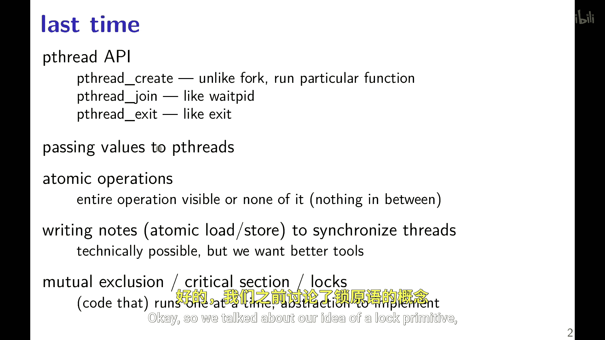
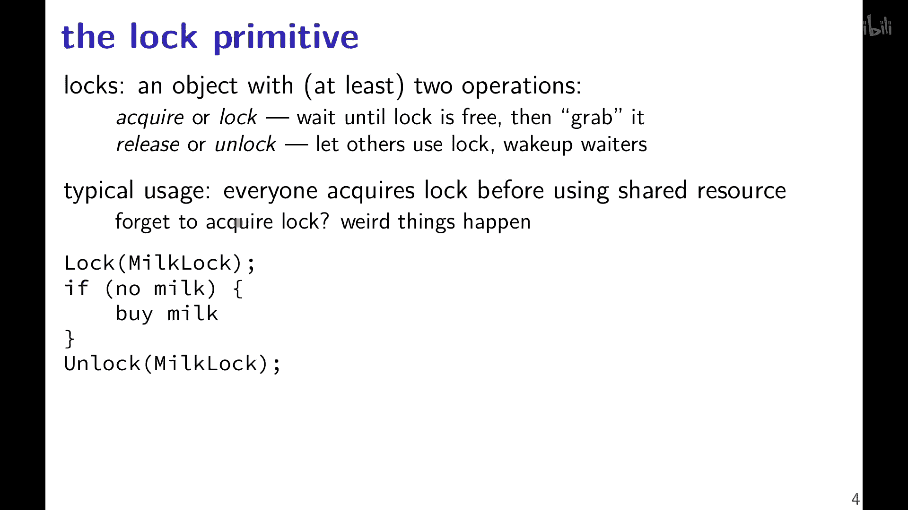
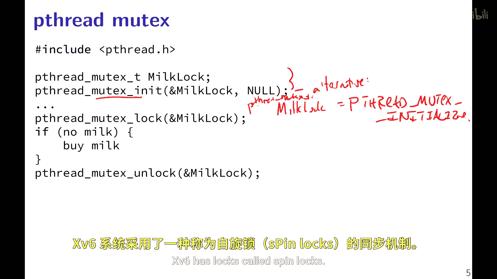
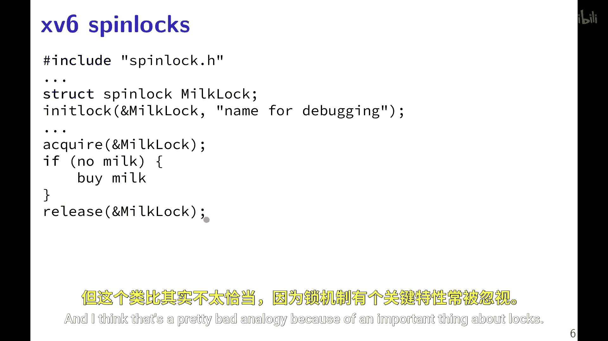
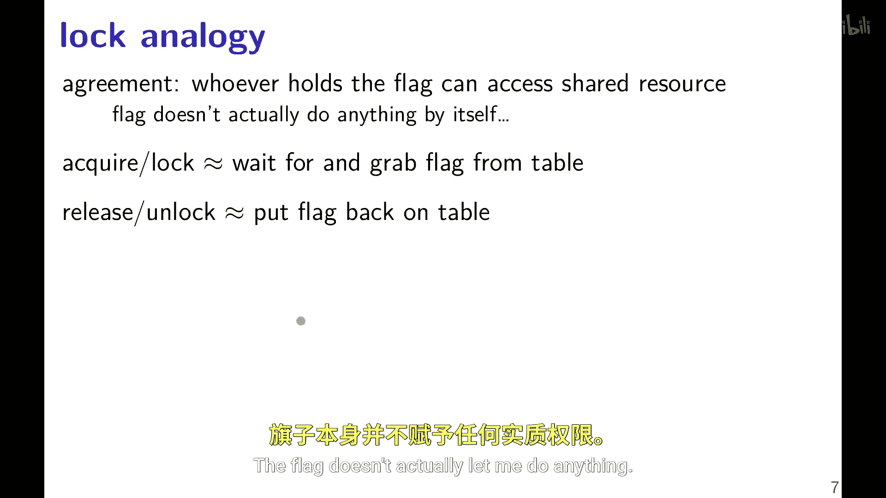

# 009：同步2 - 锁与互斥量

在本节课中，我们将要学习线程同步的核心概念——锁。我们将回顾Pthreads API，深入理解为什么需要原子操作和互斥，并介绍锁的抽象概念及其基本实现方式。最后，我们会探讨Pthreads互斥锁和XV6自旋锁的具体API。

上一节我们介绍了Pthreads线程管理API。本节中我们来看看如何协调多个线程对共享资源的访问。

## 回顾Pthreads API

我们首先回顾了用于线程的Pthreads API。它与我们之前用于管理进程的函数有对应关系。

*   替代 `fork` 的是 `pthread_create`。这是与进程创建最不同的地方。它接收一个要运行的函数作为参数，新线程将运行该函数直至完成。
*   替代 `wait` 的是 `join`。与进程不同，线程没有独立的退出码。`join` 通过一个指针返回值。
*   我们还有 `pthread_exit` 函数，它类似于 `exit`，但只终止调用它的单个线程，而非整个进程。

我们探讨了向线程传递值的几种策略。

*   可以将数字直接转换为 `void*` 指针。
*   更灵活的方法是分配一个结构体，并传递指向该结构体的指针。如果需要该结构体存在更长时间，可能需要将其分配在堆上。

之前我们讨论的是启动线程、等待其结束、然后查看结果的模式。但通常我们需要更细粒度的协调，而不仅仅是等待整个线程结束。

## 原子操作与互斥的必要性

为了实现细粒度协调，我们需要考虑当两个线程操作同一事物时会发生什么。我们引入了**原子操作**的概念，即希望一系列操作要么全部完成，要么完全不发生，不存在中间状态。

我们以修改变量值为例。我们希望从别处检查时，看到的是完整的新值或旧值，而不是某个中间值。但即使像加法这样的单条指令也并非原子操作。我们可能看到值尚未改变，但用于相加的旧值已被读取的中间状态。这会导致非预期的结果，使得两个线程难以协同操作同一变量。

因此，我们需要操作是原子的。我们通常可以假设对内存中单个值的读写是原子的。但这还远远不够。我们仍然需要一种协调机制。

我们将要讨论的这种协调称为**互斥**。它确保两个线程中最多只有一个在某一时刻执行特定操作。

*   我们的第一个例子是“检查是否有牛奶，如果没有则购买”。这一系列操作应作为一个整体，一次只由一个线程执行。
*   另一个例子是给一个数字做加法。我们应该读取旧值、计算和、存储新值，这些步骤也应作为一个整体原子地完成。我们可以通过互斥来实现**原子加**。

我们称这段需要互斥执行的代码区域为**临界区**。而实现互斥的抽象机制，我们称之为**锁**。

## 锁的抽象

锁的抽象为我们提供了实现互斥的方法。今天我们将讨论实现锁的最简单方式，下次课可能会探讨更好的实现。

我们需要理解锁是什么。锁提供两个基本操作：

*   **获取**：等待锁变为空闲状态，然后占有它。
*   **释放**：让出锁，使其变为空闲状态。

锁的状态只有“已被占有”或“空闲”两种，没有中间状态。当锁被占有时，有且仅有一个线程持有它。这保证了互斥属性。

以牛奶例子为例，我们为“检查并购买牛奶”这个操作设置一个锁。在执行操作前先获取锁，操作完成后释放锁。这样我们就知道线程会轮流执行检查和购买，不会出现导致混乱的中间状态。



## 锁的API：Pthreads互斥锁与XV6自旋锁

以下是实现锁的一些API。

Pthreads提供一种称为**互斥量**的锁。使用示例如下：

```c
pthread_mutex_t lock = PTHREAD_MUTEX_INITIALIZER;
// 或者使用 pthread_mutex_init(&lock, NULL);



pthread_mutex_lock(&lock);
// 临界区代码
pthread_mutex_unlock(&lock);
```

初始化锁有两种方式：将其声明为特殊常量 `PTHREAD_MUTEX_INITIALIZER`，或调用 `pthread_mutex_init` 函数。然后使用 `lock` 和 `unlock` 进行操作。

XV6操作系统则使用称为**自旋锁**的锁。我们稍后会讨论自旋锁的具体含义。

```c
struct spinlock lock;
initlock(&lock, "lock_name"); // 通常在启动代码中初始化



acquire(&lock);
// 临界区代码
release(&lock);
```

在XV6中，锁用一个结构体表示，必须通过一个函数（通常在启动时运行的代码中调用）进行初始化。操作名为 `acquire` 和 `release`，其功能与 `lock` 和 `unlock` 相同。

## 理解锁的类比

“锁”这个名字容易让人联想到锁门。但我认为这是一个不太好的类比，因为它忽略了一个关于锁的重要事实。



我更倾向于将锁看作一面**旗帜**。我们达成一个协议：当我需要做某件事时，我会去拿起桌子上的这面旗帜。只有当我持有旗帜时，我才被允许做这件事。当我做完后，我把旗帜放回桌上，以便他人取用。

*   **获取**操作就是：看着桌子，等待旗帜出现，一旦出现就拿起它。
*   **释放**操作就是：将旗帜放回桌上。

我更喜欢这个类比的原因是，这本质上是一种**协议**。只有因为我们同意“持旗者方可操作”这个规则，它才有效。旗帜本身并不会物理阻止没有持有它的人进行操作。

---



本节课中我们一起学习了线程同步的基础——锁。我们回顾了为什么需要原子操作和互斥，引入了临界区和锁的抽象概念，并介绍了Pthreads互斥锁和XV6自旋锁的基本API。最后，我们通过“旗帜”的类比来理解锁作为一种协议的本质。下一节我们将深入探讨锁的不同实现方式。