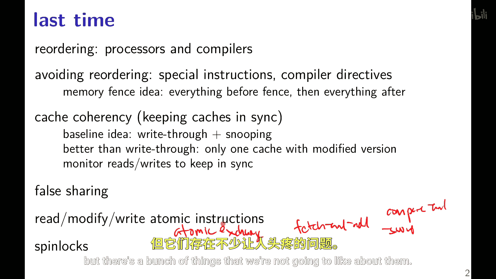
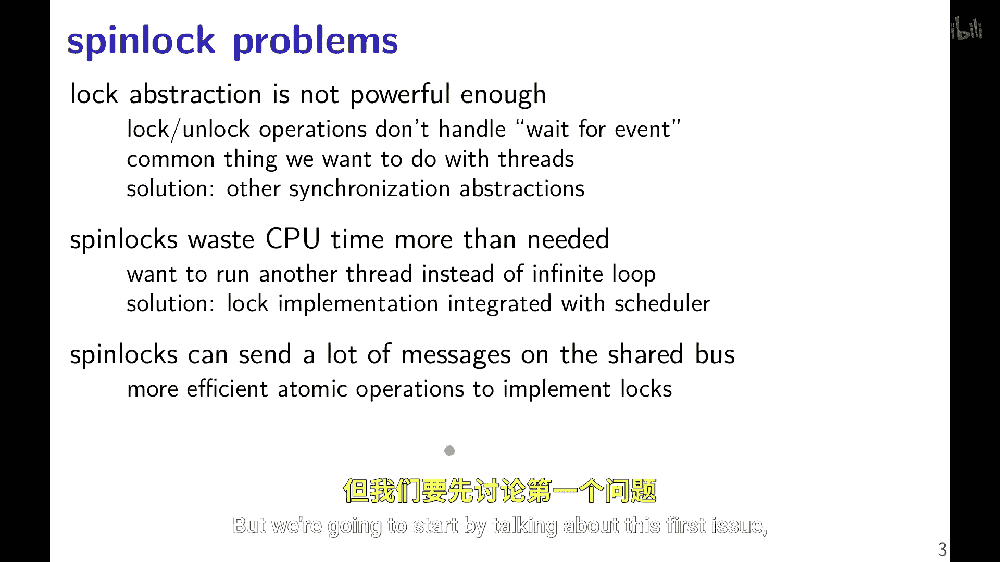

操作系统：P10：同步3 - 管程与信号量 🧵

在本节课中，我们将要学习锁之外的同步机制。我们将探讨锁的局限性，并介绍两种更强大的工具：管程和信号量，它们能解决更复杂的线程协调问题。

上一节我们介绍了缓存一致性和自旋锁的实现。本节中我们来看看自旋锁存在哪些不足。

自旋锁足以实现基本的同步，但存在几个我们不喜欢的方面。

以下是自旋锁的三个主要问题：
1.  **适用性有限**：锁是协调线程行为的错误工具。它们擅长确保线程互不干扰，但对于其他类型的协调（我们实际上已经见过）来说，锁的适配性很差。
2.  **效率低下**：即使它们实现了锁的抽象概念，自旋锁的效率也不高。当等待锁的时间较长时，会浪费大量CPU时间。更糟糕的是，假设我有一个单核处理器并使用自旋锁，或者我有多核处理器，但持有锁的线程当前并未运行。那么我将反复检查锁是否仍被占用，而实际上我本可以运行那个将要使用被锁保护资源的线程，然后释放锁。这可能会延迟锁的释放。
3.  **非最优实现**：自旋锁在原子指令的使用效率、进程间消息传递方面，并非实现锁的最有效方式。存在更智能的使用原子操作的方法，它们发送的消息更少，因此在多核环境下效率更高。

我们将从讨论第一个问题开始，即锁抽象无法处理的情况。

我说过，你已经见过一些这样的案例。虽然我们还没有特别多地使用线程，但你已经见过一个锁不足以实现线程间某些功能的例子。不过，在进程方面你肯定更常见这种情况：一个进程中的线程和另一个进程中的线程需要以某种方式进行协调。

到目前为止我们看到的机制，例如锁，主要适用于单个进程内的线程。对于跨进程的协调，我们需要更通用的工具。