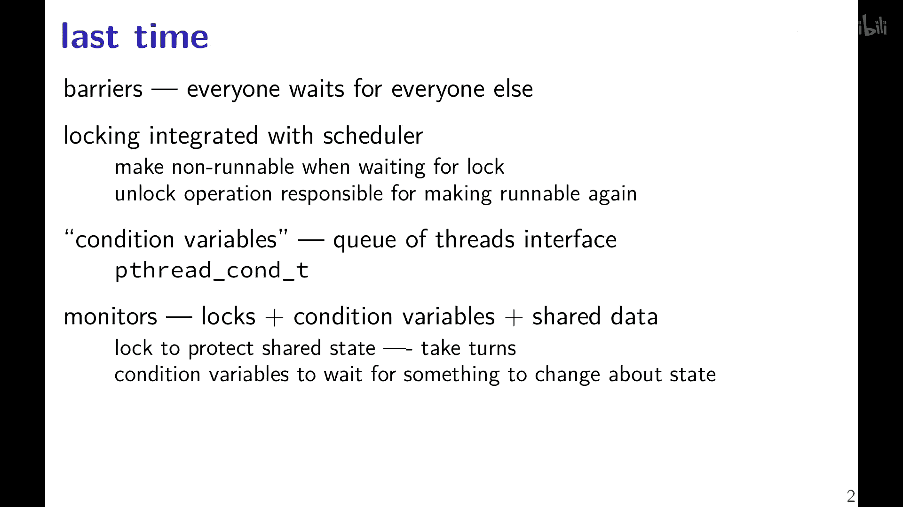
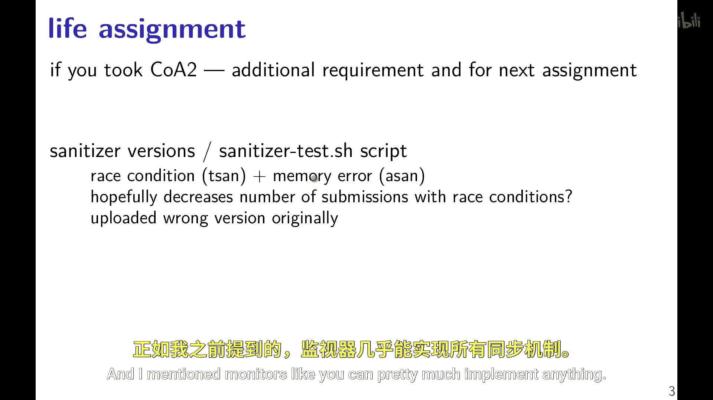
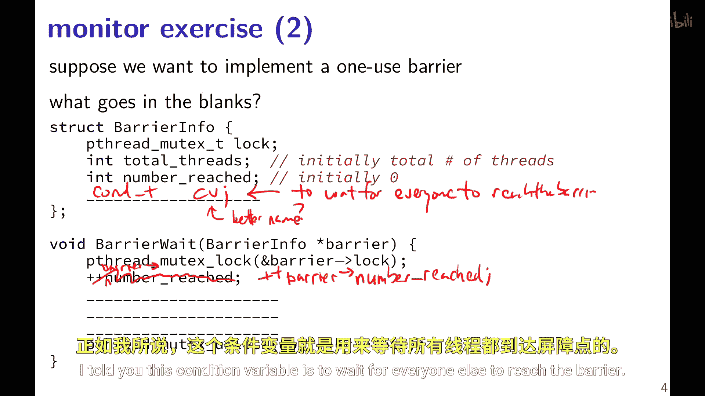

# 011：读写锁

在本节课中，我们将继续深入探讨同步机制，特别是如何使用监视器和条件变量来实现更复杂的同步模式，例如读写锁。我们还将回顾上节课介绍的屏障概念，并学习如何用监视器来实现它。

上一节我们介绍了条件变量和监视器的基本概念，本节中我们来看看如何应用这些概念来解决实际问题。

---

## 关于生命游戏作业的简要说明

如果你上过计算机组织与架构导论课程，你在完成生命游戏作业和后续的池分配作业时，有额外的要求。这是因为该课程中有一个与生命游戏非常相似的作业，我们希望你能额外练习一些内容。

此外，本学期我们构建了包含消毒器版本的脚本。这些是编译器集成的工具，用于发现常见错误。特别是线程消毒器，它有助于发现竞态条件。虽然它不能发现所有竞态条件，但如果你使用它，应该能显著减少提交代码中残留的竞态问题，尤其是在后续作业中。

请注意，最初随作业提交的消毒器测试脚本存在一个错误，它引用了错误的二进制文件名。这个问题已经通过更新修复。

---

## 使用监视器实现屏障

现在，让我们继续深入讨论监视器。我提到过，监视器几乎可以实现任何同步模式。那么，让我们来讨论如何使用监视器实现一个屏障。



假设我想实现一个一次性屏障。以下是我实现的部分代码：

```c
struct barrier {
    int total_threads;
    int num_reached; // 到达屏障的线程数
    // 还需要其他东西...
};
```

我需要在这个结构体中添加一些内容来完整表示屏障，并且需要一些协调机制。代码中有一个小错误：`num_reached` 应该是屏障结构体内部的成员变量，而不是一个全局变量。

问题是：空白处应该填什么？让我们思考一下。

首先，我们肯定需要一个条件变量。因为线程需要等待某个条件发生。在这个场景中，线程需要等待的条件是“所有其他线程都到达了屏障”。这就是我们需要等待的事情。



那么，我将如何使用这个条件变量来等待呢？我们知道，条件变量用于等待某个特定条件变为真。在这里，条件就是“所有线程都已到达”。

以下是实现屏障等待逻辑的步骤：

1.  获取保护共享数据（即 `num_reached`）的锁。
2.  检查条件是否满足（`num_reached == total_threads`？）。
3.  如果条件不满足，线程调用 `wait` 在条件变量上等待。`wait` 操作会原子性地释放锁并将线程放入等待队列。
4.  当最后一个线程到达并增加 `num_reached` 使其等于 `total_threads` 时，它将调用 `broadcast` 或 `signal` 来唤醒所有等待的线程。
5.  被唤醒的线程会重新获取锁，检查条件，然后继续执行。

通过结合锁和条件变量，我们就能构建出一个完整的屏障同步机制。这体现了监视器的强大之处：通过将共享数据、锁和条件变量组合在一起，我们可以构建出满足各种复杂同步需求的抽象。

---



本节课中我们一起学习了如何利用监视器和条件变量来实现一次性屏障。我们看到了如何将锁保护的共享状态与线程等待的条件结合起来，从而安全、高效地协调多个线程的执行。这种模式是构建更高级同步原语（如接下来要讨论的读写锁）的基础。