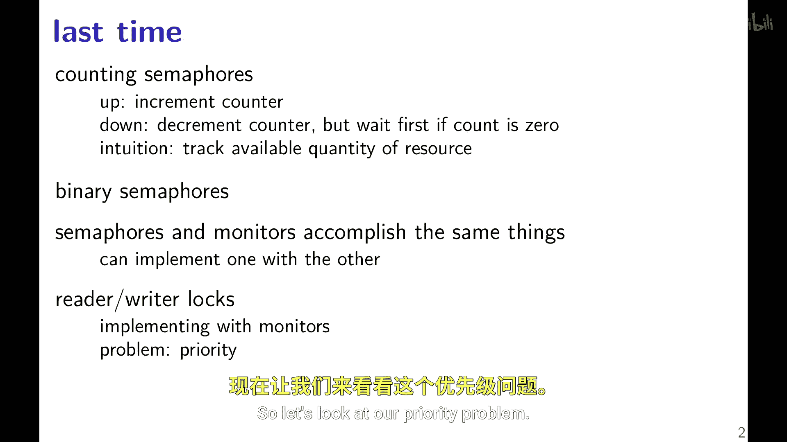
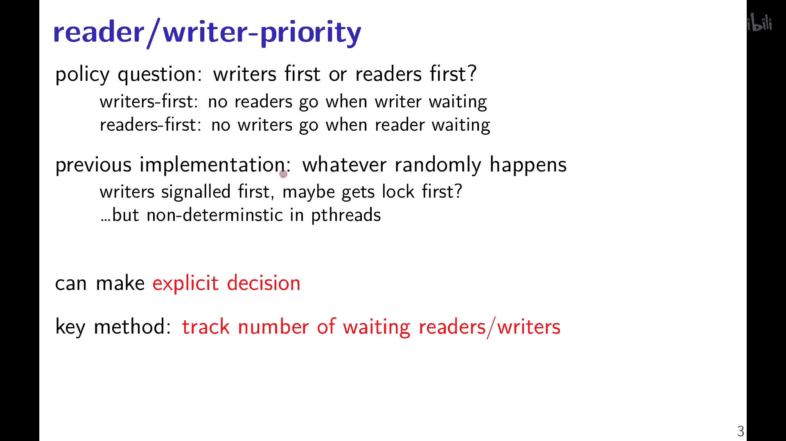
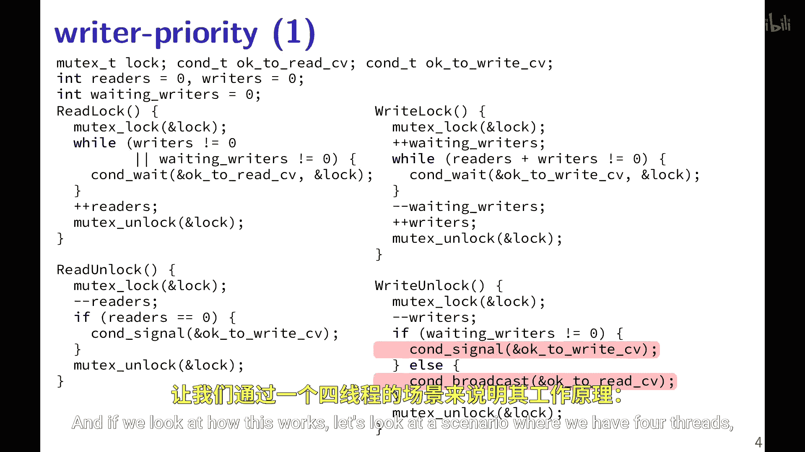
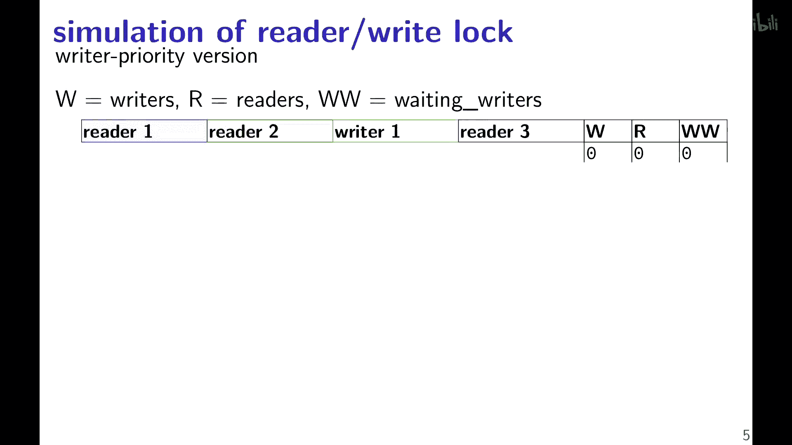

# 012：读写锁与死锁（续）

在本节课中，我们将继续探讨同步问题，特别是读写锁的实现细节。上一节我们介绍了使用信号量和管程实现读写锁的基本方法，本节我们将重点解决其中存在的优先级和潜在死锁问题，并学习如何为读写锁实现“写者优先”或“读者优先”的策略。

## 信号量与管程回顾

上一节我们介绍了信号量，它是对锁的一种更灵活的替代方案。信号量是一个计数器，我们通过 `up`（递增）和 `down`（递减）两个操作来管理它。如果执行 `down` 操作会使计数器变为负数，线程将等待直到计数器变为正数。其核心思想是用计数器跟踪可用资源的数量，并通过适当的簿记确保计数准确。

虽然我们介绍了计数信号量，但还有一种更简单的实现称为**二元信号量**，其计数器只能是0或1。事实证明，只要有二元信号量和一些存储空间，就可以实现计数信号量的所有功能。

我们还讨论了信号量和管程的关系。它们看起来差异很大，但具有相同的能力，因为我们可以用信号量实现管程，反之亦然。这里的一个关键技巧是跟踪等待者的数量，从而决定是否增加信号量，以避免唤醒未来并不存在的线程。

## 读写锁与优先级问题

我们接着讨论一种更专注的同步结构——读写锁。它适用于多个线程可以同时读取某个数据结构，但写入时则必须独占访问的场景。

我们之前展示了一个使用管程的实现。在实现中，当一个写者完成时，如果同时有读者和写者在等待，我们会同时唤醒两者。先被唤醒的线程会递增读者或写者的数量，后唤醒的线程会发现条件不满足而重新进入等待。这种实现可能导致线程被无效唤醒，效率低下。

为了解决这个问题，我们可以为读写锁设定一个优先级策略：**写者优先**或**读者优先**。

以下是两种策略的核心规则：
*   **写者优先**：当有写者在等待时，不应允许任何读者进入。
*   **读者优先**：当有读者在等待时，不应允许任何写者进入。

为了实现这些策略，我们需要跟踪正在等待的读者或写者的数量。

## 实现写者优先策略

为了实现写者优先，我们需要在原有实现基础上增加一个计数器来跟踪等待中的写者数量。

以下是修改后的关键步骤：

1.  **添加计数器**：引入一个变量 `waiting_writers`，初始值为0。
2.  **更新等待逻辑**：在写者调用 `write_lock` 开始等待前，递增 `waiting_writers`；在等待结束后（即获得锁后），递减它。
3.  **修改读者等待条件**：读者的等待条件从“仅当有活跃写者时等待”变为“当有活跃写者**或**有等待中的写者时等待”。这确保了在有写者等待时，新来的读者也会等待。
4.  **调整唤醒逻辑**：在唤醒读者时（例如当写者释放锁时），需要检查是否有等待的写者。如果有，则不广播唤醒读者，以避免无效唤醒。

通过以上修改，我们确保了写者一旦开始等待，后续的读者请求将被阻塞，直到所有等待的写者完成，从而实现了写者优先。

## 场景分析

考虑一个四个线程的场景：一个活跃的写者（W1），一个等待的写者（W2），以及两个读者（R1， R2）。
*   在**原始实现**中，当W1完成时，可能会同时唤醒W2和R1/R2，导致可能的无效唤醒和竞争。
*   在**写者优先实现**中，由于 `waiting_writers > 0`，当W1完成时，只会唤醒写者（W2）。读者R1和R2将继续等待，直到W2完成且没有其他等待的写者。这避免了无效唤醒，并保证了写者的优先执行。

## 总结

本节课我们一起学习了读写锁的优先级实现。我们首先回顾了信号量与管程的等价性。然后，我们分析了基本读写锁实现中存在的优先级模糊和无效唤醒问题。为了解决这个问题，我们引入了**写者优先**策略，其核心是跟踪等待中的写者数量，并据此调整读者的进入条件和唤醒逻辑。通过这种方式，我们能够构建更高效、行为更确定的同步原语。