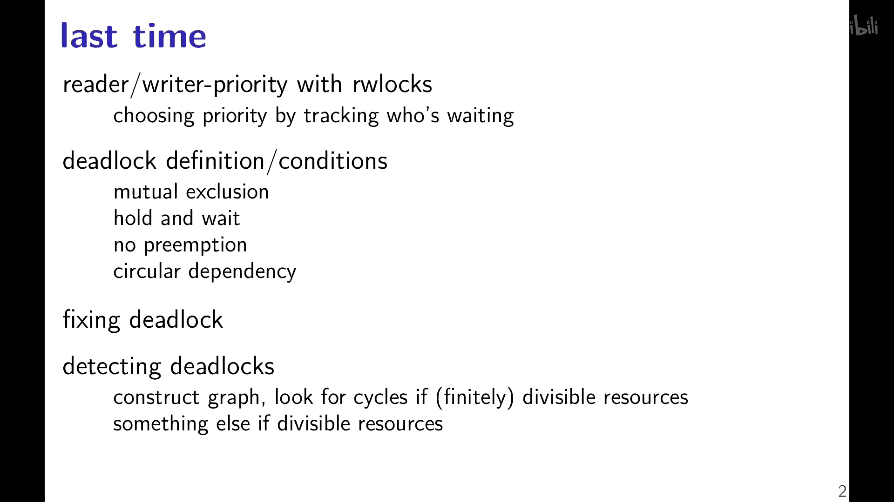
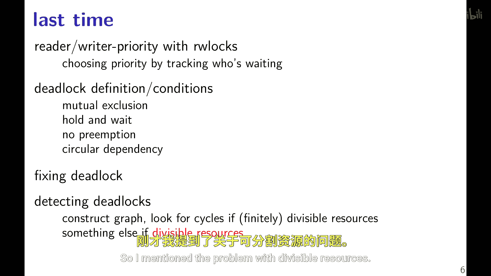
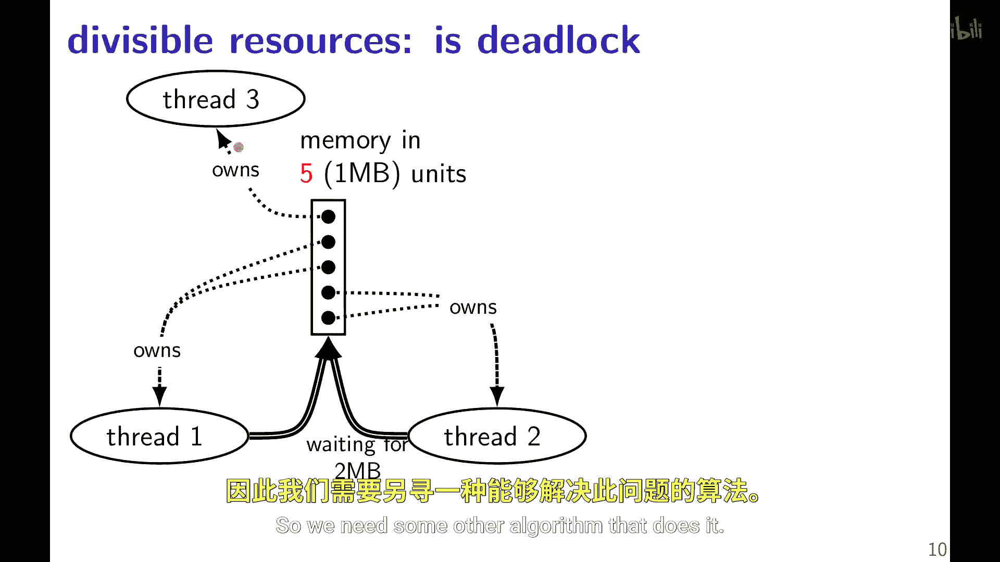
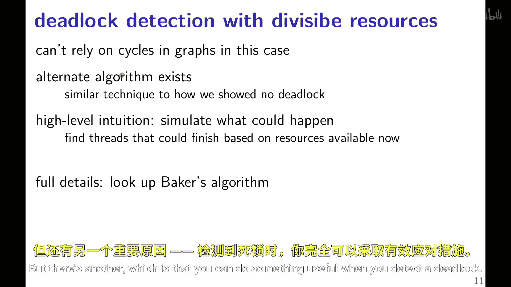
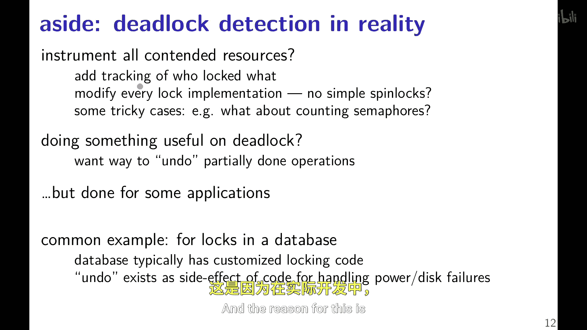

# 013：虚拟内存 1 🧠

在本节课中，我们将学习虚拟内存的基本概念。上一节我们讨论了死锁及其解决方案，本节我们将转向一个不同的核心主题：虚拟内存。虚拟内存是操作系统管理物理内存资源、为每个程序提供独立且看似连续的内存空间的关键机制。

## 概述

虚拟内存允许程序使用比实际物理内存更大的地址空间。它通过将内存地址映射到物理内存或磁盘上的存储位置来实现。这为程序提供了隔离性、安全性和灵活性。

## 读者-写者锁与监视器回顾

上一节我们介绍了使用监视器实现读者-写者锁的策略。我们面临一个选择：有时需要唤醒等待不同条件的多个线程。在最初的实现中，`signal`和`broadcast`决定了谁先运行，但这可能不是最理想的选择。我们可以通过向等待原因添加额外条件，并在决定`signal`或`broadcast`时，明确选择写者优先策略来解决这个问题。我们还可以实现其他有用的策略。

## 死锁问题回顾

在讨论了监视器之后，我们转向了一个更普遍的问题，即死锁。死锁最容易在使用锁时出现，但任何线程“拥有”资源并等待另一个资源的情况都可能发生。我们看到了块、管道缓冲区等例子。死锁的正式条件包括：
*   **互斥**：资源一次只能被一个线程拥有。
*   **持有并等待**：线程在持有资源的同时，请求并等待另一个资源。
*   **不可抢占**：资源不能被强制从拥有者那里夺走。
*   **循环等待**：存在一个线程等待链，最终形成一个循环。

我们的关键思路是审视这些条件，并找到使其不成立的方法。对于涉及锁的死锁，最简单的解决方案是打破循环等待条件。我们通过为锁定义一个全局的获取顺序来实现这一点。其他策略包括“不持有并等待”（尝试获取，失败则释放所有已持有资源）等。

## 死锁检测的复杂性

我们讨论了死锁检测。对于锁，我们可以构建资源分配图并使用图论算法检测环。然而，在更一般的情况下，例如内存资源，检测会变得更复杂。因为内存是可分割的资源，图中出现环并不一定意味着实际死锁（可能还有足够剩余内存）。存在更完整的检测算法（例如模拟资源分配过程），但本课程不要求掌握其具体实现。如果你需要，应该查阅相关资料。

## 死锁检测的实际应用

死锁检测不仅是一个调试工具，在某些应用中也有实际用途。例如，一些数据库系统会进行死锁检测。当检测到死锁时，它们有能力撤销（回滚）某个事务的操作，释放其持有的锁，然后稍后重试该操作。这在死锁预防方案不切实际的情况下（例如用户查询顺序不可控时）是一种可行的策略。

## 转向新主题：虚拟内存

现在，我们已经深入讨论了线程和并发控制。接下来，我们将讨论一个不直接使用线程，但与之密切相关的核心主题：虚拟内存。理解虚拟内存对于掌握现代操作系统如何管理内存、实现进程隔离和保护至关重要。

## 总结

本节课我们一起回顾了读者-写者锁的实现与策略选择，深入探讨了死锁的四个必要条件及其解决方案，并了解了死锁检测的复杂性和在数据库等系统中的实际应用。最后，我们引出了操作系统中的另一个核心机制——虚拟内存，为后续学习奠定了基础。