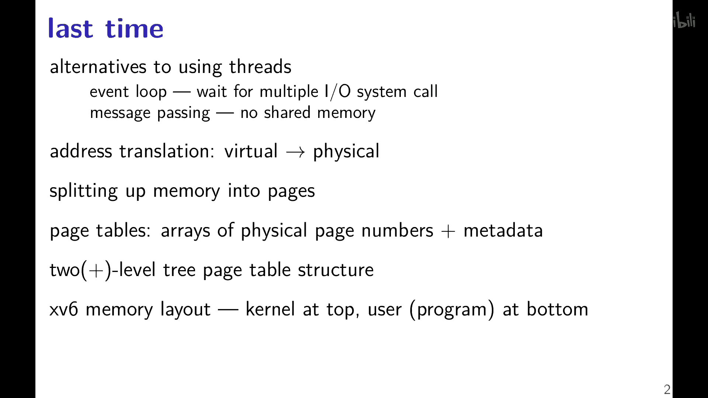
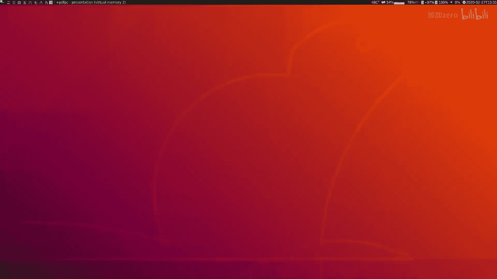
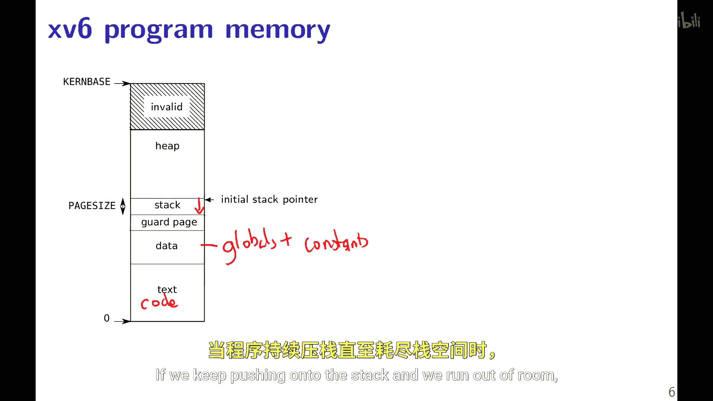

# 014：虚拟内存 2

在本节课中，我们将继续学习虚拟内存。我们将回顾上一节讨论的线程替代方案，并深入探讨虚拟内存的具体实现细节，特别是XV6操作系统中的内存布局设计。

上一节我们介绍了使用事件循环和消息传递作为多线程的替代方案。本节中，我们来看看虚拟内存的具体实现，特别是页表结构和XV6的内存布局。

## 页表结构回顾

我们之前讨论了虚拟内存的基本概念。操作系统通过建立从程序使用的虚拟地址到真实物理地址的映射来实现内存隔离。最常见的方案是将内存划分为固定大小的单元，称为页。

为了管理这种映射，我们使用一个称为页表的数据结构。页表本质上是一个数组，它为每个虚拟页存储对应的物理页号和一些元数据。

**核心概念：页表条目**
一个页表条目通常包含物理页帧号和一些控制位（如读/写权限位、存在位等）。

然而，一个平坦的页表（即单层数组）对于32位地址空间来说可能过于庞大，需要数兆字节来存储每个进程的页表，这在实践中是不可行的。

因此，我们采用了更高效的多级页表结构。我们将虚拟页号拆分为多个部分，用于索引不同层级的页表。

**核心概念：二级页表**
在二级页表结构中，虚拟地址被拆分为多个索引。第一级索引指向一个第二级页表，第二级索引最终指向物理页帧。这节省了空间，因为对于未使用的地址范围，我们无需分配完整的第二级页表。

## XV6的内存布局

在了解了页表结构及其遍历方式后，我们开始研究XV6操作系统使用的内存布局。

XV6采用了一种设计理念：所有应用程序相关的内容（即进程间不同的部分）位于内存的下半部分，而上半部分则被内核使用，并且这个映射对所有进程都是一致的。

这种设计与物理内存的布局高度一致。我们将看到，这对于XV6中需要创建和操作页表的代码非常有用，因为它允许我们为进程提供它们所期望的内存，同时让内核能够轻松处理处理器所理解的物理地址。

这意味着，即使内核在启用虚拟内存的情况下运行，当内核访问一个地址时，它也必须使用页表，通过虚拟地址进行访问，而不能直接访问物理地址。

## 内核与用户空间的隔离

上一节我们研究了这种映射关系。我们提到，内存中有一个内核部分，存在一个分界点。

在页表中，蓝色区域（内核空间）的所有条目都被设置了一个元数据位，表明只允许在内核模式下访问。这意味着，当处理器查看页表时，如果一个在用户模式下运行的程序试图访问那个蓝色区域，将会触发异常，导致该程序被终止。

这是确保安全隔离的关键机制。尽管我们为所有地址都建立了映射，使得内核在内核模式下可以通过蓝色区域读写任何程序的内存，但其他运行中的程序无法这样做以访问其他程序的数据。这对于保护程序彼此不受干扰至关重要。

## 内核映射的实用性

由于我们设置了这种静态映射，从物理页0开始依次映射，这意味着对于程序使用的大部分地址，我们将有两个映射：一个供程序使用，另一个供内核使用。内核可以基于物理地址轻松计算出它自己的映射。

采用这种映射的部分原因在于，我们根据程序的构建方式为绿色部分（用户空间）选择了布局。作为操作系统设计者，我们希望提供对程序有用的任何布局，而不是根据操作系统的构建方式来强制规定。

对于内核部分，我们希望轻松访问所有内存，因为如果我们的系统调用能够访问它们所需的任何内存，将会非常方便。这是一种方便的设计，我们无需做任何特殊操作来访问物理内存的任何特定部分。在内核区域拥有这种一一映射意味着，我们可以轻松地将一个物理地址转换为我们可以使用的虚拟地址。这个虚拟地址不一定是程序会使用的那个，但它能让内核访问物理内存的某个特定部分。

例如，如果我读取程序的页表并想查看页表指向的那个位置有什么，我可以轻松地从页表中读取物理地址并访问该内存，即使该页表不是当前活动的页表。当我们需要设置页表时，这将非常有用，因为我们可以轻松地查看部分设置好的页表，并添加或删除内容，同时了解发生了什么并访问该映射。

## XV6的程序内存布局详解

在概述了整体布局之后，让我们详细讨论一下XV6如何选择布局每个程序的内存。

以下是XV6中用户进程的典型内存布局：

*   **文本段**：这是存放程序代码的区域。“文本”是内存代码区域的一个旧称。
*   **数据段**：这里存放全局变量和常量。
*   **堆**：用于动态内存分配，向上增长。
*   **栈**：用于函数调用和局部变量。XV6做出了与Linux或Windows不同的决定，将栈放在堆的下方。初始栈指针位于栈的最高地址，栈向低地址方向增长。XV6选择给程序的栈始终只有一个页的大小（4KB）。
*   **警戒页**：位于栈的下方。如果我们持续使用栈空间，下一个可能访问的就是这个页。这个页被设置为不可访问，如果程序栈溢出尝试访问它，会触发异常，从而帮助检测栈溢出错误。

本节课中我们一起学习了虚拟内存的进阶内容。我们回顾了多级页表如何高效管理地址映射，深入探讨了XV6操作系统中内核与用户空间的内存布局设计，以及如何通过页表权限位实现两者间的安全隔离。我们还了解了XV6为程序设置的特定内存区域，包括文本段、数据段、堆、栈和警戒页。理解这些底层内存管理机制是掌握操作系统如何为应用程序提供安全、隔离运行环境的关键。