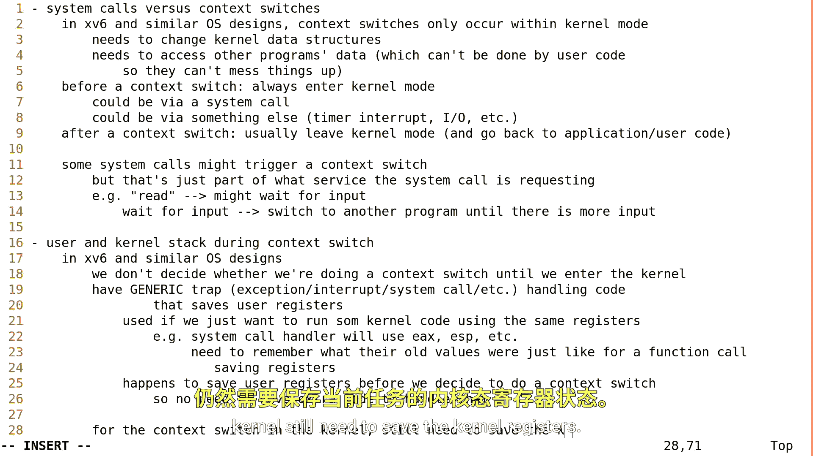
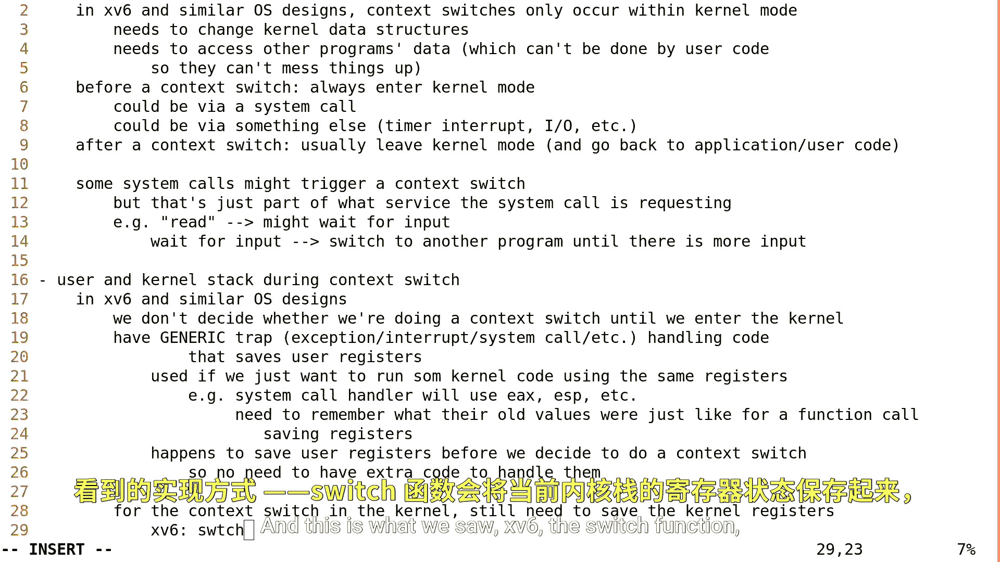
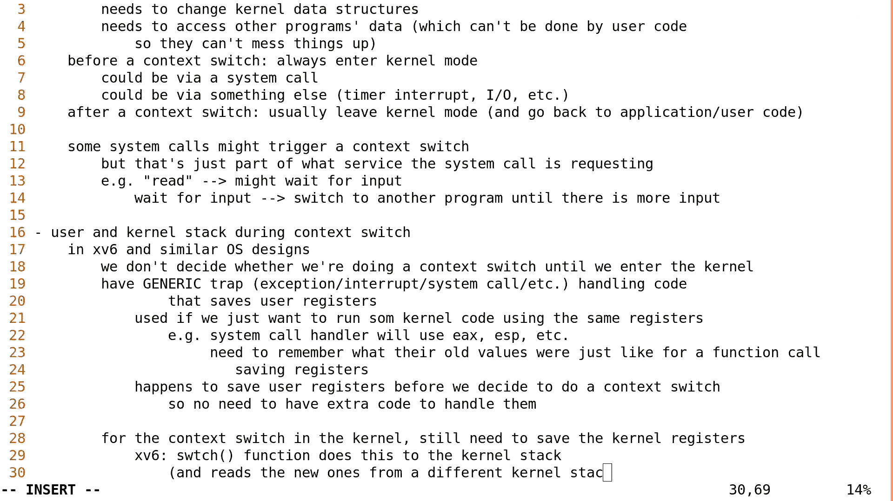
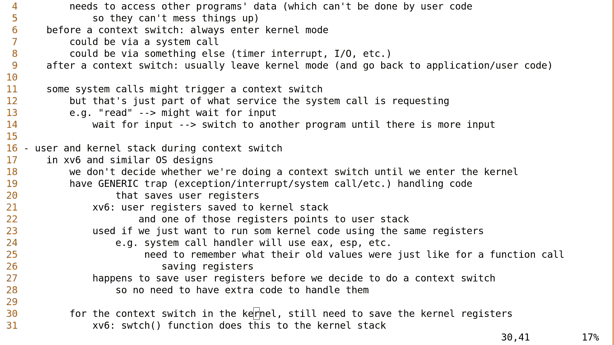
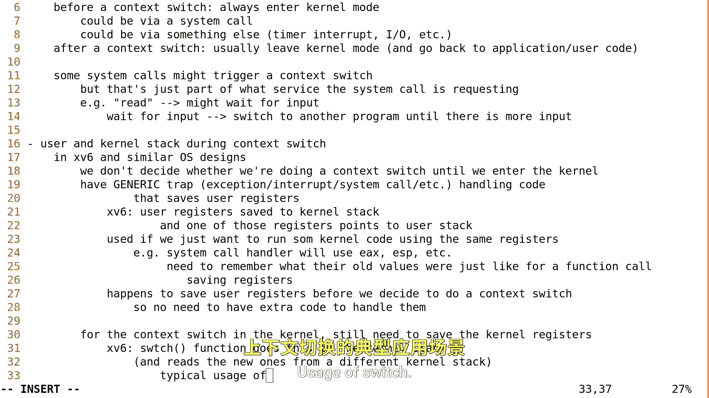
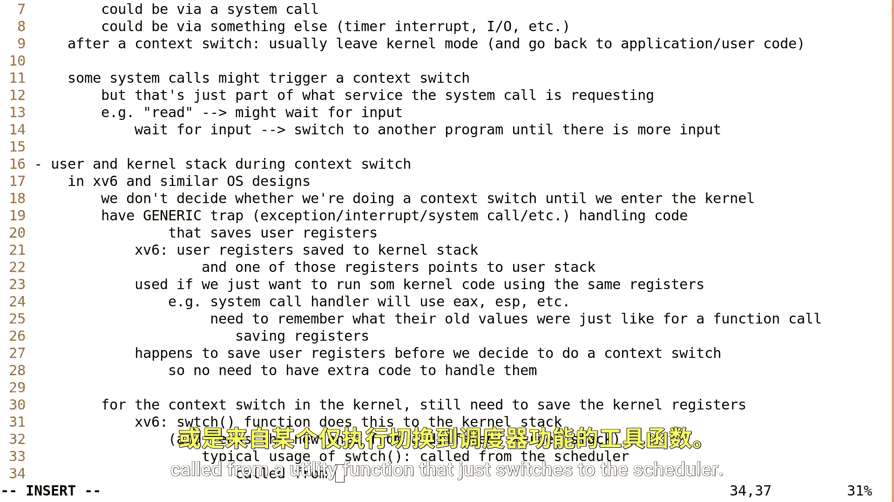

# 015：系统调用、上下文切换与内核栈管理 🧠

在本节课中，我们将回顾操作系统中的几个核心概念：系统调用与上下文切换的区别、用户栈与内核栈在上下文切换中的行为，以及内核中上下文切换的具体实现。我们将通过分析XV6等操作系统的设计来阐明这些机制。

## 系统调用与上下文切换

上一节我们介绍了课程概述，本节中我们来看看系统调用与上下文切换的关系。一个常见的困惑在于，系统调用是否必然导致上下文切换。

在XV6及类似的操作系统设计中，上下文切换**仅**发生在内核模式中。在发生上下文切换**之前**，处理器总是先进入内核模式。进入内核模式的原因可以是系统调用，也可以是其他事件（如中断或异常）。因此，系统调用只是进入内核模式、并可能（但非必然）触发上下文切换的多种途径之一。

关键在于，系统调用是内核提供服务的一种方式。**某些**系统调用（例如 `read` 等待输入）可能会因为需要等待某个事件而触发上下文切换，以便让出CPU给其他程序运行。但这只是该系统调用所提供服务的一部分，并非因为系统调用本身与上下文切换有固有的、必然的联系。

## 用户栈、内核栈与上下文切换

理解了系统调用的角色后，我们来看看在上下文切换过程中，用户栈和内核栈是如何被管理的。

在XV6的设计中，是否进行上下文切换的决策是在**进入内核之后**才做出的。内核有一套通用的陷阱（trap）、异常和系统调用处理代码。无论进入内核的原因是什么，这套代码都会首先将用户态的寄存器保存起来。

以下是其工作流程：
1.  无论通过系统调用、中断还是异常进入内核，通用处理代码都会将用户寄存器保存到当前进程的**内核栈**上。
2.  这类似于函数调用前保存寄存器的操作，目的是为了在内核代码执行完毕后能正确恢复用户程序的执行状态。
3.  完成保存后，内核才会根据情况（例如当前进程需要等待I/O）决定是否要进行上下文切换。

这种设计的巧妙之处在于，它为可能的上下文切换做好了准备，但又不依赖于它。因为寄存器已经保存，所以如果后续决定切换上下文，就无需额外的特殊代码来处理用户寄存器的保存。

当决定进行上下文切换时，内核还需要保存和恢复它自己的执行状态。这通过一个名为 `switch` 的函数完成。

`switch` 函数负责保存当前内核线程的寄存器（例如`%ebp`, `%ebx`, `%esi`, `%edi` 和程序计数器 `%eip`）到当前进程的内核栈上，然后从目标进程的内核栈上恢复这些寄存器的值。请注意，此时用户寄存器早已在第一步中被保存到各自进程的内核栈上了，`switch` 函数处理的是内核自身的执行上下文。

关于栈的总结：
*   **用户栈**：用于用户态函数的调用。其指针（如`%esp`）作为用户寄存器之一，在进入内核时被保存。
*   **内核栈**：每个进程都有一个独立的内核栈，用于内核态执行。它有两个关键作用：
    *   作为进入内核时保存用户寄存器的地方。
    *   作为内核函数调用和`switch`函数保存/恢复内核寄存器的地方。

这种为每个进程分配独立内核栈的设计非常典型，因为它使得内核在切换进程时，能自然地记住每个进程在内核中的执行点（例如，在某个系统调用中执行到哪一步）。

## 上下文切换函数 `switch` 的调用

最后，我们来探讨一下负责上下文切换的核心函数 `switch` 是如何被调用的。

`switch` 函数本身并不决定切换到哪个进程。它只是一个工具，负责执行寄存器保存和恢复的机械性工作。在XV6中，`switch` 的典型调用路径是间接的：

1.  一个想要放弃CPU的进程（例如，在`sleep`函数中）会调用`sched`函数。
2.  `sched`函数在进行了必要的检查（如锁的状态）后，会调用`switch`函数，将当前上下文切换到**调度器**的内核线程。
3.  调度器运行后，它会选择下一个要运行的进程，然后再次调用`switch`函数，从调度器上下文切换到目标进程的上下文。

因此，`switch` 总是被内核中的调度相关代码（如 `sched` 和调度器本身）调用，从而在进程之间以及进程与调度器之间切换执行流。

---

**本节课总结**

本节课中我们一起学习了：
1.  **系统调用与上下文切换**：系统调用是进入内核的一种方式，可能但不必然引发上下文切换；后者是内核调度CPU资源的手段。
2.  **栈的管理**：通过通用的陷阱处理程序，用户寄存器在进入内核时被自动保存到当前进程的内核栈上，这为潜在的上下文切换做好了统一准备。
3.  **上下文切换的实现**：内核使用 `switch` 函数保存和恢复内核寄存器，完成执行流的切换。`switch` 由调度逻辑（如 `sched`）调用，在进程与调度器之间切换。

这些机制共同构成了操作系统进行多任务处理的基础，确保了进程间的隔离与高效切换。