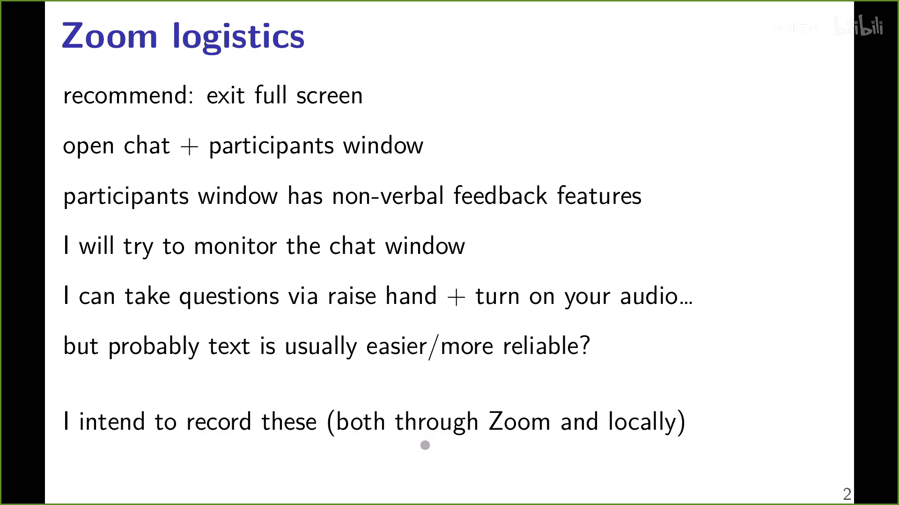
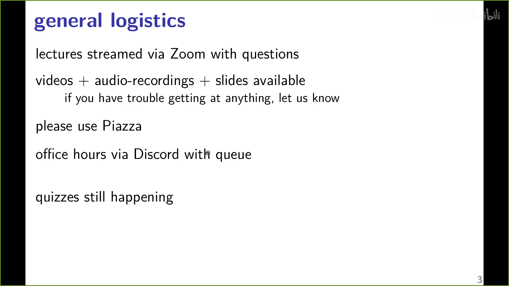
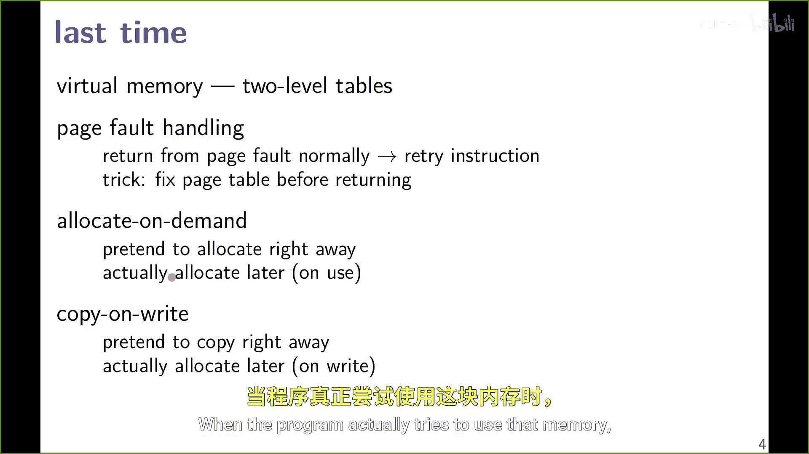
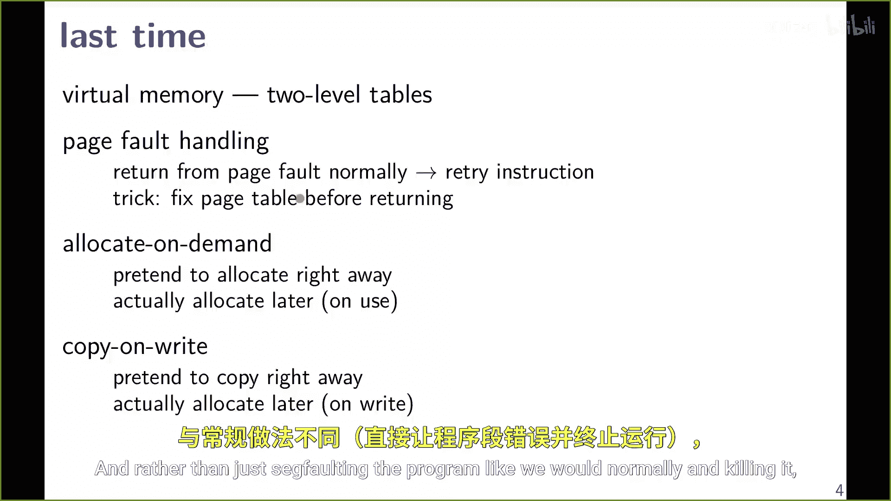
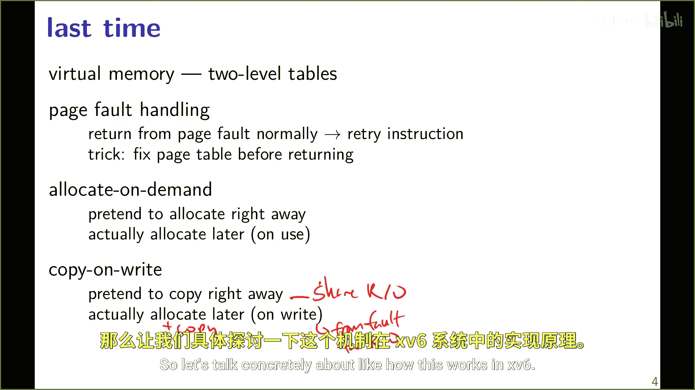
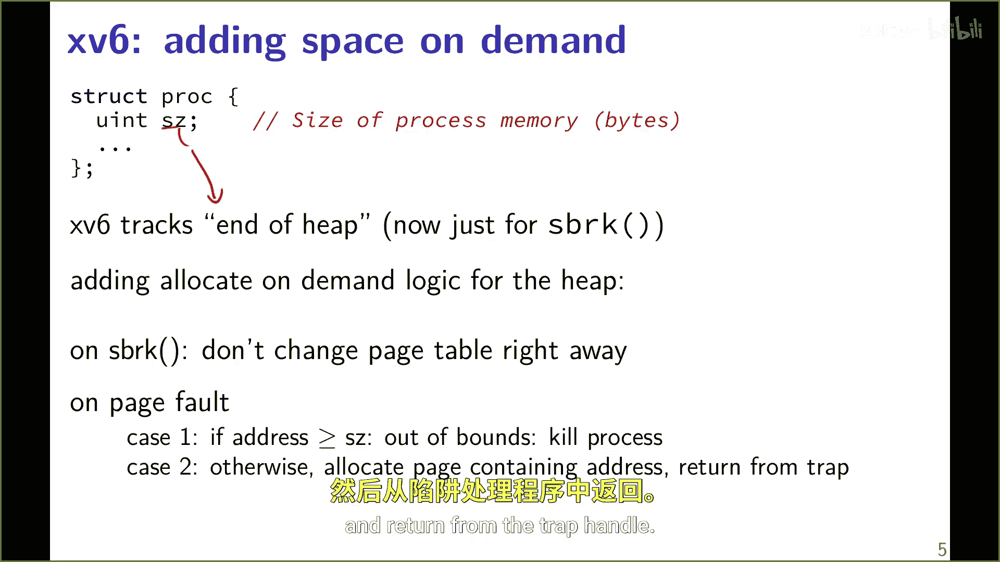
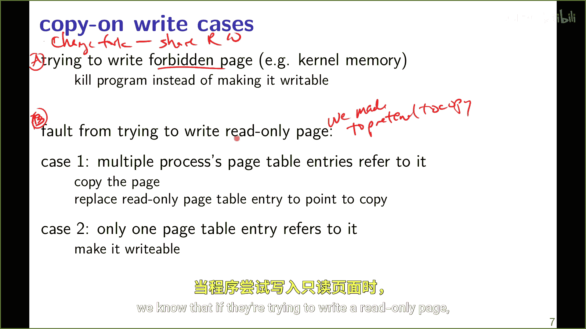

# 016：虚拟内存 3 - mmap 与页缓存（简介）

在本节课中，我们将学习虚拟内存的更多高级应用，特别是 `mmap` 系统调用和页缓存的基本概念。我们将了解操作系统如何利用这些机制来高效地管理内存和文件。

---

## 课程安排与后勤

我们通过 Zoom 进行课程直播，并支持实时提问。课程将提供视频、音频录音和幻灯片。请使用 Piazza 平台进行讨论，这对于身处不同时区、在不同时间工作的同学来说非常合适。答疑时间将通过 Discord 进行，使用排队系统，目前运行良好。测验照常进行，本周测验涵盖的内容会比原计划少一些。

关于期末考试，目前计划可能是开卷考试，需要将答案以文本文件形式上传到课程系统，具体细节仍在考虑中。评分标准预计不会与正常学期有太大不同，许多同学将采用“通过/不通过”的评分方式，具体边界将等待学校的进一步通知。

---

## 虚拟内存回顾

在期中考试之前，我们讨论了虚拟内存。我们讲解了 XV6 中使用的两级页表结构是如何工作的。

在理解了如何建立映射之后，我们提到，当页表中没有建立映射时，我们可以通过处理**缺页异常**来做一些事情。处理器在两级页表中查找映射失败时，会触发缺页异常。

如果我们从异常处理程序中正常返回（而不是终止进程），处理器会重新执行触发异常的指令。因此，我们可以使用一个技巧：不在缺页时直接终止进程，而是在缺页处理程序中修复页表项，然后让指令重新执行，第二次就能成功。

这使我们能够实现**按需分配**。我们可以假装立即分配了内存，但实际上并不真正设置页表来分配物理内存。当程序真正尝试使用那块内存时，会触发缺页异常。此时，我们不是在最后一刻终止程序，而是在最后一刻修复页表项。

对于**写时复制**，我们也不是立即分配和复制内存，而是先假装复制，实际上将页面设置为只读共享。真正的分配和复制可以延迟到发生写操作时，由触发的缺页异常来处理。

---

## 在 XV6 中的具体实现

我们的作业要求你们在 XV6 中添加这两个功能。让我们具体看看在 XV6 中如何工作。

### 按需分配

XV6 已经跟踪堆的末尾，这是通过 `size` 变量实现的。如果我们想按需分配，就必须假装分配内存。在 `sbrk` 系统调用中，我们将更新堆的末尾指针，但实际上并不处理内存分配。

在发生缺页异常时，我们有两种情况：
*   第一种情况是，即使我们真的分配了之前假装分配的内存，这个异常仍然会发生。在这种情况下，我们应该像以前一样终止进程。
*   第二种情况是，这个缺页异常仅仅是因为我们假装分配了内存而发生的。在这种情况下，我们需要实际进行分配，更新页表，然后从异常中返回。

### 写时复制

对于写时复制，我们的设置是：在 `fork` 时，让父子进程共享页面，但将其设置为只读。

之后，当我们尝试写入这个只读页面时，会触发一个“禁止写入”的缺页异常。我们需要区分两种情况：
*   如果页面本来就是禁止写入的（例如内核内存），那么即使我们不是在进行写时复制的“假装”操作，它仍然会发生缺页。此时我们仍然应该终止程序。
*   如果页面是我们为了写时复制而设置为只读的，那么又有两种情况：
    1.  如果有多个进程在使用这个页面，我们确实需要复制一份。我们不想干扰其他正在使用原始版本的进程。因此，我们会复制页面，并更新那个只读的页表项。
    2.  如果只有一个进程在使用这个页面，我们可以采取一个捷径：不需要复制并删除原始页面，可以直接将原始页面改为可写状态并使用它。

以上就是实现按需分配和写时复制的高级概述。我们看到，在这些模型中，我们使用了一个非常简单的模型来跟踪分配给程序的内存：一个指示堆末尾的变量，以及在写时复制中跟踪页面引用计数。

---

## 总结

本节课我们一起回顾了虚拟内存中按需分配和写时复制的原理，并探讨了它们在 XV6 操作系统中的具体实现思路。我们了解了如何通过处理缺页异常来延迟内存的实际分配与复制，从而提升内存使用效率。理解这些机制是掌握现代操作系统内存管理的关键。