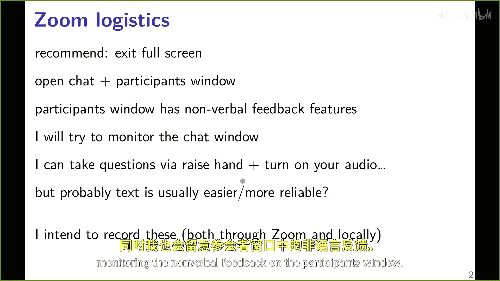
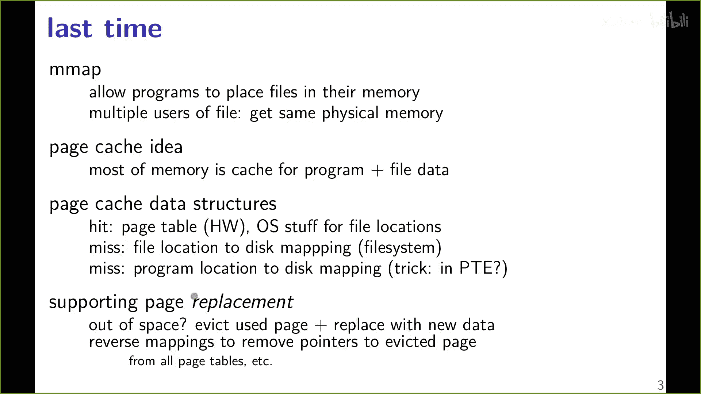
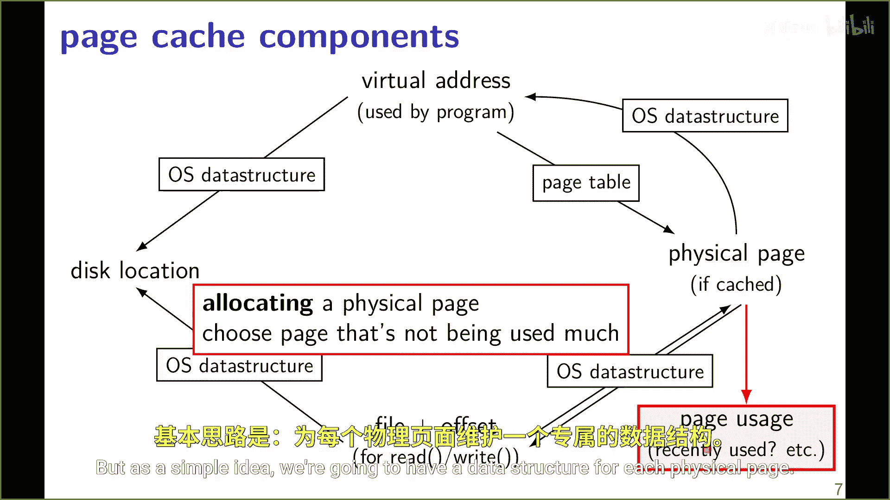
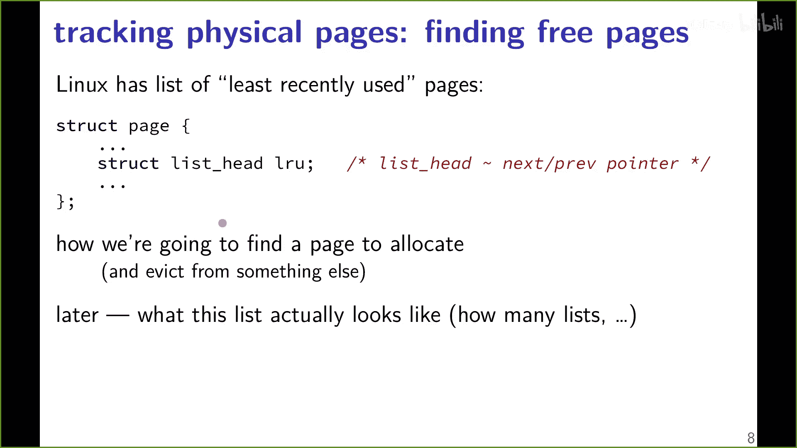
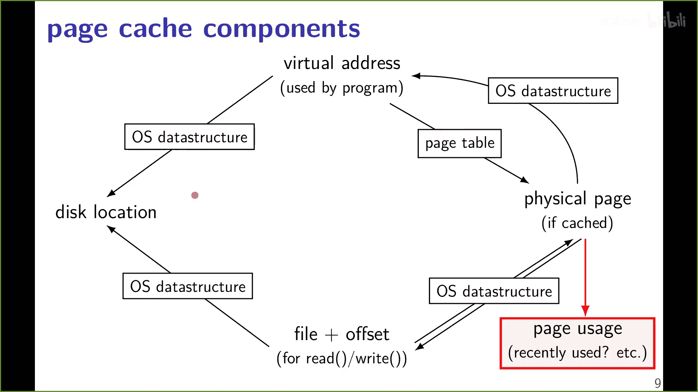
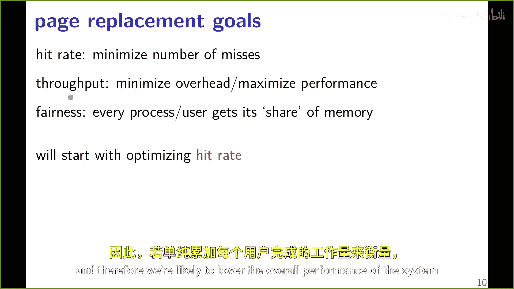

# 017：页面置换策略 🧠



在本节课中，我们将学习操作系统虚拟内存管理的核心部分——页面置换策略。我们将探讨当物理内存已满时，操作系统如何决定将哪些页面移出内存，以为新数据腾出空间。理解这些策略对于优化系统性能至关重要。

---

上一节我们介绍了页面缓存（Page Cache）的基本概念和数据结构。本节中，我们来看看当缓存未命中且物理内存已满时，操作系统如何决定替换哪些页面。

## 替换决策的目标 🎯

在讨论具体算法前，我们需要明确页面置换策略的目标。这与我们之前讨论的处理器调度类似，不同的目标会导致不同的算法。

以下是几种可能的目标：

*   **命中率**：目标是最大化缓存命中率，即最小化未来需要从磁盘加载数据的次数。这是一个直观且重要的目标。
*   **系统吞吐量**：用户真正关心的是系统整体性能，即单位时间内完成的工作量。虽然高命中率通常有助于提高吞吐量，但两者并不完全等同，因为页面置换本身也有开销。
*   **公平性**：在多用户系统中，可能需要确保每个用户公平地使用内存资源。这可能会牺牲一些整体吞吐量，以避免个别用户性能过差。

## 核心策略：替换“不常用”的页面 🔄



我们的直觉是，应该替换那些“不被使用”的页面。原因很简单：如果替换了一个即将被使用的页面，系统很快又需要将其从磁盘换入，这会带来昂贵的性能开销。

因此，一个基本思路是：**替换最近最少使用的页面**。



为了支持这个决策，操作系统需要为每个物理页面跟踪使用信息。





## 数据结构与实现示例 📊

在Linux等操作系统中，一个常见的数据结构是 **LRU（Least Recently Used）链表**。这是一个有序链表，用于跟踪物理页面的使用顺序。

**代码描述示例**：
```c
// 简化的LRU链表节点概念
struct page {
    // ... 其他页面元数据 ...
    struct list_head lru_list; // 用于链接到LRU链表的指针
};
```
然而，我们将会了解到，由于实现复杂性和硬件限制，实际系统中的“LRU”策略往往是对理想LRU的一种近似。

---



本节课中我们一起学习了页面置换策略的基本目标，并引入了通过替换“最近最少使用”页面来优化性能的核心思想。我们还简要了解了用于实现该策略的数据结构。接下来，我们将深入探讨如何精确地定义“使用”，并分析不同的置换算法。