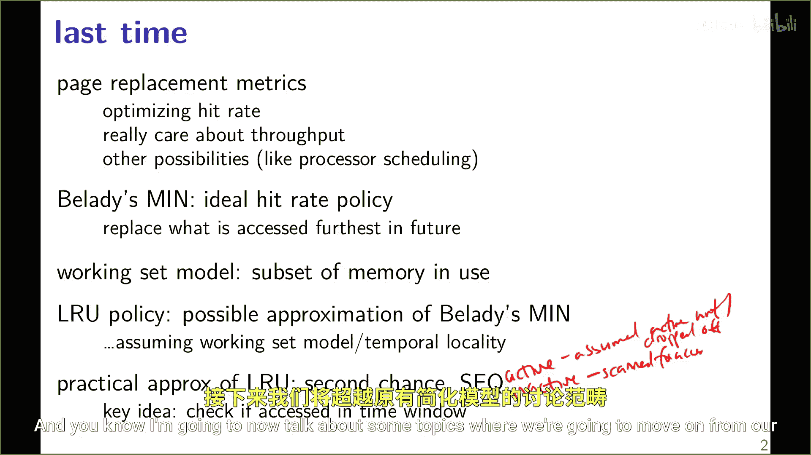
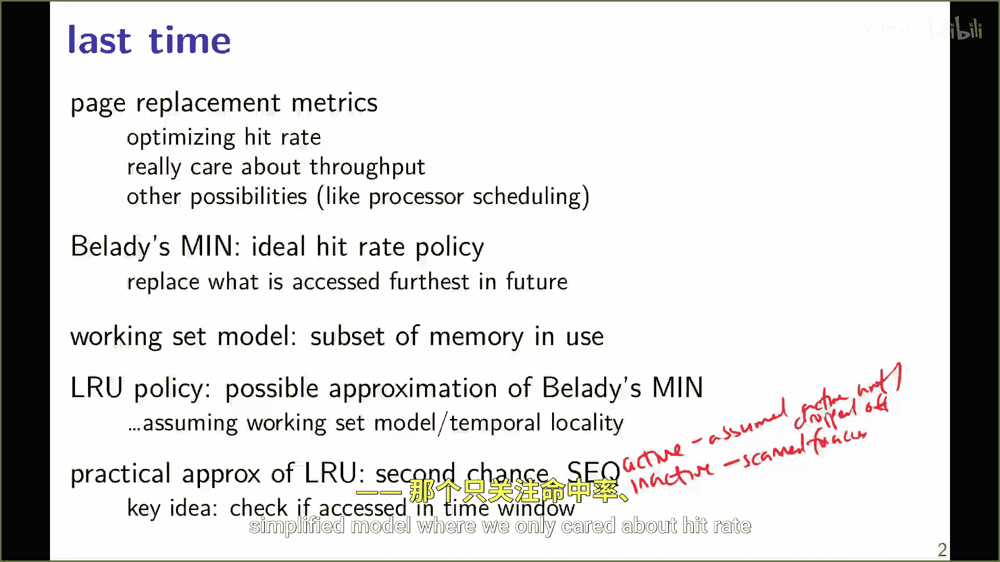
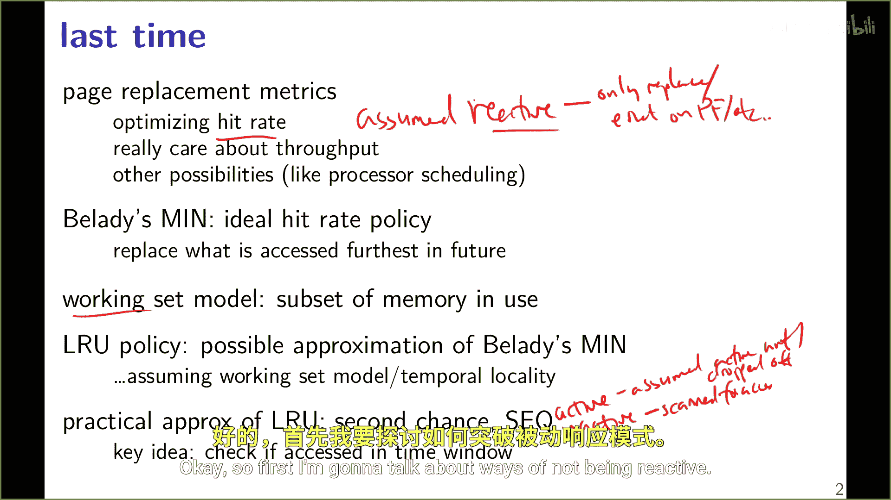
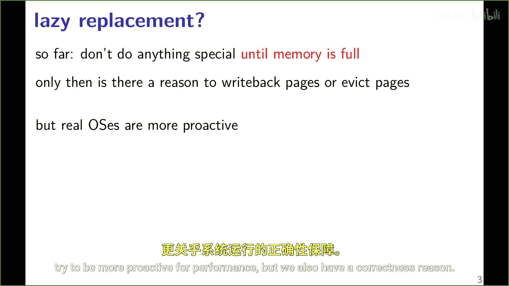
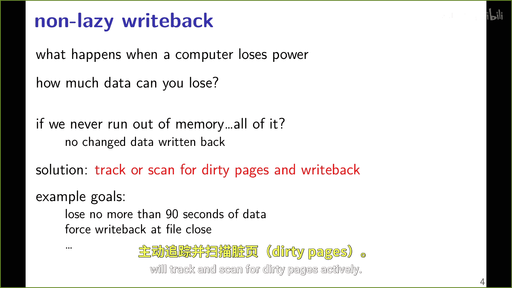

# 018：虚拟内存与I/O（第一部分）

在本节课中，我们将学习页面置换策略的后续内容，并探讨如何超越简单的“命中率优化”模型。我们将讨论从被动响应到主动管理的转变，并特别关注“写回”操作带来的性能与数据一致性挑战。

上一节我们介绍了基于工作集模型和LRU近似的页面置换策略。本节中，我们来看看如何超越这种被动响应的模型。

## 超越被动响应模型

我们之前的模型是“被动响应”的：仅在发生缺页错误、需要将新页面调入内存时，才去选择一个页面进行置换。我们优化的核心指标是命中率。然而，这种模型存在局限。

首先，它忽略了其他系统目标，例如公平性。就像在处理器调度中，我们不仅关心系统总吞吐量，也关心每个用户能否获得合理的资源份额。页面置换也可能需要考虑类似的因素，通常可以通过在基础算法之上增加一层决策逻辑来实现。

其次，命中率本身并非我们真正关心的终极目标。我们真正关心的是系统吞吐量，因为每次页面置换操作本身就有开销，并且不同的置换操作开销并不相同。我们今天将开始探讨这些问题。

最后，我们之前假设操作系统无法预知未来，因此采用基于“最近最少使用”（LRU）原则的猜测来近似理想的最优置换策略（即置换未来最久不会被访问的页面）。虽然LRU在理论上是可实现的，但精确跟踪每个页面的“最近使用”时间戳成本极高。

因此，我们采用了两种实用的近似方案：
*   **二次机会算法**：通过一个引用位来近似LRU，给被访问过的页面多一次留在内存的机会。
*   **时钟算法**：是二次机会算法的一种更高效的实现，使用一个循环链表（像时钟指针一样扫描）来管理页面。

这两种方案的共同直觉是：我们并非精确追踪每次访问的顺序，而是检查一个“时间窗口”内的访问情况。对于二次机会算法，这个窗口大小与内存容量相关；对于时钟算法，我们可以通过调整“非活跃”页面的数量来更精确地控制这个时间窗口。

以上是我们通常的页面置换策略。现在，我将讨论一些新主题，我们将从那个只关心命中率、且完全被动响应的简化模型中走出来。

## 为何需要主动管理

首先，我们来探讨如何不再被动响应。

你可以认为我们之前的设置是“懒惰”的：直到内存已满、确实需要更多空间时，我们才采取行动。但实际的操作系统通常不会这样做，它们更加“主动”。

这样做有多个原因。一个主要原因是性能：在典型的桌面系统上，在我启动一个可能需要大量内存的程序之前，系统很可能处于相对空闲状态。利用这段时间提前进行一些操作是有益的。另一个原因是，页面置换（尤其是涉及磁盘I/O时）是相对昂贵的操作，我们希望尽早开始这些操作，而不是等到迫在眉睫、影响用户体验时才进行。

接下来，我将讨论一个案例，其中我们不仅有性能上的理由需要更主动，还有一个**正确性**上的强理由。这就是与“写回”操作相关的问题。

## 写回与数据一致性挑战

我们之前提到，需要跟踪页面是否是“脏”的，即是否被修改过。如果是脏页，在置换它之前，必须将其内容写回磁盘，以防数据丢失。

对于文件数据而言，这不仅仅是一个性能问题。考虑一个例子：你正在编辑一个Word文档并点击保存。如果采用我们之前“仅在需要置换时才写回”的策略，那么保存操作可能只是将数据写入了内存缓存（页面）。只要内存不紧张，这个被修改的页面可能一直留在缓存中，即使你已经关闭了文档。如果你的电脑此时断电或崩溃，那些你认为已经“保存”的更改实际上从未写入持久化存储（磁盘），从而导致数据丢失。

这通常是不可接受的。仅仅从防止数据丢失的角度出发，我们就必须比“被动响应”更主动。用户不会接受点击保存后，数据要等到几天后或关机时才真正写入磁盘。

因此，典型的操作系统会主要基于对数据丢失的担忧，主动跟踪和扫描脏页，并在合适的时机将其写回磁盘。

本节课中，我们一起学习了页面置换策略如何从优化命中率扩展到考虑系统吞吐量等其他目标。我们回顾了LRU的近似实现（二次机会和时钟算法），并探讨了为何需要从被动响应转向主动管理。特别地，我们分析了“写回”操作带来的数据一致性挑战，这是迫使操作系统进行主动页面管理的一个重要原因。在接下来的课程中，我们将继续深入探讨虚拟内存与I/O系统的其他交互。