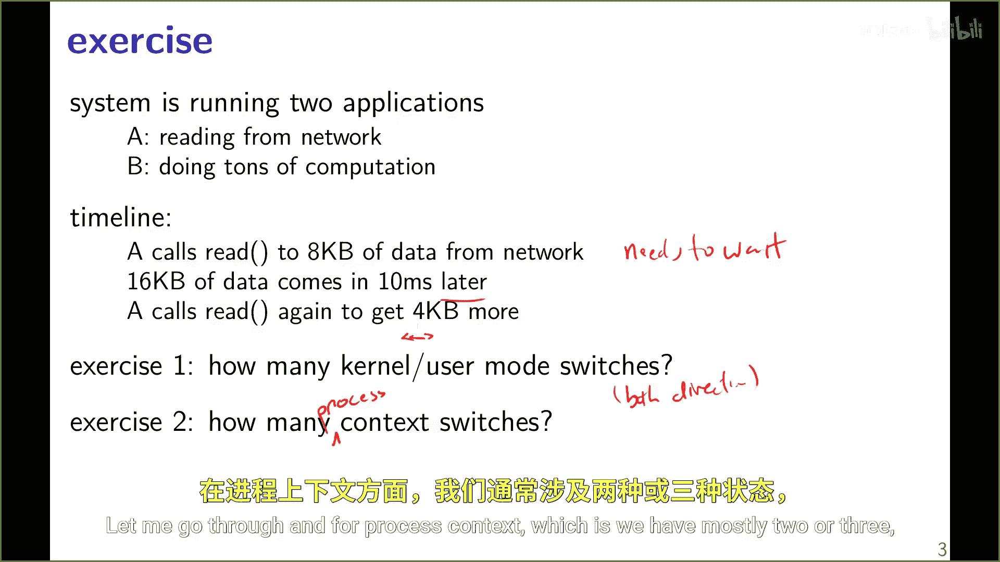
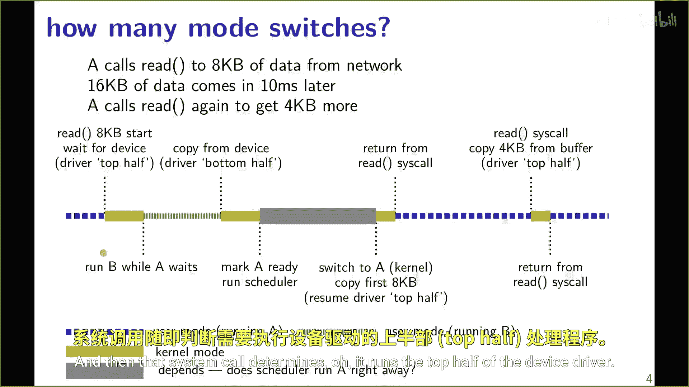
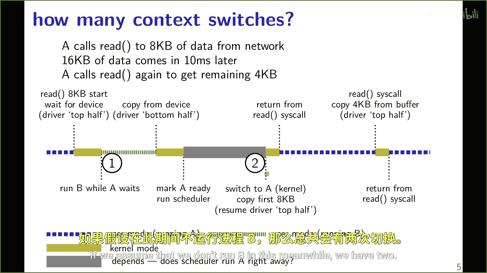

# 019：I/O与文件系统（第一部分）

在本节课中，我们将通过一个具体的I/O场景分析，来理解系统调用、进程上下文切换和模式切换是如何协同工作的。我们将重点关注一个应用程序从网络读取数据时，内核与用户空间之间的交互过程。

---

上一节我们介绍了I/O请求的基本流程，本节中我们来看看一个涉及等待和中断的具体例子。

假设我们有一个系统，其中运行着两个应用程序A和B。应用程序A希望从网络读取数据，而应用程序B主要进行大量计算。我们从一个具体的操作序列开始分析。

最初，应用程序A调用`read`系统调用，请求读取8KB的数据。此时，数据尚未到达，因此A需要等待。

由于A需要等待，操作系统不会让CPU空闲。它会进行一次上下文切换，开始运行应用程序B进行计算。

随后，有16KB的数据通过网络到达。这会触发一个硬件中断，导致CPU从用户模式（正在运行B）陷入内核模式，执行中断处理程序（即设备驱动的“下半部分”）。

中断处理程序处理到达的数据，将其放入缓冲区，并发现正在等待该数据的进程A。于是，它将进程A的状态标记为“就绪”。

此时，调度器需要决定接下来运行哪个进程。它可能立即切换到A，也可能让B再运行一段时间（例如，直到下一个时钟中断）。我们考虑立即切换的情况。

调度器决定后，发生一次上下文切换，从进程B切换到进程A。此时仍在内核模式。A之前被挂起的`read`系统调用（“上半部分”）得以恢复执行。它发现数据已在缓冲区中，于是将前8KB数据复制到用户空间，并返回给应用程序A。

应用程序A处理完这8KB数据后，发现还有更多数据可用，于是再次调用`read`请求读取4KB数据。这一次，由于数据已经在缓冲区中，系统调用可以立即完成并返回，无需等待。

以下是此过程中发生的模式切换（用户态与内核态之间的切换）计数：

1.  A发起第一次`read`系统调用，从用户态切换到内核态。
2.  由于需要等待，内核决定调度B运行，从内核态切换到用户态（运行B）。
3.  数据到达产生中断，从用户态（B）陷入内核态。
4.  中断处理完毕后，内核决定立即运行A。此时仍在内核态，执行A被挂起的系统调用并返回，从内核态切换到用户态（运行A）。
5.  A发起第二次`read`系统调用，从用户态切换到内核态。
6.  第二次`read`立即完成并返回，从内核态切换到用户态。

因此，总共发生了 **6次** 模式切换。

以下是此过程中发生的进程上下文切换（从一个进程的内核线程切换到另一个）计数：

1.  从进程A切换到进程B（当A的第一次`read`开始等待时）。
2.  从进程B切换回进程A（当数据到达且调度器决定立即运行A时）。

因此，总共发生了 **2次** 进程上下文切换。

如果调度器没有立即切换回A，而是让B继续运行了一段时间，那么模式切换的次数会增加（多一次从B用户态到内核态的切换，以及一次从内核态回到B用户态的切换），但进程上下文切换的次数仍然是2次。

---

本节课中我们一起学习了在一个涉及网络I/O等待的场景中，系统调用、中断处理、调度和上下文切换是如何交织在一起的。我们通过逐步分析，明确了模式切换与进程上下文切换的区别与计数方法。理解这些交互是掌握操作系统I/O子系统工作原理的关键。