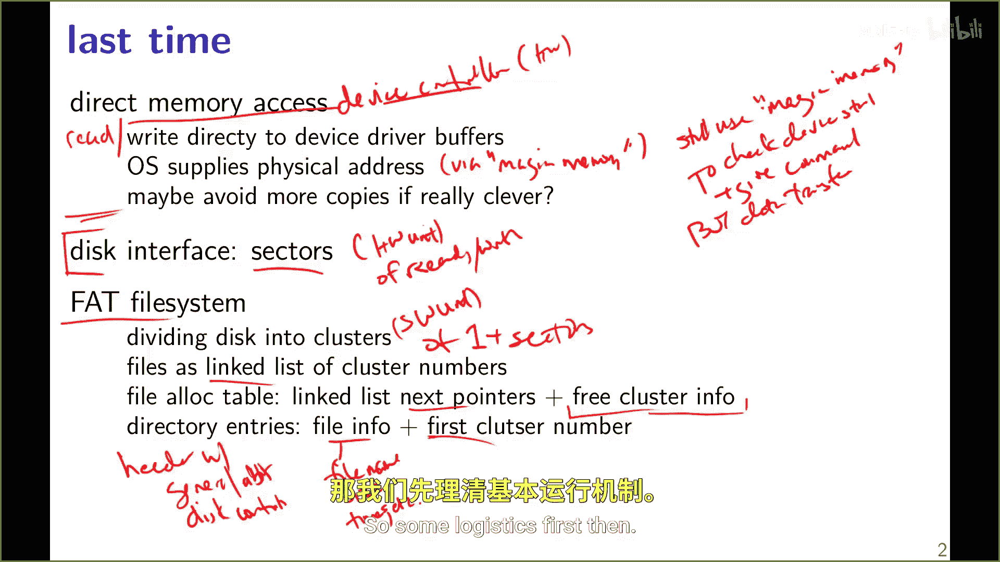
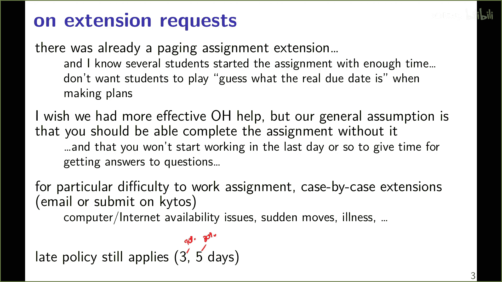
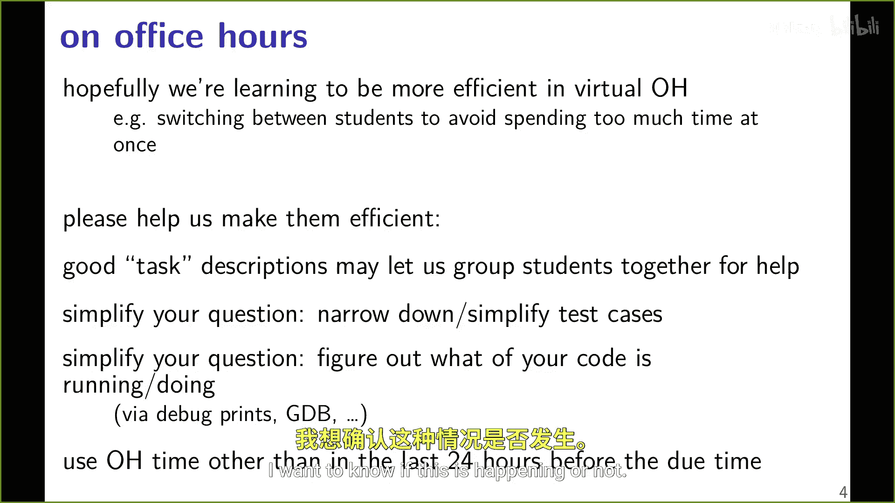

# 020：文件系统 2 💾

在本节课中，我们将继续学习操作系统如何与设备通信，并深入探讨文件系统的底层硬件基础。我们将了解硬盘和固态硬盘的工作原理，以及操作系统如何与它们交互。

## 回顾与过渡

上一节我们介绍了操作系统通过**直接内存访问**与设备通信的机制。在这种方案中，设备控制器可以直接读写设备驱动程序提供的缓冲区，从而避免了CPU进行数据拷贝，提升了硬盘、网卡等需要大量数据传输的设备的性能。

接着，我们开始讨论文件系统。为了设计文件系统，我们需要了解如何与硬盘或SSD通信。硬件的基本读写单位是**扇区**，这限制了我们在磁盘上组织数据的方式。我们看了一个简单的文件系统设计——**FAT**。FAT将磁盘划分为**簇**（一个或多个扇区），并通过一个链表结构来存储文件数据，这个链表信息保存在**文件分配表**中。此外，文件的元数据（如文件名、大小等）则存储在**目录项**中。

## 磁盘接口详解

本节中，我们将更详细地探讨磁盘接口，了解硬盘和固态硬盘的工作原理以及操作系统与它们交互的接口。

### 硬盘的工作原理

硬盘是一种机械式存储设备。数据存储在高速旋转的盘片上，通过可移动的磁头进行读写。

以下是硬盘操作的基本步骤：
1.  **寻道**：磁臂移动，将磁头定位到目标磁道上方。
2.  **旋转延迟**：盘片旋转，使目标扇区移动到磁头下方。
3.  **数据传输**：磁头进行实际的读取或写入操作。

因此，一次硬盘访问的时间由以下公式决定：
`访问时间 = 寻道时间 + 旋转延迟 + 传输时间`

### 固态硬盘的工作原理



固态硬盘使用闪存芯片存储数据，没有机械部件。其基本操作单位是**页**（例如4KB），而擦除操作必须在更大的**块**（例如256页）上进行。

以下是SSD操作的特点：
1.  **读写不对称**：写入（编程）页的速度比读取慢，擦除整个块的速度更慢。
2.  **磨损均衡**：控制器需要将写入操作均匀分布到所有存储单元，以避免部分单元过早损坏。
3.  **写入放大**：由于必须在写入前擦除整个块，实际写入的物理数据量可能大于逻辑数据量。

操作系统通过标准的块设备接口与SSD交互，但SSD内部的闪存转换层会处理上述所有复杂性。

### 操作系统与磁盘的接口

无论底层是硬盘还是SSD，操作系统通常通过一个统一的抽象接口与它们通信。核心操作是读写**扇区**。

一个简化的设备驱动接口可能如下所示：
```c
// 读取指定扇区到内存缓冲区
int read_sector(int sector_number, void* buffer);
// 将内存缓冲区的数据写入指定扇区
int write_sector(int sector_number, const void* buffer);
```

操作系统发出的命令可能包括：
*   读取扇区 X 到内存地址 Y。
*   将内存地址 Z 的数据写入扇区 X。
*   查询设备状态（是否繁忙、是否出错）。



## 课程总结

本节课我们一起学习了文件系统所依赖的底层存储硬件。
*   我们回顾了**直接内存访问**如何提升I/O性能。
*   我们分析了**FAT文件系统**如何利用簇和文件分配表来组织数据。
*   我们深入探讨了**硬盘**的机械工作原理及其访问时间的构成。
*   我们了解了**固态硬盘**基于闪存的工作原理及其特有的挑战，如磨损均衡和写入放大。
*   最后，我们看到了操作系统如何通过统一的**扇区读写接口**与这些存储设备进行交互。



理解这些硬件特性对于设计高效、可靠的文件系统至关重要。在接下来的课程中，我们将基于这些知识，探索更复杂的文件系统设计。