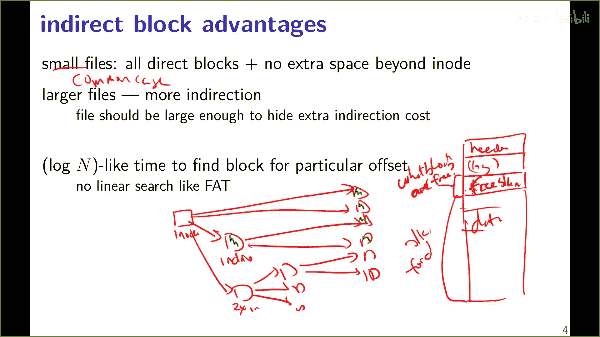
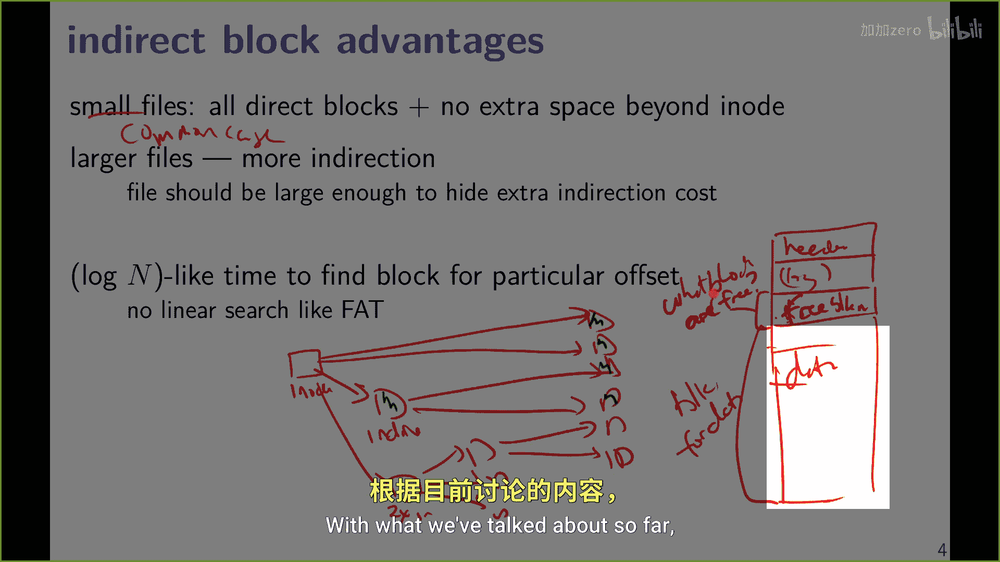
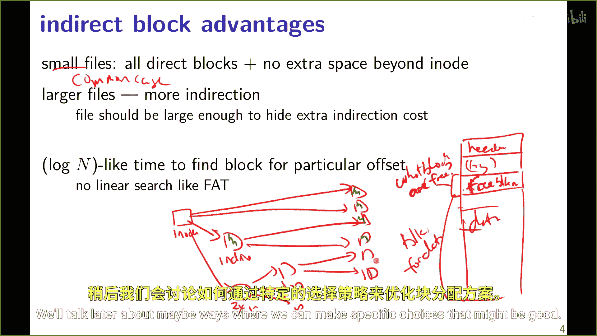

# 021：文件系统 4 🗂️

在本节课中，我们将继续学习文件系统。上一节我们介绍了基于inode的文件系统设计，本节我们将简要总结间接块的概念，并探讨XV6文件系统中尚未完善或解释的部分。

## 回顾：硬盘与固态硬盘

上一节我们首先讨论了硬盘。我们之所以讨论硬盘，是因为它们是文件系统的基础存储单元，尽管它们已不再是最主流的技术。

硬盘是物理设备，包含旋转的盘片，需要一个物理读写头移动到盘片的正确位置进行读写。我们提到了这些物理限制，例如寻道时间和旋转延迟。这意味着我们在考虑性能时，需要关注数据存放的位置，以减少物理移动时间。

我们还提到，虽然硬盘通常将扇区号相近的数据存放在一起，但物理介质并不可靠。硬盘控制器在不通知操作系统的情况下，会在磁盘上移动数据，以避开那些物理上已损坏、无法存储磁信号的区域。

接着我们讨论了固态硬盘。固态硬盘提供了与硬盘相同的接口，但底层采用了完全不同的技术——闪存。这种技术没有活动部件，因此更可靠，但也有一些特殊特性。最关键的一点是“擦除块”的概念。在硬盘上，我们可以直接覆盖磁盘的任何部分。而在固态硬盘上，要覆盖磁盘的某一部分，必须先擦除其周围的所有数据，且这些擦除块相对较大。更糟的是，每个块在开始失效前只能承受有限次数的擦除操作。因此，我们不能像在硬盘上那样，对同一区域进行多次覆盖写入。例如，FAT文件系统中的文件分配表位于磁盘起始位置，会被频繁覆盖写入，这在硬盘上没问题，但在固态硬盘上则行不通。

因此，固态硬盘控制器会进行自己的块重映射。每次我们覆盖写入数据时，控制器实际上会将其写入一个新的位置。这样做的目的是将负载分散到所有擦除块中，并处理一次只能擦除整个相对较大的擦除块这一事实。通过这种方式，控制器隐藏了擦除块的存在，让操作系统将其视为一个更快的硬盘。

## 基于Inode的文件系统

然后我们讨论了基于inode的文件系统。这是一种传统的类UNIX文件系统设计，其重大改变是将文件的所有数据（除了文件名）集中存放在一个称为“inode”的结构中。我们有一个inode数组，存储在磁盘的固定位置。每个inode包含文件的元数据，以及指向文件数据块的指针。

由于inode大小固定，我们无法总是将所有数据块指针都存放在inode中。因此，当直接指针用完后，我们会使用间接指针。这意味着我们会分配一个额外的块来存储更多的块号。有时，我们甚至会分配指向块的块。这种间接寻址只用于较大的文件；对于小文件，所有信息都直接存放在inode中。

在这种方案下，我们将inode数组存储在磁盘上。我们仍然需要跟踪哪些块是空闲的。实际上，这与我们跟踪下一个指针的方式有些类似，但在这里我们需要单独跟踪，因为我们不能将其放在inode中，所以我们有一个单独的空闲块位图。

完成这些后，与FAT文件系统将数据分散在目录项和FAT表各处不同，我们基本上只有一个地方可以查找和更新文件信息。目录项只包含inode数组的索引，而不是文件的部分信息。

## 间接块与树形结构

今天我们将非常简要地总结一下间接块，然后看看XV6文件系统中我们尚未解释或做得不够好的地方。

在继续之前，我们先回顾一下直接块和间接块的方案。我们首先使用直接块，但当直接块不够用时，我们不是采用链表方案，而是使用一个指针指向一个存储更多块号的数组。如果这还不够，则使用一个指针指向一个存储更多指向块号数组的指针的数组，依此类推。

你可能会问，我们为什么要采用这种分层方案？一个关键的观察是，对于小文件，我们只使用直接块，不会在inode之外分配任何空间。这样做的好处在于，这是最常见的情况。我们稍后会了解到，大多数文件都很小。因此，通常我们不需要分配间接块，也无需处理它们。但这并不意味着间接块不重要，因为我们确实需要能够高效地读写和存储大文件。我们只为较大的文件使用额外的间接块，这就是为什么我们采用这种分层结构：对小文件使用直接块，对大文件使用间接块。

最终的结果是，随着文件变大，我们使用越来越多的间接层。你可以将其视为一种倾斜的树形结构。我们有一个间接块，指向更多的间接块，这些间接块再指向数据块。我们从上到下填充这棵树：首先使用这一层，然后是下一层，依此类推。我们最终在任何时候得到的都是一个倾斜的树形结构。

因此，我们不需要线性搜索来查找数据。如果你想了解访问数据的复杂度，它类似于树形结构的访问时间，是对数级别的，而不是像FAT那样的线性时间。无论文件大小如何，我们都可以构建这种结构。

## 操作系统如何选择数据块位置

现在有一个问题：操作系统如何知道应该将文件数据放在哪里？具体来说，它如何选择数据块？

在XV6文件系统中，我们有引导区、日志（稍后讨论）、空闲块位图和数据区。操作系统将使用空闲块位图来了解哪些块是空闲的。这些空闲块用于存储文件的实际数据，以及需要分配的间接块、双重间接块或三重间接块。

基于这些空闲块信息，操作系统将选择数据区中的一组空闲块来存放文件数据。根据我们目前讨论的内容，操作系统可以选择这些空闲块中的任意子集来存放文件的实际数据，以及它需要分配的任何间接块。

## 总结

本节课中，我们一起学习了文件系统的关键概念。我们回顾了硬盘和固态硬盘的物理特性及其对文件系统设计的影响。我们深入探讨了基于inode的文件系统设计，理解了直接块和间接块如何协同工作以高效管理不同大小的文件，并形成了倾斜的树形结构。最后，我们了解了操作系统如何利用空闲块位图来选择存储文件数据的位置。这些知识为我们理解现代文件系统的工作原理奠定了基础。