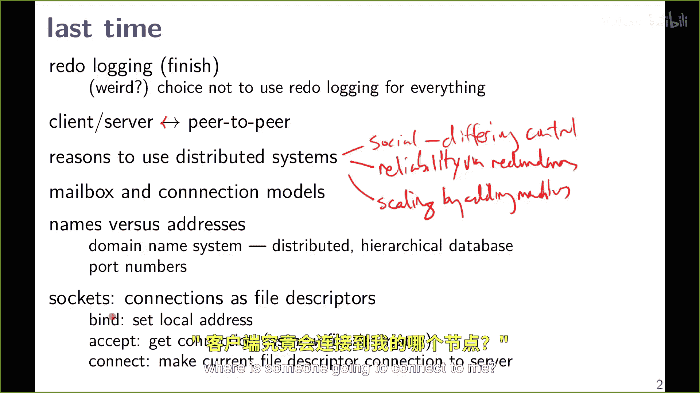
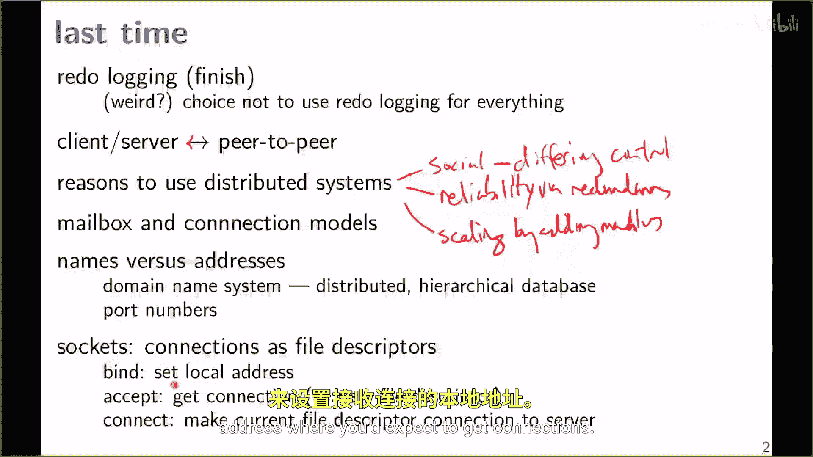
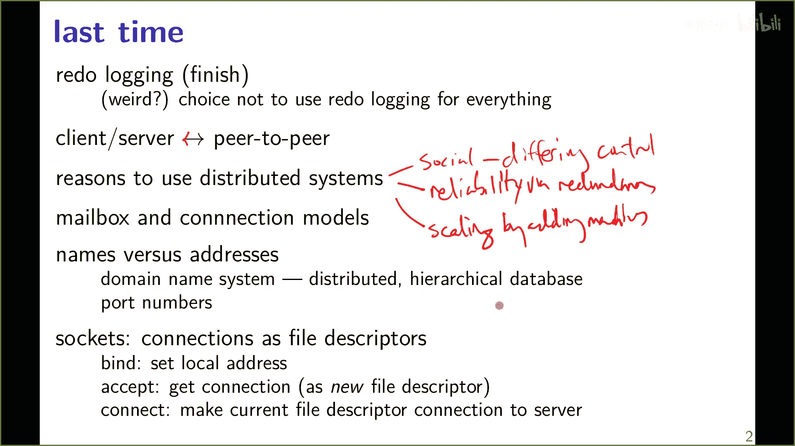
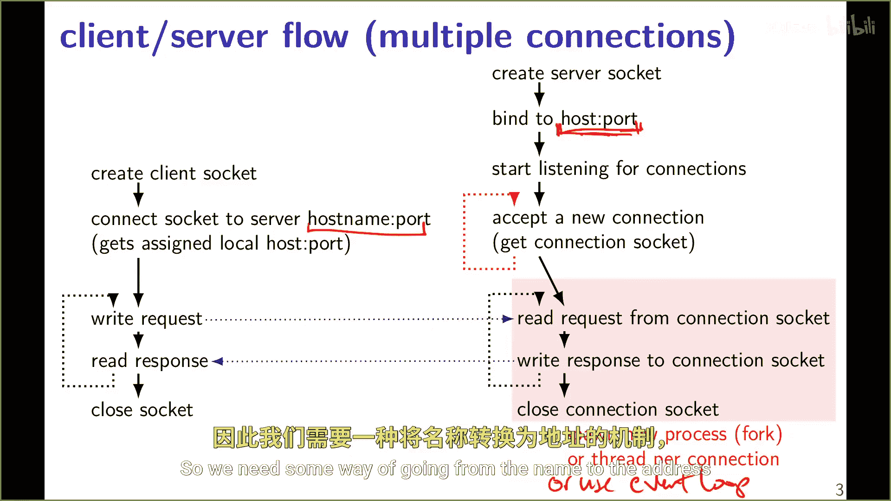

# 023：RPC 与故障处理 🖥️🔗

在本节课中，我们将学习分布式系统中的远程过程调用（RPC）模型，并探讨在分布式环境下处理故障的挑战。我们将从回顾上节课的套接字通信开始，逐步深入到更抽象的RPC概念。

上一节我们介绍了使用套接字进行机器间通信的基础。本节中，我们将看看如何在此基础上构建一个更便捷的编程模型。

## 套接字通信回顾

在深入RPC之前，我们先快速回顾一下基于套接字的客户端-服务器模型。以下是其核心工作流程：

*   **客户端流程**：
    1.  创建一个套接字。
    2.  调用 `connect` 操作，指定服务器的主机名和端口号以建立连接。
    3.  连接建立后，通过该套接字进行读写操作，直到完成。
*   **服务器端流程**：
    1.  创建一个“服务器套接字”，作为连接套接字的工厂。
    2.  调用 `bind` 操作，设置本地地址和端口号，以便客户端连接。
    3.  调用 `accept` 操作等待并接受客户端连接。每次 `accept` 成功都会返回一个**新的文件描述符**，用于与特定客户端通信。
    4.  服务器可以同时处理多个连接。实现方式包括：
        *   为每个新连接创建一个新的进程或线程。
        *   使用事件循环来同时管理多个连接套接字的读写。

一个关键点是，`connect` 和 `bind` 操作需要的是地址（如IP地址），而我们通常使用主机名。因此，需要通过**域名系统**将主机名解析为地址。

## 引入远程过程调用

尽管套接字提供了基础的通信能力，但直接使用它们进行编程可能不够方便。我们希望能像调用本地函数一样调用远程机器上的服务。这就是**远程过程调用**模型的目标。

RPC旨在让程序员感觉像是在进行普通的函数调用，但实际执行发生在另一台机器上。以下是实现RPC所涉及的核心步骤：

1.  **客户端调用存根函数**：客户端程序调用一个看起来像本地函数的存根。
2.  **参数打包**：客户端存根将函数参数**序列化**（打包）成适合网络传输的格式。
3.  **网络通信**：打包后的数据通过网络发送到服务器。
4.  **服务器解包与调用**：服务器端的存根接收数据，将其**反序列化**（解包），然后调用实际的服务器函数。
5.  **结果返回**：服务器函数执行后，返回值被服务器存根序列化，通过网络发回客户端。
6.  **客户端接收结果**：客户端存根接收数据，反序列化，并将结果返回给客户端程序。

这个过程的简化伪代码如下：
```c
// 客户端视角
result = remote_function(arg1, arg2); // 看起来是本地调用

// 背后实际发生（简化）
// 1. 客户端存根打包参数: message = marshal(arg1, arg2)
// 2. 通过网络发送: send(socket, message)
// 3. 服务器存根接收并解包: (a1, a2) = unmarshal(receive(socket))
// 4. 调用真实函数: real_result = actual_function(a1, a2)
// 5. 打包结果并返回: send(socket, marshal(real_result))
// 6. 客户端存根解包结果: result = unmarshal(receive(socket))
```

## 分布式环境下的故障处理





在单机系统中，函数调用要么成功，要么因程序崩溃而完全失败。但在分布式RPC中，情况变得复杂，因为故障可能发生在网络通信的任何环节。这引出了几个关键问题：

*   **网络消息可能丢失、重复或延迟**。
*   **客户端或服务器可能在操作中途崩溃**。
*   **如何区分慢速服务器和故障服务器**？

### 调用语义



为了处理部分故障，RPC系统通常定义以下几种调用语义：

*   **最多一次**：请求可能丢失，不会重试。如果没收到回复，调用可能从未执行，也可能执行了一次。
*   **至少一次**：客户端会持续重试请求直到收到确认。这保证了服务器端函数**至少被执行一次**，但可能导致重复执行。
*   **恰好一次**：这是最理想也是最难实现的语义。它要求系统保证远程函数**被执行且只执行一次**，即使面对重试和故障。这通常需要服务器端具有**幂等性**或使用复杂的事务协议。

### 处理服务器故障

当服务器故障时，一个核心挑战是：客户端无法区分是**服务器崩溃了**，还是仅仅**响应消息丢失了**。如果客户端简单地重试请求，在“至少一次”语义下，可能导致服务器恢复后重复执行操作。

解决方案之一是让服务器将操作和结果**持久化到稳定存储**（如磁盘）中。这样，即使服务器崩溃后重启，它也能检查日志，避免重复执行已完成的请求。这类似于文件系统中的**重做日志**技术，但同样需要权衡性能开销。



本节课中我们一起学习了远程过程调用如何为分布式通信提供一个更抽象的编程接口，以及在这种环境下处理网络和节点故障所面临的独特挑战和常见语义（最多一次、至少一次）。理解这些基础是构建可靠分布式系统的关键。