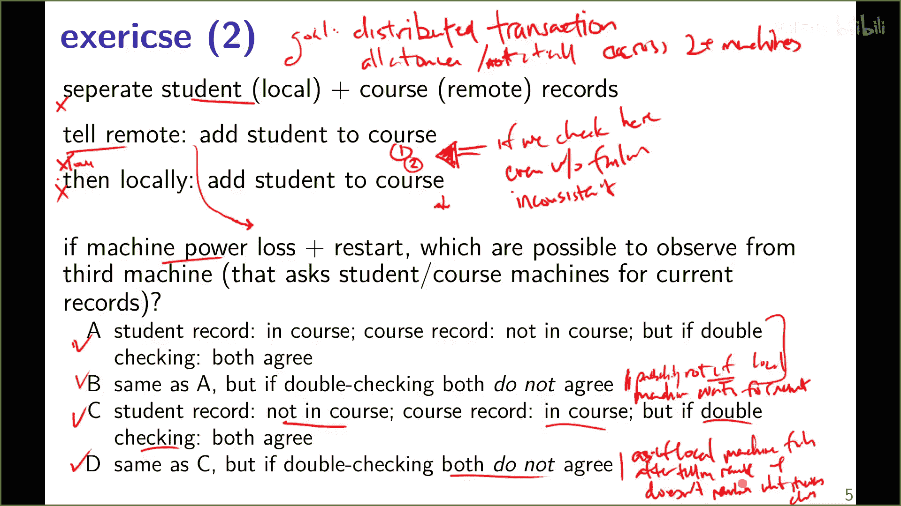
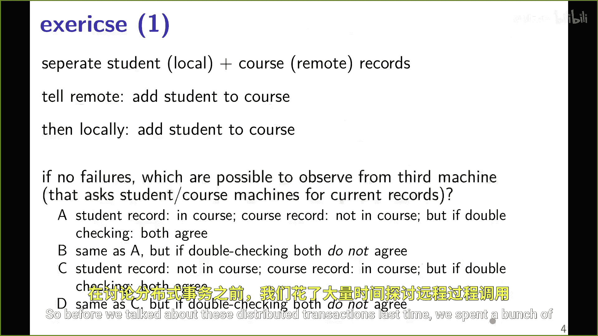
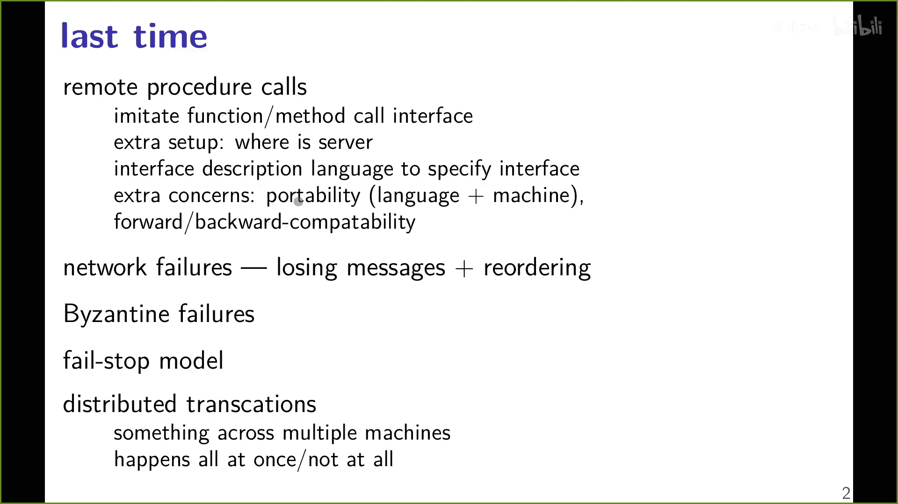

# 024：故障处理 🛠️

在本节课中，我们将要学习分布式系统中的故障处理。我们将探讨在多个机器上执行操作时，如何确保一致性，特别是在发生故障的情况下。我们将回顾远程过程调用（RPC）的概念，并深入分析一个简单的分布式事务方案可能遇到的问题。

## 回顾：分布式事务与不一致性问题

上一节我们介绍了分布式事务的概念，即一个操作要么在所有相关机器上全部完成，要么完全不执行。这与我们在文件系统中讨论的重做日志概念类似。

我们讨论了一个示例场景：学生记录和课程记录存储在不同的机器上。学生记录包含学生选修的课程列表，课程记录包含选修该课程的学生列表。如果我们想将一名学生添加到一门课程中，一个简单的方案可能是在学生记录所在的机器上运行代码，通知课程记录所在的机器添加该学生，然后本地再添加该学生。

**代码示例：简单方案**
```python
# 伪代码：简单方案
def add_student_to_course(student_id, course_id):
    # 1. 通知远程（课程）机器添加学生
    tell_remote_machine(course_id, "add_student", student_id)
    # 2. 本地（学生）机器添加课程
    add_course_to_student_locally(student_id, course_id)
```

即使没有发生故障，这个方案也存在问题。如果在通知远程机器之后、本地操作完成之前进行检查，系统会给出不一致的答案：查询课程记录显示学生在课程中，而查询学生记录显示学生不在课程中。

## 故障引入的复杂性

本节中我们来看看当系统发生故障时，情况会变得更糟。我们假设故障是“故障-停止”类型的，即机器会断电重启，而不会写入错误的值。

以下是简单方案在故障下可能出现的几种不一致情况：

*   **临时不一致**：故障可能发生在远程操作之后、本地操作之前，导致系统暂时处于不一致状态。如果本地机器在此后发生故障且未恢复状态，这种不一致可能永久存在。
*   **永久不一致（本地故障）**：如果本地机器在通知远程机器后、执行本地操作前发生故障，并且不记得自己正在执行的操作，那么即使远程操作成功，系统也会永久处于不一致状态。
*   **永久不一致（远程故障）**：如果“通知远程机器”的操作只是发送请求而不等待确认，那么消息可能丢失，或者远程机器可能在内存中执行了操作但未持久化存储，重启后就会遗忘。这可能导致本地操作成功而远程操作失败的不一致。
*   **延迟导致的不一致**：由于网络延迟，远程操作可能在本地操作完成很久之后才执行，在此期间系统处于不一致状态。

所有这些情况都可能在简单的方案中出现，具体取决于实现细节。我们的目标是找到一种方法来避免这些问题，核心思路包括：验证远程机器确实执行了操作，以及确保机器在崩溃后能记住自己正在执行的任务。

## 回顾：远程过程调用（RPC）

在深入讨论故障处理方案之前，我们先简要回顾一下上节课讨论的远程过程调用（RPC）。RPC 是访问远程机器的一种接口方式，它看起来像普通的函数调用，但有一些关键区别。

以下是与普通函数调用不同的一些考虑因素：





*   **服务器定位**：必须指定服务器位置。
*   **参数处理**：需要处理指针等复杂参数，这比普通库函数头文件提供的信息更多。
*   **可移植性**：通常需要在不同编程语言和机器架构之间实现可移植性。
*   **兼容性**：需要明确处理服务器或客户端单独升级时的兼容性问题。

出于以上原因，我们引入了**接口描述语言（IDL）**。IDL 以一种独立于具体编程语言的方式，明确定义了客户端与服务器之间通信的接口、函数和数据结构，从而解决了上述问题。

## 总结



本节课中我们一起学习了分布式系统中的故障处理挑战。我们分析了一个简单的分布式事务方案在无故障和发生故障时可能出现的各种不一致性问题。我们还回顾了远程过程调用（RPC）作为分布式通信的一种方式，及其引入接口描述语言（IDL）的必要性。理解这些问题是设计健壮的、能容忍故障的分布式协议的基础。在接下来的课程中，我们将探讨解决这些问题的具体协议和算法。