# 025：NFS 与访问控制 1

在本节课中，我们将学习分布式系统中的网络文件系统设计，并探讨其面临的核心挑战，特别是如何处理服务器状态和故障。我们首先会回顾两阶段提交协议，然后深入分析一个基于远程过程调用的简单网络文件系统模型及其问题。

上一节我们讨论了两阶段提交协议。该协议旨在提供分布式事务支持，即一个操作需要跨多台机器执行。其核心思想是确保所有参与机器要么全部执行操作，要么全部不执行，不存在中间状态。关键机制在于操作执行前，所有工作节点和协调节点必须达成一致同意，并且这个决定会被记录在日志中，即使发生故障也不会被撤回。

然而，由于要求所有节点必须共同行动，两阶段提交存在“故障时阻塞”的问题。这意味着如果在错误的时间点发生故障，系统必须等待以确定发生了什么，而无法在缺少部分节点的情况下继续推进。这在我们假设每个工作节点对操作都至关重要的场景下是合理的。

我们还简要提及，可以通过投票机制实现多数同意即可执行操作，而不需要所有节点参与。这在数据有副本的系统中很常见，即使部分机器故障，只要足够多的机器正常工作，系统就能持续运行。本学期我们不深入讨论其实现细节，其中最棘手的问题之一是当协调节点停止工作时该如何处理。

以上是我们上节课讨论的内容。接下来，我们将探讨最后一个分布式系统主题——网络文件系统，并简要讨论安全性。

在开始新内容前，关于上节课的内容有任何问题吗？

---

**课程安排提醒**：上周的课后测验截止日期是本周四下午12:15（即第一次讲座开始前）。关于两阶段提交的作业则按邮件通知，截止日期为下周一。

---

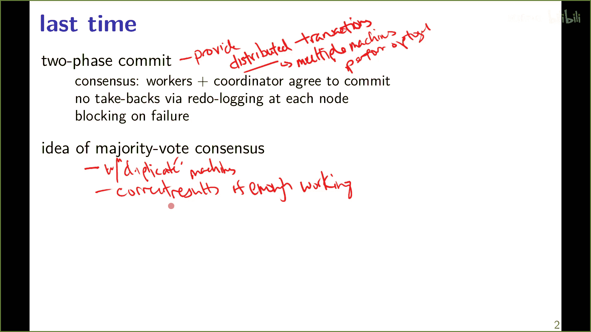

现在开始我们的新主题：网络文件系统。什么是网络文件系统？一个例子是：系里有多台机器，当它们正常工作时，你可以通过SSH登录。实际上，支持SSH或远程桌面的背后有多台机器，但在所有这些机器上，你看到的文件都是相同的。这是如何实现的？

其原理是，你SSH登录的每台机器都作为一个客户端，与一个**网络文件服务器**进行通信。你的文件实际存储在那里，真正的文件系统也运行在那里。今天我们将讨论如何设计这种通信协议。

我们将从一个基于**远程过程调用**的简单设计思路开始。我们考虑将通常访问文件时进行的操作——即系统调用——直接转换为RPC。

以下是将系统调用转换为远程过程调用的示意图：

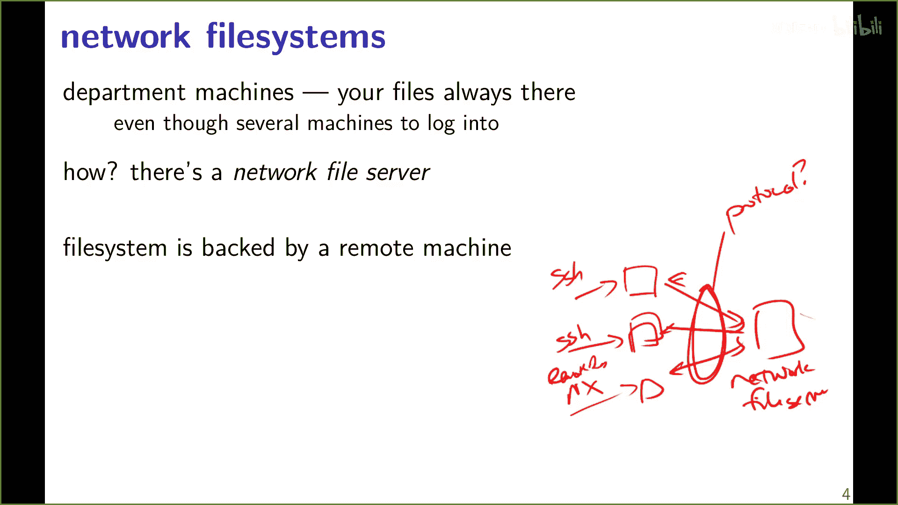

例如，当调用 `open` 时，我们不是在内核本地处理，而是通过RPC将这个调用发送到存储文件的另一台机器上。这听起来是个合理的想法，但我们将看到它存在一些问题，促使我们需要不同的设计哲学。

我们面临的首要问题是：这要求服务器做什么？第二个问题，实际上更为紧迫：在发生故障时，我们该如何处理？

---

关于服务器需要做什么：服务器需要存储状态。具体需要存储什么？

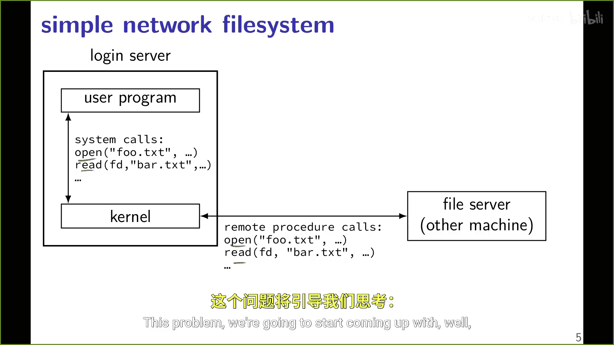

我们需要在服务器上跟踪所有已打开的文件。`open` 调用会返回一个文件描述符，我们需要将客户端进程与文件描述符关联起来。因此，服务器需要为每个客户端进程记住其每个文件描述符对应哪个打开的文件，以及相关信息，如文件偏移量、读写模式等。

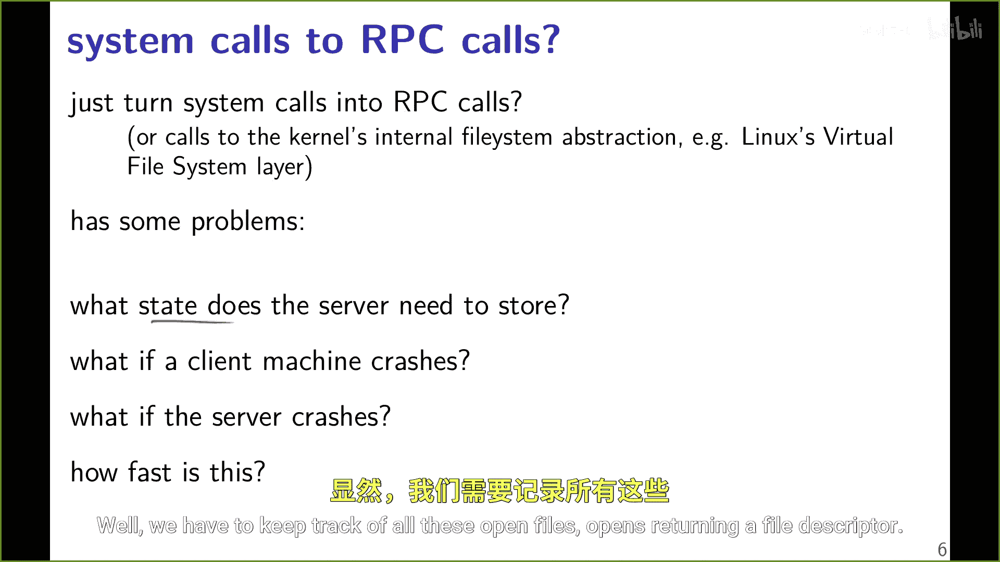

以下是在服务器上需要维护的状态示意图：

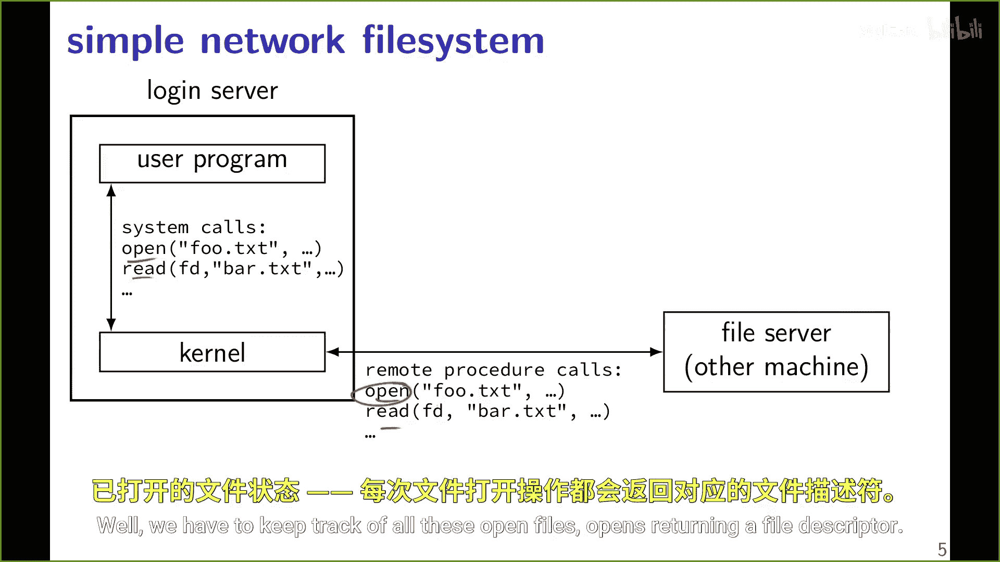

本质上，所有原本存储在本地进程控制块中的打开文件列表信息，现在都需要存储在服务器上。

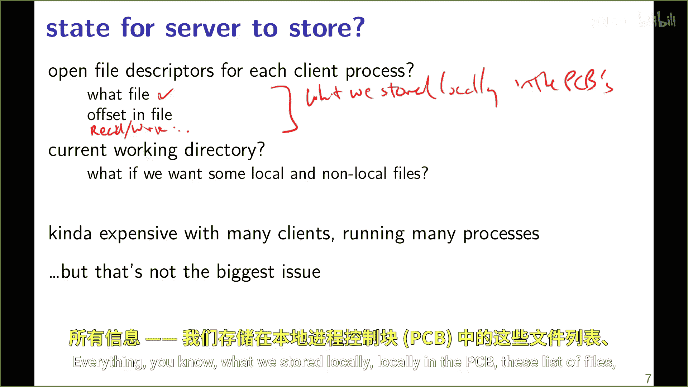

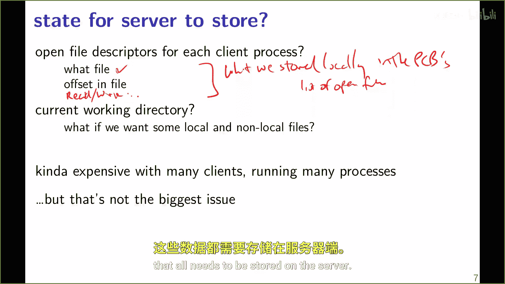

此外，像当前工作目录这样的信息也需要服务器知晓，以便正确解析相对路径。但这里存在一个问题：我们通常混合使用本地文件和非本地（网络）文件。

例如，通过SSH登录后，你的家目录可能在网络文件服务器上，而像 `/tmp` 这样的目录最好是本地的，因为访问速度更快。因此，将当前工作目录等信息完全存储在服务器上并不合理，我们需要某种间接机制。

虽然服务器需要存储大量状态，但这或许可以管理。假设一个公司有上千名员工，每台员工电脑运行着100个进程，每个进程打开10个文件，那么服务器可能需要管理多达100万个打开的文件描述符。这个数量虽然庞大，查找起来可能不是最快的操作，但对于一台机器来说仍在合理范围内。

然而，这个方案真正的大问题来自于**如何处理故障**。如果只考虑存储信息，或许还能应付。但当我们思考故障场景时，基于“简单地将 `open`、`read`、`write` 转换为RPC”的想法就会变得非常棘手。

---

让我们看一个故障场景的例子。假设一个客户端已经一个小时没有向文件服务器发送任何请求。

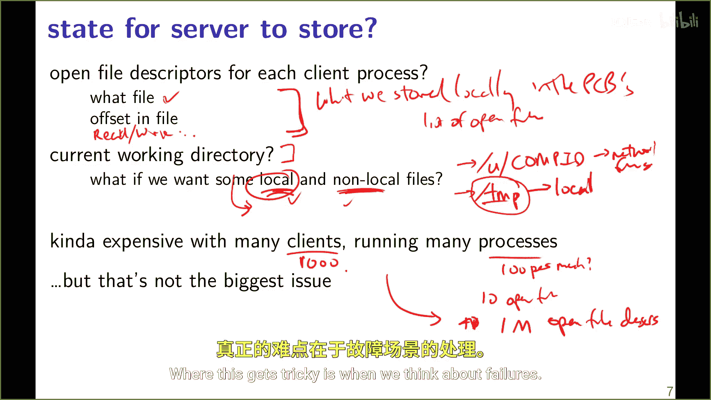

问题是：服务器现在可以删除该客户端的打开文件信息吗？答案很可能是否定的。

为什么服务器不能这么做？最可能的原因是什么？提示：想想如果客户端是一台笔记本电脑会怎样。

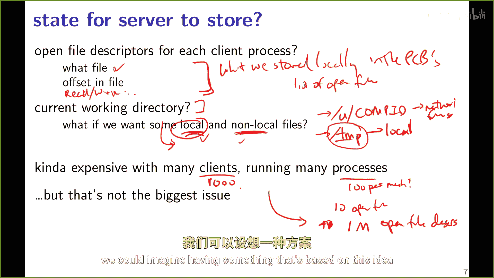

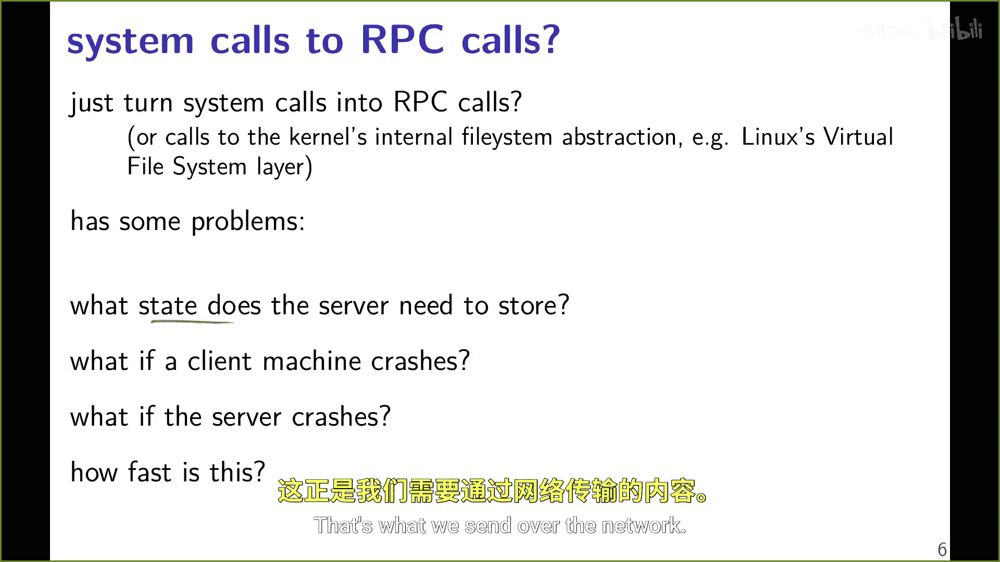

原因在于：**客户端可能只是暂时离线了**。例如，用户带着笔记本电脑离开了无线网络覆盖范围。客户端虽然离线，但文件仍然处于打开状态。如果服务器此时清理了状态，当客户端重新连接并尝试继续之前的文件操作时，就会发生错误。

以下示意图说明了客户端暂时离线的场景：

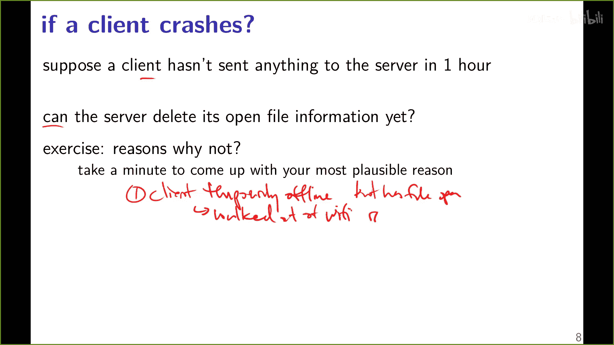

本节课中，我们一起回顾了两阶段提交的局限性，并初步探讨了网络文件系统的设计。我们分析了一个将系统调用直接映射为RPC的简单模型，发现它要求服务器维护大量易失的客户端状态，并且在面对网络分区或客户端临时离线等故障时，难以决定何时安全地清理这些状态。这引出了对更健壮、无状态或弱状态协议的需求，我们将在后续课程中继续探讨。