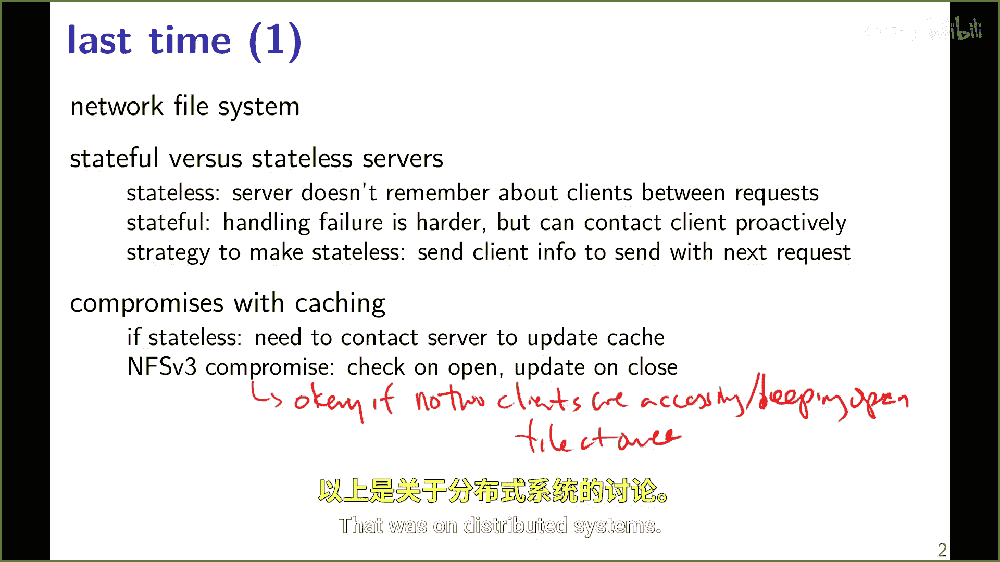
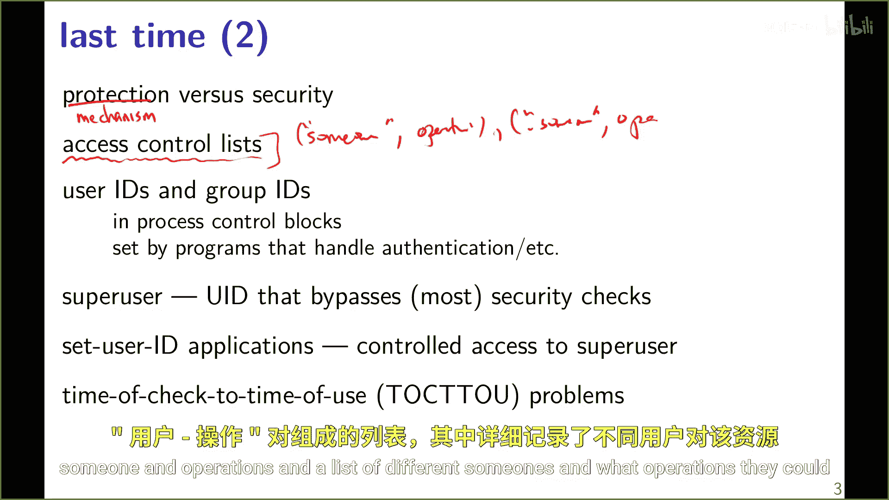
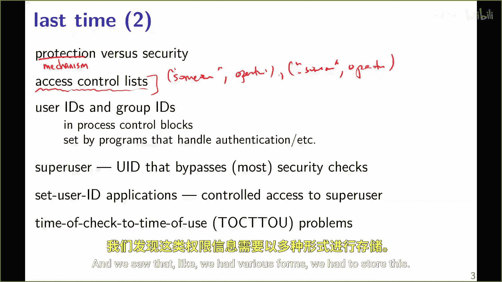
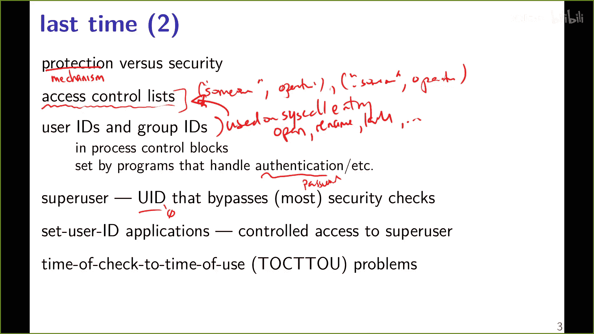

# 026：虚拟机 🖥️

在本节课中，我们将要学习虚拟机的概念。上一节我们介绍了分布式系统，特别是网络文件系统，本节中我们来看看如何通过虚拟机技术来隔离和运行多个操作系统实例。

## 概述

下午好。上次我们通过探讨网络文件系统的概念，完成了对分布式系统的讨论。我们希望多台机器能以某种方式共享相同的文件。

我们可以通过客户端-服务器模型来实现这一点，即为这些文件设置一个服务器。

我们不是访问本地文件系统，而是访问远程文件系统。

我们大致上使用远程过程调用来构建这个系统。

但我们看到在设计该协议时，我们有一些选择需要考虑。

我们希望设计一个对服务器和客户端都更方便的接口。

我们面临的一个关键选择是服务器应该是无状态的还是有状态的。

当我们说服务器是无状态的，意思是服务器不会在请求之间记住关于客户端的信息。

例如，在我们无状态的网络文件系统协议中，我们希望由客户端记住关于文件描述符以及应用程序打开了哪些文件的所有信息。

这样服务器就不需要记住这些，这使得一些事情变得更容易。例如，处理故障，当客户端消失时，服务器不需要实际跟踪这类信息；如果服务器崩溃，我们只关心文件系统中的数据，我们不需要恢复一些额外数据来避免所有客户端都需要重启。

我们还解决了这个通用模式，它在许多其他问题中很有用。

对于将原本有状态、服务器需要做大量工作且相当复杂的东西转变为无状态，我们可以将信息发送给客户端，让客户端在下一次请求时附带发送。

而不是将其存储在服务器上，即使客户端可能不理解或不关心这些信息的具体用途，我们仍然可以让客户端负责存储它。

这对于实现服务器来说通常方便得多，特别是如果我们希望优雅地处理故障。

我们也看到存在一些权衡，对于网络文件系统，这主要体现在缓存方面。如果我们是无状态的，如果我们不记住客户端在请求之间所做的任何事情，那么客户端就无法有效地缓存某些内容，并期望知道他们缓存的值是否仍然有效。

一个实际的解决方案是，我们可以说这真的不值得，转而使用更有状态的协议，一些系统确实这样做。如果我们想保持无状态，就必须做出某种妥协，因为如果每次都必须与服务器核对，缓存将变得不切实际，这基本上会抵消缓存的意义。是的，我们仍然会通过网络发送数据，但对于小文件来说，缓存的主要成本在于我们必须与服务器通信，而不是我们必须从服务器发送和接收几个字节（表示没有变化）与整个千字节文件。

在NFS版本三中，他们采取了这种折衷方案：在打开时检查缓存是否有效，并在关闭时更新服务器。这里的想法是，只要没有两个客户端同时打开或访问同一个文件，这是可以接受的。然而，即使这样，在有两个客户端同时打开文件的情况下，他们会真正注意到这不像本地文件系统，从而失去了某种透明性的概念。

以上就是关于分布式系统的内容。我们接下来的主题是关于安全性的。

为了引入这个话题，我介绍了保护这个概念，这是我们主要关心的问题，即控制资源访问的机制。

并提到我们将实现某种安全性，即我们有一些关于哪些事情可以发生的目标，我们希望通过这些保护机制来实现。

在这门课中，我们主要关心的是我们可以提供哪些机制，并希望系统管理员和标准程序能够配置这些机制，以实现实际的安全目标。

控制资源访问的一般思路是，我们需要指定哪些事物可以访问该资源。

我们实现这一点的关键方法是访问控制列表，其核心思想是，我们有一个资源（或文件、进程），并与之一起存储允许访问它的事物。

我们通常的概念是，对于一个文件，试图访问它的这些事物（实际上是进程）会与某些人相关联。

我们需要某种方式来表示这一点，并具体表示每个资源谁可以做什么的列表。

所以，这些列表基本上就是：某人、操作，以及不同的人及其可以在该资源上执行的操作的列表。

我们看到我们已经以各种形式存储了这些信息。

但这是关键思想。那么这些“某人”是谁呢？

在类POSIX模型中，我们有两种表示方式：用户ID和组ID。从概念上讲，这些可以对应于用户和用户组，尽管这不是必需的。这些概念只是数字。因此，从内核的角度来看，它实际上并不关心用户ID或组ID是个人还是一组人。它只是在进程控制块中存储一个数字。

这些ID被用于系统调用，例如当我们执行`open`、`rename`或`kill`等操作时，用于检查访问控制列表。因此，这些就是我们用来在访问控制列表中标识事物的方式。

我们将这些存储在进程控制块中，以了解当前进程可以对每个资源做什么。

所以这些只是ID，它们由其他处理诸如身份验证（例如密码等）的程序设置，然后由内核使用。

我们不能允许任何程序随意设置这些用户ID，我们需要某种方式来设置那种初始状态，例如当我登录系统时，我的程序的用户ID如何被设置？

为了支持这一点，我们有了超级用户的概念，即存在一个特殊的用户ID，可以绕过POSIX中的大多数安全检查，这就是Uid 0，这只是一个任意的选择。我们以该用户ID运行初始程序，它会判断我输入了哪个密码和用户ID，然后设置一个不同的用户ID。正因为如此，我们不需要让每个程序都能设置任何用户ID，内核也不需要担心如何验证密码，所有这些都将由这个拥有额外权限的初始程序来处理。

现在，我们看到有这样的情况：我仍然希望以我的用户ID登录，但我想执行通常我的用户ID无法执行的操作。一个例子是`su`命令，我们还有其他例子，比如我想挂载USB驱动器。通常，我们不会在内核中编写非常详细的规则来区分挂载USB驱动器和以可能损坏其文件的方式挂载磁盘。

因此，我们有了这样的想法：我们可以提供对超级用户功能的受控访问，这样我们就可以实现像`su`或挂载USB驱动器这样的程序。系统管理员会设置一些需要额外权限才能执行某些操作的应用程序，例如切换到不同用户、重启系统、挂载USB驱动器。

他们会编写这个程序来执行该操作。他们会在文件系统中设置一个特殊位，表示这个程序是特殊的，应该以额外权限运行。因为他们控制着该程序能做什么，这不会让我为所欲为，只会让我做该程序允许我做的事情。

这将是一种增加功能的方式，即使我的用户ID被设置为“错误”的，也无需修改内核来添加所有这些情况。

我们看到这些设置用户ID的程序是一种非常灵活的机制。